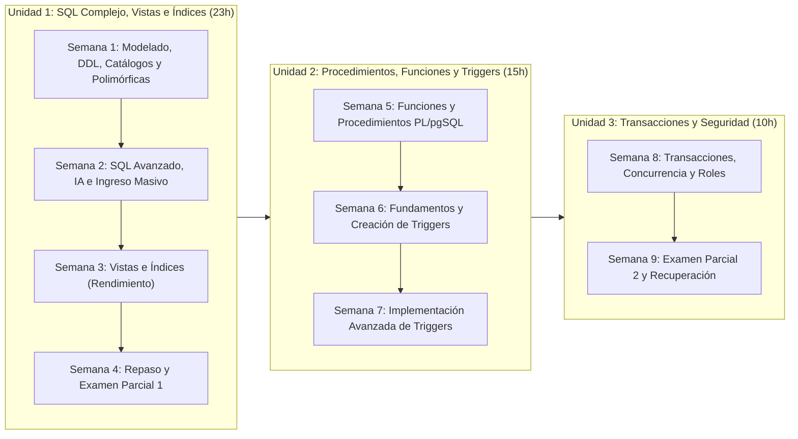

# 🗄️ Base de Datos Avanzada (`DS4AC1-215`)

> **Instituto Superior Tecnológico de Turismo y Patrimonio Yavirac**  
> **Carrera:** Tecnología Superior en Desarrollo de Software  
> **Periodo Académico:** 2026-II | **Semestre:** Segundo | **Modalidad:** Dual

Bienvenido al repositorio oficial de clases, talleres prácticos, guías de laboratorio y evaluaciones de la asignatura **Base de Datos Avanzada**, estructurado semana a semana conforme al **Programa de Estudios de la Asignatura (PEA)** oficial.

---

## 📋 1. Información General de la Asignatura

| Campo | Detalle |
| :--- | :--- |
| **Asignatura** | Base de Datos Avanzada |
| **Carrera** | Desarrollo de Software |
| **Código y Semestre** | `DS4AC1-215` — Segundo Semestre |
| **Periodo Académico** | `2026-II` |
| **Modalidad** | Dual |
| **Unidad de Organización Curricular** | Profesional |
| **Prerrequisito** | `DS4AC1-121` — Prácticas Pre Profesionales I |
| **Total Horas de Formación** | **48 horas** |

### ⏱️ Distribución de Horas en las Actividades de Aprendizaje

| Componente de Aprendizaje | Sigla | Horas | Porcentaje |
| :--- | :---: | :---: | :---: |
| Aprendizaje en contacto con el docente | **ACD** | 15 h | 31.25% |
| Aprendizaje práctico-experimental en contacto con el docente | **APECD** | 30 h | 62.50% |
| Aprendizaje práctico-experimental autónomo | **APEA** | 1 h | 2.08% |
| Aprendizaje autónomo | **AA** | 2 h | 4.17% |
| **Total** | — | **48 h** | **100%** |

---

## 🎯 2. Descripción y Objetivo General

### Descripción de la Asignatura
La asignatura **Base de Datos Avanzada** profundiza en el uso de sentencias SQL complejas, procedimientos almacenados, funciones, triggers, transacciones y seguridad en bases de datos. Se enfoca en la optimización del rendimiento, la automatización de procesos y la integridad de la información dentro de un Sistema de Gestión de Bases de Datos (**PostgreSQL**). A través de la aplicación de técnicas avanzadas, los estudiantes desarrollarán habilidades para diseñar, implementar y administrar bases de datos de manera eficiente, garantizando consistencia, integridad y seguridad en el manejo de datos empresariales.

### Objetivo General
Desarrollar en los estudiantes las competencias necesarias para aplicar técnicas avanzadas en la gestión de bases de datos, incluyendo la optimización de consultas SQL, la creación de funciones y procedimientos almacenados, la implementación de triggers y el control de transacciones y seguridad, con el fin de mejorar la eficiencia, confiabilidad y protección de los datos en entornos organizacionales.

---

## 🏆 3. Resultados de Aprendizaje, Competencias y Evidencias

| # | Resultado de Aprendizaje (RdA) | Competencia | Evidencia del Resultado de Aprendizaje |
| :-: | :--- | :--- | :--- |
| **1** | Brinda asistencia técnica en el diseño, modelamiento e ilustración del proceso de base de datos. | Diseñar y modelar bases de datos aplicando principios de modelamiento y estructuras relacionales para apoyar el desarrollo de soluciones de software. | • Diagrama de modelo de datos (MER o modelo lógico) elaborado con una herramienta de modelado, con su explicación. • Documento técnico que describa la estructura de la base de datos y sus relaciones. • Script SQL de creación de la estructura de la base de datos. |
| **2** | Utiliza herramientas y tecnologías de programación para llevar a cabo tareas específicas en el campo de desarrollo de software. | Aplicar herramientas y tecnologías de bases de datos avanzadas para implementar mecanismos de procesamiento y gestión eficiente de la información en aplicaciones de software. | • Implementación de consultas SQL avanzadas. • Desarrollo de procedimientos almacenados, funciones o triggers. • Implementación de vistas e índices para optimización de consultas. |
| **3** | Brinda asistencia técnica en el diseño de bases de datos mediante procesos de control y seguimiento de las operaciones para el manejo adecuado de la información. | Administrar y controlar las operaciones de bases de datos mediante mecanismos de seguimiento, integridad y gestión de transacciones que garanticen la confiabilidad de la información. | • Describe los conceptos de transaccionalidad y concurrencia; y las instrucciones para crear roles y usuarios. |
| **4** | Realiza procesos de análisis y verificación de consistencia de datos extraídos de diversas fuentes, que permitan generar reportes relevantes para una organización. | Analizar y validar datos provenientes de distintas fuentes utilizando consultas y mecanismos de verificación de consistencia para generar información útil para la toma de decisiones. | • Consultas SQL complejas para extracción y análisis de datos. • Verificación de consistencia de datos mediante reglas o restricciones. |

---

## 🗺️ 4. Planificación Curricular Semana por Semana

Haz clic en cualquiera de las semanas para acceder a la clase completa (objetivos, marco conceptual con diagramas, ejemplos en PostgreSQL, taller práctico guiado con solucionario, actividades autónomas y rúbrica de evaluación):

### 🔹 Unidad 1: Sentencias SQL complejas, vistas e índices (23 horas)

| Semana | Clase / Enlace al Documento | Contenidos Principales (PEA) | Horas (ACD / APECD / APEA / AA) |
| :---: | :--- | :--- | :---: |
| **1** | [📘 Semana 1: Modelado Lógico, DDL, Tablas Catálogo y Polimórficas](./clases/semana-01-modelado-ddl-tablas-catalogo-polimorficas.md) | • Sentencias SQL complejas e implementación con DDL. • Conversión de modelo conceptual a lógico normalizado. • Conceptos y patrones de Tablas Catálogo y Polimórficas. • Modelado con pgModeler / Lucidchart. | **5 h** *(2 / 3 / 0 / 0)* |
| **2** | [📘 Semana 2: SQL Avanzado, Funciones Escalares, IA e Ingreso Masivo](./clases/semana-02-sql-avanzado-ia-ingreso-masivo.md) | • SQL de consulta avanzado: `JOIN`, alias, `DISTINCT`, funciones de agregación, `GROUP BY`, `HAVING`, cálculos y subconsultas. • Operadores relacionales/lógicos y funciones escalares (numéricas, texto, fecha). • Ingreso masivo de datos a BD (`COPY`, `generate_series`). • Extensión de IA en VS Code (Copilot / ChatGPT) para Text-to-SQL en Postgres. | **8 h** *(2 / 3 / 1 / 2)* |
| **3** | [📘 Semana 3: Vistas, Implementación de Índices y Análisis de Rendimiento](./clases/semana-03-vistas-indices-rendimiento.md) | • Vistas estándar y Vistas Materializadas mediante consultas complejas. • Investigación e implementación de Índices (B-Tree, Hash, GIN, parciales, compuestos). • Creación, modificación y eliminación de vistas e índices. • Comparación de rendimiento con y sin índice (`EXPLAIN ANALYZE`). | **5 h** *(2 / 3 / 0 / 0)* |
| **4** | [📘 Semana 4: Repaso Unidad 1 y Evaluación del Primer Parcial](./clases/semana-04-repaso-examen-parcial-1.md) | • Espacio de preguntas y respuestas para aclarar dudas. • Síntesis ejecutiva y resolución de casos integradores de la Unidad 1. • Evaluación teórico-práctica del Primer Parcial (con rúbrica y solucionario). | **5 h** *(2 / 3 / 0 / 0)* |

---

### 🔹 Unidad 2: Generación de procedimientos, funciones y triggers (15 horas)

| Semana | Clase / Enlace al Documento | Contenidos Principales (PEA) | Horas (ACD / APECD / APEA / AA) |
| :---: | :--- | :--- | :---: |
| **5** | [📗 Semana 5: Funciones y Procedimientos Almacenados en PL/pgSQL](./clases/semana-05-funciones-procedimientos-plpgsql.md) | • Funciones y procedimientos almacenados: creación, modificación y eliminación. • Sintaxis, argumentos (`IN`, `OUT`, `INOUT`), tipos de retorno. • Tipo `RECORD` (`NEW`, `OLD`, registros dinámicos) y uso de `SELECT ... INTO`. • Programación procedural en lenguaje `PL/pgSQL`. | **5 h** *(1 / 4 / 0 / 0)* |
| **6** | [📗 Semana 6: Generación de Triggers (Creación, Invocación y Eliminación)](./clases/semana-06-fundamentos-creacion-triggers.md) | • Fundamentos de Triggers: eventos (`INSERT`, `UPDATE`, `DELETE`) y momentos (`BEFORE`, `AFTER`, `INSTEAD OF`). • Tipos de triggers (`FOR EACH ROW`, `FOR EACH STATEMENT`). • Creación de funciones disparadoras (`RETURNS TRIGGER`), invocación y eliminación de triggers. | **5 h** *(1 / 4 / 0 / 0)* |
| **7** | [📗 Semana 7: Implementación Avanzada de Triggers en Entornos Empresariales](./clases/semana-07-implementacion-avanzada-triggers.md) | • Implementación avanzada de triggers para reglas de negocio críticas. • Auditoría forense con `JSONB`, control automático de stock/saldos, campos desnormalizados y borrado lógico (*Soft Delete*). • Taller integrador de automatización e integridad en PostgreSQL. | **5 h** *(2 / 3 / 0 / 0)* |

---

### 🔹 Unidad 3: Transacciones y Seguridad (10 horas)

| Semana | Clase / Enlace al Documento | Contenidos Principales (PEA) | Horas (ACD / APECD / APEA / AA) |
| :---: | :--- | :--- | :---: |
| **8** | [📙 Semana 8: Transacciones, Concurrencia y Seguridad (Roles y Usuarios)](./clases/semana-08-transacciones-concurrencia-seguridad-roles.md) | • Transacciones (`BEGIN`, `COMMIT`, `ROLLBACK`, `SAVEPOINT`) y propiedades ACID. • Concurrencia (MVCC, niveles de aislamiento, bloqueos `FOR UPDATE`, deadlocks). • Criterios de seguridad en bases de datos. • Instrucciones DCL para creación y gestión de Roles, Usuarios y privilegios (`GRANT`, `REVOKE`). | **5 h** *(1 / 4 / 0 / 0)* |
| **9** | [📙 Semana 9: Repaso Final, Examen Parcial 2 y Examen de Recuperación](./clases/semana-09-repaso-examen-parcial-2-recuperacion.md) | • Espacio de preguntas y respuestas para aclarar dudas. • Evaluación del Segundo Parcial (Unidades 2 y 3). • Examen de Recuperación (Integrador Unidades 1, 2 y 3) y guía del Proyecto de Integración de Saberes. | **5 h** *(2 / 3 / 0 / 0)* |

---

## 🤝 5. Formación en Habilidades Blandas y Metodología

### Habilidades Blandas Desarrolladas
- **Comunicación efectiva:** Expone y participa en las exposiciones de sus compañeros.
- **Trabajo en equipo:** Realiza trabajos de investigación grupales.
- **Pensamiento crítico:** Utiliza herramientas específicas para la creación de modelos de datos.
- **Gestión del tiempo:** Realiza las prácticas en laboratorio dentro del horario establecido.
- **Resolución de problemas:** Emplea lógica y teoría de la asignatura para resolver eficazmente problemas planteados.
- **Creatividad:** Plantea varias alternativas de solución a ejercicios planteados en clase.
- **Autogestión y responsabilidad:** Realiza ejercicios extras de Funciones y Triggers de forma autónoma.
- **Inteligencia emocional:** Practica la comunicación efectiva, el liderazgo compartido y la resolución de problemas en grupo en clases.
- **Escucha activa:** Escucha con atención las clases y exposiciones de sus compañeros.
- **Proactividad:** Realiza instrucciones SQL 100% efectivas en consultas de información.
- **Orientación a resultados:** Presenta solución a casos planteados.

### Estrategias Metodológicas
1. **Aprendizaje Situado:** Vincula el aprendizaje al contexto sociocultural y empresarial real mediante el trabajo cooperativo y métodos analíticos.
2. **Aprendizaje Basado en Problemas (ABP):** Enfrenta al estudiante a situaciones reales de bases de datos (cuellos de botella, inconsistencias, fallos transaccionales) tal como ocurren en el ejercicio profesional.
3. **Aprendizaje Basado en Proyectos:** Desarrolla soluciones integrales de bases de datos mediante investigación y creación autónoma centrada en el *"saber hacer"*.
4. **Aula Invertida (*Flipped Classroom*):** El estudiante interactúa con el contenido antes de la sesión y utiliza el tiempo de laboratorio en contacto con el docente para debatir, resolver retos prácticos y recibir retroalimentación directa.

---

## 📊 6. Sistema de Evaluación (Modalidad Dual - Fase Teórica)

| Tipo de Evaluación | Ponderación | Criterios de Evaluación Institucionales |
| :--- | :---: | :--- |
| **Evaluación Formativa** | **60%** | • Actividades en el aula de clase (en contacto con el docente). • Actividades de refuerzo académico (con o sin contacto con el docente). • Actividades prácticas y experimentales (en contacto con el docente). • Actividades autónomas. |
| **Evaluación Sumativa** | **40%** | • Exámenes parciales 1 y 2. • Proyecto de integración de saberes. |
| **Total** | **100%** | **Nota mínima de aprobación:** `7 / 10` \| **Asistencia mínima:** `70%` |

---

## 🛠️ 7. Herramientas y Entorno Tecnológico Requerido

Para el desarrollo de los talleres prácticos de la asignatura se requiere el siguiente stack tecnológico:

1. **Motor de Base de Datos:** [PostgreSQL](https://www.postgresql.org/) (Versión 15, 16 o 17 recomendada).
2. **Administración Gráfica y Consola:** [pgAdmin 4](https://www.pgadmin.org/) y cliente de terminal `psql`.
3. **Herramienta de Modelado de Datos:** [pgModeler](https://pgmodeler.io/), [Lucidchart](https://www.lucidchart.com/) o Draw.io / dbdiagram.io.
4. **Editor de Código + Asistente de IA:** [Visual Studio Code](https://code.visualstudio.com/) con extensiones de PostgreSQL (`SQLTools` / `PostgreSQL`) y asistente de IA (`GitHub Copilot`, `ChatGPT` o `Continue`).
5. **Entorno Virtual de Aprendizaje:** [EVA Yavirac](https://eva.yavirac.edu.ec/).

---

## 📚 8. Bibliografía Oficial del PEA

### Bibliografía Básica
- **Bagui, S., & Earp, R. (2011).** *Database Design Using Entity-Relationship Diagrams* (2nd ed.). CRC Press. *(Disponible en Biblioteca física)*.
- **Ramírez, E. (2001).** *Aplicando SQL Server 2000* (2da ed.). Editorial Macro. *(Disponible en Biblioteca física)*.
- **Sánchez, F., Pazmiño, G., Gordón, A., Mera, E., Chipuxi, L., Moya, Y., Páez, R., & Mejía, H. (2024).** *Guía completa de desarrollo de software Tomo 2* (1ra ed.). Editorial Yavirac - Ecuador. ISBN: `978-9942-48-412-3`. *(Disponible en Biblioteca digital)*.

### Bibliografía Complementaria
- **Silberschatz, A., & Korth, H. (2006).** *Fundamentos de Bases de Datos*. McGraw-Hill. *(Disponible en Biblioteca digital)*.
- **Elmasri, R., & Navathe, S. (2007).** *Fundamentos de Sistemas de Bases de Datos*. Madrid: Pearson Educación S.A. *(Disponible en Biblioteca digital)*.
- **Zea, M., Molina, J., & Redrován, F. (2017).** *Administración de base de datos con PostgreSQL*. Alicante: Área de Innovación y Desarrollo, S.L. *(Disponible en Biblioteca digital)*.
- **Obe, R., & Hsu, L. (2014).** *PostgreSQL: Up and Running* (2nd ed.). EE.UU.: O'Reilly Media. *(Disponible en Biblioteca digital)*.
- **Domínguez Chávez, J. (2019).** *Fundamentos de programación en lenguaje PL/pgSQL*. Aragua: IEASS Ed. *(Disponible en Biblioteca digital)*.

### Recursos Web Oficiales
- Documentación Oficial de PostgreSQL: [https://www.postgresql.org/docs/](https://www.postgresql.org/docs/)
- PostgreSQL Tutorial: [https://www.postgresqltutorial.com/](https://www.postgresqltutorial.com/)
- W3Schools SQL & PostgreSQL: [https://www.w3schools.com/postgresql/](https://www.w3schools.com/postgresql/)
