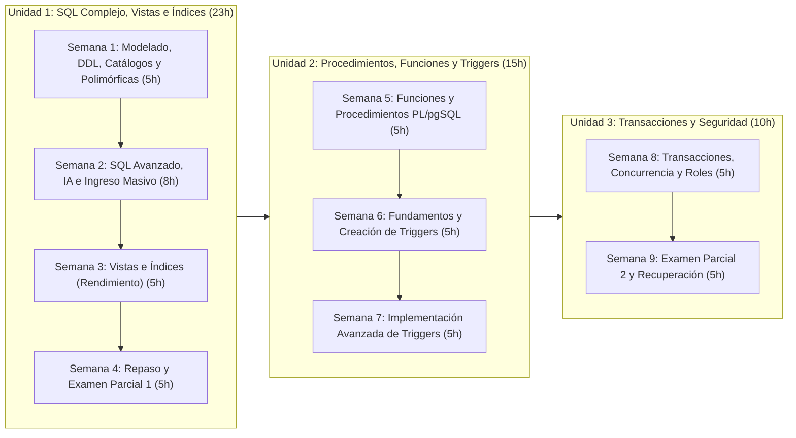

# 🗄️ Base de Datos Avanzada (`DS4AC1-215`)

> **Instituto Superior Tecnológico de Turismo y Patrimonio Yavirac**  
> **Carrera:** Tecnología Superior en Desarrollo de Software  
> **Asignatura:** Base de Datos Avanzada (`DS4AC1-215`) | **Paralelo:** D  
> **Docente:** Ing. Yoli Moya, MSc. (Representante del Colectivo de Asignatura)  
> **Periodo Académico:** 2026-II | **Semestre:** Segundo | **Modalidad:** Dual  

Bienvenido al repositorio oficial de clases, talleres prácticos, guías de laboratorio y evaluaciones de la asignatura **Base de Datos Avanzada**, estructurado sesión por sesión conforme al **Programa de Estudios de la Asignatura (PEA)** oficial y a la planificación de unidades del **Paralelo D**.

---

## 📋 1. Información General de la Asignatura

| Campo | Detalle Oficial (PEA) |
| :--- | :--- |
| **Institución** | Instituto Superior Tecnológico de Turismo y Patrimonio Yavirac |
| **Docente** | Ing. Yoli Moya, MSc. (Coordinadora / Representante del Colectivo) |
| **Carrera** | Tecnología Superior en Desarrollo de Software |
| **Código y Semestre** | `DS4AC1-215` — Segundo Semestre |
| **Paralelo** | Paralelo D |
| **Periodo Académico** | `2026-II` |
| **Modalidad** | Dual |
| **Unidad de Organización Curricular** | Profesional |
| **Prerrequisito** | `DS4AC1-121` — Prácticas Pre Profesionales I |
| **Total Horas de Formación** | **48 horas** |

### ⏱️ Distribución Oficial de Horas de Aprendizaje

| Componente de Aprendizaje | Sigla | Horas | Porcentaje | Modalidad en Paralelo D |
| :--- | :---: | :---: | :---: | :--- |
| Aprendizaje en contacto con el docente | **ACD** | 15 h | 31.25% | Clases magistrales y teórico-prácticas (Lunes, 2h) |
| Aprendizaje práctico-experimental en contacto con el docente | **APECD** | 30 h | 62.50% | Talleres prácticos y laboratorios guiados (Miércoles, 3h) |
| Aprendizaje práctico-experimental autónomo | **APEA** | 1 h | 2.08% | Laboratorio autónomo de ingreso masivo de datos |
| Aprendizaje autónomo | **AA** | 2 h | 4.17% | Extensión de IA en Visual Studio Code |
| **Total General** | — | **48 h** | **100%** | **9 Semanas / 18 Sesiones Presenciales** |

---

## 🎯 2. Descripción y Objetivos de la Asignatura

### Descripción de la Asignatura
La asignatura **Base de Datos Avanzada** profundiza en el uso de sentencias SQL complejas, procedimientos almacenados, funciones, triggers, transacciones y seguridad en bases de datos. Se enfoca en la optimización del rendimiento, la automatización de procesos y la integridad de la información dentro de un Sistema de Gestión de Bases de Datos (**PostgreSQL**). A través de la aplicación de técnicas avanzadas, los estudiantes desarrollarán habilidades para diseñar, implementar y administrar bases de datos de manera eficiente, garantizando consistencia, integridad y seguridad en el manejo de datos empresariales.

### Objetivo General
Desarrollar en los estudiantes las competencias necesarias para aplicar técnicas avanzadas en la gestión de bases de datos, incluyendo la optimización de consultas SQL, la creación de funciones y procedimientos almacenados, la implementación de triggers y el control de transacciones y seguridad, con el fin de mejorar la eficiencia, confiabilidad y protección de los datos en entornos organizacionales.

---

## 🏆 3. Resultados de Aprendizaje, Competencias y Evidencias

> [!IMPORTANT]
> **Norma Pedagógica de Redacción:** Conforme a los estándares curriculares del IST Yavirac y del PEA institucional, los Resultados de Aprendizaje (RdA) describen desempeños observables y se redactan en **tercera persona del presente de indicativo** (NUNCA en infinitivo terminado en *-ar*, *-er*, *-ir*).

| # | Resultado de Aprendizaje (RdA) | Competencia Asociada | Evidencia del Resultado de Aprendizaje |
| :-: | :--- | :--- | :--- |
| **1** | **Brinda** asistencia técnica en el diseño, modelamiento e ilustración del proceso de base de datos. | Diseñar y modelar bases de datos aplicando principios de modelamiento y estructuras relacionales para apoyar el desarrollo de soluciones de software. | • Diagrama de modelo de datos (MER o modelo lógico) elaborado con una herramienta de modelado CASE, con su explicación. • Documento técnico que describa la estructura de la base de datos y sus relaciones. • Script SQL DDL de creación de la estructura de la base de datos. |
| **2** | **Utiliza** herramientas y tecnologías de programación para llevar a cabo tareas específicas en el campo de desarrollo de software. | Aplicar herramientas y tecnologías de bases de datos avanzadas para implementar mecanismos de procesamiento y gestión eficiente de la información en aplicaciones de software. | • Implementación de consultas SQL avanzadas. • Desarrollo y ejecución de procedimientos almacenados, funciones y triggers. • Implementación de vistas e índices para optimización de consultas. |
| **3** | **Brinda** asistencia técnica en el diseño de bases de datos mediante procesos de control y seguimiento de las operaciones para el manejo adecuado de la información. | Administrar y controlar las operaciones de bases de datos mediante mecanismos de seguimiento, integridad y gestión de transacciones que garanticen la confiabilidad de la información. | • Describe los conceptos de transaccionalidad y concurrencia; y las instrucciones para crear roles y usuarios. • Implementación de políticas de seguridad y control de acceso. |
| **4** | **Realiza** procesos de análisis y verificación de consistencia de datos extraídos de diversas fuentes, que permitan generar reportes relevantes para una organización. | Analizar y validar datos provenientes de distintas fuentes utilizando consultas y mecanismos de verificación de consistencia para generar información útil para la toma de decisiones. | • Consultas SQL complejas para extracción y análisis de datos. • Verificación de consistencia de datos mediante reglas o restricciones. |

---

## 🗓️ 4. Cronograma Oficial de Clases — Paralelo D (18 Sesiones / 9 Semanas)

El curso se imparte de forma presencial con un régimen semanal estricto de **2 sesiones por semana**:
- **Lunes (2 Horas — ACD):** Clase teórica magistral, análisis conceptual y ejemplos guiados paso a paso.
- **Miércoles (3 Horas — APECD):** Laboratorio de cómputo, talleres prácticos aplicados, retos graduados y solucionarios.

| Sesión | Fecha | Horas | Tipo | Unidad | Contenido Oficial del Reporte PEA | Documento de Clase |
| :---: | :---: | :---: | :---: | :---: | :--- | :--- |
| **Clase 1** | Lunes 26/10/2026 | 2 h | Aula (ACD) | Unidad 1 | Sentencias SQL complejas y DDL: Modelamiento de datos, reglas para convertir modelo conceptual en lógico, y explicación de conceptos de tablas catálogo y polimórficas. | [📘 Semana 1](./clases/semana-01-modelado-ddl-tablas-catalogo-polimorficas.md) |
| **Clase 2** | Miércoles 28/10/2026 | 3 h | Lab (APECD) | Unidad 1 | Laboratorio práctico: Creación de modelo lógico normalizado en herramienta CASE (PG-Modeler / Lucidchart) e implementación de base de datos con sentencias DDL. | [📘 Semana 1](./clases/semana-01-modelado-ddl-tablas-catalogo-polimorficas.md) |
| **Clase 3** | Lunes 02/11/2026 | 2 h | Aula (ACD) | Unidad 1 | SQL avanzado: Consultas complejas con operadores relacionales y lógicos, funciones escalares (numéricas, texto, fecha), cruce de tablas, JOINs, alias y DISTINCT asistidos por IA. | [📘 Semana 2](./clases/semana-02-sql-avanzado-ia-ingreso-masivo.md) |
| **Clase 4** | Miércoles 04/11/2026 | 3 h | Lab (APECD) | Unidad 1 | Laboratorio práctico: Implementación de consultas SQL avanzadas con funciones de agregación, GROUP BY, HAVING, subconsultas y práctica de ingreso masivo de datos. | [📘 Semana 2](./clases/semana-02-sql-avanzado-ia-ingreso-masivo.md) |
| **Clase 5** | Lunes 09/11/2026 | 2 h | Aula (ACD) | Unidad 1 | Vistas e Índices: Clase magistral de vistas mediante consultas complejas. Fundamentos teóricos de índices, arquitectura, tipos y utilidad en optimización. | [📘 Semana 3](./clases/semana-03-vistas-indices-rendimiento.md) |
| **Clase 6** | Miércoles 11/11/2026 | 3 h | Lab (APECD) | Unidad 1 | Laboratorio práctico: Creación y eliminación de vistas. Creación, modificación y eliminación de índices, comparando rendimiento en consultas SQL con y sin índice. | [📘 Semana 3](./clases/semana-03-vistas-indices-rendimiento.md) |
| **Clase 7** | Lunes 16/11/2026 | 2 h | Aula (ACD) | Unidad 1 | Retroalimentación académica: Espacio de preguntas, respuestas y resolución de dudas sobre sentencias SQL complejas, vistas e índices. | [📘 Semana 4](./clases/semana-04-repaso-examen-parcial-1.md) |
| **Clase 8** | Miércoles 18/11/2026 | 3 h | Lab (APECD) | Unidad 1 | Evaluación práctica del Primer Parcial: Aplicación práctica y resolución de casos de sentencias SQL complejas, vistas e índices en laboratorio. | [📘 Semana 4](./clases/semana-04-repaso-examen-parcial-1.md) |
| **Clase 9** | Lunes 23/11/2026 | 2 h | Aula (ACD) | Unidad 2 | Funciones y Procedimientos Almacenados: Análisis de sintaxis, argumentos, tipos de retornos, uso de tipo RECORD (NEW, OLD), cláusula INTO y fundamentos de PL/pgSQL. | [📗 Semana 5](./clases/semana-05-funciones-procedimientos-plpgsql.md) |
| **Clase 10** | Miércoles 25/11/2026 | 3 h | Lab (APECD) | Unidad 2 | Laboratorio práctico: Ejercicios de desarrollo, creación, invocación, modificación y eliminación de funciones y procedimientos almacenados en PostgreSQL. | [📗 Semana 5](./clases/semana-05-funciones-procedimientos-plpgsql.md) |
| **Clase 11** | Lunes 30/11/2026 | 2 h | Aula (ACD) | Unidad 2 | Generación de Triggers: Análisis de componentes de un trigger (evento, momento BEFORE/AFTER), tipos de triggers y estructura de funciones trigger. | [📗 Semana 6](./clases/semana-06-fundamentos-creacion-triggers.md) |
| **Clase 12** | Miércoles 02/12/2026 | 3 h | Lab (APECD) | Unidad 2 | Laboratorio práctico: Creación, invocación, prueba y eliminación de triggers para auditoría y validación automática de datos en tablas. | [📗 Semana 6](./clases/semana-06-fundamentos-creacion-triggers.md) |
| **Clase 13** | Lunes 07/12/2026 | 2 h | Aula (ACD) | Unidad 2 | Implementación de Triggers: Casos avanzados de aplicación, triggers condicionales y manejo de reglas de integridad referencial compleja. | [📗 Semana 7](./clases/semana-07-implementacion-avanzada-triggers.md) |
| **Clase 14** | Miércoles 09/12/2026 | 3 h | Lab (APECD) | Unidad 2 | Laboratorio práctico: Implementación, pruebas integrales e invocación de triggers combinados con procedimientos almacenados. | [📗 Semana 7](./clases/semana-07-implementacion-avanzada-triggers.md) |
| **Clase 15** | Lunes 14/12/2026 | 2 h | Aula (ACD) | Unidad 3 | Transacciones y Seguridad: Clase magistral sobre transacciones (COMMIT y ROLLBACK), concurrencias y criterios fundamentales de seguridad en bases de datos. | [📙 Semana 8](./clases/semana-08-transacciones-concurrencia-seguridad-roles.md) |
| **Clase 16** | Miércoles 16/12/2026 | 3 h | Lab (APECD) | Unidad 3 | Laboratorio práctico: Gestión de roles y usuarios en base de datos. Análisis e implementación de instrucciones de creación de roles, asignación de privilegios y control de acceso. | [📙 Semana 8](./clases/semana-08-transacciones-concurrencia-seguridad-roles.md) |
| **Clase 17** | Lunes 21/12/2026 | 2 h | Aula (ACD) | Unidad 3 | Retroalimentación final: Espacio de preguntas, respuestas y aclaración de dudas generales sobre transacciones, seguridad y contenidos de la asignatura. | [📙 Semana 9](./clases/semana-09-repaso-examen-parcial-2-recuperacion.md) |
| **Clase 18** | Miércoles 23/12/2026 | 3 h | Lab (APECD) | Unidad 3 | Evaluación práctica del Segundo Parcial y examen de recuperación en laboratorio. | [📙 Semana 9](./clases/semana-09-repaso-examen-parcial-2-recuperacion.md) |

---

## 🗺️ 5. Mapeo Curricular por Unidades

### 🔹 Unidad 1: Sentencias SQL complejas, vistas e índices (23 horas — ID Unidad: 347552)

| Semana | Clases | Enlace al Documento de Clase | Contenidos Principales (Reporte PEA) | Carga Horaria (ACD / APECD / APEA / AA) |
| :---: | :---: | :--- | :--- | :---: |
| **1** | C1 y C2 | [📘 Semana 1: Modelado Lógico, DDL, Tablas Catálogo y Polimórficas](./clases/semana-01-modelado-ddl-tablas-catalogo-polimorficas.md) | • Sentencias SQL complejas e implementación con DDL. • Conversión de modelo conceptual a lógico normalizado. • Conceptos y patrones de Tablas Catálogo y Polimórficas. • Modelado con pgModeler / Lucidchart. | **5 h** *(2 / 3 / 0 / 0)* |
| **2** | C3 y C4 | [📘 Semana 2: SQL Avanzado, Funciones Escalares, IA e Ingreso Masivo](./clases/semana-02-sql-avanzado-ia-ingreso-masivo.md) | • SQL de consulta avanzado: `JOIN`, alias, `DISTINCT`, funciones de agregación, `GROUP BY`, `HAVING`, cálculos y subconsultas. • Operadores relacionales/lógicos y funciones escalares (numéricas, texto, fecha). • Ingreso masivo de datos a BD (`COPY`, `generate_series`). • Extensión de IA en VS Code (Copilot / ChatGPT) para Text-to-SQL en Postgres. | **8 h** *(2 / 3 / 1 / 2)* |
| **3** | C5 y C6 | [📘 Semana 3: Vistas, Implementación de Índices y Análisis de Rendimiento](./clases/semana-03-vistas-indices-rendimiento.md) | • Vistas estándar y Vistas Materializadas mediante consultas complejas. • Investigación e implementación de Índices (B-Tree, Hash, GIN, parciales, compuestos). • Creación, modificación y eliminación de vistas e índices. • Comparación de rendimiento con y sin índice (`EXPLAIN ANALYZE`). | **5 h** *(2 / 3 / 0 / 0)* |
| **4** | C7 y C8 | [📘 Semana 4: Repaso Unidad 1 y Evaluación del Primer Parcial](./clases/semana-04-repaso-examen-parcial-1.md) | • Espacio de preguntas y respuestas para aclarar dudas. • Síntesis ejecutiva y resolución de casos integradores de la Unidad 1. • Evaluación práctico-experimental del Primer Parcial (con rúbrica y solucionario). | **5 h** *(2 / 3 / 0 / 0)* |

---

### 🔹 Unidad 2: Generación de procedimientos, funciones y triggers (15 horas — ID Unidad: 347553)

| Semana | Clases | Enlace al Documento de Clase | Contenidos Principales (Reporte PEA) | Carga Horaria (ACD / APECD / APEA / AA) |
| :---: | :---: | :--- | :--- | :---: |
| **5** | C9 y C10 | [📗 Semana 5: Funciones y Procedimientos Almacenados en PL/pgSQL](./clases/semana-05-funciones-procedimientos-plpgsql.md) | • Funciones y procedimientos almacenados: creación, modificación y eliminación. • Sintaxis, argumentos (`IN`, `OUT`, `INOUT`, `VARIADIC`), tipos de retorno. • Tipo `RECORD` (`NEW`, `OLD`, registros dinámicos) y uso de `SELECT ... INTO`. • Programación procedural en lenguaje `PL/pgSQL`. | **5 h** *(2 / 3 / 0 / 0)* |
| **6** | C11 y C12 | [📗 Semana 6: Generación de Triggers (Creación, Invocación y Eliminación)](./clases/semana-06-fundamentos-creacion-triggers.md) | • Fundamentos de Triggers: eventos (`INSERT`, `UPDATE`, `DELETE`, `TRUNCATE`) y momentos (`BEFORE`, `AFTER`, `INSTEAD OF`). • Tipos de triggers (`FOR EACH ROW`, `FOR EACH STATEMENT`). • Creación de funciones disparadoras (`RETURNS TRIGGER`), invocación y eliminación de triggers. | **5 h** *(2 / 3 / 0 / 0)* |
| **7** | C13 y C14 | [📗 Semana 7: Implementación Avanzada de Triggers en Entornos Empresariales](./clases/semana-07-implementacion-avanzada-triggers.md) | • Implementación avanzada de triggers para reglas de negocio críticas. • Auditoría forense con `JSONB`, control automático de stock/saldos, campos desnormalizados y borrado lógico (*Soft Delete*). • Taller integrador de automatización e integridad en PostgreSQL. | **5 h** *(2 / 3 / 0 / 0)* |

---

### 🔹 Unidad 3: Transacciones y Seguridad (10 horas — ID Unidad: 347554)

| Semana | Clases | Enlace al Documento de Clase | Contenidos Principales (Reporte PEA) | Carga Horaria (ACD / APECD / APEA / AA) |
| :---: | :---: | :--- | :--- | :---: |
| **8** | C15 y C16 | [📙 Semana 8: Transacciones, Concurrencia y Seguridad (Roles y Usuarios)](./clases/semana-08-transacciones-concurrencia-seguridad-roles.md) | • Transacciones (`BEGIN`, `COMMIT`, `ROLLBACK`, `SAVEPOINT`) y propiedades ACID. • Concurrencia (MVCC, niveles de aislamiento, bloqueos `FOR UPDATE`, deadlocks). • Criterios de seguridad en bases de datos. • Instrucciones DCL para creación y gestión de Roles, Usuarios y privilegios (`GRANT`, `REVOKE`) y RLS. | **5 h** *(2 / 3 / 0 / 0)* |
| **9** | C17 y C18 | [📙 Semana 9: Repaso Final, Examen Parcial 2 y Examen de Recuperación](./clases/semana-09-repaso-examen-parcial-2-recuperacion.md) | • Espacio de preguntas y respuestas para aclarar dudas generales. • Evaluación práctica del Segundo Parcial (Unidades 2 y 3). • Examen de Recuperación integral y cierre de la asignatura. | **5 h** *(2 / 3 / 0 / 0)* |

---

## 💡 6. Metodologías de Enseñanza Oficiales (PEA)

1. **Aprendizaje Situado:** Promueve el contexto sociocultural y laboral real como elemento clave, incentivando el trabajo cooperativo y la resolución de problemas empresariales con visión colectiva.
2. **Aprendizaje Basado en Problemas (ABP):** Centrado en el estudiante, quien adquiere conocimientos y destrezas analizando y resolviendo fallos reales (cuellos de botella, bloqueos pesimistas, inconsistencias, fallos transaccionales) tal como ocurren en la industria de desarrollo de software.
3. **Aprendizaje Basado en Proyectos:** Desarrolla soluciones integrales de bases de datos mediante investigación y creación centrada en el *"saber hacer"*, materializado en el Proyecto de Integración de Saberes (PIS).
4. **Aula Invertida (*Flipped Classroom*):** El estudiante interactúa con el marco teórico antes de la sesión presencial y aprovecha el tiempo de laboratorio en contacto con el docente para debatir, formular preguntas complejas y resolver retos prácticos.

---

## 📊 7. Sistema de Evaluación (Modalidad Dual)

| Tipo de Evaluación | Ponderación | Criterios de Evaluación Institucionales |
| :--- | :---: | :--- |
| **Evaluación Formativa** | **60%** | • Actividades en el aula de clase (en contacto con el docente — ACD). • Actividades de refuerzo académico (con o sin contacto con el docente). • Actividades prácticas y experimentales (en contacto con el docente — APECD). • Actividades autónomas (APEA y AA). |
| **Evaluación Sumativa** | **40%** | • Exámenes parciales 1 y 2 (Laboratorio práctico). • Proyecto de Integración de Saberes (PIS). |
| **Total** | **100%** | **Nota mínima de aprobación:** `7 / 10` \| **Asistencia mínima obligatoria:** `70%` |

---

## 🛠️ 8. Herramientas y Entorno Tecnológico Requerido

Para el desarrollo óptimo de las clases y laboratorios prácticos se requiere:

1. **Motor de Base de Datos:** [PostgreSQL](https://www.postgresql.org/) (Versiones 15, 16 o 17).
2. **Administración Gráfica y Consola:** [pgAdmin 4](https://www.pgadmin.org/), cliente de terminal `psql` o [DBeaver Community](https://dbeaver.io/).
3. **Herramienta de Modelado CASE:** [pgModeler](https://pgmodeler.io/), [Lucidchart](https://www.lucidchart.com/) o Draw.io.
4. **Editor de Código + Asistente de IA:** [Visual Studio Code](https://code.visualstudio.com/) con extensión `PostgreSQL / SQLTools` y asistente de IA (`GitHub Copilot` o `ChatGPT`).
5. **Entorno Virtual de Aprendizaje Institucional:** [EVA Yavirac](https://eva.yavirac.edu.ec/).

---

## 🗄️ 9. Datasets de Producción para Laboratorios Reales

A lo largo de las 9 semanas, las clases integran prácticas, mediciones de rendimiento y laboratorios utilizando **3 bases de datos estándar de la industria en PostgreSQL**:

| Base de Datos | Escala y Volumen | Enfoque Pedagógico | Enlace Oficial |
| :--- | :--- | :--- | :--- |
| **1. Employees** | **~3.919.015 registros** (~333 MB instalada, 6 tablas). | **Rendimiento e Índices:** Índices B-Tree/compuestos/parciales, `JOIN` masivos, agregaciones analíticas, lectura de `EXPLAIN (ANALYZE, BUFFERS)` y planes de ejecución. | [Neon Postgres Sample DBs](https://github.com/neondatabase/postgres-sample-dbs) |
| **2. Pagila** | **~62.322 filas** (33 tablas y particiones). | **Lógica Avanzada en Servidor:** Esquema normalizado, vistas, funciones y procedimientos en `PL/pgSQL`, triggers, transacciones concurrentes y seguridad (Roles/RLS). | [Pagila en GitHub](https://github.com/xzilla/pagila) |
| **3. MusicBrainz** | **Gran escala (Millones de filas)**. | **Catálogos y Polimorfismo Real:** Esquema empresarial con tablas catálogo y asociaciones polimórficas avanzadas (`l_artist_recording`, `l_artist_release`). | [MusicBrainz Database Docs](https://musicbrainz.org/doc/MusicBrainz_Database) |

---

## 📚 10. Bibliografía Oficial del PEA

1. **Obe, R., & Hsu, L. (2014).** *PostgreSQL: Up and Running* (2da Ed.). EE.UU.: O'Reilly Media. *(Disponible en Biblioteca Digital Yavirac)*.
2. **Domínguez Chávez, J. (2019).** *Fundamentos de Programación en Lenguaje PL/pgSQL*. Aragua: IEASS Editorial. *(Disponible en Biblioteca Digital Yavirac)*.
3. **Sánchez, F., Pazmiño, G., Gordón, A., Mera, E., Chipuxi, L., Moya, Y., Páez, R., Mejía, H. (2024).** *Guía completa de desarrollo de software* (Tomo 2, 1ra Ed.). Quito: Editorial Yavirac. ISBN: 978-9942-48-412-3. *(Disponible en Biblioteca Digital Yavirac)*.
4. **Silberschatz, A., Korth, H. F., & Sudarshan, S. (2006).** *Fundamentos de Bases de Datos* (5ta Ed.). McGraw-Hill.
5. **Elmasri, R., & Navathe, S. B. (2007).** *Fundamentos de Sistemas de Bases de Datos* (5ta Ed.). Pearson Educación.
6. **Zea, M., Molina, J., & Redrován, F. (2017).** *Administración de base de datos con PostgreSQL*. Alicante: Área de Innovación y Desarrollo, S.L.
