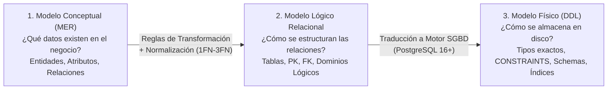
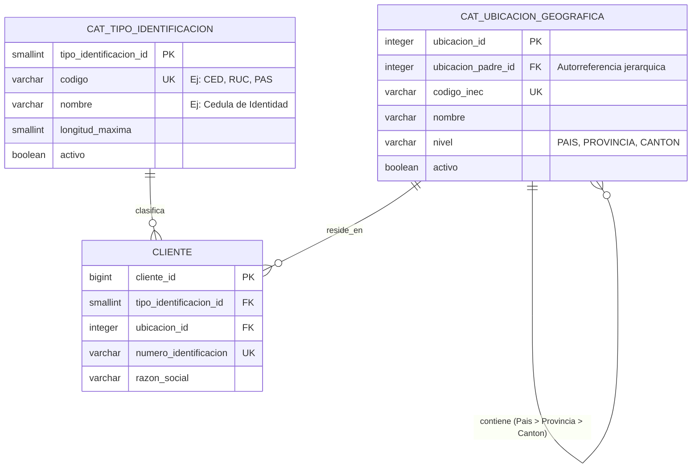
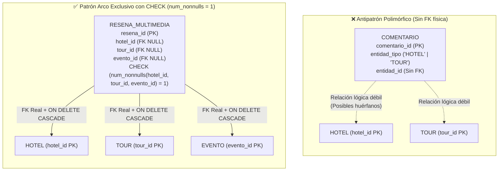
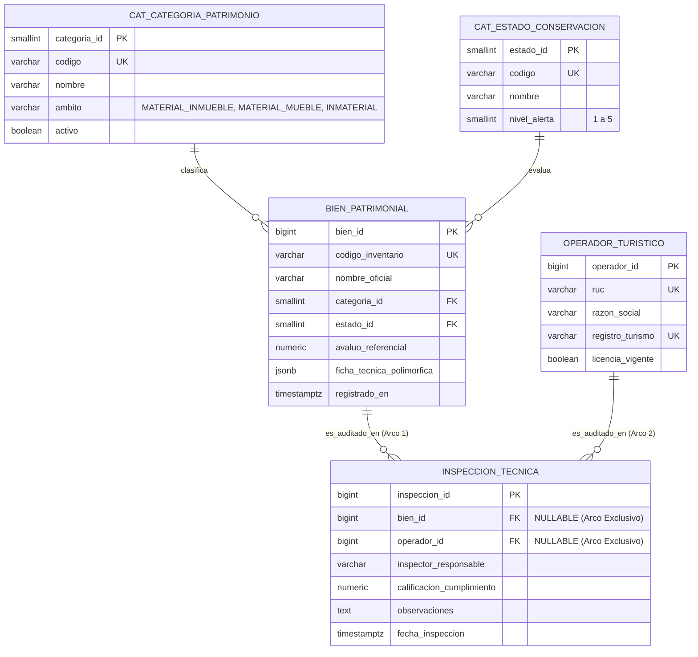
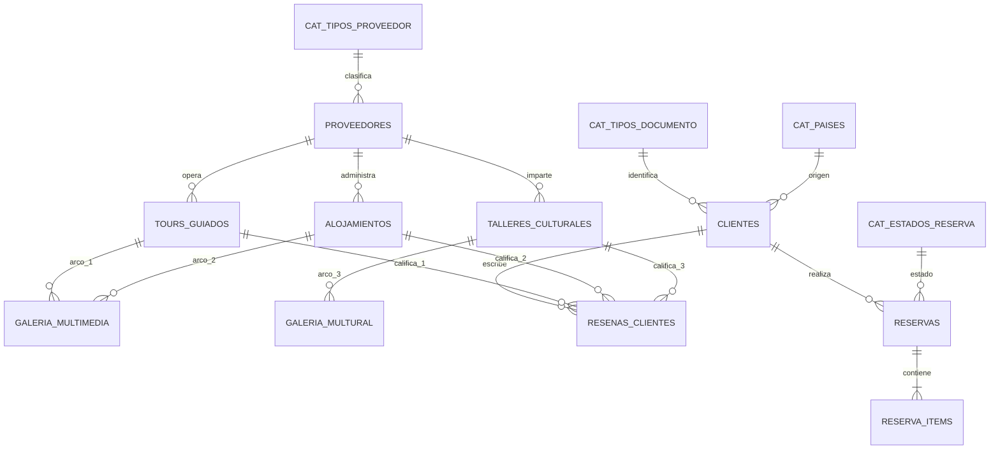
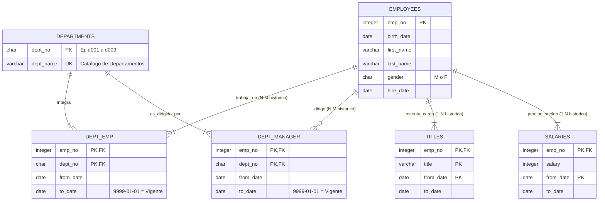
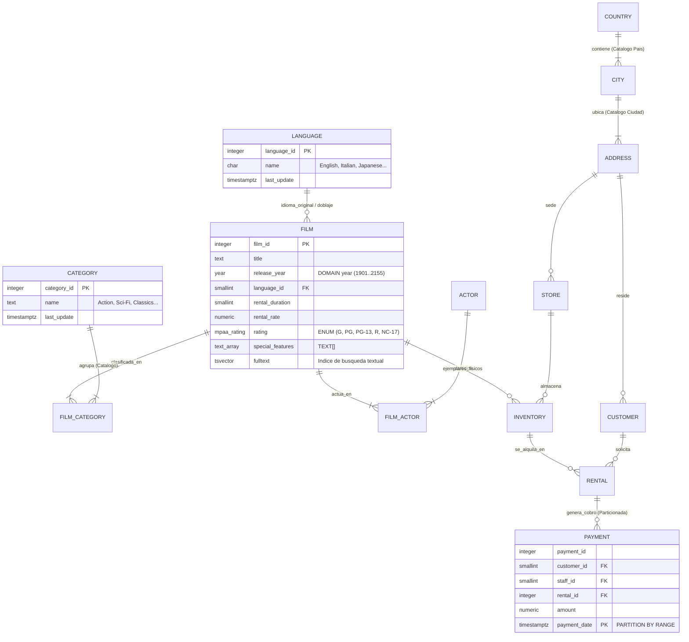
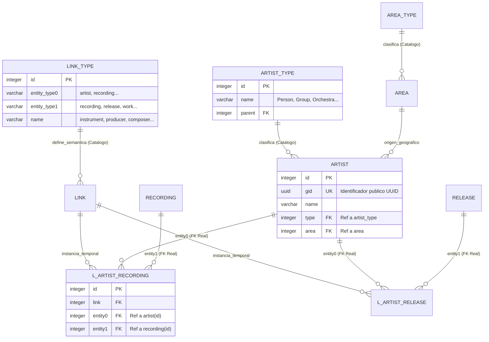

# 🏛️ Semana 1: Modelado de Datos, Implementación DDL, Tablas Catálogo y Polimórficas

> **Instituto Superior Tecnológico de Turismo y Patrimonio Yavirac**  
> **Carrera:** Tecnología Superior en Desarrollo de Software  
> **Asignatura:** Base de Datos Avanzada (`DS4AC1-215`) | **Paralelo:** Paralelo D  
> **Docente:** Ing. Byron Moreno  
> **Unidad 1:** Sentencias SQL complejas, vistas e índices  
> **Periodo Académico:** 2026-II | **Semestre:** Segundo | **Modalidad:** Dual  

---

## 📋 1. Ficha Técnica de la Sesión y Planificación Curricular

| Parámetro | Detalle Oficial según PEA y Planificación de Unidades (Paralelo D) |
| :--- | :--- |
| **Institución** | Instituto Superior Tecnológico de Turismo y Patrimonio Yavirac |
| **Carrera / Nivel** | Desarrollo de Software — Segundo Semestre (Modalidad Dual) |
| **Periodo Académico** | 2026-II |
| **Docente** | Ing. Byron Moreno |
| **Asignatura / Código** | Base de Datos Avanzada (`DS4AC1-215`) |
| **Paralelo** | Paralelo D |
| **Unidad Curricular** | Unidad 1: Sentencias SQL complejas, vistas e índices (ID Unidad: 347552) |
| **Semana Académica** | Semana 1 de 9 |
| **Carga Horaria Semanal** | **5 Horas Presenciales** (ACD: 2h | APECD: 3h | APEA: 0h | AA: 0h) |
| **Clase 1 (2 Horas — ACD)** | **Fecha:** Lunes 26 de octubre de 2026 \| **Tipo:** Aula (ACD - Presencial Teórico-Práctico) \| **Contenido:** Sentencias SQL complejas y DDL: Modelamiento de datos, reglas para convertir modelo conceptual en lógico, y explicación de conceptos de tablas catálogo y polimórficas. |
| **Clase 2 (3 Horas — APECD)** | **Fecha:** Miércoles 28 de octubre de 2026 \| **Tipo:** Laboratorio (APECD - Práctico-Experimental) \| **Contenido:** Laboratorio práctico: Creación de modelo lógico normalizado en herramienta CASE (PG-Modeler / Lucidchart) e implementación de base de datos con sentencias DDL. |
| **Prerrequisitos** | Fundamentos de Bases de Datos, Modelo Entidad-Relación (MER), Álgebra Relacional básica |
| **Entorno Tecnológico** | PostgreSQL 16+, pgAdmin 4, psql, DBeaver, Visual Studio Code |

---

## 🎯 2. Objetivos de las Clases, Resultados de Aprendizaje y Competencias

### 2.1. Objetivos de las Clases (Redactados con Verbo en Infinitivo)

- **Objetivo General de la Semana 1:**  
  Transformar modelos conceptuales de dominio empresarial en modelos lógicos relacionales normalizados (hasta 3FN/BCNF) e implementarlos físicamente en PostgreSQL mediante sentencias DDL robustas, integrando tablas catálogo y asociaciones polimórficas con integridad referencial garantizada.
- **Objetivo Específico de la Clase 1 (2 Horas (120 min) — ACD / Aula — Lunes 26 de octubre de 2026):**  
  Analizar las reglas formales de transformación del modelo conceptual al modelo lógico relacional normalizado (hasta 3FN/BCNF) y los patrones arquitectónicos de tablas catálogo y relaciones polimórficas.
- **Objetivo Específico de la Clase 2 (3 Horas (180 min) — APECD / Laboratorio — Miércoles 28 de octubre de 2026):**  
  Diseñar modelos lógicos normalizados en herramientas CASE (pgModeler / Lucidchart) e implementar físicamente la base de datos en PostgreSQL mediante sentencias DDL avanzadas, restricciones y arcos exclusivos.

### 2.2. Resultados de Aprendizaje (RdA) y Competencias
> [!IMPORTANT]
> **Norma Pedagógica de Redacción:** Los Resultados de Aprendizaje describen lo que el estudiante demuestra al finalizar la clase; se redactan en **tercera persona del presente de indicativo** (NUNCA en infinitivo terminado en *-ar*, *-er*, *-ir*).

| Componente Curricular | Redacción Oficial (Sin Verbos en Infinitivo) |
| :--- | :--- |
| **Resultados de Aprendizaje Institucionales (PEA)** | **RdA 1 (PEA):** Brinda asistencia técnica en el diseño, modelamiento e ilustración del proceso de base de datos. |
| **Resultado de Aprendizaje Específico de la Semana** | **Modela esquemas relacionales normalizados hasta 3FN e implementa la base de datos física en PostgreSQL con sentencias DDL, tablas catálogo y relaciones polimórficas garantizando la consistencia y las restricciones de integridad empresarial.** |
| **Competencia de la Asignatura** | Diseñar y modelar bases de datos aplicando principios de modelamiento y estructuras relacionales para apoyar el desarrollo de soluciones de software. |
| **Habilidades Blandas Priorizadas (PEA)** | • **Trabajo en equipo:** Realiza trabajos de investigación grupales y prácticas colaborativas.<br>• **Pensamiento crítico:** Utiliza herramientas específicas para el diseño y optimización de bases de datos.<br>• **Gestión del tiempo:** Realiza las prácticas en laboratorio dentro del horario establecido.<br>• **Comunicación técnica efectiva:** Expone y sustenta con claridad decisiones de arquitectura relacional. |

---

## ⏱️ 3. Agenda Detallada y Cronograma Semanal (5 Horas)

### 📅 CLASE 1: Lunes 26 de octubre de 2026 (2 Horas (120 min)) — ACD (Aula / Teoría Magistral y Ejemplos Guiados)
| Bloque | Tiempo | Componente | Actividad Pedagógica y Contenido |
| :---: | :---: | :---: | :--- |
| **Bloque 1.1** | 40 min | **ACD** | De lo Conceptual a lo Lógico: Reglas formales de transformación (Entidades fuertes/débiles, cardinalidades 1:1, 1:N, N:M) y normalización relacional (1FN, 2FN, 3FN, BCNF). |
| **Bloque 1.2** | 40 min | **ACD** | Arquitectura de Tablas Catálogo y Polimórficas: Diseño de tablas paramétricas (*Lookup Tables*) vs. tipos `ENUM`; patrones de asociaciones polimórficas y arcos exclusivos con `CHECK (num_nonnulls(...) = 1)`. |
| **Bloque 1.3** | 40 min | **ACD** | DDL Profesional y Ejemplos Guiados en PostgreSQL: Esquemas, tipos de datos modernos (`IDENTITY`, `NUMERIC`, `TIMESTAMPTZ`, `JSONB`), restricciones y políticas `ON DELETE / ON UPDATE`. |

### 🔬 CLASE 2: Miércoles 28 de octubre de 2026 (3 Horas (180 min)) — APECD (Laboratorio de Cómputo / Taller Práctico y Solucionario)
| Bloque | Tiempo | Componente | Actividad Pedagógica y Contenido |
| :---: | :---: | :---: | :--- |
| **Bloque 2.1** | 50 min | **APECD** | Taller Fase 1 (Modelado Lógico CASE): Análisis de requerimientos del caso empresarial *KunturGo* y diseño del modelo lógico normalizado en **pgModeler / Lucidchart**. |
| **Bloque 2.2** | 90 min | **APECD** | Taller Fase 2 (Implementación DDL en PostgreSQL): Codificación del script SQL DDL completo en pgAdmin/psql, creación de catálogos, resolución de polimorfismo y pruebas de violación de restricciones. |
| **Bloque 2.3** | 40 min | **APECD** | Revisión Técnica, Verificación de Restricciones y Solucionario: Pruebas DML de estrés, validación del modelo generado, feedback docente y cierre formativo. |

---

## 🧠 4. PARTE I: CLASE 1 (26/10/2026 — 2 Horas / ACD) — Desarrollo Teórico-Conceptual Profundo

### 4.1. Niveles de Abstracción y Reglas de Transformación del Modelo Conceptual al Lógico

El diseño de una base de datos relacional transita por tres niveles de abstracción claramente diferenciados. Confundir estos niveles suele producir bases de datos rígidas, redundantes o difíciles de mantener en producción.



#### Tabla Comparativa: Niveles de Modelado de Datos

| Característica | Modelo Conceptual (MER) | Modelo Lógico Relacional | Modelo Físico (PostgreSQL DDL) |
| :--- | :--- | :--- | :--- |
| **Audiencia Principal** | Analistas de negocio, clientes, arquitectos | Ingenieros de software, diseñadores de BD | DBAs, desarrolladores backend, motor SGBD |
| **Independencia del SGBD** | Total (agnóstico a la tecnología) | Alta (orientado al paradigma relacional) | Nula (específico para PostgreSQL) |
| **Elementos Centrales** | Entidades, relaciones (rombos), atributos | Relaciones (tablas), tuplas, claves primarias y foráneas | `CREATE TABLE`, tipos (`BIGINT`, `TIMESTAMPTZ`), `CHECK`, `INDEX` |
| **Relaciones Muchos a Muchos (N:M)** | Se representan directamente entre dos entidades | Se descomponen obligatoriamente en una **tabla asociativa** | Tabla física con PK compuesta o subrogada + 2 `FOREIGN KEY` |
| **Atributos Multivaluados** | Permitidos visualmente (doble óvalo) | Prohibidos (1FN exige atomicidad); se extraen a otra tabla | Tabla hija con FK o arreglo/JSONB en casos no relacionales |

#### Reglas Formales para Convertir un Modelo Conceptual en Lógico

1. **Regla de Entidades Fuertes:** Toda entidad fuerte del modelo conceptual se convierte en una tabla en el modelo lógico. Su identificador único se transforma en la **Clave Primaria (`PRIMARY KEY`)**.
2. **Regla de Entidades Débiles:** Una entidad débil (aquella cuya existencia depende de otra entidad propietaria) se convierte en una tabla que hereda la clave primaria de la entidad fuerte como `FOREIGN KEY` con política `ON DELETE CASCADE`, formando una clave primaria compuesta o utilizando una clave subrogada más una restricción `UNIQUE`.
3. **Regla de Relaciones 1:1 (Uno a Uno):**
   - **Participación (0,1) a (1,1):** La clave primaria de la entidad con participación obligatoria (1,1) se propaga como `FOREIGN KEY` con restricción `UNIQUE` hacia la tabla con participación opcional (0,1), evitando valores `NULL`.
   - **Participación (1,1) a (1,1):** Generalmente se fusionan en una sola tabla, salvo por razones de seguridad, particionamiento vertical o rendimiento.
4. **Regla de Relaciones 1:N (Uno a Muchos):** La clave primaria del lado **"1" (Padre)** se propaga como **Clave Foránea (`FOREIGN KEY`)** hacia la tabla del lado **"N" (Hijo)**. Nunca se coloca un arreglo de IDs en la tabla padre.
5. **Regla de Relaciones N:M (Muchos a Muchos):** Se crea una **nueva tabla intermedia (asociativa o de intersección)** que incluye como claves foráneas las claves primarias de ambas entidades. Además, esta tabla almacena los atributos propios de la relación (por ejemplo, `fecha_registro`, `cantidad`, `precio_unitario_historico`).
6. **Síntesis de Normalización (1FN, 2FN, 3FN):**
   - **Primera Forma Normal (1FN):** Todos los atributos deben ser **atómicos** (sin listas separadas por comas como `"Quito, Guayaquil"` ni grupos repetitivos como `telefono1, telefono2, telefono3`).
   - **Segunda Forma Normal (2FN):** Cumple 1FN y todo atributo no clave depende de la **totalidad** de la clave primaria (elimina dependencias parciales en claves compuestas).
   - **Tercera Forma Normal (3FN):** Cumple 2FN y ningún atributo no clave depende transitivamente de otro atributo no clave (*"Cada atributo que no es clave debe proporcionar un hecho sobre la clave, toda la clave y nada más que la clave"*).

---

### 4.2. Tablas Catálogo (*Lookup / Reference Tables*)

#### ¿Qué es una Tabla Catálogo?
Una **tabla catálogo** (también denominada *tabla de referencia*, *tabla paramétrica* o *lookup table*) es una entidad relacional diseñada para almacenar conjuntos de valores controlados, estandarizados y de baja frecuencia de cambio que clasifican o tipifican a otras entidades transaccionales del sistema (por ejemplo: `cat_tipos_documento`, `cat_estados_pedido`, `cat_metodos_pago`, `cat_provincias`).

#### ¿Por qué usar Tablas Catálogo en lugar de texto libre o `CREATE TYPE ... AS ENUM`?

En el diseño profesional de bases de datos existen tres formas de restringir dominios de valores: `CHECK (columna IN (...))`, tipos `ENUM` nativos y **Tablas Catálogo**. Analicemos sus ventajas y desventajas técnicas:

| Criterio Técnico | Texto Libre (`VARCHAR`) | `CHECK` o `ENUM` Nativo | Tabla Catálogo Relacional (`cat_*`) |
| :--- | :--- | :--- | :--- |
| **Integridad de Datos** | ❌ Pésima (`"Efectivo"`, `"efectivo"`, `"EFEC"`) | ✅ Alta | ✅ Máxima (mediante `FOREIGN KEY`) |
| **Agregar nuevos valores** | No aplica | ⚠️ Requiere `ALTER TYPE` o `ALTER TABLE` (migración DDL) | ✅ Simple `INSERT` (operación DML desde panel admin) |
| **Desactivar un valor obsoleto** | ❌ Imposible sin borrar historial | ❌ No se pueden eliminar valores de un `ENUM` fácilmente en PG | ✅ Columna `activo BOOLEAN DEFAULT TRUE` (baja lógica) |
| **Atributos adicionales (Metadatos)** | ❌ Imposible | ❌ Solo almacena una cadena de texto | ✅ Permite `codigo`, `nombre`, `descripcion`, `icono`, `orden` |
| **Internacionalización / Reportes** | ❌ Caótico | ⚠️ Difícil de traducir dinámicamente | ✅ Permite columnas de etiqueta o tablas de traducción |

#### Patrón Estándar de Tabla Catálogo Simple vs. Catálogo Maestro Unificado

En la industria existen dos enfoques para implementar catálogos:

1. **Enfoque Recomendado: Tablas Catálogo Específicas (`cat_estado_reserva`, `cat_tipo_identificacion`)**
   Cada dominio tiene su propia tabla y las tablas transaccionales apuntan a ella con una `FOREIGN KEY` explícita. Garantiza integridad referencial exacta.
2. **Enfoque Alternativo: Catálogo Maestro Jerárquico o Recursivo (`cat_catalogo_general`)**
   Usa una sola tabla autorreferenciada (`padre_id`) para almacenar múltiples listas desplegables de interfaz. Aunque reduce el número de tablas, **debilita la validación semántica** (sin un trigger adicional, alguien podría insertar el `id` de una "Provincia" en la columna `estado_civil_id` porque ambos viven en la misma tabla maestra).



---

### 4.3. Tablas y Asociaciones Polimórficas

#### ¿Qué es una Relación Polimórfica en Bases de Datos?
En Programación Orientada a Objetos, el polimorfismo permite que una misma interfaz opere sobre múltiples tipos de objetos. En bases de datos relacionales, una **relación polimórfica** ocurre cuando una tabla necesita pertenecer o asociarse indistintamente a **dos o más tablas padres diferentes**.

**Ejemplos clásicos de la vida real:**
- Una tabla `archivos_adjuntos` o `fotografias` que puede adjuntarse a un `hotel`, a un `atractivo_turistico` o a un `guia_turistico`.
- Una tabla `comentarios_calificaciones` donde un usuario puede reseñar tanto un `producto` como un `servicio_guiado` o un `evento_cultural`.
- Una tabla `auditoria_cambios` o `direcciones` compartida entre `clientes`, `proveedores` y `sucursales`.

#### El Problema del "Antipatrón Polimórfico Ingenuo" (Sin `FOREIGN KEY`)
Muchos frameworks ORM (como Laravel Eloquent con `MorphTo`, Ruby on Rails o Django GenericForeignKey) promueven el siguiente diseño en una tabla `comentarios`:
- `comentable_tipo VARCHAR(50)` (guarda el nombre de la tabla: `'hoteles'`, `'tours'`)
- `comentable_id BIGINT` (guarda el ID del registro en esa tabla)

> [!WARNING]
> **¿Por qué el polimorfismo sin clave foránea (`comentable_tipo` + `comentable_id`) es riesgoso en bases de datos empresariales?**
> En SQL estándar y PostgreSQL, **una restricción `FOREIGN KEY` solo puede apuntar a exactamente una tabla destino**. Por lo tanto, `comentable_id` no puede tener `FOREIGN KEY`. Si alguien elimina el Hotel #45, sus comentarios quedan como **registros huérfanos** en la base de datos sin que el motor pueda impedirlo ni aplicar `ON DELETE CASCADE`.

#### Las 4 Arquitecturas para Resolver Relaciones Polimórficas en PostgreSQL

Para diseñar bases de datos profesionales en PostgreSQL, debemos conocer las cuatro estrategias arquitectónicas y elegir la adecuada según el caso de uso:

| Patrón Arquitectónico | Cómo Funciona | Integridad Referencial (`FK`) | Complejidad de Consultas | Cuándo Usarlo |
| :--- | :--- | :---: | :---: | :--- |
| **1. Polimorfismo por Tipo + ID (Sin FK)** | Columnas `entidad_tipo` + `entidad_id` en la tabla hija. | ❌ **No tiene FK** (Riesgo de huérfanos) | Media (requiere `LEFT JOIN` condicionados por `entidad_tipo`) | Solo en tablas de logs/auditoría masiva donde no importa que el registro padre se borre. |
| **2. Arcos Exclusivos (`CHECK num_nonnulls`)** | Una columna FK anulable por cada tabla padre posible + `CHECK (num_nonnulls(fk1, fk2, fk3) = 1)`. | ✅ **100% Garantizada** por el motor PostgreSQL | Baja (JOIN directo por cada columna FK) | **Recomendado** cuando el número de tablas padres es acotado (entre 2 y 5 tablas). |
| **3. Supertipo / Subtipo (Herencia de Tabla Clase)** | Una tabla base `entidad_comentable (id)` de la que heredan `hoteles`, `tours` y `eventos`. `comentarios` apunta a la tabla base. | ✅ **100% Garantizada** | Media (JOIN con supertipo y subtipo) | **Ideal** cuando las entidades comparten atributos comunes y semántica de dominio (ej. `item_catalogo`). |
| **4. Atributos Polimórficos con `JSONB` validado** | Entidades similares en una sola tabla con columna `atributos_especificos JSONB` + `CHECK`. | ✅ **100% Garantizada** | Baja (operadores nativos `@>`, `->>` e índices GIN) | Cuando una misma entidad tiene propiedades variables según su categoría (ej. productos electrónicos vs. ropa). |

#### Diagrama Comparativo: Antipatrón Sin FK vs. Patrón de Arco Exclusivo (`num_nonnulls`)



> [!TIP]
> **La función nativa `num_nonnulls()` de PostgreSQL:**  
> En otros motores SQL, validar que *exactamente una* de tres claves foráneas no sea nula requiere escribir un `CHECK` largo y propenso a errores:  
> `CHECK ((hotel_id IS NOT NULL AND tour_id IS NULL AND evento_id IS NULL) OR (hotel_id IS NULL AND tour_id IS NOT NULL AND evento_id IS NULL) ...)`  
> En **PostgreSQL (versión 9.6+)** existe la función nativa `num_nonnulls(a, b, c)`. Basta con escribir:  
> `CONSTRAINT ck_resena_arco_exclusivo CHECK (num_nonnulls(hotel_id, tour_id, evento_id) = 1)`  
> Si todas son `NULL` devuelve `0` (error). Si dos tienen valor devuelve `2` (error). ¡Solo permite el registro cuando exactamente una clave foránea está presente!

---

### 4.4. Buenas Prácticas de Sentencias DDL en PostgreSQL Moderno

Al escribir un script DDL de nivel de producción en PostgreSQL, debemos aplicar las siguientes reglas de oro:

1. **Identificadores Autoincrementales Estándar SQL (`GENERATED ALWAYS AS IDENTITY`):**
   Evita el antiguo pseudo-tipo `SERIAL` o `BIGSERIAL` (que crea secuencias con permisos difíciles de gestionar). Usa el estándar SQL:2003 soportado desde PostgreSQL 10+:
   `id BIGINT GENERATED ALWAYS AS IDENTITY PRIMARY KEY`
2. **Exactitud Numérica Monetaria (`NUMERIC(p, s)`):**
   **Nunca** uses `REAL` ni `DOUBLE PRECISION` (`FLOAT`) para dinero, precios, impuestos o saldos bancarios debido a los errores de redondeo en coma flotante IEEE 754 (`0.1 + 0.2 = 0.30000000000000004`). Usa siempre `NUMERIC(12, 2)`.
3. **Fechas y Horas con Zona Horaria (`TIMESTAMPTZ`):**
   Usa `TIMESTAMPTZ` (`TIMESTAMP WITH TIME ZONE`) en lugar de `TIMESTAMP` sin zona horaria para registrar eventos transaccionales (`creado_en`, `fecha_pago`). PostgreSQL almacena internamente en UTC en 8 bytes y convierte automáticamente según la zona horaria del cliente (`America/Guayaquil`).
4. **Nombres Explícitos para todas las Restricciones (`CONSTRAINT`):**
   Nombrar cada restricción permite identificar inmediatamente qué regla de negocio falló en el backend:
   - `pk_<tabla>`: Clave primaria (`pk_reservas`)
   - `fk_<tabla>_<destino>`: Clave foránea (`fk_reservas_cliente`)
   - `uq_<tabla>_<columna>`: Unicidad (`uq_clientes_identificacion`)
   - `ck_<tabla>_<regla>`: Validación de dominio (`ck_reservas_total_positivo`)

---

## 💻 5. CLASE 1: Ejemplos Guiados Paso a Paso en PostgreSQL (ACD — 2 Horas)

### Caso de Estudio Guiado: Sistema de Gestión de Atractivos y Servicios Patrimoniales
Diseñaremos e implementaremos un esquema completo en PostgreSQL que incluye:
1. **Esquema dedicado (`patrimonio`)** para organizar los objetos de base de datos.
2. **Tablas Catálogo** (`cat_categorias_patrimonio`, `cat_estados_conservacion`, `cat_tipos_tarifa`).
3. **Herencia / Polimorfismo de Atributos con `JSONB`** en la entidad `bienes_patrimoniales` (un bien puede ser un inmueble histórico o una pieza arqueológica móvil).
4. **Relación Polimórfica con Arco Exclusivo (`num_nonnulls`)** en la tabla `inspecciones_tecnicas`, que puede auditar o bien un `bien_patrimonial` o bien un `operador_turistico`.

### Modelo Entidad-Relación del Ejemplo Guiado



### Script SQL DDL Completo y Comentado

Copia y ejecuta este bloque paso a paso en **pgAdmin 4** o en **VS Code**:

```sql
-- ============================================================================
-- SEMANA 1: EJEMPLO GUIADO - MODELADO DDL, CATÁLOGOS Y POLIMORFISMO
-- Motor: PostgreSQL 16+
-- ============================================================================

-- 1. Creación limpia del esquema de trabajo
DROP SCHEMA IF EXISTS patrimonio CASCADE;
CREATE SCHEMA patrimonio;
SET search_path TO patrimonio, public;

-- ============================================================================
-- SECCIÓN A: TABLAS CATÁLOGO (LOOKUP TABLES)
-- ============================================================================

-- Catálogo 1: Categorías de Patrimonio Cultural
CREATE TABLE cat_categorias_patrimonio (
    categoria_id SMALLINT GENERATED ALWAYS AS IDENTITY,
    codigo VARCHAR(15) NOT NULL,
    nombre VARCHAR(80) NOT NULL,
    ambito VARCHAR(30) NOT NULL,
    descripcion TEXT,
    activo BOOLEAN NOT NULL DEFAULT TRUE,
    creado_en TIMESTAMPTZ NOT NULL DEFAULT CURRENT_TIMESTAMP,

    CONSTRAINT pk_cat_categorias_patrimonio PRIMARY KEY (categoria_id),
    CONSTRAINT uq_cat_categorias_codigo UNIQUE (codigo),
    CONSTRAINT ck_cat_categorias_ambito CHECK (
        ambito IN ('MATERIAL_INMUEBLE', 'MATERIAL_MUEBLE', 'INMATERIAL', 'NATURAL')
    )
);

COMMENT ON TABLE cat_categorias_patrimonio IS 'Tabla catálogo que estandariza las categorías del inventario patrimonial.';

-- Catálogo 2: Estados de Conservación
CREATE TABLE cat_estados_conservacion (
    estado_id SMALLINT GENERATED ALWAYS AS IDENTITY,
    codigo VARCHAR(15) NOT NULL,
    nombre VARCHAR(50) NOT NULL,
    nivel_alerta SMALLINT NOT NULL,
    requiere_intervencion_urgente BOOLEAN NOT NULL DEFAULT FALSE,
    activo BOOLEAN NOT NULL DEFAULT TRUE,

    CONSTRAINT pk_cat_estados_conservacion PRIMARY KEY (estado_id),
    CONSTRAINT uq_cat_estados_codigo UNIQUE (codigo),
    CONSTRAINT ck_cat_estados_nivel_alerta CHECK (nivel_alerta BETWEEN 1 AND 5)
);

-- ============================================================================
-- SECCIÓN B: ENTIDADES PRINCIPALES Y ATRIBUTOS POLIMÓRFICOS CON JSONB
-- ============================================================================

CREATE TABLE bienes_patrimoniales (
    bien_id BIGINT GENERATED ALWAYS AS IDENTITY,
    codigo_inventario VARCHAR(25) NOT NULL,
    nombre_oficial VARCHAR(150) NOT NULL,
    categoria_id SMALLINT NOT NULL,
    estado_id SMALLINT NOT NULL,
    anio_construccion_aprox SMALLINT,
    avaluo_referencial NUMERIC(14, 2) NOT NULL DEFAULT 0.00,
    -- Columna polimórfica de atributos específicos según el tipo de bien
    ficha_tecnica JSONB NOT NULL DEFAULT '{}'::JSONB,
    registrado_en TIMESTAMPTZ NOT NULL DEFAULT CURRENT_TIMESTAMP,

    CONSTRAINT pk_bienes_patrimoniales PRIMARY KEY (bien_id),
    CONSTRAINT uq_bienes_codigo_inventario UNIQUE (codigo_inventario),
    CONSTRAINT fk_bienes_categoria FOREIGN KEY (categoria_id)
        REFERENCES cat_categorias_patrimonio (categoria_id)
        ON UPDATE CASCADE ON DELETE RESTRICT,
    CONSTRAINT fk_bienes_estado FOREIGN KEY (estado_id)
        REFERENCES cat_estados_conservacion (estado_id)
        ON UPDATE CASCADE ON DELETE RESTRICT,
    CONSTRAINT ck_bienes_avaluo_no_negativo CHECK (avaluo_referencial >= 0),
    CONSTRAINT ck_bienes_ficha_json_objeto CHECK (jsonb_typeof(ficha_tecnica) = 'object')
);

CREATE TABLE operadores_turisticos (
    operador_id BIGINT GENERATED ALWAYS AS IDENTITY,
    ruc CHAR(13) NOT NULL,
    razon_social VARCHAR(150) NOT NULL,
    registro_turismo VARCHAR(30) NOT NULL,
    correo_contacto VARCHAR(120) NOT NULL,
    licencia_vigente BOOLEAN NOT NULL DEFAULT TRUE,
    registrado_en TIMESTAMPTZ NOT NULL DEFAULT CURRENT_TIMESTAMP,

    CONSTRAINT pk_operadores_turisticos PRIMARY KEY (operador_id),
    CONSTRAINT uq_operadores_ruc UNIQUE (ruc),
    CONSTRAINT uq_operadores_registro UNIQUE (registro_turismo),
    CONSTRAINT ck_operadores_ruc_longitud CHECK (char_length(ruc) = 13)
);

-- ============================================================================
-- SECCIÓN C: TABLA POLIMÓRFICA CON ARCO EXCLUSIVO (num_nonnulls)
-- ============================================================================
-- Una inspección técnica puede realizarse sobre un BIEN_PATRIMONIAL
-- o sobre un OPERADOR_TURISTICO, pero NUNCA sobre ambos al mismo tiempo
-- ni quedar huérfana sin ninguno.

CREATE TABLE inspecciones_tecnicas (
    inspeccion_id BIGINT GENERATED ALWAYS AS IDENTITY,
    bien_id BIGINT NULL,
    operador_id BIGINT NULL,
    codigo_acta VARCHAR(30) NOT NULL,
    inspector_responsable VARCHAR(100) NOT NULL,
    calificacion_cumplimiento NUMERIC(5, 2) NOT NULL,
    observaciones TEXT NOT NULL,
    fecha_inspeccion TIMESTAMPTZ NOT NULL DEFAULT CURRENT_TIMESTAMP,

    CONSTRAINT pk_inspecciones_tecnicas PRIMARY KEY (inspeccion_id),
    CONSTRAINT uq_inspecciones_codigo_acta UNIQUE (codigo_acta),
    CONSTRAINT fk_inspecciones_bien FOREIGN KEY (bien_id)
        REFERENCES bienes_patrimoniales (bien_id)
        ON UPDATE CASCADE ON DELETE CASCADE,
    CONSTRAINT fk_inspecciones_operador FOREIGN KEY (operador_id)
        REFERENCES operadores_turisticos (operador_id)
        ON UPDATE CASCADE ON DELETE CASCADE,
    CONSTRAINT ck_inspecciones_calificacion_rango CHECK (
        calificacion_cumplimiento BETWEEN 0.00 AND 100.00
    ),
    -- RESTRICCIÓN POLIMÓRFICA DE ARCO EXCLUSIVO:
    -- Exactamente 1 de las 2 claves foráneas debe ser NO NULA
    CONSTRAINT ck_inspecciones_arco_polimorfico CHECK (
        num_nonnulls(bien_id, operador_id) = 1
    )
);

-- ============================================================================
-- SECCIÓN D: POBLADO INICIAL Y PRUEBAS DE INTEGRIDAD
-- ============================================================================

INSERT INTO cat_categorias_patrimonio (codigo, nombre, ambito, descripcion) VALUES
('ARQ-COL', 'Arquitectura Religiosa y Civil Colonial', 'MATERIAL_INMUEBLE', 'Edificaciones de los siglos XVI al XVIII'),
('PIE-ARQ', 'Bienes Arqueológicos Prehispánicos', 'MATERIAL_MUEBLE', 'Cerámica, lítica y orfebrería ancestral'),
('TRAD-ORAL', 'Tradiciones y Expresiones Orales', 'INMATERIAL', 'Saberes ancestrales y fiestas populares');

INSERT INTO cat_estados_conservacion (codigo, nombre, nivel_alerta, requiere_intervencion_urgente) VALUES
('OPT', 'Óptimo', 1, FALSE),
('REG', 'Regular - Mantenimiento Preventivo', 3, FALSE),
('CRI', 'Crítico - Riesgo Estructural', 5, TRUE);

INSERT INTO bienes_patrimoniales (
    codigo_inventario, nombre_oficial, categoria_id, estado_id,
    anio_construccion_aprox, avaluo_referencial, ficha_tecnica
) VALUES
(
    'INPC-UIO-0001',
    'Convento e Iglesia de San Francisco de Quito',
    1, 1, 1535, 25000000.00,
    '{"area_m2": 35000, "estilo_predominante": "Barroco Quiteño", "numero_claustros": 7}'::JSONB
),
(
    'INPC-UIO-0002',
    'Vasija Antropomorfa Cultura Quito-Cara',
    2, 2, 1200, 45000.00,
    '{"material": "Cerámica cocida", "peso_gramos": 850, "dimensiones_cm": "28x18x18", "sala_exhibicion": "Sala Prehispánica 2"}'::JSONB
);

INSERT INTO operadores_turisticos (ruc, razon_social, registro_turismo, correo_contacto) VALUES
('1790012345001', 'Andes Heritage Expeditions S.A.', 'MINTUR-UIO-2026-88', 'operaciones@andesheritage.ec');

-- Inspección 1: Asociada a un Bien Patrimonial (bien_id = 1, operador_id = NULL)
INSERT INTO inspecciones_tecnicas (
    bien_id, operador_id, codigo_acta, inspector_responsable, calificacion_cumplimiento, observaciones
) VALUES (
    1, NULL, 'ACTA-2026-001', 'Arq. Valeria Montalvo', 96.50,
    'Estructura de cubierta e impermeabilización en excelente estado.'
);

-- Inspección 2: Asociada a un Operador Turístico (bien_id = NULL, operador_id = 1)
INSERT INTO inspecciones_tecnicas (
    bien_id, operador_id, codigo_acta, inspector_responsable, calificacion_cumplimiento, observaciones
) VALUES (
    NULL, 1, 'ACTA-2026-002', 'Ing. Carlos Tapia', 91.00,
    'Cumple con protocolos de seguridad y guías certificados.'
);

-- Consulta unificada de la tabla polimórfica
SELECT
    i.codigo_acta,
    i.inspector_responsable,
    i.calificacion_cumplimiento,
    CASE
        WHEN i.bien_id IS NOT NULL THEN 'BIEN PATRIMONIAL'
        WHEN i.operador_id IS NOT NULL THEN 'OPERADOR TURÍSTICO'
    END AS tipo_entidad_auditada,
    COALESCE(b.nombre_oficial, o.razon_social) AS nombre_entidad_auditada
FROM inspecciones_tecnicas i
LEFT JOIN bienes_patrimoniales b ON i.bien_id = b.bien_id
LEFT JOIN operadores_turisticos o ON i.operador_id = o.operador_id;
```

> [!IMPORTANT]
> **Experimenta el blindaje del Arco Exclusivo:**  
> Intenta ejecutar en tu consola un `INSERT` en `inspecciones_tecnicas` enviando `bien_id = 1` y `operador_id = 1` simultáneamente, o ambos en `NULL`. Observarás cómo PostgreSQL rechaza inmediatamente la operación indicando:  
> `ERROR: new row for relation "inspecciones_tecnicas" violates check constraint "ck_inspecciones_arco_polimorfico"`.

---

### 📺 Video Tutorial Recomendado en Español — Clase 1 (2 Horas — ACD / Aula)

> [!TIP]
> **Video de Apoyo Académico (Español):**  
> 🎬 **[Normalización en Bases de Datos (1FN, 2FN, 3FN)](https://www.youtube.com/watch?v=kvt2wE-q-yY)**  
> **Canal / Autor:** TodoCode / Edgar Ramírez • **Duración estimada:** ~28 min • **Idioma:** Español  
> **Temas clave explicados:** Explicación de las reglas formales de transformación del modelo conceptual a relacional lógico, reducción de redundancias, diseño de tablas catálogo paramétricas y normalización hasta 3FN.

---

## 🛠️ 6. PARTE II: CLASE 2 (28/10/2026 — 3 Horas / APECD) — Taller Práctico-Experimental en Laboratorio

### Escenario Empresarial Realista: Plataforma "KunturGo — Ecosistema de Reservas Turísticas y Culturales"

El **Instituto Superior Tecnológico de Turismo y Patrimonio Yavirac**, en convenio con operadores del Centro Histórico de Quito, está desarrollando el backend del sistema **"KunturGo"**. Actualmente, un analista junior levantó el siguiente requerimiento conceptual desnormalizado y con problemas estructurales:

1. **Clientes / Turistas:** Se requiere registrar su tipo de documento de identificación (Cédula, RUC, Pasaporte, Carné Diplomático), número de documento, nombres completos, país de origen (desde un catálogo estandarizado ISO de países), correo electrónico y teléfono.
2. **Proveedores Aliados:** Empresas o artesanos que ofrecen servicios en la plataforma (RUC, razón social, tipo de proveedor desde un catálogo: `'HOSPEDAJE'`, `'GASTRONOMIA'`, `'TRANSPORTE'`, `'ARTESANIA'`).
3. **Experiencias Comercializables:** Existen tres tipos de productos independientes que los clientes pueden reservar o adquirir:
   - **Paquetes de Tour Guiado (`tours_guiados`):** código, título, duración en horas, cupo máximo, nivel de dificultad (catálogo: Fácil, Moderado, Exigencia Alta) y precio base.
   - **Alojamientos Patrimoniales (`alojamientos`):** código, nombre del establecimiento, dirección, número de habitaciones, precio por noche y servicios incluidos en formato flexible (`JSONB`).
   - **Talleres Culturales (`talleres_culturales`):** código, nombre del taller (ej. Escuela Quiteña, Chocolatería Artesanal), maestro artesano, duración en minutos y costo por participante.
4. **Reservas y Detalles:** Un cliente puede realizar una `reserva` (con un estado controlado por catálogo: Pendiente, Confirmada, Pagada, Cancelada).
5. **Galería Multimedia Polimórfica (`galeria_multimedia`) y Reseñas Polimórficas (`resenas_clientes`):**
   - Tanto los `tours_guiados`, como los `alojamientos` y los `talleres_culturales` necesitan almacenar múltiples **fotografías/videos** en una tabla `galeria_multimedia` y recibir **reseñas con calificación de 1 a 5 estrellas** en una tabla `resenas_clientes`, garantizando el **100% de integridad referencial** en PostgreSQL.

---

### Retos Prácticos Graduados del Taller

#### 🔹 Reto 1 (Nivel Básico — Transformación Conceptual a Lógico)
Diseña en **pgModeler**, **Lucidchart** o **Draw.io** (o expresa en sintaxis `mermaid` `erDiagram`) el **Modelo Lógico Relacional Normalizado en 3FN** del sistema *KunturGo*. Identifica claramente cuáles son las **tablas catálogo**, las **entidades fuertes**, las **tablas transaccionales** y las **tablas polimórficas**.

#### 🔹 Reto 2 (Nivel Básico — Esquema y Tablas Catálogo)
Crea un esquema llamado `kunturgo` en PostgreSQL y construye las **4 tablas catálogo** del sistema (`cat_tipos_documento`, `cat_paises`, `cat_tipos_proveedor`, `cat_estados_reserva`) aplicando claves primarias `GENERATED ALWAYS AS IDENTITY`, restricciones `UNIQUE` para los códigos cortos y columnas de control (`activo`, `creado_en`).

#### 🔹 Reto 3 (Nivel Intermedio — Entidades Principales y Reglas de Negocio)
Implementa las tablas `clientes` y `proveedores` vinculadas a sus respectivos catálogos mediante `FOREIGN KEY` con políticas `ON DELETE RESTRICT` y `ON UPDATE CASCADE`. Agrega validaciones `CHECK` para asegurar que el correo electrónico contenga `@` y que los campos obligatorios no sean cadenas vacías (`trim(campo) <> ''`).

#### 🔹 Reto 4 (Nivel Intermedio — Las 3 Entidades de Oferta Turística)
Implementa las tablas `tours_guiados`, `alojamientos` y `talleres_culturales`, todas vinculadas a `proveedores`. Asegúrate de usar `NUMERIC(10,2)` para precios, validar que los precios y cupos sean estrictamente mayores a cero (`> 0`), e incluir una columna `amenidades JSONB` en `alojamientos`.

#### 🔹 Reto 5 (Nivel Avanzado — Polimorfismo con Arco Exclusivo en `galeria_multimedia`)
Crea la tabla polimórfica `galeria_multimedia` que permita adjuntar fotos o videos (`url_archivo`, `tipo_medio` `'IMAGEN'` o `'VIDEO'`, `es_portada`, `orden_visualizacion`) a un `tour_guiado`, a un `alojamiento` o a un `taller_cultural`. Implementa el patrón de **Arco Exclusivo** con `num_nonnulls(...) = 1` y claves foráneas con `ON DELETE CASCADE`.

#### 🔹 Reto 6 (Nivel Avanzado — Polimorfismo y Regla de Unicidad en `resenas_clientes`)
Crea la tabla polimórfica `resenas_clientes` donde un `cliente` califica (de `1` a `5` estrellas) y comenta sobre un `tour_guiado`, un `alojamiento` o un `taller_cultural` usando arco exclusivo. Agrega además restricciones `UNIQUE` para que un mismo cliente no pueda calificar dos veces el mismo tour, el mismo alojamiento ni el mismo taller.

#### 🔹 Reto 7 (Nivel Experto — Evolución de Esquema con `ALTER TABLE` y Tabla Transaccional `reservas`)
Implementa la tabla `reservas` y su tabla de detalle polimórfico `reserva_items` (donde cada ítem reservado apunta a uno de los 3 productos turísticos, registrando `cantidad_personas`, `precio_unitario` y `subtotal` calculado o validado). Posteriormente, usa `ALTER TABLE` para agregar una columna `codigo_promocional VARCHAR(20)` a `reservas`.

#### 🔹 Reto 8 (Nivel Experto — Pruebas de Estrés de Integridad y Consulta Polimórfica)
Inserta datos de prueba en todas las tablas y escribe:
1. Una sentencia `INSERT` deliberadamente inválida que demuestre que el arco polimórfico bloquea una reseña asignada simultáneamente a un tour y a un alojamiento.
2. Una consulta SQL que liste todas las reseñas indicando el nombre del cliente, el tipo de servicio calificado (`'TOUR'`, `'ALOJAMIENTO'`, `'TALLER'`), el nombre del servicio, las estrellas y el comentario.

---

### Solucionario Completo del Taller (APECD)

<details>
<summary>✅ Ver Solución Propuesta (Diagrama Lógico + Script SQL Completo de los 8 Retos)</summary>

#### Solución Reto 1: Diagrama Lógico Relacional Normalizado (3FN)



#### Solución Retos 2 al 8: Script SQL DDL y DML Completo en PostgreSQL

```sql
-- ============================================================================
-- SOLUCIONARIO TALLER APECD SEMANA 1: SISTEMA "KUNTURGO"
-- ============================================================================

-- RETO 2: ESQUEMA Y TABLAS CATÁLOGO
DROP SCHEMA IF EXISTS kunturgo CASCADE;
CREATE SCHEMA kunturgo;
SET search_path TO kunturgo, public;

CREATE TABLE cat_tipos_documento (
    tipo_documento_id SMALLINT GENERATED ALWAYS AS IDENTITY,
    codigo VARCHAR(10) NOT NULL,
    nombre VARCHAR(60) NOT NULL,
    activo BOOLEAN NOT NULL DEFAULT TRUE,
    creado_en TIMESTAMPTZ NOT NULL DEFAULT CURRENT_TIMESTAMP,
    CONSTRAINT pk_cat_tipos_documento PRIMARY KEY (tipo_documento_id),
    CONSTRAINT uq_cat_tipos_documento_codigo UNIQUE (codigo)
);

CREATE TABLE cat_paises (
    pais_id SMALLINT GENERATED ALWAYS AS IDENTITY,
    codigo_iso CHAR(2) NOT NULL,
    nombre VARCHAR(80) NOT NULL,
    prefijo_telefonico VARCHAR(6) NOT NULL,
    activo BOOLEAN NOT NULL DEFAULT TRUE,
    CONSTRAINT pk_cat_paises PRIMARY KEY (pais_id),
    CONSTRAINT uq_cat_paises_iso UNIQUE (codigo_iso)
);

CREATE TABLE cat_tipos_proveedor (
    tipo_proveedor_id SMALLINT GENERATED ALWAYS AS IDENTITY,
    codigo VARCHAR(20) NOT NULL,
    nombre VARCHAR(80) NOT NULL,
    activo BOOLEAN NOT NULL DEFAULT TRUE,
    CONSTRAINT pk_cat_tipos_proveedor PRIMARY KEY (tipo_proveedor_id),
    CONSTRAINT uq_cat_tipos_proveedor_codigo UNIQUE (codigo)
);

CREATE TABLE cat_estados_reserva (
    estado_reserva_id SMALLINT GENERATED ALWAYS AS IDENTITY,
    codigo VARCHAR(20) NOT NULL,
    nombre VARCHAR(60) NOT NULL,
    es_estado_final BOOLEAN NOT NULL DEFAULT FALSE,
    orden_flujo SMALLINT NOT NULL,
    CONSTRAINT pk_cat_estados_reserva PRIMARY KEY (estado_reserva_id),
    CONSTRAINT uq_cat_estados_reserva_codigo UNIQUE (codigo)
);

-- RETO 3: ENTIDADES CLIENTES Y PROVEEDORES
CREATE TABLE clientes (
    cliente_id BIGINT GENERATED ALWAYS AS IDENTITY,
    tipo_documento_id SMALLINT NOT NULL,
    numero_documento VARCHAR(25) NOT NULL,
    nombres_completos VARCHAR(140) NOT NULL,
    pais_id SMALLINT NOT NULL,
    correo_electronico VARCHAR(120) NOT NULL,
    telefono VARCHAR(25),
    creado_en TIMESTAMPTZ NOT NULL DEFAULT CURRENT_TIMESTAMP,

    CONSTRAINT pk_clientes PRIMARY KEY (cliente_id),
    CONSTRAINT uq_clientes_documento UNIQUE (tipo_documento_id, numero_documento),
    CONSTRAINT uq_clientes_correo UNIQUE (correo_electronico),
    CONSTRAINT fk_clientes_tipo_doc FOREIGN KEY (tipo_documento_id)
        REFERENCES cat_tipos_documento (tipo_documento_id)
        ON UPDATE CASCADE ON DELETE RESTRICT,
    CONSTRAINT fk_clientes_pais FOREIGN KEY (pais_id)
        REFERENCES cat_paises (pais_id)
        ON UPDATE CASCADE ON DELETE RESTRICT,
    CONSTRAINT ck_clientes_nombres_no_vacio CHECK (trim(nombres_completos) <> ''),
    CONSTRAINT ck_clientes_correo_formato CHECK (correo_electronico LIKE '%_@__%.__%')
);

CREATE TABLE proveedores (
    proveedor_id BIGINT GENERATED ALWAYS AS IDENTITY,
    tipo_proveedor_id SMALLINT NOT NULL,
    ruc CHAR(13) NOT NULL,
    razon_social VARCHAR(150) NOT NULL,
    correo_comercial VARCHAR(120) NOT NULL,
    activo BOOLEAN NOT NULL DEFAULT TRUE,
    creado_en TIMESTAMPTZ NOT NULL DEFAULT CURRENT_TIMESTAMP,

    CONSTRAINT pk_proveedores PRIMARY KEY (proveedor_id),
    CONSTRAINT uq_proveedores_ruc UNIQUE (ruc),
    CONSTRAINT fk_proveedores_tipo FOREIGN KEY (tipo_proveedor_id)
        REFERENCES cat_tipos_proveedor (tipo_proveedor_id)
        ON UPDATE CASCADE ON DELETE RESTRICT,
    CONSTRAINT ck_proveedores_ruc_valido CHECK (char_length(ruc) = 13),
    CONSTRAINT ck_proveedores_razon_no_vacia CHECK (trim(razon_social) <> '')
);

-- RETO 4: ENTIDADES DE OFERTA TURÍSTICA Y CULTURAL
CREATE TABLE tours_guiados (
    tour_id BIGINT GENERATED ALWAYS AS IDENTITY,
    proveedor_id BIGINT NOT NULL,
    codigo_tour VARCHAR(20) NOT NULL,
    titulo VARCHAR(150) NOT NULL,
    duracion_horas NUMERIC(4, 1) NOT NULL,
    cupo_maximo SMALLINT NOT NULL,
    nivel_dificultad VARCHAR(20) NOT NULL,
    precio_persona NUMERIC(10, 2) NOT NULL,
    activo BOOLEAN NOT NULL DEFAULT TRUE,

    CONSTRAINT pk_tours_guiados PRIMARY KEY (tour_id),
    CONSTRAINT uq_tours_codigo UNIQUE (codigo_tour),
    CONSTRAINT fk_tours_proveedor FOREIGN KEY (proveedor_id)
        REFERENCES proveedores (proveedor_id)
        ON UPDATE CASCADE ON DELETE RESTRICT,
    CONSTRAINT ck_tours_duracion_positiva CHECK (duracion_horas > 0),
    CONSTRAINT ck_tours_cupo_positivo CHECK (cupo_maximo > 0),
    CONSTRAINT ck_tours_dificultad CHECK (nivel_dificultad IN ('FACIL', 'MODERADO', 'ALTO')),
    CONSTRAINT ck_tours_precio_positivo CHECK (precio_persona > 0)
);

CREATE TABLE alojamientos (
    alojamiento_id BIGINT GENERATED ALWAYS AS IDENTITY,
    proveedor_id BIGINT NOT NULL,
    codigo_alojamiento VARCHAR(20) NOT NULL,
    nombre_establecimiento VARCHAR(150) NOT NULL,
    direccion VARCHAR(250) NOT NULL,
    numero_habitaciones SMALLINT NOT NULL,
    precio_noche NUMERIC(10, 2) NOT NULL,
    amenidades JSONB NOT NULL DEFAULT '{}'::JSONB,
    activo BOOLEAN NOT NULL DEFAULT TRUE,

    CONSTRAINT pk_alojamientos PRIMARY KEY (alojamiento_id),
    CONSTRAINT uq_alojamientos_codigo UNIQUE (codigo_alojamiento),
    CONSTRAINT fk_alojamientos_proveedor FOREIGN KEY (proveedor_id)
        REFERENCES proveedores (proveedor_id)
        ON UPDATE CASCADE ON DELETE RESTRICT,
    CONSTRAINT ck_alojamientos_habitaciones CHECK (numero_habitaciones > 0),
    CONSTRAINT ck_alojamientos_precio CHECK (precio_noche > 0)
);

CREATE TABLE talleres_culturales (
    taller_id BIGINT GENERATED ALWAYS AS IDENTITY,
    proveedor_id BIGINT NOT NULL,
    codigo_taller VARCHAR(20) NOT NULL,
    nombre_taller VARCHAR(150) NOT NULL,
    maestro_artesano VARCHAR(120) NOT NULL,
    duracion_minutos SMALLINT NOT NULL,
    costo_participante NUMERIC(10, 2) NOT NULL,
    activo BOOLEAN NOT NULL DEFAULT TRUE,

    CONSTRAINT pk_talleres_culturales PRIMARY KEY (taller_id),
    CONSTRAINT uq_talleres_codigo UNIQUE (codigo_taller),
    CONSTRAINT fk_talleres_proveedor FOREIGN KEY (proveedor_id)
        REFERENCES proveedores (proveedor_id)
        ON UPDATE CASCADE ON DELETE RESTRICT,
    CONSTRAINT ck_talleres_duracion CHECK (duracion_minutos >= 30),
    CONSTRAINT ck_talleres_costo CHECK (costo_participante > 0)
);

-- RETO 5: GALERÍA MULTIMEDIA POLIMÓRFICA CON ARCO EXCLUSIVO
CREATE TABLE galeria_multimedia (
    multimedia_id BIGINT GENERATED ALWAYS AS IDENTITY,
    tour_id BIGINT NULL,
    alojamiento_id BIGINT NULL,
    taller_id BIGINT NULL,
    url_archivo VARCHAR(500) NOT NULL,
    tipo_medio VARCHAR(15) NOT NULL DEFAULT 'IMAGEN',
    es_portada BOOLEAN NOT NULL DEFAULT FALSE,
    orden_visualizacion SMALLINT NOT NULL DEFAULT 1,
    creado_en TIMESTAMPTZ NOT NULL DEFAULT CURRENT_TIMESTAMP,

    CONSTRAINT pk_galeria_multimedia PRIMARY KEY (multimedia_id),
    CONSTRAINT fk_galeria_tour FOREIGN KEY (tour_id)
        REFERENCES tours_guiados (tour_id) ON DELETE CASCADE,
    CONSTRAINT fk_galeria_alojamiento FOREIGN KEY (alojamiento_id)
        REFERENCES alojamientos (alojamiento_id) ON DELETE CASCADE,
    CONSTRAINT fk_galeria_taller FOREIGN KEY (taller_id)
        REFERENCES talleres_culturales (taller_id) ON DELETE CASCADE,
    CONSTRAINT ck_galeria_tipo_medio CHECK (tipo_medio IN ('IMAGEN', 'VIDEO', 'RECORRIDO_360')),
    CONSTRAINT ck_galeria_arco_exclusivo CHECK (
        num_nonnulls(tour_id, alojamiento_id, taller_id) = 1
    )
);

-- RETO 6: RESEÑAS POLIMÓRFICAS DE CLIENTES
CREATE TABLE resenas_clientes (
    resena_id BIGINT GENERATED ALWAYS AS IDENTITY,
    cliente_id BIGINT NOT NULL,
    tour_id BIGINT NULL,
    alojamiento_id BIGINT NULL,
    taller_id BIGINT NULL,
    calificacion SMALLINT NOT NULL,
    comentario TEXT NOT NULL,
    fecha_resena TIMESTAMPTZ NOT NULL DEFAULT CURRENT_TIMESTAMP,

    CONSTRAINT pk_resenas_clientes PRIMARY KEY (resena_id),
    CONSTRAINT fk_resenas_cliente FOREIGN KEY (cliente_id)
        REFERENCES clientes (cliente_id) ON DELETE RESTRICT,
    CONSTRAINT fk_resenas_tour FOREIGN KEY (tour_id)
        REFERENCES tours_guiados (tour_id) ON DELETE CASCADE,
    CONSTRAINT fk_resenas_alojamiento FOREIGN KEY (alojamiento_id)
        REFERENCES alojamientos (alojamiento_id) ON DELETE CASCADE,
    CONSTRAINT fk_resenas_taller FOREIGN KEY (taller_id)
        REFERENCES talleres_culturales (taller_id) ON DELETE CASCADE,
    CONSTRAINT ck_resenas_calificacion_estrellas CHECK (calificacion BETWEEN 1 AND 5),
    CONSTRAINT ck_resenas_arco_exclusivo CHECK (
        num_nonnulls(tour_id, alojamiento_id, taller_id) = 1
    ),
    CONSTRAINT uq_resenas_cliente_tour UNIQUE (cliente_id, tour_id),
    CONSTRAINT uq_resenas_cliente_alojamiento UNIQUE (cliente_id, alojamiento_id),
    CONSTRAINT uq_resenas_cliente_taller UNIQUE (cliente_id, taller_id)
);

-- RETO 7: RESERVAS, DETALLE POLIMÓRFICO Y ALTER TABLE
CREATE TABLE reservas (
    reserva_id BIGINT GENERATED ALWAYS AS IDENTITY,
    codigo_reserva VARCHAR(20) NOT NULL,
    cliente_id BIGINT NOT NULL,
    estado_reserva_id SMALLINT NOT NULL,
    fecha_reserva TIMESTAMPTZ NOT NULL DEFAULT CURRENT_TIMESTAMP,
    total_reserva NUMERIC(12, 2) NOT NULL DEFAULT 0.00,

    CONSTRAINT pk_reservas PRIMARY KEY (reserva_id),
    CONSTRAINT uq_reservas_codigo UNIQUE (codigo_reserva),
    CONSTRAINT fk_reservas_cliente FOREIGN KEY (cliente_id)
        REFERENCES clientes (cliente_id) ON DELETE RESTRICT,
    CONSTRAINT fk_reservas_estado FOREIGN KEY (estado_reserva_id)
        REFERENCES cat_estados_reserva (estado_reserva_id) ON DELETE RESTRICT,
    CONSTRAINT ck_reservas_total_no_negativo CHECK (total_reserva >= 0)
);

CREATE TABLE reserva_items (
    reserva_item_id BIGINT GENERATED ALWAYS AS IDENTITY,
    reserva_id BIGINT NOT NULL,
    tour_id BIGINT NULL,
    alojamiento_id BIGINT NULL,
    taller_id BIGINT NULL,
    fecha_servicio DATE NOT NULL,
    cantidad SMALLINT NOT NULL,
    precio_unitario NUMERIC(10, 2) NOT NULL,
    subtotal NUMERIC(12, 2) GENERATED ALWAYS AS (cantidad * precio_unitario) STORED,

    CONSTRAINT pk_reserva_items PRIMARY KEY (reserva_item_id),
    CONSTRAINT fk_items_reserva FOREIGN KEY (reserva_id)
        REFERENCES reservas (reserva_id) ON DELETE CASCADE,
    CONSTRAINT fk_items_tour FOREIGN KEY (tour_id)
        REFERENCES tours_guiados (tour_id) ON DELETE RESTRICT,
    CONSTRAINT fk_items_alojamiento FOREIGN KEY (alojamiento_id)
        REFERENCES alojamientos (alojamiento_id) ON DELETE RESTRICT,
    CONSTRAINT fk_items_taller FOREIGN KEY (taller_id)
        REFERENCES talleres_culturales (taller_id) ON DELETE RESTRICT,
    CONSTRAINT ck_items_cantidad_positiva CHECK (cantidad > 0),
    CONSTRAINT ck_items_precio_positivo CHECK (precio_unitario > 0),
    CONSTRAINT ck_items_arco_exclusivo CHECK (
        num_nonnulls(tour_id, alojamiento_id, taller_id) = 1
    )
);

-- Evolución del esquema con ALTER TABLE
ALTER TABLE reservas
    ADD COLUMN codigo_promocional VARCHAR(20) NULL;

-- RETO 8: DATOS DE PRUEBA Y CONSULTA UNIFICADA POLIMÓRFICA
INSERT INTO cat_tipos_documento (codigo, nombre) VALUES ('CED', 'Cédula'), ('PAS', 'Pasaporte');
INSERT INTO cat_paises (codigo_iso, nombre, prefijo_telefonico) VALUES ('EC', 'Ecuador', '+593'), ('CO', 'Colombia', '+57');
INSERT INTO cat_tipos_proveedor (codigo, nombre) VALUES ('HOSPEDAJE', 'Alojamiento Patrimonial'), ('OPERADOR', 'Operadora de Turismo'), ('ARTESANIA', 'Taller Artesanal');
INSERT INTO cat_estados_reserva (codigo, nombre, es_estado_final, orden_flujo) VALUES ('PEND', 'Pendiente', FALSE, 1), ('PAG', 'Pagada', TRUE, 2);

INSERT INTO clientes (tipo_documento_id, numero_documento, nombres_completos, pais_id, correo_electronico, telefono) VALUES
(1, '1712345678', 'Mateo Sebastián Cevallos', 1, 'mateo.cevallos@correo.ec', '0991234567'),
(2, 'PA99887766', 'Laura Valentina Gómez', 2, 'laura.gomez@correo.co', '3001234567');

INSERT INTO proveedores (tipo_proveedor_id, ruc, razon_social, correo_comercial) VALUES
(2, '1791112223001', 'Quito Eterno Tours Cía. Ltda.', 'reservas@quitoeterno.ec'),
(1, '1794445556001', 'Casona de la Ronda Boutique S.A.', 'recepcion@casonalaronda.ec'),
(3, '1709998887001', 'Escuela de Arte Quiteño San Andrés', 'talleres@artequiteno.ec');

INSERT INTO tours_guiados (proveedor_id, codigo_tour, titulo, duracion_horas, cupo_maximo, nivel_dificultad, precio_persona) VALUES
(1, 'TR-UIO-01', 'Ruta de las Cúpulas y Claustros Nocturnos', 3.5, 15, 'FACIL', 28.00);

INSERT INTO alojamientos (proveedor_id, codigo_alojamiento, nombre_establecimiento, direccion, numero_habitaciones, precio_noche, amenidades) VALUES
(2, 'AL-UIO-01', 'Hotel Patrimonial Casona de la Ronda', 'Calle Morales Oe1-120, Centro Histórico', 12, 95.00, '{"wifi": true, "desayuno_andino": true, "patio_colonial": true}'::JSONB);

INSERT INTO talleres_culturales (proveedor_id, codigo_taller, nombre_taller, maestro_artesano, duracion_minutos, costo_participante) VALUES
(3, 'TL-UIO-01', 'Tallado en Madera y Pan de Oro Tradicional', 'Maestro Oswaldo Chiluiza', 120, 35.00);

INSERT INTO resenas_clientes (cliente_id, tour_id, alojamiento_id, taller_id, calificacion, comentario) VALUES
(1, 1, NULL, NULL, 5, 'Una experiencia inolvidable recorriendo las cúpulas iluminadas.'),
(2, NULL, 1, NULL, 4, 'Excelente atención y arquitectura colonial impecable.'),
(1, NULL, NULL, 1, 5, 'El Maestro Oswaldo explica la técnica colonial con gran pasión.');

-- Consulta polimórfica unificada
SELECT
    r.resena_id,
    c.nombres_completos AS cliente,
    CASE
        WHEN r.tour_id IS NOT NULL THEN 'TOUR GUIADO'
        WHEN r.alojamiento_id IS NOT NULL THEN 'ALOJAMIENTO PATRIMONIAL'
        WHEN r.taller_id IS NOT NULL THEN 'TALLER CULTURAL'
    END AS categoria_servicio,
    COALESCE(t.titulo, a.nombre_establecimiento, tc.nombre_taller) AS servicio_calificado,
    r.calificacion AS estrellas,
    r.comentario,
    r.fecha_resena
FROM resenas_clientes r
INNER JOIN clientes c ON r.cliente_id = c.cliente_id
LEFT JOIN tours_guiados t ON r.tour_id = t.tour_id
LEFT JOIN alojamientos a ON r.alojamiento_id = a.alojamiento_id
LEFT JOIN talleres_culturales tc ON r.taller_id = tc.taller_id
ORDER BY r.resena_id;
```

</details>

---

### 📺 Video Tutorial Recomendado en Español — Clase 2 (3 Horas — APECD / Laboratorio)

> [!TIP]
> **Video de Apoyo Académico (Español):**  
> 🎬 **[PostgreSQL: Creación de Tablas DDL, Primary Key y Foreign Keys](https://www.youtube.com/watch?v=FRT38sQeZ-w)**  
> **Canal / Autor:** PicaCódigo / La Geekipedia de Ernesto • **Duración estimada:** ~32 min • **Idioma:** Español  
> **Temas clave explicados:** Implementación práctica en PostgreSQL de sentencias DDL (CREATE TABLE, PRIMARY KEY, FOREIGN KEY, CHECK, IDENTITY) y resolución de restricciones de integridad y arcos polimórficos.

---

## 🚀 7. PARTE III: Actividades Autónomas, Benchmarks Reales, Rúbrica y Bibliografía

Aunque la Semana 1 concentra sus 5 horas en trabajo presencial y experimental con el docente (2h ACD + 3h APECD), para consolidar la **Evidencia de Aprendizaje del RdA 1** (*Diagrama de modelo de datos elaborado con una herramienta de modelado con su explicación, documento técnico y script SQL DDL*), te recomendamos verificar el siguiente **Checklist de Calidad Arquitectónica**:

- [ ] **Verificación de 3FN:** Ninguna tabla transaccional contiene atributos que dependan de otra columna no-clave (por ejemplo, guardar el `nombre_provincia` dentro de la tabla `clientes` además del `provincia_id`).
- [ ] **Estandarización de Catálogos:** Todas las listas de estados, tipos o categorías están modeladas como tablas catálogo (`cat_*`) con su respectiva clave foránea.
- [ ] **Integridad Polimórfica:** Toda tabla que se relacione con múltiples entidades padres utiliza el patrón de Arco Exclusivo (`num_nonnulls(...) = 1`) o Herencia de Supertipo, evitando claves foráneas huérfanas.
- [ ] **Diccionario de Datos en PostgreSQL:** Usa `COMMENT ON TABLE` y `COMMENT ON COLUMN` en tu script DDL para que herramientas como **pgModeler** o **DBeaver** exporten la documentación automáticamente.

---

## 🌐 Caso Práctico con Bases de Datos Reales: Ingeniería Inversa y Modelado en Employees, Pagila y MusicBrainz

Para consolidar el modelado lógico, la escritura de sentencias **DDL**, el diseño de **tablas catálogo** y la resolución de **relaciones polimórficas**, en esta asignatura trabajaremos transversalmente con **tres bases de datos reales de estándar industrial** ampliamente utilizadas por ingenieros de datos y DBAs de PostgreSQL a nivel mundial:

| Base de Datos | Escala / Volumen | Dominio de Negocio | Repositorio Oficial | Aporte Pedagógico en Semana 1 (Modelado y DDL) |
| :--- | :--- | :--- | :--- | :--- |
| **1. Employees** (`employees`) | **~3.919.015 filas** \| ~333 MB \| 6 tablas | Nómina corporativa, historial salarial y cargos por departamento | [Repositorio de bases de ejemplo de Neon](https://github.com/neondatabase/postgres-sample-dbs) | Claves primarias compuestas históricas `(emp_no, from_date)`, relaciones N:M con atributos temporales (`dept_emp`, `dept_manager`) y convención de vigencia `to_date = '9999-01-01'`. |
| **2. Pagila** (`pagila`) | **~62.322 filas** \| 33 tablas/particiones | Cadena internacional de alquiler de películas (DVD/Streaming) | [Pagila en GitHub](https://github.com/xzilla/pagila) / [Colección Neon](https://github.com/neondatabase/postgres-sample-dbs) | Tablas catálogo geográficas y de clasificación (`language`, `category`, `country` ➔ `city` ➔ `address`), tipos personalizados (`DOMAINS`, `ENUM`), arreglos `TEXT[]`, `TSVECTOR` y particionamiento declarativo en `payment`. |
| **3. MusicBrainz** (`musicbrainz`) | **Escala masiva** (millones de entidades musicales) | Enciclopedia abierta de metadatos musicales, artistas, obras y grabaciones | [Documentación de MusicBrainz Database](https://musicbrainz.org/doc/MusicBrainz_Database) | El caso real más emblemático del mundo en **Tablas Catálogo** (`artist_type`, `area_type`, `gender`, `link_type`) y **Asociaciones Polimórficas** (`l_artist_recording`, `l_artist_release`, `l_recording_work`). |

---

### 📥 Guía Rápida de Descarga y Restauración en PostgreSQL Local

Puedes descargar e importar rápidamente `employees` y `pagila` desde el repositorio oficial de **Neon** ejecutando los siguientes comandos en tu terminal (macOS / Linux / Git Bash en Windows):

```bash
# ============================================================================
# 1. DESCARGAR Y RESTAURAR "EMPLOYEES" (3.9 Millones de registros - 333 MB)
# ============================================================================
curl -L -O https://raw.githubusercontent.com/neondatabase/postgres-sample-dbs/main/employees.sql.gz
createdb -U postgres employees
gunzip -c employees.sql.gz | psql -U postgres -d employees

pg_restore -U postgres -d employees employees.sql

# ============================================================================
# 2. DESCARGAR Y RESTAURAR "PAGILA" (~62.322 filas - 33 tablas)
# ============================================================================
curl -L -O https://raw.githubusercontent.com/neondatabase/postgres-sample-dbs/main/pagila.sql.gz
createdb -U postgres pagila
gunzip -c pagila.sql.gz | psql -U postgres -d pagila

```

---

### 🔍 Caso Real 1: Ingeniería Inversa de `Employees` (Modelado Temporal y Claves Compuestas)

La base de datos **Employees** consta de **6 tablas altamente cohesionadas** pero que almacenan casi **4 millones de filas** (`salaries` por sí sola contiene `2,844,047` registros y `dept_emp` contiene `331,603` registros).

> [!TIP]
> **🚀 Taller Práctico Especializado:**  
> Consulta el documento complementario con los **[25 Ejercicios Prácticos DDL y SQL sobre Employees](semana-01-taller-ejercicios-ddl-sql-employees.md)**, clasificados desde nivel inicial hasta avanzado accesible con soluciones comentadas y análisis arquitectónico.


#### Diagrama Entidad-Relación de `Employees`



#### Lecciones Arquitectónicas de Modelado en `Employees`
1. **Modelado de Series Históricas sin Sobrescritura (SCD Tipo 2):** En un sistema real de Recursos Humanos, cuando un empleado recibe un aumento salarial o cambia de departamento, **jamás se hace un `UPDATE` destructivo** sobre su salario anterior. En `salaries`, la clave primaria es compuesta: `PRIMARY KEY (emp_no, from_date)`. El registro vigente tiene por convención `to_date = '9999-01-01'`.
2. **`departments` como Tabla Catálogo Corporativa:** La tabla `departments` actúa como un catálogo estandarizado con código corto (`dept_no CHAR(4)`, ej. `'d005'` para *Development*) y restricción `UNIQUE (dept_name)`.
3. **Descomposición de Relaciones N:M:** Un empleado puede pasar por varios departamentos a lo largo de su carrera y un departamento tiene miles de empleados (`dept_emp`). Igualmente, un departamento tiene varios gerentes a lo largo del tiempo (`dept_manager`). Ambas relaciones N:M se resuelven con tablas asociativas que incorporan la ventana de vigencia `(from_date, to_date)`.

---

### 🎬 Caso Real 2: Ingeniería Inversa de `Pagila` (Tablas Catálogo, Tipos Avanzados y Particionamiento DDL)

**Pagila** es la adaptación oficial para PostgreSQL de la base de datos *Sakila* de MySQL, modernizada para aprovechar características avanzadas del DDL de PostgreSQL.

#### Diagrama Lógico del Núcleo de `Pagila` (Catálogo, Inventario y Alquileres)



#### Lecciones Arquitectónicas de DDL en `Pagila`
Al inspeccionar el DDL de `Pagila`, encontramos cuatro joyas de diseño en PostgreSQL:
1. **Jerarquía Geográfica de Tablas Catálogo (3FN Pura):** En lugar de escribir el país y la ciudad como texto repetido dentro de `customer`, `staff` y `store`, Pagila normaliza la ubicación en 3 niveles: `country` (109 países) ➔ `city` (600 ciudades con `country_id`) ➔ `address` (603 direcciones con `city_id`). Si `customer`, `staff` y `store` necesitan dirección, las tres apuntan a `address_id` (evitando polimorfismo inverso).
2. **Creación de Dominios Personalizados (`CREATE DOMAIN`):** Pagila define `CREATE DOMAIN year AS integer CONSTRAINT year_check CHECK (((VALUE >= 1901) AND (VALUE <= 2155)));`, reutilizando una regla de validación como si fuera un tipo de dato nativo.
3. **Contraste entre `ENUM` (`mpaa_rating`) y Tablas Catálogo (`category`, `language`):** La clasificación por edades de la MPAA (`'G'`, `'PG'`, `'PG-13'`, `'R'`, `'NC-17'`) rara vez cambia en décadas, por lo que se modela como `ENUM`. En cambio, las categorías de películas (`category`) y los idiomas (`language`) requieren auditoría (`last_update`) y extensibilidad mediante `INSERT`, por lo que se modelan como **Tablas Catálogo**.
4. **Tabla `payment` Particionada Declarativamente:** En la versión moderna de Pagila (de ahí las 33 tablas en Neon), la tabla `payment` está definida con `PARTITION BY RANGE (payment_date)`, dividiendo automáticamente los pagos en sub-tablas mensuales (`payment_p2022_01`, `payment_p2022_02`, ..., `payment_p2022_07`).

---

### 🎵 Caso Real 3: Arquitectura de `MusicBrainz` (El Estándar Mundial en Tablas Catálogo y Relaciones Polimórficas)

El esquema de **[MusicBrainz Database](https://musicbrainz.org/doc/MusicBrainz_Database)** es estudiado en ingeniería de software porque resuelve uno de los dominios más complejos y polimórficos que existen: la industria musical global.

#### 1. Cómo Diseña `MusicBrainz` sus Tablas Catálogo
En MusicBrainz, prácticamente ningún atributo clasificador es texto libre. Todo está gobernado por tablas catálogo con soporte de jerarquía (`parent`) y orden visual (`child_order`):
- **`artist_type`**: Clasifica si un `artist` es `'Person'`, `'Group'`, `'Orchestra'`, `'Choir'`, `'Character'` o `'Other'`.
- **`gender`**: Catálogo de género (`'Male'`, `'Female'`, `'Non-binary'`, `'Not applicable'`).
- **`area_type`**: Clasifica la tabla `area` en `'Country'`, `'Subdivision'`, `'City'`, `'Municipality'`.
- **`release_group_primary_type`** y **`release_status`**: Clasifican si un lanzamiento es `'Album'`, `'Single'`, `'EP'` y si su estado es `'Official'`, `'Promotional'`, `'Bootleg'`.

#### 2. Cómo Resuelve `MusicBrainz` el Polimorfismo ("Advanced Relationships" / Tablas `l_*`)
En MusicBrainz, cualquier entidad núcleo (`artist`, `recording`, `release`, `work`, `area`, `url`) puede relacionarse con cualquier otra mediante cientos de roles semánticos (ej. *"el artista X tocó el bajo en la grabación Y"*, *"la grabación Y es una versión en vivo de la obra Z"*, *"el artista X grabó en el área W"*).

En lugar de usar el antipatrón sin clave foránea (`entity0_type`, `entity0_id`), **MusicBrainz garantiza el 100% de integridad referencial** combinando:
- Una tabla catálogo de tipos de vínculo (`link_type`) y una instancia de vínculo con fechas (`link`).
- Tablas polimórficas tipadas de intersección (`l_artist_recording`, `l_artist_release`, `l_artist_work`, `l_recording_work`), o en variantes compactas, una tabla de relaciones con **Arco Exclusivo (`num_nonnulls`)**.



#### Script DDL Ejecutable: Laboratorio Local del Núcleo de `MusicBrainz`

Dado que el volcado completo de producción de MusicBrainz supera los **60 GB**, ejecuta el siguiente script DDL oficial simplificado en tu PostgreSQL local para crear el esquema `musicbrainz_lab` y experimentar su arquitectura de catálogos y relaciones polimórficas:

```sql
-- ============================================================================
-- LABORATORIO REAL: NÚCLEO ARQUITECTÓNICO DE MUSICBRAINZ EN POSTGRESQL
-- ============================================================================
DROP SCHEMA IF EXISTS musicbrainz_lab CASCADE;
CREATE SCHEMA musicbrainz_lab;
SET search_path TO musicbrainz_lab, public;

-- 1. TABLAS CATÁLOGO DE MUSICBRAINZ (Con jerarquía recursiva parent_id)
CREATE TABLE artist_type (
    id SMALLINT GENERATED ALWAYS AS IDENTITY PRIMARY KEY,
    name VARCHAR(50) NOT NULL UNIQUE,
    parent SMALLINT NULL REFERENCES artist_type(id),
    child_order SMALLINT NOT NULL DEFAULT 0,
    description TEXT
);

CREATE TABLE area_type (
    id SMALLINT GENERATED ALWAYS AS IDENTITY PRIMARY KEY,
    name VARCHAR(50) NOT NULL UNIQUE,
    description TEXT
);

CREATE TABLE release_status (
    id SMALLINT GENERATED ALWAYS AS IDENTITY PRIMARY KEY,
    name VARCHAR(50) NOT NULL UNIQUE
);

-- 2. ENTIDADES NÚCLEO (AREA, ARTIST, RECORDING, RELEASE, WORK)
CREATE TABLE area (
    id INT GENERATED ALWAYS AS IDENTITY PRIMARY KEY,
    gid UUID NOT NULL DEFAULT gen_random_uuid() UNIQUE,
    name VARCHAR(120) NOT NULL,
    type SMALLINT NOT NULL REFERENCES area_type(id)
);

CREATE TABLE artist (
    id BIGINT GENERATED ALWAYS AS IDENTITY PRIMARY KEY,
    gid UUID NOT NULL DEFAULT gen_random_uuid() UNIQUE,
    name VARCHAR(200) NOT NULL,
    sort_name VARCHAR(200) NOT NULL,
    type SMALLINT NOT NULL REFERENCES artist_type(id),
    area INT NULL REFERENCES area(id),
    begin_date_year SMALLINT,
    CHECK (begin_date_year IS NULL OR begin_date_year BETWEEN 1000 AND 2100)
);

CREATE TABLE work (
    id BIGINT GENERATED ALWAYS AS IDENTITY PRIMARY KEY,
    gid UUID NOT NULL DEFAULT gen_random_uuid() UNIQUE,
    name VARCHAR(250) NOT NULL,
    iswc CHAR(15) NULL UNIQUE -- International Standard Musical Work Code
);

CREATE TABLE recording (
    id BIGINT GENERATED ALWAYS AS IDENTITY PRIMARY KEY,
    gid UUID NOT NULL DEFAULT gen_random_uuid() UNIQUE,
    name VARCHAR(250) NOT NULL,
    length_ms INT NULL CHECK (length_ms > 0), -- Duración en milisegundos
    isrc CHAR(12) NULL UNIQUE -- International Standard Recording Code
);

CREATE TABLE release (
    id BIGINT GENERATED ALWAYS AS IDENTITY PRIMARY KEY,
    gid UUID NOT NULL DEFAULT gen_random_uuid() UNIQUE,
    name VARCHAR(250) NOT NULL,
    status SMALLINT NOT NULL REFERENCES release_status(id),
    release_year SMALLINT NOT NULL
);

-- 3. ARQUITECTURA DE ENLACES Y POLIMORFISMO SEGURO DE CRÉDITOS ARTÍSTICOS
CREATE TABLE link_type (
    id SMALLINT GENERATED ALWAYS AS IDENTITY PRIMARY KEY,
    name VARCHAR(80) NOT NULL UNIQUE,
    link_phrase VARCHAR(150) NOT NULL
);

-- Tabla Polimórfica Unificada de Créditos/Relaciones con Arco Exclusivo en PostgreSQL:
-- Permite vincular a un ARTIST con un RECORDING, un RELEASE o un WORK con FK real
CREATE TABLE artist_relationship_polymorphic (
    relationship_id BIGINT GENERATED ALWAYS AS IDENTITY PRIMARY KEY,
    artist_id BIGINT NOT NULL REFERENCES artist(id) ON DELETE CASCADE,
    link_type_id SMALLINT NOT NULL REFERENCES link_type(id) ON DELETE RESTRICT,
    -- Destinos polimórficos mutuamente excluyentes:
    recording_id BIGINT NULL REFERENCES recording(id) ON DELETE CASCADE,
    release_id BIGINT NULL REFERENCES release(id) ON DELETE CASCADE,
    work_id BIGINT NULL REFERENCES work(id) ON DELETE CASCADE,
    credited_as VARCHAR(200) NULL,

    CONSTRAINT ck_mb_polymorphic_target CHECK (
        num_nonnulls(recording_id, release_id, work_id) = 1
    )
);

-- Poblar datos reales de ejemplo
INSERT INTO artist_type (name, description) VALUES
('Person', 'An individual human artist'),
('Group', 'A band or musical ensemble'),
('Orchestra', 'A large instrumental ensemble');

INSERT INTO area_type (name) VALUES ('Country'), ('City');
INSERT INTO release_status (name) VALUES ('Official'), ('Promotional'), ('Bootleg');
INSERT INTO link_type (name, link_phrase) VALUES
('composer', 'composed'),
('lead vocals', 'performed lead vocals on'),
('executive producer', 'was executive producer for');

INSERT INTO area (name, type) VALUES ('Ecuador', 1), ('Quito', 2), ('United Kingdom', 1);

INSERT INTO artist (name, sort_name, type, area, begin_date_year) VALUES
('Julio Jaramillo', 'Jaramillo, Julio', 1, 1, 1935),
('Guardarraya', 'Guardarraya', 2, 2, 1999),
('Queen', 'Queen', 2, 3, 1970);

INSERT INTO work (name, iswc) VALUES ('Nuestro Juramento', 'T-001.234.567-8'), ('Bohemian Rhapsody', 'T-009.876.543-2');
INSERT INTO recording (name, length_ms, isrc) VALUES
('Nuestro Juramento (Versión Original 1957)', 198000, 'EC-A01-57-00001'),
('Bohemian Rhapsody (Remastered)', 354000, 'GB-UM7-10-29604');
INSERT INTO release (name, status, release_year) VALUES ('A Night at the Opera', 1, 1975);

-- Insertar relaciones polimórficas hacia RECORDING, WORK y RELEASE
INSERT INTO artist_relationship_polymorphic (artist_id, link_type_id, recording_id, release_id, work_id, credited_as) VALUES
(1, 2, 1, NULL, NULL, 'Julio Jaramillo - El Ruiseñor de América'),
(3, 1, NULL, NULL, 2, 'Freddie Mercury / Queen'),
(3, 3, NULL, 1, NULL, 'Queen');
```

---

### 🏆 Taller Práctico Adicional sobre `Employees`, `Pagila` y `MusicBrainz` (6 Retos)

Resuelve estos 6 desafíos prácticos de ingeniería inversa, auditoría de esquemas y extensión DDL sobre las tres bases de datos reales:

#### 🔹 Reto Real 1 (Auditoría del Esquema `Employees` vía Diccionario de Datos)
Conectado a la base de datos `employees`, escribe una consulta sobre `information_schema.table_constraints` e `information_schema.key_column_usage` que liste todas las tablas del esquema `public`, el nombre de sus restricciones (`PRIMARY KEY`, `FOREIGN KEY`, `UNIQUE`) y las columnas que las componen, demostrando por qué `salaries` y `titles` tienen claves primarias compuestas.

#### 🔹 Reto Real 2 (Evolución DDL en `Employees`: Tabla Catálogo de Modalidades de Trabajo)
En la base de datos `employees`, la empresa desea modernizar su esquema agregando una tabla catálogo `cat_work_modality` (`modality_id`, `code` `'ONSITE'`, `'HYBRID'`, `'REMOTE'`, `name`, `active`) y vincularla a la tabla histórica `dept_emp` mediante `ALTER TABLE` agregando la columna `modality_id SMALLINT` con valor por defecto `1` (`'ONSITE'`) y su respectiva `FOREIGN KEY`. Escribe las sentencias DDL correspondientes.

#### 🔹 Reto Real 3 (Inspección de Tablas Catálogo y Particiones en `Pagila`)
Conectado a la base de datos `pagila`, escribe una consulta al catálogo interno de PostgreSQL (`pg_inherits` y `pg_class`) que muestre todas las tablas hijas/particiones que pertenecen a la tabla padre `payment`, demostrando cómo está estructurado su particionamiento físico.

#### 🔹 Reto Real 4 (Extensión Polimórfica en `Pagila`: Tabla `user_bookmarks`)
El equipo de producto de **Pagila** quiere que los clientes (`customer`) puedan guardar en una lista de "Favoritos" (`user_bookmarks`) ya sea una **película** (`film`), un **actor** (`actor`) o una **categoría completa** (`category`), agregando una nota personal. Diseña e implementa en Pagila la tabla `user_bookmarks` aplicando el patrón de **Arco Exclusivo (`num_nonnulls = 1`)** con claves foráneas reales hacia `customer(customer_id)`, `film(film_id)`, `actor(actor_id)` y `category(category_id)`.

#### 🔹 Reto Real 5 (Extensión de Catálogo en `MusicBrainz`: Formatos de Medio Físico/Digital)
En el esquema `musicbrainz_lab`, crea la tabla catálogo `medium_format` (`id`, `name` como `'CD'`, `'12" Vinyl'`, `'Digital Media'`, `'Cassette'`, `year_introduced`, `has_discids BOOLEAN`) y la tabla `medium` que vincula un `release` con su `medium_format`, validando con un `CHECK` que `position > 0` y `track_count > 0`.

#### 🔹 Reto Real 6 (Consulta Polimórfica Unificada en `MusicBrainz`)
Sobre el esquema `musicbrainz_lab`, escribe una consulta SQL que cruce `artist_relationship_polymorphic` con `artist`, `artist_type`, `link_type`, `recording`, `release` y `work`, proyectando el nombre del artista, su tipo (`Person`/`Group`), la frase del vínculo (`link_phrase`), el tipo de entidad destino (`'RECORDING'`, `'RELEASE'` o `'WORK'`) y el nombre exacto de la obra/grabación/lanzamiento.

<details>
<summary>✅ Ver Solución Propuesta de los 6 Retos sobre Employees, Pagila y MusicBrainz</summary>

```sql
-- ============================================================================
-- SOLUCIÓN RETO REAL 1 (En BD: employees): Auditoría de PKs y FKs
-- ============================================================================
SELECT
    tc.table_name AS tabla,
    tc.constraint_name AS nombre_restriccion,
    tc.constraint_type AS tipo_restriccion,
    STRING_AGG(kcu.column_name, ', ' ORDER BY kcu.ordinal_position) AS columnas_involucradas
FROM information_schema.table_constraints tc
INNER JOIN information_schema.key_column_usage kcu
    ON tc.constraint_name = kcu.constraint_name
   AND tc.table_schema = kcu.table_schema
WHERE tc.table_schema = 'public'
GROUP BY tc.table_name, tc.constraint_name, tc.constraint_type
ORDER BY tc.table_name, tc.constraint_type;

-- ============================================================================
-- SOLUCIÓN RETO REAL 2 (En BD: employees): Catálogo de Modalidad y ALTER TABLE
-- ============================================================================
CREATE TABLE IF NOT EXISTS cat_work_modality (
    modality_id SMALLINT GENERATED ALWAYS AS IDENTITY PRIMARY KEY,
    code VARCHAR(15) NOT NULL UNIQUE,
    name VARCHAR(60) NOT NULL,
    active BOOLEAN NOT NULL DEFAULT TRUE
);

INSERT INTO cat_work_modality (code, name) VALUES
('ONSITE', 'Presencial en sede corporativa'),
('HYBRID', 'Esquema híbrido alternado'),
('REMOTE', 'Teletrabajo 100% remoto')
ON CONFLICT (code) DO NOTHING;

ALTER TABLE dept_emp
    ADD COLUMN IF NOT EXISTS modality_id SMALLINT NOT NULL DEFAULT 1,
    ADD CONSTRAINT fk_dept_emp_modality FOREIGN KEY (modality_id)
        REFERENCES cat_work_modality (modality_id)
        ON UPDATE CASCADE ON DELETE RESTRICT;

-- ============================================================================
-- SOLUCIÓN RETO REAL 3 (En BD: pagila): Inspección de particiones de payment
-- ============================================================================
SELECT
    parent.relname AS tabla_padre,
    child.relname AS nombre_particion,
    pg_get_expr(child.relpartbound, child.oid) AS rango_particion
FROM pg_inherits i
INNER JOIN pg_class parent ON i.inhparent = parent.oid
INNER JOIN pg_class child ON i.inhrelid = child.oid
WHERE parent.relname = 'payment'
ORDER BY child.relname;

-- ============================================================================
-- SOLUCIÓN RETO REAL 4 (En BD: pagila): Tabla Polimórfica user_bookmarks
-- ============================================================================
CREATE TABLE IF NOT EXISTS user_bookmarks (
    bookmark_id BIGINT GENERATED ALWAYS AS IDENTITY PRIMARY KEY,
    customer_id INT NOT NULL REFERENCES customer(customer_id) ON DELETE CASCADE,
    film_id INT NULL REFERENCES film(film_id) ON DELETE CASCADE,
    actor_id INT NULL REFERENCES actor(actor_id) ON DELETE CASCADE,
    category_id INT NULL REFERENCES category(category_id) ON DELETE CASCADE,
    personal_note VARCHAR(250),
    created_at TIMESTAMPTZ NOT NULL DEFAULT CURRENT_TIMESTAMP,

    CONSTRAINT ck_bookmarks_arco_exclusivo CHECK (
        num_nonnulls(film_id, actor_id, category_id) = 1
    ),
    CONSTRAINT uq_bookmark_customer_film UNIQUE (customer_id, film_id),
    CONSTRAINT uq_bookmark_customer_actor UNIQUE (customer_id, actor_id),
    CONSTRAINT uq_bookmark_customer_category UNIQUE (customer_id, category_id)
);

-- ============================================================================
-- SOLUCIÓN RETO REAL 5 (En esquema: musicbrainz_lab): Catálogo medium_format
-- ============================================================================
SET search_path TO musicbrainz_lab, public;

CREATE TABLE medium_format (
    id SMALLINT GENERATED ALWAYS AS IDENTITY PRIMARY KEY,
    name VARCHAR(50) NOT NULL UNIQUE,
    year_introduced SMALLINT NULL,
    has_discids BOOLEAN NOT NULL DEFAULT FALSE
);

CREATE TABLE medium (
    id BIGINT GENERATED ALWAYS AS IDENTITY PRIMARY KEY,
    release_id BIGINT NOT NULL REFERENCES release(id) ON DELETE CASCADE,
    format_id SMALLINT NOT NULL REFERENCES medium_format(id) ON DELETE RESTRICT,
    position SMALLINT NOT NULL,
    track_count SMALLINT NOT NULL,
    CONSTRAINT ck_medium_position CHECK (position > 0),
    CONSTRAINT ck_medium_track_count CHECK (track_count > 0),
    CONSTRAINT uq_medium_release_pos UNIQUE (release_id, position)
);

INSERT INTO medium_format (name, year_introduced, has_discids) VALUES
('12" Vinyl', 1948, FALSE),
('CD', 1982, TRUE),
('Digital Media', 1999, FALSE);

INSERT INTO medium (release_id, format_id, position, track_count) VALUES (1, 1, 1, 12);

-- ============================================================================
-- SOLUCIÓN RETO REAL 6 (En esquema: musicbrainz_lab): Consulta Polimórfica
-- ============================================================================
SELECT
    a.name AS artista,
    at.name AS tipo_artista,
    lt.link_phrase AS relacion_semantica,
    CASE
        WHEN rel.recording_id IS NOT NULL THEN 'RECORDING (Grabación)'
        WHEN rel.release_id IS NOT NULL THEN 'RELEASE (Álbum/Lanzamiento)'
        WHEN rel.work_id IS NOT NULL THEN 'WORK (Obra Musical)'
    END AS tipo_entidad_destino,
    COALESCE(rec.name, rls.name, w.name) AS entidad_destino,
    COALESCE(rel.credited_as, a.name) AS acreditado_como
FROM artist_relationship_polymorphic rel
INNER JOIN artist a ON rel.artist_id = a.id
INNER JOIN artist_type at ON a.type = at.id
INNER JOIN link_type lt ON rel.link_type_id = lt.id
LEFT JOIN recording rec ON rel.recording_id = rec.id
LEFT JOIN release rls ON rel.release_id = rls.id
LEFT JOIN work w ON rel.work_id = w.id
ORDER BY rel.relationship_id;
```

</details>

---

## 📊 8. Rúbrica de Evaluación Formativa y Autoevaluación

### 8.1. Rúbrica de Evaluación de la Evidencia (RdA 1)

| Criterio de Evaluación | Excelente (10 - 9 pts) | Bueno (8.9 - 7.5 pts) | Regular (7.4 - 6.0 pts) | Deficiente (< 6.0 pts) |
| :--- | :--- | :--- | :--- | :--- |
| **1. Modelo Lógico y Normalización (30%)** | El diagrama en pgModeler/Lucidchart cumple estrictamente 3FN, resuelve relaciones N:M con tablas asociativas y define cardinalidades exactas. | El modelo está en 3FN pero presenta leves imprecisiones en la notación de cardinalidad o nombres de atributos. | Existen dependencias transitivas sin resolver (violación de 3FN) o relaciones N:M directas. | El diagrama es incompleto, carece de claves foráneas o no corresponde al caso planteado. |
| **2. Diseño de Tablas Catálogo y Polimórficas (30%)** | Implementa correctamente tablas catálogo normalizadas y resuelve relaciones polimórficas con integridad referencial (`num_nonnulls` o supertipo). | Implementa tablas catálogo, pero la relación polimórfica carece de la validación `CHECK` de arco exclusivo. | Usa texto libre en lugar de catálogos o implementa polimorfismo sin claves foráneas sin justificación. | No implementa tablas catálogo ni comprende el patrón de tablas polimórficas. |
| **3. Calidad del Script SQL DDL en PostgreSQL (25%)** | Usa tipos óptimos (`GENERATED ALWAYS AS IDENTITY`, `NUMERIC`, `TIMESTAMPTZ`), nombra todos los `CONSTRAINTS` y el script ejecuta sin errores. | El script ejecuta correctamente pero usa tipos antiguos (`SERIAL`, `FLOAT`) o restricciones anónimas. | El script presenta errores de sintaxis en el orden de creación de tablas o claves foráneas. | El script no es ejecutable en PostgreSQL. |
| **4. Documento Técnico y Pruebas (15%)** | Incluye explicación clara de decisiones de diseño, diccionario de restricciones y lote de datos de prueba verificable. | Incluye explicación general y datos básicos de prueba. | La explicación es superficial y no prueba las restricciones `CHECK`/`FK`. | No entrega documentación técnica ni datos de prueba. |

---

### 8.2. Preguntas de Autoevaluación (Estilo Entrevista Técnica)

Pon a prueba tu dominio de los conceptos de la Semana 1 antes de revisar las respuestas:

1. **¿Por qué en sistemas financieros y de comercio electrónico se prohíbe usar `FLOAT` o `DOUBLE PRECISION` para columnas de precios, impuestos o saldos, y qué tipo debe usarse en PostgreSQL?**
2. **¿Cuál es la diferencia arquitectónica entre usar un tipo `ENUM` nativo de PostgreSQL y crear una Tabla Catálogo (`cat_*`) con clave foránea?**
3. **Un desarrollador propone crear una tabla `archivos_adjuntos` con las columnas `(id, tabla_origen VARCHAR, registro_id BIGINT, url TEXT)` para adjuntar PDFs a `facturas`, `contratos` y `empleados`. ¿Qué problema grave de integridad tiene este diseño y cómo lo solucionarías en PostgreSQL?**
4. **¿Qué hace exactamente la expresión `CHECK (num_nonnulls(factura_id, contrato_id, empleado_id) = 1)` en PostgreSQL?**
5. **Al transformar una relación Muchos a Muchos (N:M) del modelo conceptual al modelo lógico, ¿cómo se estructura la nueva tabla y dónde se colocan los atributos propios de la relación?**

<details>
<summary>💡 Ver Respuestas de la Autoevaluación</summary>

1. **Exactitud Numérica:** `FLOAT` y `DOUBLE PRECISION` utilizan aritmética binaria de punto flotante (IEEE 754), la cual no puede representar de forma exacta fracciones decimales como `0.1` o `0.01`, generando errores acumulativos en sumas y redondeos contables. En PostgreSQL se debe usar siempre `NUMERIC(p, s)` o `DECIMAL(p, s)`, que almacena dígitos decimales exactos en base 10.
2. **ENUM vs. Tabla Catálogo:** Un `ENUM` almacena solo una lista fija de etiquetas de texto en el catálogo del sistema; no permite agregar columnas descriptivas (como `codigo_sri`, `activo`, `icono`), ni eliminar o desactivar valores fácilmente sin alterar el tipo (`DDL`). Una **Tabla Catálogo (`cat_*`)** permite gestionar valores mediante simples sentencias `INSERT`/`UPDATE`, agregar atributos de negocio, soportar bajas lógicas (`activo = false`) y mantener integridad referencial mediante `FOREIGN KEY`.
3. **Polimorfismo sin FK vs. Arco Exclusivo:** El diseño con `tabla_origen` + `registro_id` **impide declarar una restricción `FOREIGN KEY`** porque una columna no puede referenciar dinámicamente a tres tablas distintas según el texto de otra columna. Esto provoca registros huérfanos cuando se borra una factura o empleado. Se soluciona aplicando el patrón de **Arco Exclusivo** (tres columnas FK anulables `factura_id`, `contrato_id`, `empleado_id` con `CHECK (num_nonnulls(...) = 1)`) o mediante una tabla supertipo base.
4. **Función `num_nonnulls()`:** Cuenta cuántos de los argumentos pasados NO son `NULL`. Al igualarla a `1`, PostgreSQL garantiza que **exactamente una** de las tres claves foráneas tenga un valor válido y que las otras dos sean obligatoriamente `NULL`, impidiendo tanto registros huérfanos (0 valores) como registros ambiguos que apunten a dos entidades distintas a la vez (2 o 3 valores).
5. **Transformación N:M:** Se crea una **tabla intermedia o asociativa** que contiene como claves foráneas (`FOREIGN KEY`) las claves primarias de las dos entidades originales. Los atributos propios del vínculo (como `fecha_asignacion`, `cantidad` o `precio_pactado`) se ubican como columnas dentro de esta tabla asociativa.

</details>

---

## 📚 9. Bibliografía y Recursos Recomendados

### Bibliografía Oficial del PEA (Asignatura `DS4AC1-215`)
* **Silberschatz, A., Korth, H. F., & Sudarshan, S. (2014).** *Fundamentos de bases de datos* (6.ª ed.). McGraw-Hill. *(Capítulos 1, 7 y 8: Introducción, Diseño del modelo E-R y Diseño de bases de datos relacionales / Normalización).*
* **Capacho Portilla, J. R., & Nieto Bernal, W. (2017).** *Diseño de base de datos*. Universidad del Norte. *(Reglas de transformación del modelo conceptual al modelo lógico y físico).*
* **Hueso Ibáñez, L. (2014).** *Administración de sistemas gestores de bases de datos*. RA-MA Editorial. *(Implementación física con sentencias DDL y administración de esquemas).*
* **Pulido Romero, E., Escobar Domínguez, Ó., & Núñez Pérez, J. Á. (2019).** *Base de datos*. Grupo Editorial Patria.

### Documentación Técnica Complementaria
* **PostgreSQL Global Development Group (2026).** *PostgreSQL 16 Documentation — Chapter 5: Data Definition (DDL) & Section 9.18: Conditional Expressions (`num_nonnulls`)*. Disponible en: `https://www.postgresql.org/docs/current/ddl.html`
* **pgModeler — PostgreSQL Database Modeler:** Herramienta oficial de código abierto para modelado lógico y generación de scripts DDL para PostgreSQL (`https://pgmodeler.io/`).

---

<div align="center">

[🏠 Volver al Sílabo General (README)](../README.md) &nbsp;|&nbsp; [➡️ Siguiente: Semana 2 — SQL Avanzado, IA e Ingreso Masivo](./semana-02-sql-avanzado-ia-ingreso-masivo.md)

</div>
