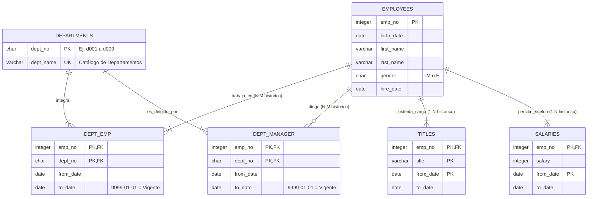

# 📘 Semana 1 — Taller Especializado: 25 Ejercicios Prácticos DDL y SQL sobre la Base de Datos Real `Employees`

> **Instituto Superior Tecnológico de Turismo y Patrimonio Yavirac**  
> **Carrera:** Tecnología Superior en Desarrollo de Software  
> **Asignatura:** Base de Datos Avanzada (`DS4AC1-215`) | **Paralelo:** D  
> **Docente:** Ing. Byron Moreno  
> **Periodo Académico:** 2026-II | **Modalidad:** Dual  
> **Caso de Estudio:** 🔍 Caso Real 1: Ingeniería Inversa de `Employees` (Modelado Temporal y Claves Compuestas)
> **Portal Interactivo (Estilo W3Schools):** [	utorial-sql-employees/index.html](../tutorial-sql-employees/index.html)  

---

## 🧭 1. Presentación y Contexto del Caso de Estudio

La base de datos **`employees`** es uno de los bancos de pruebas relacionales más reconocidos en la industria del software. Diseñada originalmente por Patrick Crews y Giuseppe Maxia (con datos sintéticos generados formalmente), contiene **6 tablas altamente normalizadas** con casi **4 millones de registros** en total (`salaries` por sí sola contiene `2,844,047` filas y `dept_emp` alberga `331,603` asignaciones departamentales).



### 🎯 Resultados de Aprendizaje que Desarrolla este Taller
- **Modela e implementa** esquemas relacionales complejos con claves primarias compuestas y tablas históricas (SCD Tipo 2).
- **Aplica** restricciones de integridad referencial, reglas `CHECK`, valores por defecto y sentencias `ALTER TABLE` sin afectar la coherencia de datos existentes.
- **Formula** consultas SQL de extracción, agregación y cruce de datos multi-tabla respetando la ventana de vigencia temporal (`to_date = '9999-01-01'`).

---

## 🗂️ 2. Índice Progresivo de los 25 Ejercicios

| # | Tipo | Nivel | Enunciado Sintético del Reto |
| :-: | :---: | :---: | :--- |
| **01** | DDL | Inicial | Creación de la tabla catálogo `departments` con clave primaria y restricción UNIQUE. |
| **02** | DDL | Inicial | Creación de la tabla maestra `employees` con restricciones CHECK de género y fechas. |
| **03** | DDL | Inicial | Creación de la tabla temporal `salaries` con clave primaria compuesta `(emp_no, from_date)`. |
| **04** | SQL | Inicial | Selección de los primeros 25 empleados contratados en el año 1990 ordenados cronológicamente. |
| **05** | SQL | Inicial | Filtrado del salario activo vigente de un colaborador utilizando la convención temporal `9999-01-01`. |
| **06** | SQL | Inicial | Proyección calculada de nombres completos, género formal y cálculo de edad y antigüedad con `AGE()`. |
| **07** | DDL | Básico | Creación de la tabla asociativa `dept_emp` para resolver la relación N:M con ventana de fechas. |
| **08** | DDL | Básico | Creación de la tabla histórica de cargos `titles` con clave primaria triple `(emp_no, title, from_date)`. |
| **09** | DDL | Básico | Modificación estructural con `ALTER TABLE` para imponer la regla `CHECK (to_date >= from_date)`. |
| **10** | DDL | Básico | Adición de columna booleana de estado operativo `is_active` en la tabla `departments`. |
| **11** | SQL | Intermedio | Consulta JOIN de 2 tablas para listar empleados con su cargo formal vigente. |
| **12** | SQL | Intermedio | Cruce N:M de 3 tablas para determinar a qué departamento pertenece cada empleado en la actualidad. |
| **13** | DDL | Intermedio | Creación de una nueva tabla catálogo `cat_contract_type` e integración foránea con `employees`. |
| **14** | DDL | Intermedio | Creación de la tabla satélite `employee_bonuses` con restricción de valores positivos e índices. |
| **15** | SQL | Intermedio | Cálculo de la masa salarial activa, sueldo promedio, mínimo y máximo por departamento (`GROUP BY`). |
| **16** | SQL | Intermedio | Filtrado de departamentos de alta dotación que superen los 20,000 colaboradores activos (`HAVING`). |
| **17** | SQL | Intermedio | Reporte integrado de nómina activa cruzando `employees`, `dept_emp`, `departments` y `salaries`. |
| **18** | SQL | Intermedio | Análisis de estabilidad: cálculo del número de ascensos y cambios de cargo por colaborador. |
| **19** | SQL | Intermedio-Avanzado | Detección de colaboradores cuyo salario actual supera el salario promedio de toda la compañía. |
| **20** | SQL | Intermedio-Avanzado | Identificación del cuadro de mando gerencial actual (`dept_manager`) y cálculo de sus años de gestión. |
| **21** | DDL | Intermedio-Avanzado | Creación de la tabla de auditoría `audit_salary_changes` para registrar trazabilidad de incrementos. |
| **22** | SQL | Intermedio-Avanzado | Comparativa de progresión económica: salario de contratación inicial vs. salario vigente actual. |
| **23** | DDL | Intermedio-Avanzado | Creación de la vista corporativa `vw_active_employees` encapsulando la lógica de vigencia temporal. |
| **24** | SQL | Intermedio-Avanzado | Auditoría salarial de equidad: distribución por género y remuneración media por departamento. |
| **25** | DDL/SQL | Avanzado Accesible | Script transaccional (`BEGIN...COMMIT`) para incorporar sedes físicas (`locations`) y asignación departamental. |

---

## 🧱 BLOQUE 1: Fundamentos DDL y Consultas Directas (Ejercicios 1 al 6)

### 📌 Ejercicio 01 (DDL — Inicial): Creación de la Tabla Catálogo `departments`
- **Contexto:** La empresa requiere registrar sus unidades operativas mediante un código mnemotécnico estandarizado de 4 caracteres (ej. `'d001'`, `'d009'`) asegurando que no existan nombres duplicados.
- **Concepto clave:** Uso de `CHAR(4)` para códigos de longitud fija y restricción `UNIQUE` a nivel de columna para evitar redundancias semánticas en catálogos.

```sql
-- Ejercicio 01: Creación de departments
DROP TABLE IF EXISTS departments CASCADE;

CREATE TABLE departments (
    dept_no   CHAR(4)      NOT NULL,
    dept_name VARCHAR(40)  NOT NULL,
    CONSTRAINT pk_departments PRIMARY KEY (dept_no),
    CONSTRAINT uq_departments_dept_name UNIQUE (dept_name)
);

-- Inserción de prueba en el catálogo
INSERT INTO departments (dept_no, dept_name) VALUES
    ('d001', 'Marketing'),
    ('d002', 'Finance'),
    ('d003', 'Human Resources'),
    ('d004', 'Production'),
    ('d005', 'Development'),
    ('d006', 'Quality Management'),
    ('d007', 'Sales'),
    ('d008', 'Research'),
    ('d009', 'Customer Service');
```
> [!NOTE]
> Al definir `dept_no` como `CHAR(4)`, el motor optimiza el almacenamiento en páginas de disco, ya que todas las claves tienen exactamente 4 bytes sin sobrecosto de cabecera de longitud variable.

---

### 📌 Ejercicio 02 (DDL — Inicial): Creación de la Tabla Maestra `employees`
- **Contexto:** Definir la entidad fuerte que identifica a los colaboradores de la corporación. Cada empleado posee un número único, fecha de nacimiento, nombres, apellidos, género biológico y fecha de ingreso a la compañía.
- **Concepto clave:** Restricción `CHECK` para validar dominios específicos (ej. géneros permitidos `'M'` y `'F'`) y garantizar que la fecha de ingreso sea posterior a la de nacimiento.

```sql
-- Ejercicio 02: Creación de employees
DROP TABLE IF EXISTS employees CASCADE;

CREATE TABLE employees (
    emp_no     INTEGER     NOT NULL,
    birth_date DATE        NOT NULL,
    first_name VARCHAR(14) NOT NULL,
    last_name  VARCHAR(16) NOT NULL,
    gender     CHAR(1)     NOT NULL,
    hire_date  DATE        NOT NULL,
    CONSTRAINT pk_employees PRIMARY KEY (emp_no),
    CONSTRAINT chk_employees_gender CHECK (gender IN ('M', 'F')),
    CONSTRAINT chk_employees_hire_after_birth CHECK (hire_date > birth_date)
);

-- Inserción de registro de verificación
INSERT INTO employees (emp_no, birth_date, first_name, last_name, gender, hire_date)
VALUES (10001, '1953-09-02', 'Georgi', 'Facello', 'M', '1986-06-26');
```

---

### 📌 Ejercicio 03 (DDL — Inicial): Creación de la Tabla Histórica `salaries` con Clave Compuesta
- **Contexto:** En la gestión corporativa, un empleado experimenta múltiples revisiones salariales en el tiempo. La base de datos no debe sobrescribir el sueldo anterior, sino registrar cada intervalo temporal.
- **Concepto clave:** Clave primaria compuesta `(emp_no, from_date)` que garantiza que un mismo empleado no pueda tener dos sueldos que comiencen exactamente el mismo día, modelando una dimensión de cambio lento (SCD Tipo 2).

```sql
-- Ejercicio 03: Creación de salaries
DROP TABLE IF EXISTS salaries CASCADE;

CREATE TABLE salaries (
    emp_no    INTEGER NOT NULL,
    salary    INTEGER NOT NULL,
    from_date DATE    NOT NULL,
    to_date   DATE    NOT NULL,
    CONSTRAINT pk_salaries PRIMARY KEY (emp_no, from_date),
    CONSTRAINT fk_salaries_employees FOREIGN KEY (emp_no)
        REFERENCES employees (emp_no) ON DELETE CASCADE,
    CONSTRAINT chk_salaries_positive CHECK (salary > 0)
);

-- Inserciones históricas de prueba para un empleado
INSERT INTO salaries (emp_no, salary, from_date, to_date) VALUES
    (10001, 60117, '1986-06-26', '1987-06-26'),
    (10001, 62102, '1987-06-26', '1988-06-25'),
    (10001, 88958, '2002-06-22', '9999-01-01'); -- Sueldo vigente actual
```

---

### 📌 Ejercicio 04 (SQL — Inicial): Selección de Colaboradores Contratados en 1990
- **Contexto:** La Dirección de Gestión de Talento Humano requiere condecorar por trayectoria a los primeros 25 colaboradores incorporados durante el año fiscal 1990.
- **Concepto clave:** Filtrado por rangos de fechas (`BETWEEN` o comparación con fechas literales) y ordenamiento determinístico con `ORDER BY`.

```sql
-- Ejercicio 04: Primeros 25 contratados en 1990
SELECT 
    emp_no,
    first_name,
    last_name,
    gender,
    hire_date
FROM employees
WHERE hire_date BETWEEN '1990-01-01' AND '1990-12-31'
ORDER BY hire_date ASC, emp_no ASC
LIMIT 25;
```

---

### 📌 Ejercicio 05 (SQL — Inicial): Filtrado de Salario Vigente según Convención Temporal
- **Contexto:** Consultar el sueldo vigente de un empleado específico sin traer filas históricas de años anteriores.
- **Concepto clave:** La convención en bases de datos con modelado temporal asigna `'9999-01-01'` en `to_date` para representar que el registro sigue activo indefinidamente (registro abierto).

```sql
-- Ejercicio 05: Salario vigente del empleado 10001
SELECT 
    emp_no,
    salary AS salario_actual_usd,
    from_date AS fecha_inicio_vigencia,
    to_date   AS fecha_fin_convencional
FROM salaries
WHERE emp_no = 10001
  AND to_date = '9999-01-01';
```

---

### 📌 Ejercicio 06 (SQL — Inicial): Proyección Calculada con `AGE()` y Concatenación
- **Contexto:** Generar una ficha básica de empleados donde se visualice su nombre completo formal, su sexo en formato descriptivo y sus años exactos de servicio en la organización.
- **Concepto clave:** Uso de la función `AGE(CURRENT_DATE, hire_date)`, `EXTRACT(YEAR FROM ...)` y sentencias condicionales simples `CASE`.

```sql
-- Ejercicio 06: Ficha con cálculos de antigüedad
SELECT 
    emp_no,
    first_name || ' ' || last_name AS colaborador,
    CASE gender
        WHEN 'M' THEN 'Masculino'
        WHEN 'F' THEN 'Femenino'
        ELSE 'No especificado'
    END AS genero_descripcion,
    hire_date,
    EXTRACT(YEAR FROM AGE(CURRENT_DATE, hire_date)) AS anios_antiguedad
FROM employees
ORDER BY emp_no ASC
LIMIT 20;
```

---

## 🔗 BLOQUE 2: Relaciones N:M, Claves Foráneas y Modificaciones DDL (Ejercicios 7 al 12)

### 📌 Ejercicio 07 (DDL — Básico): Creación de la Tabla Asociativa N:M `dept_emp`
- **Contexto:** Un empleado puede ser transferido de un departamento a otro durante sus años de servicio, y un departamento acoge a miles de empleados. Se requiere una tabla intermedia que almacene las fechas de permanencia.
- **Concepto clave:** Tabla asociativa o puente con clave primaria compuesta por las dos claves foráneas más la fecha de inicio: `PRIMARY KEY (emp_no, dept_no)`.

```sql
-- Ejercicio 07: Creación de dept_emp
DROP TABLE IF EXISTS dept_emp CASCADE;

CREATE TABLE dept_emp (
    emp_no    INTEGER NOT NULL,
    dept_no   CHAR(4) NOT NULL,
    from_date DATE    NOT NULL,
    to_date   DATE    NOT NULL,
    CONSTRAINT pk_dept_emp PRIMARY KEY (emp_no, dept_no),
    CONSTRAINT fk_dept_emp_employees FOREIGN KEY (emp_no)
        REFERENCES employees (emp_no) ON DELETE CASCADE,
    CONSTRAINT fk_dept_emp_departments FOREIGN KEY (dept_no)
        REFERENCES departments (dept_no) ON DELETE RESTRICT
);

-- Inserción de prueba: Georgi Facello asignado a Development ('d005')
INSERT INTO dept_emp (emp_no, dept_no, from_date, to_date)
VALUES (10001, 'd005', '1986-06-26', '9999-01-01');
```

---

### 📌 Ejercicio 08 (DDL — Básico): Creación de la Tabla Histórica de Cargos `titles`
- **Contexto:** Los empleados ascienden de rango a lo largo de su carrera (ej. de *Senior Engineer* a *Staff Engineer*). Un empleado podría volver a ostentar un título en fechas diferentes.
- **Concepto clave:** Clave primaria triple: `(emp_no, title, from_date)`.

```sql
-- Ejercicio 08: Creación de titles
DROP TABLE IF EXISTS titles CASCADE;

CREATE TABLE titles (
    emp_no    INTEGER     NOT NULL,
    title     VARCHAR(50) NOT NULL,
    from_date DATE        NOT NULL,
    to_date   DATE        NULL,
    CONSTRAINT pk_titles PRIMARY KEY (emp_no, title, from_date),
    CONSTRAINT fk_titles_employees FOREIGN KEY (emp_no)
        REFERENCES employees (emp_no) ON DELETE CASCADE
);

-- Inserción de prueba
INSERT INTO titles (emp_no, title, from_date, to_date)
VALUES (10001, 'Senior Engineer', '1986-06-26', '9999-01-01');
```

---

### 📌 Ejercicio 09 (DDL — Básico): Evolución de Esquema con `ALTER TABLE` y Restricción CHECK
- **Contexto:** Se ha detectado en auditoría que ninguna fecha de finalización (`to_date`) puede ser cronológicamente anterior a la fecha de inicio (`from_date`).
- **Concepto clave:** Uso de `ALTER TABLE ... ADD CONSTRAINT ... CHECK (...)` sobre esquemas relacionales ya creados.

```sql
-- Ejercicio 09: Imposición de regla de coherencia temporal
ALTER TABLE salaries
    ADD CONSTRAINT chk_salaries_dates_order
    CHECK (to_date >= from_date);

ALTER TABLE dept_emp
    ADD CONSTRAINT chk_dept_emp_dates_order
    CHECK (to_date >= from_date);
```

---

### 📌 Ejercicio 10 (DDL — Básico): Adición de Columna Operativa `is_active` en `departments`
- **Contexto:** La empresa reestructura departamentos y desea descontinuar ciertos departamentos antiguos sin borrar su historial pasado (borrado lógico / soft state).
- **Concepto clave:** Agregar una columna con valor por defecto mediante `ALTER TABLE ... ADD COLUMN ... DEFAULT ... NOT NULL`.

```sql
-- Ejercicio 10: Adición de columna is_active
ALTER TABLE departments
    ADD COLUMN is_active BOOLEAN NOT NULL DEFAULT TRUE;

-- Verificación de la estructura en PostgreSQL
COMMENT ON COLUMN departments.is_active IS 'Indica si el departamento recibe nuevas asignaciones';
```

---

### 📌 Ejercicio 11 (SQL — Intermedio): JOIN de 2 Tablas para Consultar el Cargo Vigente
- **Contexto:** Recursos Humanos necesita un reporte con el identificador del empleado, su nombre, apellido y su cargo vigente actual.
- **Concepto clave:** `INNER JOIN` filtrado por la condición temporal de vigencia `t.to_date = '9999-01-01'`.

```sql
-- Ejercicio 11: Empleados y su cargo vigente
SELECT 
    e.emp_no,
    e.first_name,
    e.last_name,
    t.title AS cargo_actual,
    t.from_date AS desde
FROM employees e
JOIN titles t ON e.emp_no = t.emp_no
WHERE t.to_date = '9999-01-01'
ORDER BY e.emp_no ASC
LIMIT 30;
```

---

### 📌 Ejercicio 12 (SQL — Intermedio): Cruce N:M de Empleado con su Departamento Actual
- **Contexto:** Consultar a qué departamento se encuentra adscrito cada colaborador hoy en día.
- **Concepto clave:** Cruce de 3 tablas relacionales (`employees`, tabla intermedia `dept_emp` y tabla catálogo `departments`) con condición de vigencia en la tabla puente.

```sql
-- Ejercicio 12: Departamento vigente de los colaboradores
SELECT 
    e.emp_no,
    e.first_name || ' ' || e.last_name AS colaborador,
    d.dept_no,
    d.dept_name AS departamento_actual,
    de.from_date AS fecha_ingreso_depto
FROM employees e
JOIN dept_emp de ON e.emp_no = de.emp_no
JOIN departments d ON de.dept_no = d.dept_no
WHERE de.to_date = '9999-01-01'
ORDER BY d.dept_name ASC, e.last_name ASC
LIMIT 40;
```

---

## 📊 BLOQUE 3: Agregaciones, Métricas y Extensión del Esquema (Ejercicios 13 al 18)

### 📌 Ejercicio 13 (DDL — Intermedio): Creación de Catálogo Paramétrico `cat_contract_type`
- **Contexto:** Estandarizar la relación jurídica laboral incorporando una tabla catálogo normalizada de modalidades contractuales (Indefinido, Tiempo Parcial, Pasantía Dual).
- **Concepto clave:** Normalización con claves subrogadas pequeñas (`SMALLINT`), códigos mnemotécnicos únicos y vinculación con `ALTER TABLE`.

```sql
-- Ejercicio 13: Catálogo de tipos de contrato
DROP TABLE IF EXISTS cat_contract_type CASCADE;

CREATE TABLE cat_contract_type (
    contract_type_id SMALLINT     GENERATED ALWAYS AS IDENTITY,
    code             VARCHAR(15)  NOT NULL,
    name             VARCHAR(50)  NOT NULL,
    active           BOOLEAN      NOT NULL DEFAULT TRUE,
    CONSTRAINT pk_cat_contract_type PRIMARY KEY (contract_type_id),
    CONSTRAINT uq_cat_contract_type_code UNIQUE (code)
);

INSERT INTO cat_contract_type (code, name) VALUES
    ('INDEF', 'Contrato a Plazo Indefinido'),
    ('PARCIAL', 'Jornada Parcial Permanente'),
    ('DUAL', 'Convenio de Formación Dual Yavirac');

-- Alterar employees para asociar el tipo de contrato
ALTER TABLE employees
    ADD COLUMN contract_type_id SMALLINT NOT NULL DEFAULT 1,
    ADD CONSTRAINT fk_employees_contract_type 
        FOREIGN KEY (contract_type_id) REFERENCES cat_contract_type (contract_type_id);
```

---

### 📌 Ejercicio 14 (DDL — Intermedio): Tabla Satélite de Bonificaciones `employee_bonuses`
- **Contexto:** Crear una tabla complementaria para registrar bonos extraordinarios entregados por desempeño o proyectos.
- **Concepto clave:** Clave foránea con borrado en cascada e índices B-Tree complementarios sobre columnas de búsqueda frecuente.

```sql
-- Ejercicio 14: Tabla satélite de bonos
DROP TABLE IF EXISTS employee_bonuses CASCADE;

CREATE TABLE employee_bonuses (
    bonus_id    INTEGER        GENERATED ALWAYS AS IDENTITY,
    emp_no      INTEGER        NOT NULL,
    bonus_date  DATE           NOT NULL DEFAULT CURRENT_DATE,
    amount      NUMERIC(10, 2) NOT NULL,
    reason      VARCHAR(100)   NOT NULL,
    CONSTRAINT pk_employee_bonuses PRIMARY KEY (bonus_id),
    CONSTRAINT fk_bonuses_employees FOREIGN KEY (emp_no)
        REFERENCES employees (emp_no) ON DELETE CASCADE,
    CONSTRAINT chk_bonus_amount_positive CHECK (amount > 0)
);

-- Índice para optimizar consultas de bonos por empleado
CREATE INDEX idx_employee_bonuses_emp_no ON employee_bonuses (emp_no);
```

---

### 📌 Ejercicio 15 (SQL — Intermedio): Masa Salarial y Promedios por Departamento
- **Contexto:** La Dirección Financiera necesita un resumen de la nómina activa que muestre el total gastado en salarios, el salario promedio, el mínimo y el máximo de cada departamento.
- **Concepto clave:** Agrupamiento multi-tabla con `GROUP BY`, funciones agregadas (`SUM`, `AVG`, `MIN`, `MAX`) y redondeo con `ROUND(..., 2)`.

```sql
-- Ejercicio 15: Estadísticas salariales por departamento
SELECT 
    d.dept_no,
    d.dept_name,
    COUNT(s.emp_no) AS total_empleados_activos,
    SUM(s.salary)   AS masa_salarial_usd,
    ROUND(AVG(s.salary), 2) AS salario_promedio_usd,
    MIN(s.salary)   AS salario_minimo_usd,
    MAX(s.salary)   AS salario_maximo_usd
FROM departments d
JOIN dept_emp de ON d.dept_no = de.dept_no AND de.to_date = '9999-01-01'
JOIN salaries s  ON de.emp_no = s.emp_no   AND s.to_date  = '9999-01-01'
GROUP BY d.dept_no, d.dept_name
ORDER BY masa_salarial_usd DESC;
```

---

### 📌 Ejercicio 16 (SQL — Intermedio): Filtrado Agregado de Departamentos con `HAVING`
- **Contexto:** Identificar únicamente aquellos departamentos masivos que concentren a más de 25,000 empleados activos y cuyo promedio salarial supere los $60,000 USD.
- **Concepto clave:** Diferencia fundamental entre `WHERE` (filtra filas antes de agrupar) y `HAVING` (filtra los grupos generados por el `GROUP BY`).

```sql
-- Ejercicio 16: Departamentos masivos con HAVING
SELECT 
    d.dept_name,
    COUNT(de.emp_no) AS cantidad_colaboradores,
    ROUND(AVG(s.salary), 2) AS sueldo_promedio
FROM departments d
JOIN dept_emp de ON d.dept_no = de.dept_no AND de.to_date = '9999-01-01'
JOIN salaries s  ON de.emp_no = s.emp_no   AND s.to_date  = '9999-01-01'
GROUP BY d.dept_name
HAVING COUNT(de.emp_no) > 25000 
   AND AVG(s.salary) > 60000
ORDER BY cantidad_colaboradores DESC;
```

---

### 📌 Ejercicio 17 (SQL — Intermedio): Reporte Completo de Nómina Activa (4 Tablas)
- **Contexto:** Generar una planilla consolidada que muestre: Cédula/ID, Nombre Completo, Departamento, Cargo Vigente y Salario Vigente.
- **Concepto clave:** Cadena de `JOIN` relacionales sincronizados con filtros temporales simultáneos.

```sql
-- Ejercicio 17: Planilla de nómina consolidada
SELECT 
    e.emp_no,
    e.first_name || ' ' || e.last_name AS colaborador,
    d.dept_name AS departamento,
    t.title AS cargo,
    s.salary AS remuneracion_usd
FROM employees e
JOIN dept_emp de ON e.emp_no = de.emp_no AND de.to_date = '9999-01-01'
JOIN departments d ON de.dept_no = d.dept_no
JOIN titles t    ON e.emp_no = t.emp_no  AND t.to_date  = '9999-01-01'
JOIN salaries s  ON e.emp_no = s.emp_no  AND s.to_date  = '9999-01-01'
ORDER BY e.emp_no ASC
LIMIT 50;
```

---

### 📌 Ejercicio 18 (SQL — Intermedio): Auditoría de Movilidad Laboral (Número de Cargos)
- **Contexto:** Conocer la estabilidad laboral y evolución de los colaboradores contando cuántos puestos diferentes han ocupado en la empresa.
- **Concepto clave:** Agrupación sobre la tabla histórica `titles` con `COUNT(*)`.

```sql
-- Ejercicio 18: Número de cargos ocupados en el tiempo
SELECT 
    e.emp_no,
    e.first_name || ' ' || e.last_name AS colaborador,
    e.hire_date,
    COUNT(t.title) AS cantidad_cargos_ostentados,
    MIN(t.from_date) AS primer_cargo_desde,
    MAX(t.from_date) AS ultimo_cargo_desde
FROM employees e
JOIN titles t ON e.emp_no = t.emp_no
GROUP BY e.emp_no, e.first_name, e.last_name, e.hire_date
HAVING COUNT(t.title) > 1
ORDER BY cantidad_cargos_ostentados DESC, e.emp_no ASC
LIMIT 30;
```

---

## 🚀 BLOQUE 4: Consultas Avanzadas Accesibles y Modelado Temporal (Ejercicios 19 al 25)

### 📌 Ejercicio 19 (SQL — Avanzado): Empleados que Superan la Media Salarial Corporativa
- **Contexto:** Analítica de compensaciones: listar a los empleados cuyo sueldo actual esté por encima de la media salarial general de la empresa.
- **Concepto clave:** Subconsulta escalar dentro de la cláusula `WHERE`.

```sql
-- Ejercicio 19: Sueldos sobre la media corporativa
SELECT 
    e.emp_no,
    e.first_name || ' ' || e.last_name AS colaborador,
    s.salary AS salario_usd
FROM employees e
JOIN salaries s ON e.emp_no = s.emp_no AND s.to_date = '9999-01-01'
WHERE s.salary > (
    -- Subconsulta escalar que calcula la media corporativa vigente
    SELECT AVG(salary) 
    FROM salaries 
    WHERE to_date = '9999-01-01'
)
ORDER BY s.salary DESC
LIMIT 50;
```

---

### 📌 Ejercicio 20 (SQL — Avanzado): Identificación de Gerentes Activos (`dept_manager`)
- **Contexto:** Identificar quién es el director o gerente en funciones de cada uno de los 9 departamentos corporativos y cuántos años lleva en el puesto de liderazgo.
- **Concepto clave:** Cruce con la tabla relacional `dept_manager` aplicando la convención `to_date = '9999-01-01'`.

```sql
-- Ejercicio 20: Gerentes vigentes por departamento
SELECT 
    d.dept_no,
    d.dept_name,
    dm.emp_no AS id_gerente,
    e.first_name || ' ' || e.last_name AS nombre_gerente,
    dm.from_date AS lidera_desde,
    EXTRACT(YEAR FROM AGE(CURRENT_DATE, dm.from_date)) AS anios_al_mando
FROM departments d
JOIN dept_manager dm ON d.dept_no = dm.dept_no AND dm.to_date = '9999-01-01'
JOIN employees e     ON dm.emp_no = e.emp_no
ORDER BY d.dept_no ASC;
```

---

### 📌 Ejercicio 21 (DDL — Avanzado): Tabla de Auditoría Salarial `audit_salary_changes`
- **Contexto:** Diseñar el almacenamiento para un futuro trigger de seguridad que registre quién, cuándo y por qué monto se modificaron sueldos.
- **Concepto clave:** Modelado de bitácora transaccional con clave foránea referencial y campos de auditoría (`timestamp`, `operation_user`).

```sql
-- Ejercicio 21: Creación de la tabla de auditoría salarial
DROP TABLE IF EXISTS audit_salary_changes CASCADE;

CREATE TABLE audit_salary_changes (
    audit_id        BIGINT       GENERATED ALWAYS AS IDENTITY,
    emp_no          INTEGER      NOT NULL,
    old_salary      INTEGER      NULL,
    new_salary      INTEGER      NOT NULL,
    change_date     TIMESTAMP    NOT NULL DEFAULT CURRENT_TIMESTAMP,
    operation_user  VARCHAR(50)  NOT NULL DEFAULT CURRENT_USER,
    reason          VARCHAR(150) NULL,
    CONSTRAINT pk_audit_salary_changes PRIMARY KEY (audit_id),
    CONSTRAINT fk_audit_salary_employees FOREIGN KEY (emp_no)
        REFERENCES employees (emp_no) ON DELETE CASCADE
);

-- Verificación de inserción simulada
INSERT INTO audit_salary_changes (emp_no, old_salary, new_salary, reason)
VALUES (10001, 85000, 88958, 'Ajuste inflacionario anual aprobado por Directorio');
```

---

### 📌 Ejercicio 22 (SQL — Avanzado): Comparativa de Primer Salario vs. Salario Vigente
- **Contexto:** Evaluar el crecimiento salarial histórico de los colaboradores comparando su sueldo de entrada contra su sueldo más reciente.
- **Concepto clave:** Uso de expresiones de tabla comunes (`WITH`) o joins entre el histórico inicial y el registro vigente.

```sql
-- Ejercicio 22: Crecimiento salarial entrada vs actual
WITH primer_salario AS (
    -- Salario correspondiente a la fecha mínima de contratación
    SELECT DISTINCT ON (emp_no)
        emp_no,
        salary AS salario_inicial,
        from_date AS fecha_ingreso
    FROM salaries
    ORDER BY emp_no, from_date ASC
),
salario_actual AS (
    -- Salario vigente actual
    SELECT 
        emp_no,
        salary AS salario_vigente
    FROM salaries
    WHERE to_date = '9999-01-01'
)
SELECT 
    e.emp_no,
    e.first_name || ' ' || e.last_name AS colaborador,
    ps.salario_inicial,
    sa.salario_vigente,
    (sa.salario_vigente - ps.salario_inicial) AS incremento_total_usd,
    ROUND(((sa.salario_vigente - ps.salario_inicial)::NUMERIC / ps.salario_inicial) * 100, 2) AS porcentaje_crecimiento
FROM employees e
JOIN primer_salario ps ON e.emp_no = ps.emp_no
JOIN salario_actual sa ON e.emp_no = sa.emp_no
ORDER BY incremento_total_usd DESC
LIMIT 30;
```

---

### 📌 Ejercicio 23 (DDL — Avanzado): Creación de Vista Corporativa `vw_active_employees`
- **Contexto:** Evitar que los desarrolladores juniors y analistas de BI tengan que recordar siempre escribir `to_date = '9999-01-01'` en cada consulta diaria.
- **Concepto clave:** Objeto DDL de tipo `VIEW` que encapsula la lógica de negocio temporal y normalizada.

```sql
-- Ejercicio 23: Creación de vista segura de personal activo
CREATE OR REPLACE VIEW vw_active_employees AS
SELECT 
    e.emp_no,
    e.first_name,
    e.last_name,
    e.gender,
    e.hire_date,
    d.dept_no,
    d.dept_name,
    t.title,
    s.salary,
    de.from_date AS departamento_desde
FROM employees e
JOIN dept_emp de ON e.emp_no = de.emp_no AND de.to_date = '9999-01-01'
JOIN departments d ON de.dept_no = d.dept_no
JOIN titles t    ON e.emp_no = t.emp_no  AND t.to_date  = '9999-01-01'
JOIN salaries s  ON e.emp_no = s.emp_no  AND s.to_date  = '9999-01-01';

-- Prueba de consumo de la vista simplificada
SELECT * FROM vw_active_employees 
WHERE dept_name = 'Development'
ORDER BY salary DESC
LIMIT 15;
```

---

### 📌 Ejercicio 24 (SQL — Avanzado): Análisis de Equidad de Género y Remuneraciones
- **Contexto:** Auditoría de responsabilidad social corporativa: determinar el salario promedio y la proporción de colaboradores por género dentro de cada unidad operativa.
- **Concepto clave:** Agrupación bidimensional (`dept_name`, `gender`) con agregaciones condicionales `COUNT(*) FILTER (...)`.

```sql
-- Ejercicio 24: Brecha y distribución de género por departamento
SELECT 
    dept_name,
    COUNT(*) AS dotacion_total,
    COUNT(*) FILTER (WHERE gender = 'F') AS mujeres,
    COUNT(*) FILTER (WHERE gender = 'M') AS hombres,
    ROUND(AVG(salary) FILTER (WHERE gender = 'F'), 2) AS sueldo_prom_mujeres_usd,
    ROUND(AVG(salary) FILTER (WHERE gender = 'M'), 2) AS sueldo_prom_hombres_usd,
    ROUND(AVG(salary), 2) AS sueldo_prom_global_usd
FROM vw_active_employees
GROUP BY dept_name
ORDER BY dept_name ASC;
```

---

### 📌 Ejercicio 25 (DDL/SQL — Avanzado Accesible): Script Transaccional de Extensión con Sedes (`locations`)
- **Contexto:** La compañía se expande y requiere abrir sedes operativas en distintas ciudades (Quito, Guayaquil, Cuenca) asignando cada departamento a una sede corporativa.
- **Concepto clave:** Transacción ACID completa (`BEGIN ... COMMIT`) que crea la tabla catálogo `locations`, altera `departments`, inserta datos y comprueba la integridad relacional de extremo a extremo.

```sql
-- Ejercicio 25: Transacción DDL y DML de extensión corporativa
BEGIN;

-- 1. Crear tabla catálogo de sedes
CREATE TABLE IF NOT EXISTS locations (
    location_id   SERIAL       PRIMARY KEY,
    city          VARCHAR(50)  NOT NULL,
    country       VARCHAR(50)  NOT NULL DEFAULT 'Ecuador',
    address       VARCHAR(120) NOT NULL,
    active        BOOLEAN      NOT NULL DEFAULT TRUE
);

-- 2. Insertar sedes principales
INSERT INTO locations (city, address) VALUES
    ('Quito', 'Centro Histórico - Campus Yavirac'),
    ('Guayaquil', 'Av. 9 de Octubre y Malecón'),
    ('Cuenca', 'Parque Calderón');

-- 3. Modificar departments para vincular la sede
ALTER TABLE departments
    ADD COLUMN IF NOT EXISTS location_id INTEGER NULL,
    ADD CONSTRAINT fk_departments_locations
        FOREIGN KEY (location_id) REFERENCES locations (location_id)
        ON DELETE SET NULL;

-- 4. Asignar sedes a los departamentos existentes
UPDATE departments SET location_id = 1 WHERE dept_no IN ('d001', 'd003', 'd005'); -- Quito
UPDATE departments SET location_id = 2 WHERE dept_no IN ('d002', 'd004', 'd007'); -- Guayaquil
UPDATE departments SET location_id = 3 WHERE dept_no IN ('d006', 'd008', 'd009'); -- Cuenca

-- 5. Consulta de verificación dentro de la misma transacción
SELECT 
    d.dept_no,
    d.dept_name,
    l.city AS sede_ciudad,
    l.address AS direccion_campus
FROM departments d
JOIN locations l ON d.location_id = l.location_id
ORDER BY d.dept_no;

-- Confirmar todas las operaciones de forma atómica
COMMIT;
```

---

## 🏆 3. Resumen Técnico y Buenas Prácticas del Esquema `Employees`

1. **Gestión de la Temporalidad sin Destruir Información (SCD Tipo 2):**
   - Las tablas `salaries`, `titles`, `dept_emp` y `dept_manager` implementan vigencia con la convención de fecha abierta `to_date = '9999-01-01'`.
   - Cuando se añade un nuevo estado o aumento salarial, se debe actualizar la fila anterior cerrando su `to_date` con la fecha del cambio e insertar una nueva fila con `to_date = '9999-01-01'`.
2. **Claves Primarias Compuestas Estratégicas:**
   - La clave `(emp_no, from_date)` en `salaries` o `(emp_no, dept_no)` en `dept_emp` impiden inconsistencias como sueldos duplicados en la misma fecha o doble adscripción departamental abierta.
3. **Optimización con Vistas y Restricciones:**
   - Encapsular las reglas de vigencia en vistas (como `vw_active_employees`) previene errores comunes en consultas analíticas y simplifica el consumo de datos para aplicaciones cliente.
