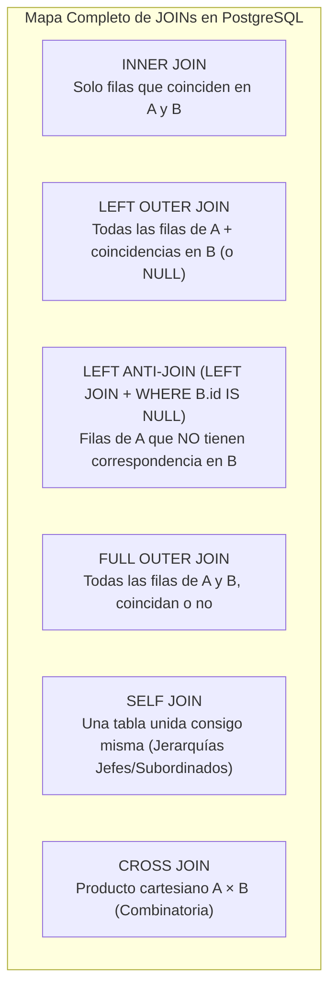
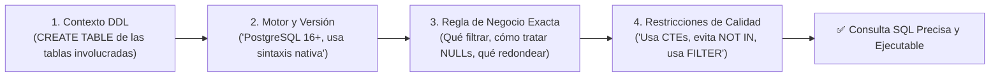

# 🚀 Semana 2: SQL de Consulta Avanzado, Funciones Escalares, Ingreso Masivo e IA en VS Code

> **Instituto Superior Tecnológico de Turismo y Patrimonio Yavirac**  
> **Carrera:** Tecnología Superior en Desarrollo de Software  
> **Asignatura:** Base de Datos Avanzada (`DS4AC1-215`)  
> **Unidad 1:** Sentencias SQL complejas, vistas e índices  

---

## 📋 1. Ficha Técnica de la Sesión

| Parámetro | Detalle Oficial según PEA |
| :--- | :--- |
| **Institución** | Instituto Superior Tecnológico de Turismo y Patrimonio Yavirac |
| **Carrera / Nivel** | Desarrollo de Software — Segundo Semestre (Modalidad Dual) |
| **Periodo Académico** | 2026 - II |
| **Asignatura / Código** | Base de Datos Avanzada (`DS4AC1-215`) |
| **Unidad Curricular** | Unidad 1: Sentencias SQL complejas, vistas e índices |
| **Semana** | Semana 2 de 8 |
| **Carga Horaria Semanal** | **ACD:** 2h \| **APECD:** 3h \| **APEA:** 1h \| **AA:** 2h \| **Total:** 8 horas |
| **Prerrequisitos** | Semana 1 (Modelado Lógico, DDL, Tablas Catálogo y Polimórficas) |
| **Entorno Tecnológico** | PostgreSQL 16+, pgAdmin 4, Visual Studio Code + Extensiones SQLTools / PostgreSQL + Asistente IA (GitHub Copilot / Continue) |

---

## 🎯 2. Objetivos, Resultados de Aprendizaje y Competencias

### Objetivo General de la Sesión
Construir consultas analíticas y transaccionales de alta complejidad en **PostgreSQL** combinando múltiples tablas (`JOIN`), funciones escalares nativas, agregaciones avanzadas (`GROUP BY`, `HAVING`, `FILTER`), subconsultas correlacionadas y expresiones de tabla comunes (`CTE / WITH`), integrando técnicas de **ingreso masivo de datos (`generate_series`, `COPY`)** y **asistentes de Inteligencia Artificial en Visual Studio Code** bajo criterios de auditoría técnica.

### Alineación con el Programa de Estudio de la Asignatura (PEA)

| Componente Curricular | Descripción Oficial PEA |
| :--- | :--- |
| **Resultados de Aprendizaje (RdA 2 y RdA 4)** | • **RdA 2:** Utiliza herramientas y tecnologías de programación para llevar a cabo tareas específicas en el campo de desarrollo de software.<br>• **RdA 4:** Realiza procesos de análisis y verificación de consistencia de datos extraídos de diversas fuentes, que permitan generar reportes relevantes para una organización. |
| **Competencias Específicas** | • Implementar sentencias SQL avanzadas para extracción y transformación de datos.<br>• Gestionar volúmenes masivos de información y auditar consultas generadas mediante herramientas de IA. |
| **Contenidos de la Semana** | • Implementar SQL avanzado (Consultas multitabla, funciones escalares y de agregación, subconsultas, CTEs, carga masiva y generación asistida por IA). |
| **Actividades ACD (2h)** | Comprender los contenidos: SQL de consulta avanzado (cruce tablas, `JOIN`, alias, `DISTINCT`, funciones de agregación, `GROUP BY`, `HAVING`, cálculos, subconsultas). Ejecutar las instrucciones, utilizando la extensión de IA en el editor de código. |
| **Actividades APECD (3h)** | Revisar SQL básico (operadores relacionales, lógicos). El estudiante investiga funciones escalares (numéricos, texto, fecha). Aplicar consultas completas. |
| **Actividades APEA (1h)** | Ingreso masivo de datos a BD (`COPY`, `\copy`, `INSERT` multi-fila y síntesis con `generate_series`). |
| **Actividades AA (2h)** | Instalar extensión en el editor de código (Visual Studio Code) para uso de funciones de IA, para generar consultas SQL (Postgres) a partir de lenguaje natural. |
| **Evidencia de Aprendizaje** | Script SQL de consultas avanzadas verificadas, dataset masivo cargado en PostgreSQL e informe práctico de generación y validación de consultas SQL con IA en VS Code. |
| **Habilidades Blandas** | Pensamiento crítico frente a salidas de IA, resolución de problemas complejos, rigor analítico y aprendizaje autónomo. |

---

## ⏱️ 3. Agenda Detallada de la Semana (8 Horas)

| Bloque | Componente | Tiempo | Actividad Pedagógica |
| :--- | :---: | :---: | :--- |
| **Bloque 1** | **ACD** | 40 min | **Orden Lógico de Ejecución SQL y Cruce de Tablas (`JOIN`):** Álgebra relacional aplicada a `INNER`, `LEFT`, `RIGHT`, `FULL OUTER`, `CROSS`, `SELF JOIN` y `LATERAL`. Uso de alias y `DISTINCT` / `DISTINCT ON`. |
| **Bloque 2** | **ACD** | 40 min | **Agregaciones, Cálculos y Subconsultas:** Funciones `COUNT`, `SUM`, `AVG`, `MIN`, `MAX`, cláusula `FILTER (WHERE ...)`, `GROUP BY`, `HAVING`, subconsultas escalares, correlacionadas (`EXISTS` vs `IN`) y `CTEs (WITH)`. |
| **Bloque 3** | **ACD** | 40 min | **Demostración en Vivo con IA en VS Code:** Ejecución de consultas complejas asistidas por IA en el editor de código y detección de errores comunes generados por LLMs. |
| **Bloque 4** | **APECD** | 45 min | **Nivelación de SQL Básico e Investigación de Funciones Escalares:** Operadores lógicos/relacionales (`BETWEEN`, `ILIKE`, `IS DISTINCT FROM`) e investigación práctica de funciones numéricas, de texto y de fecha/hora en PostgreSQL. |
| **Bloque 5** | **APECD** | 135 min | **Taller Práctico de Consultas Completas:** Resolución de 8 requerimientos de inteligencia de negocios y reportería sobre un esquema empresarial. |
| **Bloque 6** | **APEA** | 60 min | **Práctica Autónoma de Ingreso Masivo de Datos:** Carga de decenas de miles de registros con `generate_series()`, `INSERT` multi-tupla y comandos `COPY` / `\copy` desde CSV. |
| **Bloque 7** | **AA** | 120 min | **Trabajo Autónomo — Entorno VS Code + IA para PostgreSQL:** Instalación de extensiones, ingeniería de prompts con contexto DDL (`Prompt Engineering for SQL`) y bitácora de validación. |

---

## 🧠 4. Desarrollo Teórico-Conceptual Profundo

### 4.1. El Orden Léxico vs. el Orden Lógico de Ejecución de una Consulta SQL

Uno de los errores más frecuentes al escribir consultas SQL complejas es creer que el motor ejecuta las cláusulas en el mismo orden en que las escribimos (`SELECT` primero). En realidad, el optimizador de **PostgreSQL** evalúa la consulta siguiendo un **pipeline lógico estricto**:

```mermaid
flowchart LR
    A["1. FROM / JOIN<br/>(Producto cartesiano y filtro ON)"] --> B["2. WHERE<br/>(Filtra filas individuales)"]
    B --> C["3. GROUP BY<br/>(Agrupa filas en cubos)"]
    C --> D["4. Funciones de Agregación<br/>(SUM, COUNT, AVG...)"]
    D --> E["5. HAVING<br/>(Filtra grupos ya calculados)"]
    E --> F["6. SELECT<br/>(Proyecta columnas y crea Alias)"]
    F --> G["7. DISTINCT<br/>(Elimina duplicados)"]
    G --> H["8. ORDER BY<br/>(Ordena el resultado)"]
    H --> I["9. LIMIT / OFFSET<br/>(Pagina la salida)"]
```



> [!IMPORTANT]
> **Consecuencias prácticas del orden de ejecución en PostgreSQL:**
> 1. **No puedes usar un alias definido en `SELECT` dentro del `WHERE` ni del `HAVING`**, porque cuando se evalúan `WHERE` (paso 2) y `HAVING` (paso 5), la cláusula `SELECT` (paso 6) aún no ha sido ejecutada. *(Sí puedes usarlo en `ORDER BY`, que es el paso 8).*
> 2. **No puedes poner `SUM()` o `COUNT()` dentro del `WHERE`**, porque `WHERE` filtra filas antes de agrupar; para filtrar por el resultado de una agregación debes usar obligatoriamente `HAVING`.

---

### 4.2. Revisión de Operadores Relacionales, Lógicos y Especiales en PostgreSQL

Antes de cruzar múltiples tablas, es indispensable dominar el filtrado de precisión:

| Categoría | Operador / Expresión | Comportamiento Técnico en PostgreSQL | Ejemplo de Uso |
| :--- | :--- | :--- | :--- |
| **Relacionales** | `=`, `<>` (o `!=`), `<`, `>`, `<=`, `>=` | Comparan valores escalares. Si alguno de los operandos es `NULL`, el resultado es `UNKNOWN` (no aparece en `WHERE`). | `precio_unitario >= 25.00` |
| **Comparación Segura con NULL** | `IS NULL`, `IS NOT NULL`, `IS DISTINCT FROM` | `a IS DISTINCT FROM b` trata a `NULL` como un valor comparable (devuelve `TRUE` si uno es `NULL` y el otro no, sin requerir `COALESCE`). | `descuento IS DISTINCT FROM 0` |
| **Rangos** | `BETWEEN min AND max` | Inclusivo en ambos extremos (`valor >= min AND valor <= max`). Cuidado con fechas con hora (`TIMESTAMPTZ`). | `calificacion BETWEEN 4 AND 5` |
| **Pertenencia a Conjunto** | `IN (v1, v2, ...)`, `NOT IN (...)` | **Peligro con `NOT IN`:** Si la lista o subconsulta contiene un solo `NULL`, `NOT IN` devuelve **0 filas** siempre. Prefiere `NOT EXISTS`. | `estado_codigo IN ('PAG', 'DESP')` |
| **Patrones de Texto** | `LIKE`, `ILIKE`, `~` (Regex) | `LIKE` es sensible a mayúsculas; **`ILIKE`** (exclusivo de PostgreSQL) ignora mayúsculas/minúsculas. `%` = 0 o más caracteres; `_` = 1 carácter. | `nombre ILIKE '%quito%'` |
| **Eliminación de Duplicados** | `DISTINCT`, `DISTINCT ON (col)` | `DISTINCT` evalúa toda la fila. **`DISTINCT ON (col)`** (exclusivo de PG) devuelve la **primera fila** de cada grupo según el `ORDER BY`. | `SELECT DISTINCT ON (cliente_id) * FROM pedidos ORDER BY cliente_id, fecha DESC` |

---

### 4.3. Cruce Avanzado de Tablas (`JOIN`)

Un `JOIN` combina columnas de dos o más tablas basándose en un predicado de unión relacionado (normalmente `PK = FK`).



#### Tabla Comparativa de `JOIN` en Consultas Empresariales

| Tipo de `JOIN` | Sintaxis Clave | ¿Qué conserva cuando no hay coincidencia? | Caso de Uso Empresarial Típico |
| :--- | :--- | :--- | :--- |
| **`INNER JOIN`** | `FROM a INNER JOIN b ON a.id = b.a_id` | Descarta la fila de ambas tablas. | Listar facturas emitidas junto con los datos de su cliente. |
| **`LEFT JOIN`** | `FROM a LEFT JOIN b ON a.id = b.a_id` | Conserva la fila izquierda (`a`) y rellena `b` con `NULL`. | Listar **todos** los productos del catálogo y cuánto han vendido (incluso los que tienen 0 ventas). |
| **`LEFT ANTI-JOIN`** | `FROM a LEFT JOIN b ON a.id = b.a_id WHERE b.a_id IS NULL` | Conserva **únicamente** las filas de `a` que no existen en `b`. | Encontrar clientes registrados que **nunca** han realizado una compra. |
| **`RIGHT JOIN`** | `FROM a RIGHT JOIN b ON a.id = b.a_id` | Conserva la fila derecha (`b`) y rellena `a` con `NULL`. | Poco usado en producción (por legibilidad se prefiere invertir el orden y usar `LEFT JOIN`). |
| **`FULL OUTER JOIN`** | `FROM a FULL JOIN b ON a.cod = b.cod` | Conserva filas huérfanas tanto de `a` como de `b`. | Conciliación bancaria: detectar pagos en el banco sin factura en el ERP y facturas sin pago en el banco. |
| **`SELF JOIN`** | `FROM emp e LEFT JOIN emp j ON e.jefe_id = j.emp_id` | Une la misma tabla usando **dos alias obligatorios** distintos. | Mostrar cada empleado junto con el nombre de su supervisor directo. |

---

### 4.4. Investigación de Funciones Escalares Nativas en PostgreSQL

Una **función escalar** recibe uno o más valores por cada fila y devuelve un único valor transformado. En PostgreSQL se agrupan en cuatro grandes familias:

#### 1. Funciones Escalares Numéricas y Matemáticas

| Función PostgreSQL | Descripción | Ejemplo Práctico | Resultado |
| :--- | :--- | :--- | :--- |
| `ROUND(num, dec)` | Redondea al número de decimales indicado. | `ROUND(145.678, 2)` | `145.68` |
| `TRUNC(num, dec)` | Trunca decimales sin redondear. | `TRUNC(145.678, 2)` | `145.67` |
| `CEIL(num)` / `FLOOR(num)` | Entero superior / inferior más cercano. | `CEIL(4.1)` / `FLOOR(4.9)` | `5` / `4` |
| `ABS(num)` | Valor absoluto (elimina signo negativo). | `ABS(-250.50)` | `250.50` |
| `MOD(a, b)` o `a % b` | Resto de la división entera. | `MOD(17, 5)` | `2` |
| `GREATEST(v1, v2...)` / `LEAST(...)` | Devuelve el mayor o menor de una lista de columnas/valores en la misma fila. | `GREATEST(precio_base, precio_minimo)` | El mayor de ambos |

#### 2. Funciones Escalares de Cadenas de Texto (`STRING`)

| Función PostgreSQL | Descripción | Ejemplo Práctico | Resultado |
| :--- | :--- | :--- | :--- |
| `CONCAT(s1, s2...)` / `CONCAT_WS(sep, ...)` | Concatena ignorando `NULL` (`WS` usa separador). | `CONCAT_WS(' - ', 'UIO', 'EC', NULL)` | `'UIO - EC'` |
| `UPPER(s)` / `LOWER(s)` / `INITCAP(s)` | Mayúsculas / Minúsculas / Primera letra mayúscula. | `INITCAP('juan pérez')` | `'Juan Pérez'` |
| `TRIM(s)` / `LTRIM` / `RTRIM` | Elimina espacios (u otros caracteres) en los bordes. | `TRIM('  Quito  ')` | `'Quito'` |
| `SUBSTRING(s FROM pos FOR len)` | Extrae una subcadena (indexado desde 1). | `SUBSTRING('1790012345001' FROM 1 FOR 2)` | `'17'` (Provincia) |
| `LPAD(s, len, pad)` | Rellena a la izquierda hasta completar longitud. | `LPAD('45', 6, '0')` | `'000045'` (Secuencial SRI) |
| `REPLACE(s, buscado, nuevo)` | Reemplaza todas las ocurrencias de texto. | `REPLACE('099-123-456', '-', '')` | `'099123456'` |
| `SPLIT_PART(s, delim, n)` | Divide un texto por delimitador y extrae la parte `n`. | `SPLIT_PART('admin@yavirac.edu.ec', '@', 2)` | `'yavirac.edu.ec'` |

#### 3. Funciones Escalares de Fecha y Hora (`DATE / TIMESTAMPTZ`)

| Función PostgreSQL | Descripción | Ejemplo Práctico | Resultado |
| :--- | :--- | :--- | :--- |
| `CURRENT_DATE` / `NOW()` | Fecha actual / Fecha y hora actual con zona horaria. | `NOW()` | `'2026-10-10 10:30:00-05'` |
| `AGE(f_fin, f_inicio)` | Calcula el intervalo exacto (años, meses, días) entre dos fechas. | `AGE(CURRENT_DATE, DATE '2002-05-15')` | `'24 years 4 mons 25 days'` |
| `EXTRACT(part FROM fecha)` | Extrae un componente numérico (`YEAR`, `MONTH`, `DAY`, `DOW`, `HOUR`). | `EXTRACT(MONTH FROM NOW())` | `10` |
| `DATE_TRUNC('unidad', fecha)` | Trunca la fecha al inicio del mes, año, semana o día (vital para agrupar series temporales). | `DATE_TRUNC('month', TIMESTAMPTZ '2026-10-18 14:22:00-05')` | `'2026-10-01 00:00:00-05'` |
| `TO_CHAR(fecha, formato)` | Formatea fechas o números a texto legible. | `TO_CHAR(NOW(), 'YYYY-MM-DD HH24:MI')` | `'2026-10-10 10:30'` |
| `fecha + INTERVAL 'n unit'` | Aritmética de fechas (suma o resta días, meses, horas). | `NOW() + INTERVAL '30 days'` | Fecha de vencimiento a 30 días |

#### 4. Funciones de Control de Nulos y Condicionales
- **`COALESCE(val1, val2, 'Por defecto')`**: Devuelve el primer argumento que NO sea `NULL`. Esencial para evitar que una operación matemática (`precio + envio_null`) se vuelva `NULL`.
- **`NULLIF(val1, val2)`**: Devuelve `NULL` si `val1 = val2`. **Uso estrella en ingeniería de datos:** evitar el error `division by zero` escribiendo `total_ventas / NULLIF(total_pedidos, 0)`.

---

### 4.5. Funciones de Agregación, `GROUP BY`, `HAVING` y `FILTER`

Las funciones de agregación colapsan múltiples filas en un solo resumen estadístico por cada grupo definido en `GROUP BY`:

- `COUNT(*)`: Cuenta el total de filas del grupo (incluyendo nulos).
- `COUNT(columna)`: Cuenta solo las filas donde `columna IS NOT NULL`.
- `COUNT(DISTINCT columna)`: Cuenta cuántos valores **únicos** no nulos existen en el grupo.
- `SUM(col)`, `AVG(col)`, `MIN(col)`, `MAX(col)`: Suma, promedio, mínimo y máximo.
- `STRING_AGG(col, ', ' ORDER BY col)`: Concatena en una sola celda todos los textos de un grupo (por ejemplo, listar todos los roles de un usuario separados por comas).

> [!TIP]
> **Cláusula `FILTER (WHERE ...)` en PostgreSQL (Pivotado limpio):**  
> En lugar de escribir largos `SUM(CASE WHEN estado = 'PAGADA' THEN total ELSE 0 END)`, PostgreSQL soporta el estándar SQL:2003 `FILTER`:  
> `SUM(total) FILTER (WHERE estado = 'PAGADA') AS total_pagado`  
> Es más legible, más rápido y funciona con cualquier función de agregación (`COUNT`, `AVG`, `STRING_AGG`).

---

### 4.6. Subconsultas y Expresiones de Tabla Comunes (`CTE` / `WITH`)

#### Clasificación de Subconsultas según su Retorno y Dependencia

| Tipo de Subconsulta | ¿Dónde se ubica? | ¿Qué retorna? | Comportamiento de Ejecución |
| :--- | :--- | :--- | :--- |
| **1. Escalar** | En `SELECT` o a la derecha de `=`, `>`, `<` en `WHERE` | Exactamente **1 fila y 1 columna** (si devuelve >1 fila lanza error en tiempo de ejecución). | Se ejecuta una sola vez si no es correlacionada. |
| **2. De Lista (Columna)** | En `WHERE col IN (SELECT ...)` o `= ANY(...)` | **N filas y 1 columna**. | Ideal para listas pequeñas; evitar con `NOT IN` si hay posibles nulos. |
| **3. Tabla Derivada** | En `FROM (SELECT ...) AS alias` | **N filas y M columnas** (una tabla temporal en memoria). | Requiere un alias obligatorio. Mejor reemplazarla por un `CTE`. |
| **4. Correlacionada (`EXISTS`)** | En `WHERE EXISTS (SELECT 1 FROM ... WHERE ext.id = int.id)` | Booleano (`TRUE`/`FALSE`). Referencia columnas de la consulta externa. | Opera con evaluación de **cortocircuito**: apenas encuentra la primera coincidencia, se detiene y devuelve `TRUE`. |

#### Expresiones de Tabla Comunes (`CTE` con cláusula `WITH`)
Cuando una consulta requiere varios pasos lógicos (por ejemplo: 1° calcular las ventas mensuales por vendedor, 2° calcular el promedio general de la empresa, y 3° filtrar los vendedores que superaron el promedio), anidar subconsultas dentro de `FROM` produce código ilegible ("código espagueti"). Los **CTEs (`WITH`)** permiten dividir una consulta compleja en bloques modulares con nombre propio:

```sql
WITH ventas_por_vendedor AS (
    SELECT
        vendedor_id,
        SUM(monto_neto) AS total_vendido,
        COUNT(*) AS numero_facturas
    FROM facturas
    WHERE estado = 'EMITIDA'
    GROUP BY vendedor_id
),
promedio_empresa AS (
    SELECT AVG(total_vendido) AS meta_promedio
    FROM ventas_por_vendedor
)
SELECT
    v.vendedor_id,
    v.total_vendido,
    ROUND(p.meta_promedio, 2) AS promedio_global,
    v.total_vendido - ROUND(p.meta_promedio, 2) AS excedente_sobre_meta
FROM ventas_por_vendedor v
CROSS JOIN promedio_empresa p
WHERE v.total_vendido > p.meta_promedio
ORDER BY v.total_vendido DESC;
```

---

## 💻 5. Ejemplo Guiado Paso a Paso en PostgreSQL

### Escenario del Ejemplo Guiado: Analítica Comercial "AndesMarket B2B"
Ejecuta el siguiente script completo en tu motor PostgreSQL para crear el entorno de demostración y analizar 5 consultas avanzadas progresivas:

```sql
-- ============================================================================
-- SEMANA 2: EJEMPLO GUIADO - SQL AVANZADO EN POSTGRESQL
-- ============================================================================
DROP SCHEMA IF EXISTS andesmarket CASCADE;
CREATE SCHEMA andesmarket;
SET search_path TO andesmarket, public;

CREATE TABLE categorias (
    categoria_id SMALLINT GENERATED ALWAYS AS IDENTITY PRIMARY KEY,
    nombre VARCHAR(80) NOT NULL UNIQUE
);

CREATE TABLE empleados (
    empleado_id INT GENERATED ALWAYS AS IDENTITY PRIMARY KEY,
    nombres VARCHAR(100) NOT NULL,
    cargo VARCHAR(60) NOT NULL,
    supervisor_id INT NULL REFERENCES empleados(empleado_id),
    fecha_ingreso DATE NOT NULL,
    salario_base NUMERIC(10, 2) NOT NULL
);

CREATE TABLE clientes (
    cliente_id BIGINT GENERATED ALWAYS AS IDENTITY PRIMARY KEY,
    ruc CHAR(13) NOT NULL UNIQUE,
    razon_social VARCHAR(150) NOT NULL,
    ciudad VARCHAR(60) NOT NULL,
    segmento VARCHAR(30) NOT NULL CHECK (segmento IN ('CORPORATIVO', 'PYME', 'GOBIERNO'))
);

CREATE TABLE productos (
    producto_id BIGINT GENERATED ALWAYS AS IDENTITY PRIMARY KEY,
    sku VARCHAR(20) NOT NULL UNIQUE,
    nombre VARCHAR(140) NOT NULL,
    categoria_id SMALLINT NOT NULL REFERENCES categorias(categoria_id),
    costo_unitario NUMERIC(10, 2) NOT NULL,
    precio_lista NUMERIC(10, 2) NOT NULL
);

CREATE TABLE pedidos (
    pedido_id BIGINT GENERATED ALWAYS AS IDENTITY PRIMARY KEY,
    cliente_id BIGINT NOT NULL REFERENCES clientes(cliente_id),
    vendedor_id INT NOT NULL REFERENCES empleados(empleado_id),
    fecha_pedido TIMESTAMPTZ NOT NULL,
    estado VARCHAR(20) NOT NULL CHECK (estado IN ('PENDIENTE', 'FACTURADO', 'ANULADO')),
    costo_envio NUMERIC(10, 2) NULL
);

CREATE TABLE pedido_detalles (
    detalle_id BIGINT GENERATED ALWAYS AS IDENTITY PRIMARY KEY,
    pedido_id BIGINT NOT NULL REFERENCES pedidos(pedido_id) ON DELETE CASCADE,
    producto_id BIGINT NOT NULL REFERENCES productos(producto_id),
    cantidad INT NOT NULL CHECK (cantidad > 0),
    precio_venta NUMERIC(10, 2) NOT NULL,
    descuento_porcentaje NUMERIC(5, 2) NOT NULL DEFAULT 0.00
);

-- Poblado base para el ejemplo
INSERT INTO categorias (nombre) VALUES ('Servidores y Redes'), ('Licencias de Software'), ('Almacenamiento Cloud');

INSERT INTO empleados (nombres, cargo, supervisor_id, fecha_ingreso, salario_base) VALUES
('Ing. Elena Viteri', 'Directora Comercial', NULL, '2020-01-15', 2800.00),
('Carlos Andrade', 'Ejecutivo Senior B2B', 1, '2021-06-01', 1600.00),
('Diana Peñafiel', 'Ejecutiva Key Account', 1, '2022-03-10', 1600.00),
('Marco Simbaña', 'Ejecutivo Junior', 2, '2025-02-01', 950.00);

INSERT INTO clientes (ruc, razon_social, ciudad, segmento) VALUES
('1790011223001', 'Banco de los Andes S.A.', 'Quito', 'CORPORATIVO'),
('0991122334001', 'Exportadora Pacífico C.A.', 'Guayaquil', 'CORPORATIVO'),
('0192233445001', 'Cooperativa Austro Ltda.', 'Cuenca', 'PYME'),
('1760099887001', 'Ministerio de Patrimonio Digital', 'Quito', 'GOBIERNO'),
('1893344556001', 'Textiles Ambato S.A.', 'Ambato', 'PYME'); -- Cliente sin pedidos

INSERT INTO productos (sku, nombre, categoria_id, costo_unitario, precio_lista) VALUES
('SRV-R750', 'Servidor Rack Dell PowerEdge R750', 1, 4200.00, 5800.00),
('SW-RHEL9', 'Suscripción Anual Red Hat Enterprise Linux', 2, 450.00, 790.00),
('CLD-BKP10', 'Nodo Backup Inmutable 10TB', 3, 600.00, 1100.00),
('SRV-SW48', 'Switch Administrable L3 48 Puertos PoE', 1, 680.00, 1050.00); -- Producto sin ventas

INSERT INTO pedidos (cliente_id, vendedor_id, fecha_pedido, estado, costo_envio) VALUES
(1, 2, '2026-08-10 09:15:00-05', 'FACTURADO', 120.00),
(1, 2, '2026-09-14 15:40:00-05', 'FACTURADO', NULL),
(2, 3, '2026-09-20 11:00:00-05', 'FACTURADO', 85.00),
(3, 4, '2026-10-02 16:20:00-05', 'PENDIENTE', 45.00),
(4, 3, '2026-10-05 10:10:00-05', 'ANULADO', 0.00);

INSERT INTO pedido_detalles (pedido_id, producto_id, cantidad, precio_venta, descuento_porcentaje) VALUES
(1, 1, 2, 5800.00, 5.00),
(1, 2, 4, 790.00, 0.00),
(2, 3, 3, 1100.00, 10.00),
(3, 1, 1, 5800.00, 0.00),
(3, 3, 2, 1100.00, 5.00),
(4, 2, 2, 790.00, 0.00),
(5, 1, 1, 5800.00, 0.00);

-- ============================================================================
-- CONSULTA 1: SELF JOIN + Funciones Escalares de Fecha y Texto
-- Listar cada empleado, su antigüedad exacta, el nombre de su jefe directo
-- y su correo institucional autogenerado.
-- ============================================================================
SELECT
    e.empleado_id,
    UPPER(e.nombres) AS empleado,
    e.cargo,
    COALESCE(j.nombres, 'GERENCIA GENERAL (SIN JEFE)') AS supervisor_directo,
    EXTRACT(YEAR FROM AGE(CURRENT_DATE, e.fecha_ingreso)) AS anios_antiguedad,
    LOWER(SPLIT_PART(e.nombres, ' ', 1) || '.' || SPLIT_PART(e.nombres, ' ', 2)) || '@andesmarket.ec' AS email_sugerido
FROM empleados e
LEFT JOIN empleados j ON e.supervisor_id = j.empleado_id
ORDER BY e.empleado_id;

-- ============================================================================
-- CONSULTA 2: LEFT ANTI-JOIN
-- Detectar clientes que NUNCA han realizado un pedido facturado.
-- ============================================================================
SELECT
    c.ruc,
    c.razon_social,
    c.ciudad,
    c.segmento
FROM clientes c
LEFT JOIN pedidos p
    ON c.cliente_id = p.cliente_id
    AND p.estado = 'FACTURADO'
WHERE p.pedido_id IS NULL;

-- ============================================================================
-- CONSULTA 3: Agregaciones Avanzadas con FILTER, GROUP BY y HAVING
-- Resumen financiero por cliente incluyendo desglose por estado de pedido.
-- ============================================================================
SELECT
    c.razon_social,
    c.segmento,
    COUNT(DISTINCT p.pedido_id) AS total_pedidos,
    COUNT(DISTINCT p.pedido_id) FILTER (WHERE p.estado = 'FACTURADO') AS pedidos_facturados,
    ROUND(
        COALESCE(
            SUM(d.cantidad * d.precio_venta * (1 - d.descuento_porcentaje / 100.0))
            FILTER (WHERE p.estado = 'FACTURADO'),
            0
        ), 2
    ) AS facturacion_neta_usd
FROM clientes c
LEFT JOIN pedidos p ON c.cliente_id = p.cliente_id
LEFT JOIN pedido_detalles d ON p.pedido_id = d.pedido_id
GROUP BY c.cliente_id, c.razon_social, c.segmento
HAVING COALESCE(
    SUM(d.cantidad * d.precio_venta * (1 - d.descuento_porcentaje / 100.0))
    FILTER (WHERE p.estado = 'FACTURADO'), 0
) > 0
ORDER BY facturacion_neta_usd DESC;
```

---

## 🛠️ 6. Taller Práctico-Experimental en Contacto con el Docente (APECD — 3 Horas)

### Escenario Empresarial: Auditoría y Reportería Gerencial en "AndesMarket B2B"

Utilizando el esquema `andesmarket` creado en la sección anterior (ampliado con tus propios registros de prueba si lo deseas), resuelve los siguientes **8 retos de SQL avanzado**.

#### 🔹 Reto 1 (Operadores Lógicos, `ILIKE` y Funciones de Texto)
Obtén el listado de clientes cuyo segmento sea `'CORPORATIVO'` o `'GOBIERNO'`, cuya ciudad **no** sea `'Cuenca'`, y cuya razón social contenga la palabra `'andes'` o `'pacífico'` (sin importar mayúsculas/minúsculas). Proyecta el código de provincia (los 2 primeros dígitos del RUC usando `SUBSTRING`), el RUC enmascarado (mostrando solo los primeros 4 dígitos y rellenando el resto con `'*'` hasta 13 caracteres) y la razón social en mayúsculas.

#### 🔹 Reto 2 (Funciones Escalares de Fecha y Matemática Financiera)
Para cada línea de `pedido_detalles` perteneciente a pedidos no anulados, calcula:
- `subtotal_bruto`: `cantidad * precio_venta`
- `valor_descuento`: redondeado a 2 decimales
- `subtotal_neto`: `subtotal_bruto - valor_descuento`
- `costo_total_mercaderia`: `cantidad * costo_unitario` (desde la tabla `productos`)
- `utilidad_neta_usd`: `subtotal_neto - costo_total_mercaderia`
- `margen_rentabilidad_pct`: `(utilidad_neta_usd / NULLIF(subtotal_neto, 0)) * 100` redondeado a 2 decimales
- `mes_facturacion`: Fecha del pedido truncada al mes (`DATE_TRUNC`) formateada como `'YYYY-MM'` con `TO_CHAR`.

#### 🔹 Reto 3 (`LEFT JOIN` y Análisis de Rotación de Inventario)
Genera un reporte de **todos** los productos del catálogo (incluso los que nunca se han vendido), mostrando su `sku`, `nombre`, nombre de la `categoria`, total de unidades vendidas en pedidos `'FACTURADO'` (usa `COALESCE` para mostrar `0` en lugar de `NULL`), ingresos netos generados y una columna calculada `clasificacion_rotacion` con `CASE`:
- `'ALTA ROTACIÓN'` si vendió `>= 3` unidades,
- `'ROTACIÓN MEDIA'` si vendió entre `1` y `2` unidades,
- `'SIN MOVIMIENTO (STOCK INMOVILIZADO)'` si vendió `0` unidades.

#### 🔹 Reto 4 (`GROUP BY`, `HAVING` y `STRING_AGG`)
Obtén un reporte por `vendedor` (tabla `empleados`) que muestre el nombre del vendedor, la cantidad de pedidos `'FACTURADO'` que ha gestionado, el monto total neto vendido (sumando además el `costo_envio` protegido con `COALESCE(p.costo_envio, 0)` una vez por pedido, o calculando sobre los ítems) y la lista concatenada con `STRING_AGG(DISTINCT c.razon_social, ' | ')` de los clientes que ha atendido. Filtra con `HAVING` únicamente a los vendedores cuya facturación neta en ítems supere los `$3,000.00`.

#### 🔹 Reto 5 (Subconsulta Correlacionada con `EXISTS` vs `NOT EXISTS`)
Escribe una consulta que devuelva los datos de los clientes que han comprado al menos un producto de la categoría `'Almacenamiento Cloud'` (usando `EXISTS`), pero que **nunca** han tenido un pedido en estado `'ANULADO'` (usando `NOT EXISTS`).

#### 🔹 Reto 6 (Subconsulta Escalar y Comparación contra el Promedio de Categoría)
Lista todos los productos cuyo `precio_lista` sea estrictamente mayor al promedio de `precio_lista` de su **propia categoría** (subconsulta correlacionada escalar), mostrando también cuánto dinero por encima del promedio de su categoría se encuentra cada producto.

#### 🔹 Reto 7 (`DISTINCT ON` — Último Pedido por Cliente)
Utilizando la cláusula exclusiva de PostgreSQL `SELECT DISTINCT ON (c.cliente_id)`, obtén para cada cliente que tenga pedidos los datos de su **pedido más reciente** (`cliente_id`, `razon_social`, `pedido_id`, `fecha_pedido`, `estado`).

#### 🔹 Reto 8 (CTE Múltiple `WITH` — Ranking y Participación Porcentual de Ventas)
Mediante al menos dos bloques CTE (`WITH`), construye un informe ejecutivo que calcule:
1. En el primer CTE (`ventas_categoria`): el total neto vendido por cada categoría de producto (solo pedidos `'FACTURADO'`).
2. En el segundo CTE (`total_compania`): la suma global de todas las categorías.
3. En la consulta final: el nombre de la categoría, sus ventas netas, el total de la compañía y el **porcentaje de participación (`% Share`)** que representa cada categoría sobre el total de la empresa (`ROUND((ventas_cat / NULLIF(total_global, 0)) * 100, 2)`).

---

### Solucionario Completo del Taller (APECD)

<details>
<summary>✅ Ver Solución Propuesta (Consultas SQL de los 8 Retos)</summary>

```sql
SET search_path TO andesmarket, public;

-- ============================================================================
-- SOLUCIÓN RETO 1: Operadores Lógicos, ILIKE y Funciones de Texto
-- ============================================================================
SELECT
    SUBSTRING(c.ruc FROM 1 FOR 2) AS codigo_provincia,
    RPAD(SUBSTRING(c.ruc FROM 1 FOR 4), 13, '*') AS ruc_enmascarado,
    UPPER(c.razon_social) AS razon_social_mayusculas,
    c.ciudad,
    c.segmento
FROM clientes c
WHERE c.segmento IN ('CORPORATIVO', 'GOBIERNO')
  AND c.ciudad <> 'Cuenca'
  AND (c.razon_social ILIKE '%andes%' OR c.razon_social ILIKE '%pacífico%');

-- ============================================================================
-- SOLUCIÓN RETO 2: Funciones Escalares de Fecha y Matemática Financiera
-- ============================================================================
SELECT
    p.pedido_id,
    TO_CHAR(DATE_TRUNC('month', p.fecha_pedido), 'YYYY-MM') AS mes_facturacion,
    pr.sku,
    pr.nombre AS producto,
    d.cantidad,
    ROUND(d.cantidad * d.precio_venta, 2) AS subtotal_bruto,
    ROUND((d.cantidad * d.precio_venta) * (d.descuento_porcentaje / 100.0), 2) AS valor_descuento,
    ROUND((d.cantidad * d.precio_venta) * (1 - d.descuento_porcentaje / 100.0), 2) AS subtotal_neto,
    ROUND(d.cantidad * pr.costo_unitario, 2) AS costo_total_mercaderia,
    ROUND(
        ((d.cantidad * d.precio_venta) * (1 - d.descuento_porcentaje / 100.0)) - (d.cantidad * pr.costo_unitario),
        2
    ) AS utilidad_neta_usd,
    ROUND(
        (
            (((d.cantidad * d.precio_venta) * (1 - d.descuento_porcentaje / 100.0)) - (d.cantidad * pr.costo_unitario))
            / NULLIF((d.cantidad * d.precio_venta) * (1 - d.descuento_porcentaje / 100.0), 0)
        ) * 100,
        2
    ) AS margen_rentabilidad_pct
FROM pedido_detalles d
INNER JOIN pedidos p ON d.pedido_id = p.pedido_id
INNER JOIN productos pr ON d.producto_id = pr.producto_id
WHERE p.estado <> 'ANULADO'
ORDER BY p.pedido_id, pr.sku;

-- ============================================================================
-- SOLUCIÓN RETO 3: LEFT JOIN y Análisis de Rotación de Inventario
-- ============================================================================
SELECT
    pr.sku,
    pr.nombre AS producto,
    cat.nombre AS categoria,
    COALESCE(SUM(d.cantidad) FILTER (WHERE p.estado = 'FACTURADO'), 0) AS unidades_vendidas,
    ROUND(
        COALESCE(
            SUM(d.cantidad * d.precio_venta * (1 - d.descuento_porcentaje / 100.0))
            FILTER (WHERE p.estado = 'FACTURADO'),
            0.00
        ), 2
    ) AS ingresos_netos_usd,
    CASE
        WHEN COALESCE(SUM(d.cantidad) FILTER (WHERE p.estado = 'FACTURADO'), 0) >= 3 THEN 'ALTA ROTACIÓN'
        WHEN COALESCE(SUM(d.cantidad) FILTER (WHERE p.estado = 'FACTURADO'), 0) BETWEEN 1 AND 2 THEN 'ROTACIÓN MEDIA'
        ELSE 'SIN MOVIMIENTO (STOCK INMOVILIZADO)'
    END AS clasificacion_rotacion
FROM productos pr
INNER JOIN categorias cat ON pr.categoria_id = cat.categoria_id
LEFT JOIN pedido_detalles d ON pr.producto_id = d.producto_id
LEFT JOIN pedidos p ON d.pedido_id = p.pedido_id
GROUP BY pr.producto_id, pr.sku, pr.nombre, cat.nombre
ORDER BY unidades_vendidas DESC, pr.sku;

-- ============================================================================
-- SOLUCIÓN RETO 4: GROUP BY, HAVING y STRING_AGG
-- ============================================================================
SELECT
    e.empleado_id,
    e.nombres AS vendedor,
    COUNT(DISTINCT p.pedido_id) AS pedidos_facturados,
    ROUND(SUM(d.cantidad * d.precio_venta * (1 - d.descuento_porcentaje / 100.0)), 2) AS facturacion_items_usd,
    STRING_AGG(DISTINCT c.razon_social, ' | ' ORDER BY c.razon_social) AS cartera_clientes_atendidos
FROM empleados e
INNER JOIN pedidos p ON e.empleado_id = p.vendedor_id
INNER JOIN clientes c ON p.cliente_id = c.cliente_id
INNER JOIN pedido_detalles d ON p.pedido_id = d.pedido_id
WHERE p.estado = 'FACTURADO'
GROUP BY e.empleado_id, e.nombres
HAVING SUM(d.cantidad * d.precio_venta * (1 - d.descuento_porcentaje / 100.0)) > 3000.00
ORDER BY facturacion_items_usd DESC;

-- ============================================================================
-- SOLUCIÓN RETO 5: Subconsultas Correlacionadas con EXISTS y NOT EXISTS
-- ============================================================================
SELECT
    c.cliente_id,
    c.ruc,
    c.razon_social,
    c.ciudad
FROM clientes c
WHERE EXISTS (
    SELECT 1
    FROM pedidos p
    INNER JOIN pedido_detalles d ON p.pedido_id = d.pedido_id
    INNER JOIN productos pr ON d.producto_id = pr.producto_id
    INNER JOIN categorias cat ON pr.categoria_id = cat.categoria_id
    WHERE p.cliente_id = c.cliente_id
      AND cat.nombre = 'Almacenamiento Cloud'
)
AND NOT EXISTS (
    SELECT 1
    FROM pedidos p_anul
    WHERE p_anul.cliente_id = c.cliente_id
      AND p_anul.estado = 'ANULADO'
);

-- ============================================================================
-- SOLUCIÓN RETO 6: Subconsulta Escalar Correlacionada por Categoría
-- ============================================================================
SELECT
    pr.sku,
    pr.nombre,
    pr.precio_lista,
    ROUND((
        SELECT AVG(p_int.precio_lista)
        FROM productos p_int
        WHERE p_int.categoria_id = pr.categoria_id
    ), 2) AS promedio_categoria,
    ROUND(pr.precio_lista - (
        SELECT AVG(p_int.precio_lista)
        FROM productos p_int
        WHERE p_int.categoria_id = pr.categoria_id
    ), 2) AS diferencia_sobre_promedio
FROM productos pr
WHERE pr.precio_lista > (
    SELECT AVG(p_int.precio_lista)
    FROM productos p_int
    WHERE p_int.categoria_id = pr.categoria_id
);

-- ============================================================================
-- SOLUCIÓN RETO 7: DISTINCT ON (Último pedido de cada cliente)
-- ============================================================================
SELECT DISTINCT ON (c.cliente_id)
    c.cliente_id,
    c.razon_social,
    p.pedido_id AS ultimo_pedido_id,
    p.fecha_pedido AS fecha_ultimo_pedido,
    p.estado
FROM clientes c
INNER JOIN pedidos p ON c.cliente_id = p.cliente_id
ORDER BY c.cliente_id, p.fecha_pedido DESC;

-- ============================================================================
-- SOLUCIÓN RETO 8: CTE Múltiple (WITH) — Participación de Mercado (% Share)
-- ============================================================================
WITH ventas_categoria AS (
    SELECT
        cat.categoria_id,
        cat.nombre AS categoria,
        COALESCE(
            SUM(d.cantidad * d.precio_venta * (1 - d.descuento_porcentaje / 100.0))
            FILTER (WHERE p.estado = 'FACTURADO'),
            0.00
        ) AS monto_categoria
    FROM categorias cat
    LEFT JOIN productos pr ON cat.categoria_id = pr.categoria_id
    LEFT JOIN pedido_detalles d ON pr.producto_id = d.producto_id
    LEFT JOIN pedidos p ON d.pedido_id = p.pedido_id
    GROUP BY cat.categoria_id, cat.nombre
),
total_compania AS (
    SELECT SUM(monto_categoria) AS monto_global
    FROM ventas_categoria
)
SELECT
    vc.categoria,
    ROUND(vc.monto_categoria, 2) AS ventas_netas_usd,
    ROUND(tc.monto_global, 2) AS total_empresa_usd,
    ROUND((vc.monto_categoria / NULLIF(tc.monto_global, 0)) * 100, 2) AS participacion_porcentual
FROM ventas_categoria vc
CROSS JOIN total_compania tc
ORDER BY ventas_netas_usd DESC;
```

</details>

---

## 📦 7. Aprendizaje Práctico-Experimental Autónomo (APEA — 1 Hora): Ingreso Masivo de Datos en PostgreSQL

En el entorno real de desarrollo de software (y para preparar las pruebas de rendimiento con índices de la **Semana 3**), insertar registros uno por uno es inviable. En esta hora de **APEA** dominarás las **3 técnicas profesionales de carga masiva en PostgreSQL**.

### Comparativa de Técnicas de Ingreso Masivo

| Técnica | Velocidad Relativa (100k filas) | Contexto de Uso |
| :--- | :---: | :--- |
| **`INSERT` individual en bucle** | 🐢 Muy Lenta (~45 a 90 seg) | Nunca usar para cargas masivas (genera 1 transacción y sobrecarga de red por fila). |
| **`INSERT` Multi-fila (Batch)** | ⚡ Rápida (~2 a 4 seg) | Ideal desde código backend (Node.js, Python, Java) en lotes de 500 a 5,000 filas por sentencia. |
| **`generate_series()` en SQL** | 🚀 Ultra Rápida (~0.3 a 0.8 seg) | La mejor herramienta nativa de PostgreSQL para poblar millones de filas sintéticas de prueba. |
| **`COPY` / `\copy` desde CSV** | 🚀 Máxima Velocidad (~0.2 a 0.5 seg) | Estándar industrial para ETL y migraciones de archivos planos (escribe directamente en bloques de datos). |

### Ejercicio Práctico APEA: Poblar 50,000 Transacciones en Menos de 1 Segundo

Ejecuta este script en tu base de datos `andesmarket` para generar **1,000 clientes**, **20,000 pedidos** y **50,000 detalles de pedido** utilizando `generate_series()`:

```sql
SET search_path TO andesmarket, public;

-- 1. Generar 1,000 clientes sintéticos masivamente con generate_series()
INSERT INTO clientes (ruc, razon_social, ciudad, segmento)
SELECT
    LPAD((1700000000 + g)::TEXT, 10, '0') || '001' AS ruc,
    'Empresa Comercial Andina #' || g || ' S.A.' AS razon_social,
    (ARRAY['Quito', 'Guayaquil', 'Cuenca', 'Ambato', 'Manta', 'Loja'])[1 + (g % 6)] AS ciudad,
    (ARRAY['CORPORATIVO', 'PYME', 'GOBIERNO'])[1 + (g % 3)] AS segmento
FROM generate_series(100, 1099) AS g
ON CONFLICT (ruc) DO NOTHING;

-- 2. Generar 20,000 cabeceras de pedidos distribuidas en el último año
INSERT INTO pedidos (cliente_id, vendedor_id, fecha_pedido, estado, costo_envio)
SELECT
    1 + (g % 1000) AS cliente_id,
    1 + (g % 4) AS vendedor_id,
    TIMESTAMPTZ '2025-10-01 08:00:00-05' + (g || ' minutes')::INTERVAL AS fecha_pedido,
    (ARRAY['FACTURADO', 'FACTURADO', 'FACTURADO', 'PENDIENTE', 'ANULADO'])[1 + (g % 5)] AS estado,
    ROUND((random() * 150)::NUMERIC, 2) AS costo_envio
FROM generate_series(1, 20000) AS g;

-- 3. Generar 50,000 líneas de detalle de pedido
INSERT INTO pedido_detalles (pedido_id, producto_id, cantidad, precio_venta, descuento_porcentaje)
SELECT
    1 + (g % 20000) AS pedido_id,
    1 + (g % 4) AS producto_id,
    1 + (g % 10) AS cantidad,
    (ARRAY[5800.00, 790.00, 1100.00, 1050.00])[1 + (g % 4)] AS precio_venta,
    (ARRAY[0.00, 5.00, 10.00, 15.00])[1 + (g % 4)] AS descuento_porcentaje
FROM generate_series(1, 50000) AS g;

-- Verificar conteo masivo
SELECT
    (SELECT COUNT(*) FROM clientes) AS total_clientes,
    (SELECT COUNT(*) FROM pedidos) AS total_pedidos,
    (SELECT COUNT(*) FROM pedido_detalles) AS total_detalles;
```

### Uso de `COPY` vs `\copy` con Archivos CSV

Si deseas importar o exportar un archivo `.csv` desde tu computadora local:

```sql
-- Exportar una consulta a un archivo CSV local desde la terminal psql (\copy se ejecuta en el cliente):
-- \copy (SELECT * FROM andesmarket.clientes) TO 'clientes_export.csv' WITH (FORMAT CSV, HEADER TRUE, DELIMITER ',', ENCODING 'UTF8');

-- Importar un archivo CSV hacia una tabla en PostgreSQL:
-- \copy andesmarket.categorias (nombre) FROM 'nuevas_categorias.csv' WITH (FORMAT CSV, HEADER TRUE, DELIMITER ',');
```

> [!NOTE]
> **Diferencia crítica entre `COPY` y `\copy`:**  
> `COPY tabla FROM '/ruta/archivo.csv'` es ejecutado por el **servidor PostgreSQL** (requiere permisos de superusuario `pg_read_server_files` y busca el archivo en el disco del servidor). En cambio, `\copy` (en `psql` o mediante la herramienta *Import/Export Data* de pgAdmin 4) lee el archivo desde **tu máquina local** a través de la conexión del cliente sin requerir permisos de superusuario.

---

## 🤖 8. Aprendizaje Autónomo (AA — 2 Horas): Configuración de IA en Visual Studio Code para Consultas SQL en PostgreSQL

De acuerdo con el PEA oficial, en estas 2 horas de **Aprendizaje Autónomo** configurarás tu entorno profesional en **Visual Studio Code** para generar, ejecutar y auditar consultas SQL de PostgreSQL a partir de lenguaje natural.

### Paso 1: Instalación de Extensiones en Visual Studio Code (20 min)

1. Abre **Visual Studio Code**.
2. Dirígete al panel de **Extensiones** (`Cmd+Shift+X` en macOS o `Ctrl+Shift+X` en Windows/Linux).
3. Instala un conector de base de datos para ejecutar SQL directamente desde el editor:
   - **Opción A (Recomendada):** `SQLTools` (`mtxr.sqltools`) + `SQLTools PostgreSQL/Cockroach Driver` (`mtxr.sqltools-driver-pg`).
   - **Opción B:** `PostgreSQL` de Chris Kolkman o la extensión oficial de exploración de bases de datos.
4. Instala una extensión de **Inteligencia Artificial Generativa**:
   - **GitHub Copilot & GitHub Copilot Chat** (Gratuito para estudiantes verificados con GitHub Student Developer Pack).
   - **Alternativa Gratuita / Open Source:** **Continue** (`Continue.continue`) o **Codeium / Windsurf Plugin**, que permiten conectar modelos locales o gratuitos para autocompletado y chat en el código.

### Paso 2: Ingeniería de Prompts para SQL (`Prompt Engineering for PostgreSQL`) (40 min)

Un modelo de IA **no adivina la estructura exacta de tu base de datos** a menos que le proporciones el contexto del esquema (`DDL`). Si le pides *"Dame las ventas por cliente"*, la IA inventará nombres de tablas y columnas inexistentes (*alucinación de esquema*).



#### Plantilla Profesional de Prompt para Generar SQL en VS Code

Cuando abras un archivo `.sql` en VS Code, selecciona las sentencias `CREATE TABLE` de tu script o escríbelas en el chat de la IA usando la siguiente estructura:

```markdown
Actúa como un Arquitecto de Bases de Datos experto en PostgreSQL 16.
Usando estrictamente el esquema DDL del archivo actual (`andesmarket`):
- Tablas: `clientes`, `pedidos`, `pedido_detalles`, `productos`, `categorias`, `empleados`.

Genera una consulta SQL optimizada que resuelva el siguiente requerimiento:
"Obtener el Top 5 de ciudades con mayor facturación neta en pedidos con estado 'FACTURADO' durante el año 2026, mostrando la ciudad, cantidad de clientes únicos atendidos, total de unidades vendidas, facturación neta redondeada a 2 decimales y el ticket promedio por pedido."

Reglas técnicas obligatorias:
1. Usa un CTE (`WITH`) para precalcular los totales por pedido.
2. Protege las divisiones contra cero usando `NULLIF`.
3. No uses dialectos de MySQL ni SQL Server (como `TOP 5` o `ISNULL`); usa exclusivamente sintaxis estándar de PostgreSQL (`LIMIT 5`, `COALESCE`).
```

### Paso 3: Auditoría Crítica de Consultas Generadas por IA (60 min)

> [!CAUTION]
> **Las 5 trampas más comunes que comete la IA al generar SQL (y cómo corregirlas):**
> 1. **Mezcla de dialectos SQL:** A veces la IA escribe `YEAR(fecha)` o `ISNULL(col, 0)` (sintaxis de SQL Server/MySQL) que fallan en PostgreSQL. Debes exigir `EXTRACT(YEAR FROM fecha)` y `COALESCE(col, 0)`.
> 2. **Multiplicación accidental de sumas (Fan-out Trap):** Si la IA hace `JOIN` entre `pedidos` y `pedido_detalles` y luego ejecuta `SUM(pedidos.costo_envio)`, ¡sumará el costo de envío repetido por cada producto dentro del pedido!
> 3. **Uso peligroso de `NOT IN (SELECT ...)`:** Si la columna de la subconsulta admite `NULL`, la consulta devolverá cero filas silenciosamente. Cámbialo siempre por `NOT EXISTS`.
> 4. **Comparación incorrecta de fechas con hora (`TIMESTAMPTZ`):** Si la IA genera `WHERE fecha_pedido BETWEEN '2026-10-01' AND '2026-10-31'`, dejará fuera todos los pedidos del 31 de octubre ocurridos después de las `00:00:00`. La forma correcta es:  
>    `WHERE fecha_pedido >= '2026-10-01' AND fecha_pedido < '2026-11-01'`.
> 5. **Agrupación incompleta en `GROUP BY`:** Olvidar incluir columnas proyectadas no agregadas en la cláusula `GROUP BY`.

#### Entregable de la Actividad Autónoma (AA)
Crea en tu repositorio o carpeta de trabajo un archivo llamado `aa-semana02-bitacora-ia.sql` que contenga **3 consultas complejas** generadas con el asistente de IA en VS Code:
- Para cada consulta, incluye en comentarios:
  1. El **Prompt exacto** en lenguaje natural que escribiste.
  2. El **SQL original** que devolvió la IA.
  3. Tu **auditoría y corrección humana** (explicando si tuvo algún error de dialecto, de lógica o cómo la optimizaste) y la captura o resultado de su ejecución exitosa sobre los 50,000 registros cargados en el APEA.

---

## 📊 9. Rúbrica de Evaluación Formativa y Autoevaluación

### 9.1. Rúbrica de Evaluación (RdA 2 y RdA 4)

| Criterio de Evaluación | Excelente (10 - 9 pts) | Bueno (8.9 - 7.5 pts) | Regular (7.4 - 6.0 pts) | Deficiente (< 6.0 pts) |
| :--- | :--- | :--- | :--- | :--- |
| **1. Consultas Multitabla y Funciones Escalares (30%)** | Domina `INNER`, `LEFT`, `ANTI-JOIN` y `SELF JOIN`; aplica funciones de texto, fecha y matemáticas protegiendo nulos (`COALESCE`, `NULLIF`). | Resuelve los `JOIN` correctamente pero omite `COALESCE` o `NULLIF` en casos borde. | Confunde `INNER JOIN` con `LEFT JOIN` perdiendo registros requeridos en el reporte. | Las consultas presentan productos cartesianos involuntarios o errores de sintaxis. |
| **2. Agregaciones, Subconsultas y CTEs (30%)** | Utiliza correctamente `GROUP BY`, `HAVING`, `FILTER`, `EXISTS` y estructura consultas legibles con `WITH (CTE)`. | Usa `GROUP BY` y subconsultas funcionales, pero anida subconsultas en lugar de usar `CTE`. | Confunde el uso de `WHERE` y `HAVING` o usa `NOT IN` en columnas anulables. | No logra agrupar datos ni construir subconsultas válidas. |
| **3. Ingreso Masivo de Datos — APEA (20%)** | Pobla exitosamente decenas de miles de registros con `generate_series()` y/o `\copy` manteniendo la integridad referencial. | Realiza la carga masiva con menor volumen o solo mediante `INSERT` multi-fila. | La carga masiva falla parcialmente por violación de claves foráneas o unicidad. | No realiza la práctica de ingreso masivo de datos. |
| **4. Uso Crítico de IA en VS Code — AA (20%)** | Configura la extensión en VS Code, diseña prompts con contexto DDL y documenta la validación/corrección de 3 consultas complejas. | Genera las 3 consultas con IA en VS Code y las ejecuta, pero el análisis crítico es breve. | Copia salidas de IA sin validar ni corregir errores de dialecto en PostgreSQL. | No instala la extensión ni presenta la bitácora de consultas asistidas por IA. |

---

### 9.2. Preguntas de Autoevaluación (Estilo Entrevista Técnica)

1. **¿Por qué la consulta `SELECT cliente_id, SUM(total) AS monto FROM pedidos WHERE monto > 1000 GROUP BY cliente_id;` produce un error en PostgreSQL y cuál es la forma correcta de escribirla?**
2. **¿Qué diferencia existe entre usar `WHERE col NOT IN (SELECT ...)` y `WHERE NOT EXISTS (SELECT 1 ...)` cuando la tabla de la subconsulta puede contener valores `NULL`?**
3. **Si tienes una tabla `pedidos` (con `costo_envio = $50`) que tiene 4 productos en `pedido_detalles`, ¿qué ocurre si haces un `INNER JOIN` entre ambas tablas y ejecutas `SUM(pedidos.costo_envio)`? ¿Cómo lo evitas?**
4. **¿Para qué sirve la función `NULLIF(expresion1, expresion2)` y cómo previene errores fatales en reportes financieros?**
5. **¿Cuál es la diferencia técnica entre el comando SQL `COPY` y el metacomando `\copy` al cargar un archivo CSV en PostgreSQL?**

<details>
<summary>💡 Ver Respuestas de la Autoevaluación</summary>

1. **Orden Lógico de Ejecución:** Falla por dos razones: primero, `WHERE` se evalúa **antes** de `GROUP BY` y de las funciones de agregación (`SUM`), por lo que no puede filtrar resultados agregados; segundo, el alias `monto` se define recién en el `SELECT` (paso 6), mucho después del `WHERE` (paso 2). La forma correcta es:  
   `SELECT cliente_id, SUM(total) AS monto FROM pedidos GROUP BY cliente_id HAVING SUM(total) > 1000;`
2. **`NOT IN` vs `NOT EXISTS` con `NULL`:** `x NOT IN (1, 2, NULL)` equivale lógicamente a `x <> 1 AND x <> 2 AND x <> NULL`. Como en lógica trivalente SQL cualquier comparación con `NULL` devuelve `UNKNOWN`, toda la expresión `AND` nunca es `TRUE` y la consulta devuelve **0 filas**. `NOT EXISTS` verifica la existencia de tuplas mediante predicado correlacionado y no sufre este problema con los valores `NULL`.
3. **Efecto Fan-out en `JOIN` 1:N:** Al unir `pedidos` (1) con `pedido_detalles` (4), la fila del pedido se repite 4 veces en el resultado intermedio. Si ejecutas `SUM(pedidos.costo_envio)`, sumarás `$50 × 4 = $200` en lugar de `$50`. Se evita agregando primero los detalles en un **CTE (`WITH`)** por `pedido_id` antes de unirlo con la cabecera `pedidos`.
4. **Uso de `NULLIF`:** `NULLIF(a, b)` devuelve `NULL` si `a = b`; de lo contrario devuelve `a`. Al escribir `utilidad / NULLIF(ventas, 0)`, si `ventas` es `0`, el denominador se convierte en `NULL` y toda la división devuelve `NULL` limpiamente en lugar de abortar la consulta completa con `ERROR: division by zero`.
5. **`COPY` vs `\copy`:** `COPY` es una sentencia ejecutada directamente por el proceso del servidor PostgreSQL, por lo que busca la ruta del archivo en el sistema de archivos del **servidor** y exige privilegios de superusuario. `\copy` es un comando del cliente (`psql` / pgAdmin) que abre el archivo en la **computadora local del desarrollador** y transmite los datos por la red hacia el servidor sin requerir privilegios administrativos.

</details>

---

## 📚 10. Bibliografía y Recursos Recomendados

### Bibliografía Oficial del PEA (Asignatura `DS4AC1-215`)
* **Silberschatz, A., Korth, H. F., & Sudarshan, S. (2014).** *Fundamentos de bases de datos* (6.ª ed.). McGraw-Hill. *(Capítulos 3 y 4: Introducción a SQL y SQL Intermedio/Avanzado).*
* **Pulido Romero, E., Escobar Domínguez, Ó., & Núñez Pérez, J. Á. (2019).** *Base de datos*. Grupo Editorial Patria. *(Consultas multitabla, subconsultas y funciones de agregación).*
* **Hueso Ibáñez, L. (2014).** *Administración de sistemas gestores de bases de datos*. RA-MA Editorial. *(Carga de datos, importación/exportación con `COPY`).*
* **Capacho Portilla, J. R., & Nieto Bernal, W. (2017).** *Diseño de base de datos*. Universidad del Norte.

### Documentación Técnica Complementaria
* **PostgreSQL Global Development Group (2026).** *PostgreSQL 16 Documentation — Chapter 7: Queries (JOIN, GROUP BY, WITH Queries / CTEs) & Chapter 9: Functions and Operators*. Disponible en: `https://www.postgresql.org/docs/current/queries.html`
* **Visual Studio Code SQLTools Documentation:** Configuración de conexiones PostgreSQL en VS Code (`https://vscode-sqltools.mteixeira.dev/`).

---

<div align="center">

[⬅️ Anterior: Semana 1 — Modelado, DDL, Catálogos y Polimorfismo](./semana-01-modelado-ddl-tablas-catalogo-polimorficas.md) &nbsp;|&nbsp; [🏠 Volver al Sílabo General (README)](../README.md) &nbsp;|&nbsp; [➡️ Siguiente: Semana 3 — Vistas, Índices y Rendimiento](./semana-03-vistas-indices-rendimiento.md)

</div>
