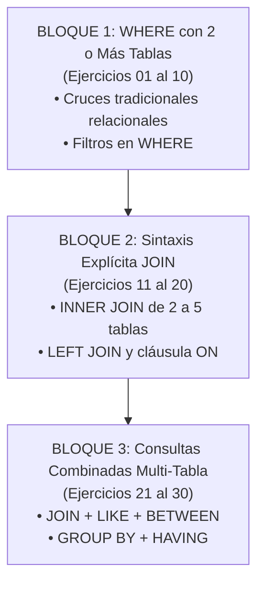

# 📝 Semana 2 — Guía de 30 Ejercicios Prácticos: Consultas Multi-Tabla, JOINs y Agregaciones (Employees Neon)

> **Instituto Superior Tecnológico de Turismo y Patrimonio Yavirac**  
> **Carrera:** Tecnología Superior en Desarrollo de Software  
> **Asignatura:** Base de Datos Avanzada (`DS4AC1-215`) | **Paralelo:** D  
> **Docente:** Ing. Byron Moreno  
> **Periodo Académico:** 2026-II | **Modalidad:** Dual  
> **Banco de Datos:** 🐘 Base de datos real `Employees` de Neon (~3.9 millones de filas / 6 tablas normalizadas)  
> **Documento:** Guía de Práctica de Habilidades de Consulta Multi-Tabla (Sin Soluciones)

---

## 🎯 Objetivos de Aprendizaje
Al resolver esta segunda serie de 30 ejercicios, el estudiante:
1. **Comprende y domina** el cruce de 2, 3 y 4 tablas utilizando la sintaxis relacional tradicional mediante condiciones en la cláusula `WHERE`.
2. **Implementa** consultas profesionales utilizando la sintaxis explícita estandarizada ANSI SQL (`INNER JOIN`, `LEFT JOIN`) con cláusulas `ON`.
3. **Resuelve** problemas complejos de analítica empresarial combinando `JOIN`, filtros con `WHERE`, patrones de texto con `LIKE`, rangos con `BETWEEN`, listas con `IN`, funciones de agregación (`COUNT`, `SUM`, `AVG`, `MIN`, `MAX`) y agrupamiento con `GROUP BY` y `HAVING`.
4. **Respeta y aplica** la convención temporal corporativa (`to_date = '9999-01-01'`) para aislar estados vigentes en bases de datos con dimensiones de cambio lento (SCD Tipo 2).

---

## 🧭 Estructura Temática de los 30 Ejercicios



---

## 📋 Lista de Ejercicios Prácticos

### 📌 Ejercicio 01 — Cruce de 2 tablas con WHERE (employees y salaries)
- **Bloque Temático:** Bloque 1: WHERE con Dos o Más Tablas
- **Enunciado del Reto:** La Dirección Financiera necesita verificar los primeros 10 colaboradores registrados junto a su salario actual. Utilizando la sintaxis tradicional de cruce en WHERE (sin JOIN explícito), consulta el número de empleado (emp_no), nombre (first_name), apellido (last_name) y salario (salary), filtrando solo los salarios vigentes (to_date = '9999-01-01').
- **💡 Pista didáctica:** Lista ambas tablas en el FROM (employees e, salaries s) e iguala sus claves primarias/foráneas en el WHERE (e.emp_no = s.emp_no) agregando la condición AND s.to_date = '9999-01-01'.

```sql
-- Escribe tu consulta SQL aquí:

```

---

### 📌 Ejercicio 02 — Cruce de 2 tablas con WHERE y filtro de texto (employees y titles)
- **Bloque Temático:** Bloque 1: WHERE con Dos o Más Tablas
- **Enunciado del Reto:** Consulta el listado de colaboradores que ostentan actualmente el cargo de 'Senior Engineer'. Muestra emp_no, nombre completo (first_name || ' ' || last_name) y cargo (title) utilizando el cruce por WHERE. Limita la salida a 10 filas.
- **💡 Pista didáctica:** Cruza employees e y titles t con e.emp_no = t.emp_no, y agrega t.title = 'Senior Engineer' y t.to_date = '9999-01-01'.

```sql
-- Escribe tu consulta SQL aquí:

```

---

### 📌 Ejercicio 03 — Cruce de 2 tablas con WHERE (departments y dept_manager)
- **Bloque Temático:** Bloque 1: WHERE con Dos o Más Tablas
- **Enunciado del Reto:** La Gerencia desea auditar a todos los gerentes registrados en la historia de la compañía. Muestra el código del departamento (dept_no), el nombre del departamento (dept_name), el ID del gerente (emp_no) y las fechas de gestión (from_date, to_date) cruzando departments y dept_manager mediante WHERE. Ordena por código de departamento.
- **💡 Pista didáctica:** FROM departments d, dept_manager dm WHERE d.dept_no = dm.dept_no.

```sql
-- Escribe tu consulta SQL aquí:

```

---

### 📌 Ejercicio 04 — Cruce de 2 tablas con WHERE y filtro de fecha (employees y dept_emp)
- **Bloque Temático:** Bloque 1: WHERE con Dos o Más Tablas
- **Enunciado del Reto:** Se requiere consultar a los colaboradores asignados al departamento de Desarrollo ('d005') que hayan ingresado en dicho departamento en o después del 1 de enero de 1998. Muestra emp_no, first_name, last_name, dept_no y from_date mediante cruce en WHERE. Limita a 10 filas.
- **💡 Pista didáctica:** Empareja e.emp_no = de.emp_no y filtra de.dept_no = 'd005' AND de.from_date >= '1998-01-01'.

```sql
-- Escribe tu consulta SQL aquí:

```

---

### 📌 Ejercicio 05 — Cruce de 2 tablas con WHERE y filtro de género y salario (employees y salaries)
- **Bloque Temático:** Bloque 1: WHERE con Dos o Más Tablas
- **Enunciado del Reto:** Para un informe sobre talento femenino en posiciones de alta remuneración, consulta a las colaboradoras de género femenino ('F') cuyo salario actual supere los $85,000 USD anuales. Muestra emp_no, first_name, last_name, gender y salary utilizando cruce en WHERE. Limita a 10 filas.
- **💡 Pista didáctica:** FROM employees e, salaries s WHERE e.emp_no = s.emp_no AND e.gender = 'F' AND s.salary > 85000 AND s.to_date = '9999-01-01'.

```sql
-- Escribe tu consulta SQL aquí:

```

---

### 📌 Ejercicio 06 — Cruce de 3 tablas con WHERE (employees, dept_emp y departments)
- **Bloque Temático:** Bloque 1: WHERE con Dos o Más Tablas
- **Enunciado del Reto:** Genera un listado formal que contenga el número de empleado (emp_no), el nombre completo (first_name || ' ' || last_name) y el nombre oficial de su departamento (dept_name) para asignaciones vigentes, utilizando cruce por WHERE. Limita a 10 filas.
- **💡 Pista didáctica:** En el FROM pon employees e, dept_emp de, departments d. En el WHERE enlaza e.emp_no = de.emp_no AND de.dept_no = d.dept_no AND de.to_date = '9999-01-01'.

```sql
-- Escribe tu consulta SQL aquí:

```

---

### 📌 Ejercicio 07 — Cruce de 3 tablas con WHERE (employees, titles y salaries)
- **Bloque Temático:** Bloque 1: WHERE con Dos o Más Tablas
- **Enunciado del Reto:** Auditoría de consistencia salarial: consulta los colaboradores mostrando emp_no, nombre completo, cargo actual (title) y salario actual (salary). Cruza employees, titles y salaries en el WHERE exigiendo vigencia en ambas tablas temporales. Limita a 10 filas.
- **💡 Pista didáctica:** FROM employees e, titles t, salaries s WHERE e.emp_no = t.emp_no AND e.emp_no = s.emp_no AND t.to_date = '9999-01-01' AND s.to_date = '9999-01-01'.

```sql
-- Escribe tu consulta SQL aquí:

```

---

### 📌 Ejercicio 08 — Cruce de 3 tablas con WHERE (departments, dept_manager y employees)
- **Bloque Temático:** Bloque 1: WHERE con Dos o Más Tablas
- **Enunciado del Reto:** Genera el cuadro de directores gerentes vigentes en la empresa. Muestra el código de departamento (dept_no), el nombre del departamento (dept_name), el ID del gerente (emp_no) y su nombre completo, filtrando gerencias activas con WHERE.
- **💡 Pista didáctica:** FROM departments d, dept_manager dm, employees e WHERE d.dept_no = dm.dept_no AND dm.emp_no = e.emp_no AND dm.to_date = '9999-01-01'.

```sql
-- Escribe tu consulta SQL aquí:

```

---

### 📌 Ejercicio 09 — Cruce de 4 tablas con WHERE (employees, dept_emp, departments y salaries)
- **Bloque Temático:** Bloque 1: WHERE con Dos o Más Tablas
- **Enunciado del Reto:** Consulta a los colaboradores del departamento de Ventas ('Sales') mostrando emp_no, nombre completo, nombre de departamento y salario vigente. Utiliza cruce de 4 tablas mediante WHERE y limita a 10 filas.
- **💡 Pista didáctica:** FROM employees e, dept_emp de, departments d, salaries s. Enlaza e con de, de con d, y e con s, filtrando d.dept_name = 'Sales' y vigencias.

```sql
-- Escribe tu consulta SQL aquí:

```

---

### 📌 Ejercicio 10 — Cruce de 4 tablas con WHERE y filtro de cargo (employees, dept_emp, departments, titles)
- **Bloque Temático:** Bloque 1: WHERE con Dos o Más Tablas
- **Enunciado del Reto:** Identifica a los colaboradores del departamento de Desarrollo ('Development') que tengan el cargo vigente de 'Engineer' (excluyendo a los Senior). Proyecta emp_no, nombre completo, departamento y cargo mediante cruce en WHERE. Limita a 10 filas.
- **💡 Pista didáctica:** Combina las 4 tablas en FROM igualando las claves en WHERE, con d.dept_name = 'Development' y t.title = 'Engineer'.

```sql
-- Escribe tu consulta SQL aquí:

```

---

### 📌 Ejercicio 11 — INNER JOIN de 2 tablas (employees y salaries)
- **Bloque Temático:** Bloque 2: Sintaxis Explícita JOIN (ANSI SQL)
- **Enunciado del Reto:** Reescribe el cruce entre employees y salaries utilizando la cláusula moderna INNER JOIN con condición ON. Consulta emp_no, first_name, last_name y salary para salarios vigentes, ordenando de forma descendente por salario. Limita a 10 filas.
- **💡 Pista didáctica:** FROM employees e INNER JOIN salaries s ON e.emp_no = s.emp_no WHERE s.to_date = '9999-01-01' ORDER BY s.salary DESC.

```sql
-- Escribe tu consulta SQL aquí:

```

---

### 📌 Ejercicio 12 — INNER JOIN de 2 tablas con filtro de cargo (employees y titles)
- **Bloque Temático:** Bloque 2: Sintaxis Explícita JOIN (ANSI SQL)
- **Enunciado del Reto:** Utilizando INNER JOIN, consulta a los colaboradores que tienen el título de 'Manager' en la tabla titles. Muestra emp_no, nombre completo, título y la fecha desde la cual ostentan el cargo (from_date). Ordena por emp_no y limita a 10 filas.
- **💡 Pista didáctica:** FROM employees e INNER JOIN titles t ON e.emp_no = t.emp_no WHERE t.title = 'Manager'.

```sql
-- Escribe tu consulta SQL aquí:

```

---

### 📌 Ejercicio 13 — INNER JOIN de 2 tablas con operador IN (departments y dept_emp)
- **Bloque Temático:** Bloque 2: Sintaxis Explícita JOIN (ANSI SQL)
- **Enunciado del Reto:** Consulta los registros de asignación vigentes (to_date = '9999-01-01') en los departamentos de Finanzas ('d002') y Recursos Humanos ('d003'). Utiliza INNER JOIN entre departments y dept_emp. Proyecta dept_no, dept_name y emp_no, limitando a 10 filas.
- **💡 Pista didáctica:** FROM departments d INNER JOIN dept_emp de ON d.dept_no = de.dept_no WHERE de.to_date = '9999-01-01' AND d.dept_no IN ('d002', 'd003').

```sql
-- Escribe tu consulta SQL aquí:

```

---

### 📌 Ejercicio 14 — INNER JOIN de 3 tablas (employees, dept_emp y departments)
- **Bloque Temático:** Bloque 2: Sintaxis Explícita JOIN (ANSI SQL)
- **Enunciado del Reto:** Genera el reporte de colaboradores activos contratados a partir del año 1996 en adelante. Utiliza dos INNER JOIN encadenados entre employees, dept_emp y departments. Muestra emp_no, nombre completo, hire_date y dept_name ordenados por hire_date. Limita a 10 filas.
- **💡 Pista didáctica:** FROM employees e INNER JOIN dept_emp de ON e.emp_no = de.emp_no INNER JOIN departments d ON de.dept_no = d.dept_no WHERE de.to_date = '9999-01-01' AND e.hire_date >= '1996-01-01'.

```sql
-- Escribe tu consulta SQL aquí:

```

---

### 📌 Ejercicio 15 — INNER JOIN de 3 tablas con filtro salarial (employees, titles y salaries)
- **Bloque Temático:** Bloque 2: Sintaxis Explícita JOIN (ANSI SQL)
- **Enunciado del Reto:** Consulta a los colaboradores con el cargo de 'Senior Staff' que tengan un salario actual superior a $90,000 USD anuales. Utiliza INNER JOIN entre employees, titles y salaries. Proyecta emp_no, nombre completo, cargo y salario, ordenando por salario descendente. Limita a 10 filas.
- **💡 Pista didáctica:** Une employees con titles mediante emp_no y con salaries mediante emp_no. Filtra t.title = 'Senior Staff' y ambas vigencias.

```sql
-- Escribe tu consulta SQL aquí:

```

---

### 📌 Ejercicio 16 — INNER JOIN de 3 tablas para Cuadro Gerencial (departments, dept_manager, employees)
- **Bloque Temático:** Bloque 2: Sintaxis Explícita JOIN (ANSI SQL)
- **Enunciado del Reto:** Construye la ficha de directores gerentes vigentes utilizando INNER JOIN. Muestra dept_no, dept_name, el emp_no del gerente, su nombre completo y la fecha desde la cual asumió la dirección (from_date).
- **💡 Pista didáctica:** FROM departments d INNER JOIN dept_manager dm ON d.dept_no = dm.dept_no INNER JOIN employees e ON dm.emp_no = e.emp_no WHERE dm.to_date = '9999-01-01'.

```sql
-- Escribe tu consulta SQL aquí:

```

---

### 📌 Ejercicio 17 — INNER JOIN de 4 tablas (employees, dept_emp, departments, titles)
- **Bloque Temático:** Bloque 2: Sintaxis Explícita JOIN (ANSI SQL)
- **Enunciado del Reto:** Genera una planilla formal de personal adscrito al departamento de 'Quality Management' ('d006'). Muestra emp_no, nombre completo, departamento y cargo oficial vigente. Limita a 10 filas ordenadas alfabéticamente por apellido.
- **💡 Pista didáctica:** Encadena 3 cláusulas INNER JOIN partiendo de employees hacia dept_emp, departments y titles. Filtra por dept_name y vigencias.

```sql
-- Escribe tu consulta SQL aquí:

```

---

### 📌 Ejercicio 18 — INNER JOIN de 4 tablas para Nómina Departamental (employees, dept_emp, departments, salaries)
- **Bloque Temático:** Bloque 2: Sintaxis Explícita JOIN (ANSI SQL)
- **Enunciado del Reto:** Consulta el listado de colaboradores activos del departamento de Recursos Humanos ('Human Resources' / 'd003') mostrando emp_no, nombre completo, departamento y su salario vigente. Ordena por salario de mayor a menor y limita a 10 filas.
- **💡 Pista didáctica:** Une employees con dept_emp, luego con departments y finalmente con salaries. Filtra d.dept_no = 'd003' y vigencias.

```sql
-- Escribe tu consulta SQL aquí:

```

---

### 📌 Ejercicio 19 — LEFT JOIN para Inclusión Departamental (departments y dept_manager)
- **Bloque Temático:** Bloque 2: Sintaxis Explícita JOIN (ANSI SQL)
- **Enunciado del Reto:** Demuestra el uso de LEFT JOIN listando todos los departamentos del catálogo (departments) junto con las gerencias vigentes en dept_manager. Muestra dept_no, dept_name y el emp_no del gerente. Explica la diferencia respecto a un INNER JOIN.
- **💡 Pista didáctica:** FROM departments d LEFT JOIN dept_manager dm ON d.dept_no = dm.dept_no AND dm.to_date = '9999-01-01'.

```sql
-- Escribe tu consulta SQL aquí:

```

---

### 📌 Ejercicio 20 — INNER JOIN Consolidado de 5 Tablas (employees, dept_emp, departments, titles, salaries)
- **Bloque Temático:** Bloque 2: Sintaxis Explícita JOIN (ANSI SQL)
- **Enunciado del Reto:** Construye la consulta maestra corporativa de 5 tablas: proyecta emp_no, nombre completo, departamento (dept_name), cargo vigente (title) y salario actual (salary). Filtra para que todas las dimensiones estén vigentes (to_date = '9999-01-01'). Ordena por emp_no y limita a 10 filas.
- **💡 Pista didáctica:** Parte de employees y encadena 4 INNER JOINs hacia dept_emp, departments, titles y salaries con sus condiciones ON correspondientes.

```sql
-- Escribe tu consulta SQL aquí:

```

---

### 📌 Ejercicio 21 — Multi-tabla con LIKE y filtro departamental
- **Bloque Temático:** Bloque 3: Consultas Combinadas Multi-Tabla
- **Enunciado del Reto:** Busca a todos los colaboradores del departamento de Desarrollo ('Development') cuyo apellido comience con 'S%' (por ejemplo: Simmel, Smith, Schneider). Muestra emp_no, nombre, apellido, departamento y cargo vigente, ordenados alfabéticamente por apellido. Limita a 10 filas.
- **💡 Pista didáctica:** Cruza employees, dept_emp, departments y titles. Aplica WHERE d.dept_name = 'Development' AND e.last_name LIKE 'S%' y vigencias.

```sql
-- Escribe tu consulta SQL aquí:

```

---

### 📌 Ejercicio 22 — Multi-tabla con BETWEEN y rango salarial
- **Bloque Temático:** Bloque 3: Consultas Combinadas Multi-Tabla
- **Enunciado del Reto:** La Gerencia Comercial desea premiar a los colaboradores de Ventas ('Sales') con remuneración media. Consulta a los empleados de dicho departamento cuyo salario actual esté entre $75,000 y $85,000 USD anuales (BETWEEN). Muestra emp_no, nombre completo, departamento y salario. Limita a 10 filas.
- **💡 Pista didáctica:** Une employees, dept_emp, departments y salaries. Filtra d.dept_name = 'Sales' AND s.salary BETWEEN 75000 AND 85000 y vigencias.

```sql
-- Escribe tu consulta SQL aquí:

```

---

### 📌 Ejercicio 23 — Multi-tabla con COUNT(*) y GROUP BY departamental
- **Bloque Temático:** Bloque 3: Consultas Combinadas Multi-Tabla
- **Enunciado del Reto:** Calcula el número de colaboradores activos que integran cada departamento de la compañía. Muestra el código de departamento (dept_no), el nombre oficial del departamento (dept_name) y la cantidad de empleados (total_colaboradores), ordenando de mayor a menor dotación.
- **💡 Pista didáctica:** Cruza departments d con dept_emp de mediante dept_no. Filtra de.to_date = '9999-01-01', agrupa por d.dept_no, d.dept_name y usa COUNT(de.emp_no).

```sql
-- Escribe tu consulta SQL aquí:

```

---

### 📌 Ejercicio 24 — Multi-tabla con AVG() y ROUND() por departamento
- **Bloque Temático:** Bloque 3: Consultas Combinadas Multi-Tabla
- **Enunciado del Reto:** La Gerencia Financiera solicita un estudio comparativo de remuneración: calcula el salario promedio vigente de cada departamento corporativo. Muestra dept_no, dept_name y salario_promedio_usd redondeado a 2 decimales, ordenado de mayor a menor sueldo medio.
- **💡 Pista didáctica:** Cruza departments d, dept_emp de y salaries s. Agrupa por d.dept_no, d.dept_name y calcula ROUND(AVG(s.salary), 2).

```sql
-- Escribe tu consulta SQL aquí:

```

---

### 📌 Ejercicio 25 — Multi-tabla con MIN(), MAX() y AVG() por Cargo
- **Bloque Temático:** Bloque 3: Consultas Combinadas Multi-Tabla
- **Enunciado del Reto:** Genera una tabla salarial por cargo formal en titles: calcula el salario mínimo, salario promedio (redondeado a 2 decimales) y salario máximo vigente para cada puesto de trabajo. Muestra title, salario_minimo, salario_promedio y salario_maximo.
- **💡 Pista didáctica:** Cruza titles t con salaries s mediante emp_no, exigiendo to_date = '9999-01-01' en ambas tablas. Agrupa por t.title.

```sql
-- Escribe tu consulta SQL aquí:

```

---

### 📌 Ejercicio 26 — Multi-tabla con COUNT(*) y filtro de grupos (HAVING)
- **Bloque Temático:** Bloque 3: Consultas Combinadas Multi-Tabla
- **Enunciado del Reto:** Filtra los departamentos corporativos que concentran a más de 30,000 colaboradores activos. Muestra el nombre del departamento (dept_name) y la dotación_activa cruzando departments y dept_emp. Ordena de mayor a menor.
- **💡 Pista didáctica:** Aplica GROUP BY d.dept_name y filtra el grupo con HAVING COUNT(de.emp_no) > 30000.

```sql
-- Escribe tu consulta SQL aquí:

```

---

### 📌 Ejercicio 27 — Multi-tabla con AVG() y condición HAVING salarial
- **Bloque Temático:** Bloque 3: Consultas Combinadas Multi-Tabla
- **Enunciado del Reto:** Identifica los cargos formales (titles) cuyo salario promedio activo supere los $75,000 USD anuales. Muestra el título (title), la cantidad de personas en el cargo y el salario promedio, ordenado por promedio descendente.
- **💡 Pista didáctica:** Cruza titles y salaries, agrupa por title y coloca HAVING AVG(s.salary) > 75000.

```sql
-- Escribe tu consulta SQL aquí:

```

---

### 📌 Ejercicio 28 — Multi-tabla con SUM() y Masa Salarial Total
- **Bloque Temático:** Bloque 3: Consultas Combinadas Multi-Tabla
- **Enunciado del Reto:** Calcula el gasto total de nómina anual por departamento. Cruza departments, dept_emp y salaries vigentes. Muestra dept_name, cantidad de empleados y masa_salarial_anual_usd, ordenado de mayor a menor presupuesto.
- **💡 Pista didáctica:** Usa SUM(s.salary) AS masa_salarial_anual_usd agrupando por d.dept_name con condiciones de vigencia.

```sql
-- Escribe tu consulta SQL aquí:

```

---

### 📌 Ejercicio 29 — Multi-tabla con WHERE + LIKE + GROUP BY + HAVING
- **Bloque Temático:** Bloque 3: Consultas Combinadas Multi-Tabla
- **Enunciado del Reto:** En el departamento de Producción ('Production'), analiza los cargos técnicos que contengan la palabra 'Engineer' (LIKE '%Engineer%'). Cuenta cuántos colaboradores activos ostentan cada uno de esos cargos y muestra únicamente los puestos que tengan más de 3,000 personas. Ordena descendentemente.
- **💡 Pista didáctica:** Cruza departments, dept_emp y titles. En WHERE filtra por d.dept_name = 'Production' AND t.title LIKE '%Engineer%' y vigencias. En HAVING filtra COUNT(*) > 3000.

```sql
-- Escribe tu consulta SQL aquí:

```

---

### 📌 Ejercicio 30 — Reto Maestro: Análisis Demográfico y Salarial Completo
- **Bloque Temático:** Bloque 3: Consultas Combinadas Multi-Tabla
- **Enunciado del Reto:** Genera el análisis demográfico y financiero integral de la compañía: para los departamentos comerciales y estratégicos ('Sales', 'Marketing', 'Development' mediante IN), calcula por cada género (gender): el total de empleados activos, el salario mínimo, el salario promedio redondeado y el salario máximo. Muestra solo grupos con más de 4,000 colaboradores y ordena por departamento y género.
- **💡 Pista didáctica:** Cruza employees, dept_emp, departments y salaries. Agrupa por d.dept_name, e.gender. Usa HAVING COUNT(*) > 4000 y ORDER BY d.dept_name, e.gender.

```sql
-- Escribe tu consulta SQL aquí:

```

---

## 🚀 Recomendaciones Metodológicas
1. **Prueba cada consulta en tu cliente PostgreSQL:** Utiliza `psql`, pgAdmin 4 o DBeaver conectado a la base de datos `employees`.
2. **Atención a la condición ON y WHERE:** Asegúrate de emparejar siempre las claves foráneas con las claves primarias para evitar productos cartesianos accidentales que saturen la memoria.
3. **Tutoría Docente:** Si tienes dudas sobre los resultados de tus consultas, consúltalas en clase o en las horas de tutoría con el docente **Ing. Byron Moreno**.
