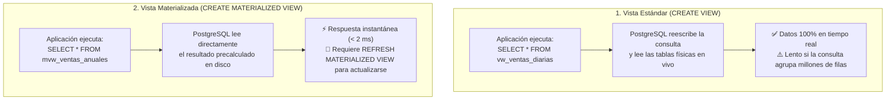
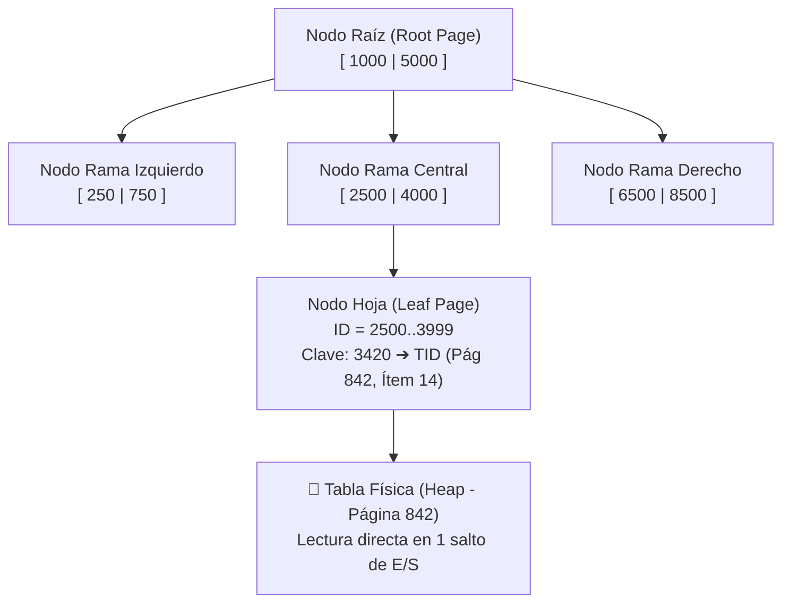
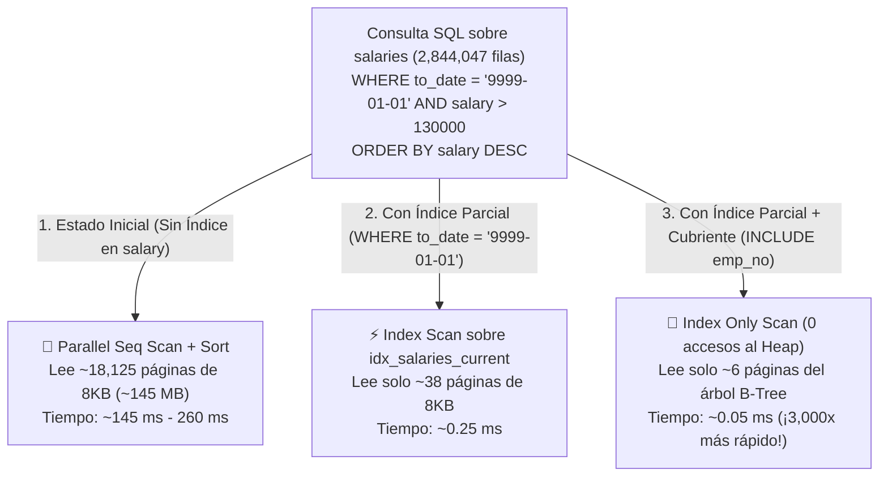

# ⚡ Semana 3: Vistas Estándar y Materializadas, Arquitectura de Índices y Optimización de Rendimiento

> **Instituto Superior Tecnológico de Turismo y Patrimonio Yavirac**  
> **Carrera:** Tecnología Superior en Desarrollo de Software  
> **Asignatura:** Base de Datos Avanzada (`DS4AC1-215`) | **Paralelo:** Paralelo D  
> **Docente:** Ing. Yoli Moya, MSc. (Representante del Colectivo de Asignatura)  
> **Unidad 1:** Sentencias SQL complejas, vistas e índices  
> **Periodo Académico:** 2026-II | **Semestre:** Segundo | **Modalidad:** Dual  

---

## 📋 1. Ficha Técnica de la Sesión y Planificación Curricular

| Parámetro | Detalle Oficial según PEA y Planificación de Unidades (Paralelo D) |
| :--- | :--- |
| **Institución** | Instituto Superior Tecnológico de Turismo y Patrimonio Yavirac |
| **Carrera / Nivel** | Desarrollo de Software — Segundo Semestre (Modalidad Dual) |
| **Periodo Académico** | 2026-II |
| **Docente** | Ing. Yoli Moya, MSc. |
| **Asignatura / Código** | Base de Datos Avanzada (`DS4AC1-215`) |
| **Paralelo** | Paralelo D |
| **Unidad Curricular** | Unidad 1: Sentencias SQL complejas, vistas e índices (ID Unidad: 347552) |
| **Semana Académica** | Semana 3 de 9 |
| **Carga Horaria Semanal** | **5 Horas Presenciales** (ACD: 2h | APECD: 3h | APEA: 0h | AA: 0h) |
| **Clase 5 (2 Horas — ACD)** | **Fecha:** Lunes 09 de noviembre de 2026 \| **Tipo:** Aula (ACD - Presencial Teórico-Práctico) \| **Contenido:** Vistas e Índices: Clase magistral de vistas mediante consultas complejas. Fundamentos teóricos de índices, arquitectura, tipos y utilidad en optimización. |
| **Clase 6 (3 Horas — APECD)** | **Fecha:** Miércoles 11 de noviembre de 2026 \| **Tipo:** Laboratorio (APECD - Práctico-Experimental) \| **Contenido:** Laboratorio práctico: Creación y eliminación de vistas. Creación, modificación y eliminación de índices, comparando rendimiento en consultas SQL con y sin índice. |
| **Prerrequisitos** | Fundamentos de Bases de Datos, Modelo Entidad-Relación (MER), Álgebra Relacional básica |
| **Entorno Tecnológico** | PostgreSQL 16+, pgAdmin 4, psql, DBeaver, Visual Studio Code |

---

## 🎯 2. Objetivos de las Clases, Resultados de Aprendizaje y Competencias

### 2.1. Objetivos de las Clases (Redactados con Verbo en Infinitivo)

- **Objetivo General de la Semana 3:**  
  Optimizar el rendimiento y la seguridad relacional mediante el diseño e implementación de vistas estándar, vistas materializadas y estrategias avanzadas de indexación, verificando las mejoras con planes de ejecución en PostgreSQL.
- **Objetivo Específico de la Clase 5 (2 Horas (120 min) — ACD / Aula — Lunes 09 de noviembre de 2026):**  
  Analizar la arquitectura, funcionamiento interno y tipos de índices (B-Tree, Hash, GIN, BRIN), así como los mecanismos de abstracción y persistencia de vistas estándar y materializadas en PostgreSQL.
- **Objetivo Específico de la Clase 6 (3 Horas (180 min) — APECD / Laboratorio — Miércoles 11 de noviembre de 2026):**  
  Crear, modificar y eliminar vistas e índices en PostgreSQL, evaluando cuantitativamente el impacto en el rendimiento y costo computacional mediante planes de ejecución con EXPLAIN ANALYZE.

### 2.2. Resultados de Aprendizaje (RdA) y Competencias
> [!IMPORTANT]
> **Norma Pedagógica de Redacción:** Los Resultados de Aprendizaje describen lo que el estudiante demuestra al finalizar la clase; se redactan en **tercera persona del presente de indicativo** (NUNCA en infinitivo terminado en *-ar*, *-er*, *-ir*).

| Componente Curricular | Redacción Oficial (Sin Verbos en Infinitivo) |
| :--- | :--- |
| **Resultados de Aprendizaje Institucionales (PEA)** | **RdA 2 (PEA):** Utiliza herramientas y tecnologías de programación para llevar a cabo tareas específicas en el campo de desarrollo de software. |
| **Resultado de Aprendizaje Específico de la Semana** | **Diseña e implementa vistas e índices optimizados, analiza planes de ejecución y compara el rendimiento computacional de consultas SQL en PostgreSQL.** |
| **Competencia de la Asignatura** | Aplicar herramientas y tecnologías de bases de datos avanzadas para implementar mecanismos de procesamiento y gestión eficiente de la información en aplicaciones de software. |
| **Habilidades Blandas Priorizadas (PEA)** | • **Trabajo en equipo:** Realiza trabajos de investigación grupales y prácticas colaborativas.<br>• **Pensamiento crítico:** Utiliza herramientas específicas para el diseño y optimización de bases de datos.<br>• **Gestión del tiempo:** Realiza las prácticas en laboratorio dentro del horario establecido.<br>• **Comunicación técnica efectiva:** Expone y sustenta con claridad decisiones de arquitectura relacional. |

---

## ⏱️ 3. Agenda Detallada y Cronograma Semanal (5 Horas)

### 📅 CLASE 5: Lunes 09 de noviembre de 2026 (2 Horas (120 min)) — ACD (Aula / Teoría Magistral y Ejemplos Guiados)
| Bloque | Tiempo | Componente | Actividad Pedagógica y Contenido |
| :---: | :---: | :---: | :--- |
| **Bloque 5.1** | 40 min | **ACD** | Clase Magistral de Vistas en PostgreSQL: Abstracción y encapsulamiento mediante consultas complejas, vistas estándar (`VIEW`) vs. vistas materializadas (`MATERIALIZED VIEW`), refresco concurrente y vistas actualizables con `WITH CHECK OPTION`. |
| **Bloque 5.2** | 40 min | **ACD** | Fundamentos Teóricos y Arquitectura de Índices: Estructura interna B-Tree, páginas en disco, punteros al *Heap*, índices Hash, GIN, BRIN, índices compuestos, parciales y basados en expresiones. |
| **Bloque 5.3** | 40 min | **ACD** | Planes de Ejecución y Ejemplos Guiados: Lectura de `EXPLAIN (ANALYZE, BUFFERS)`, análisis de `Seq Scan` vs `Index Scan` vs `Bitmap Index Scan` y costo computacional. |

### 🔬 CLASE 6: Miércoles 11 de noviembre de 2026 (3 Horas (180 min)) — APECD (Laboratorio de Cómputo / Taller Práctico y Solucionario)
| Bloque | Tiempo | Componente | Actividad Pedagógica y Contenido |
| :---: | :---: | :---: | :--- |
| **Bloque 6.1** | 50 min | **APECD** | Laboratorio Fase 1: Creación, Modificación y Eliminación de Vistas: Implementación de vistas comerciales complejas, vista materializada para reportería gerencial y prueba de `REFRESH MATERIALIZED VIEW CONCURRENTLY`. |
| **Bloque 6.2** | 80 min | **APECD** | Laboratorio Fase 2: Benchmarking con y sin Índices: Pruebas de estrés sobre cientos de miles de registros, creación de índices parciales, compuestos y de expresiones, midiendo la aceleración de consultas. |
| **Bloque 6.3** | 50 min | **APECD** | Laboratorio Fase 3: Solucionario y Conclusiones de Optimización: Validación de planes de ejecución optimizados, eliminación de índices innecesarios, feedback docente y rúbrica. |

---

## 🧠 4. PARTE I: CLASE 5 (09/11/2026 — 2 Horas / ACD) — Desarrollo Teórico-Conceptual Profundo

### 4.1. Vistas en PostgreSQL: Abstracción, Seguridad y Materialización

#### ¿Qué es una Vista (`VIEW`)?
Una **Vista Estándar** es una consulta SQL almacenada en el diccionario de datos de PostgreSQL que se comporta como una **tabla virtual**. No ocupa espacio de almacenamiento físico de datos en el disco (salvo unos pocos bytes para guardar la definición de su sentencia `SELECT`); cada vez que un usuario consulta la vista, el motor reemplaza el nombre de la vista por su consulta subyacente en tiempo real.

#### ¿Por qué las arquitecturas empresariales utilizan Vistas?
1. **Encapsulamiento de Complejidad (Principio DRY):** Si un reporte requiere unir 6 tablas con funciones escalares y `CASE`, en lugar de repetir esas 50 líneas de SQL en 10 microservicios distintos, se encapsula en una vista `vw_resumen_facturacion`.
2. **Seguridad y Control de Acceso a Nivel de Columna/Fila:** Puedes revocar el permiso `SELECT` sobre la tabla física `empleados` (que contiene `salario_base` y `cuenta_bancaria`) y otorgar `GRANT SELECT` únicamente sobre la vista `vw_directorio_empleados` (que solo proyecta `nombres`, `cargo` y `correo_institucional`).
3. **Desacoplamiento / Independencia Lógica:** Si mañana la tabla física se divide en dos por refactorización, puedes actualizar la vista para que las aplicaciones antiguas sigan funcionando sin cambiar su código.

#### Vistas Estándar (`VIEW`) vs. Vistas Materializadas (`MATERIALIZED VIEW`)

En PostgreSQL existen dos tipos fundamentales de vistas cuyo comportamiento físico es radicalmente distinto:



| Característica Técnica | Vista Estándar (`CREATE VIEW`) | Vista Materializada (`CREATE MATERIALIZED VIEW`) |
| :--- | :--- | :--- |
| **Almacenamiento Físico en Disco** | ❌ **No almacena filas** (solo guarda el texto de la consulta). | ✅ **Sí almacena físicamente las filas** resultantes en disco (como una tabla caché). |
| **Frescura de los Datos** | **Tiempo real inmediato** (refleja cada `INSERT`/`UPDATE` al instante). | **Fotografía estática** al momento de su creación o de su último `REFRESH`. |
| **Velocidad de Consulta (`SELECT`)** | Depende de la complejidad de la consulta base (puede tardar segundos). | **Ultra rápida** (milisegundos), ya que el cálculo pesado ya fue ejecutado. |
| **¿Admite crearle Índices propios?** | ❌ No (usa los índices de las tablas base). | ✅ **Sí**, puedes crear índices B-Tree, únicos o GIN directamente sobre la vista materializada. |
| **¿Permite `INSERT / UPDATE / DELETE`?** | ✅ Sí, si es una **Vista Simple** (1 sola tabla, sin `GROUP BY` ni `DISTINCT`). | ❌ No directamente (solo se actualiza mediante `REFRESH MATERIALIZED VIEW`). |
| **Caso de Uso Ideal** | Seguridad por rol, simplificación de consultas transaccionales (OLTP). | Dashboards gerenciales, reportes históricos pesados, inteligencia de negocios (OLAP). |

#### Reglas Críticas de Administración de Vistas en PostgreSQL

1. **Modificación con `CREATE OR REPLACE VIEW`:**
   Permite cambiar la lógica de la consulta sin borrar la vista, **siempre y cuando mantengas las mismas columnas en el mismo orden y con los mismos nombres y tipos de datos**. Si necesitas agregar columnas nuevas, debes agregarlas **al final** de la lista `SELECT`. Si deseas eliminar o renombrar una columna existente, debes usar `DROP VIEW` o `ALTER VIEW ... RENAME COLUMN`.
2. **Vistas Actualizables y `WITH CHECK OPTION`:**
   Cuando una vista consulta una sola tabla sin funciones de agregación, PostgreSQL permite hacer `INSERT` o `UPDATE` a través de la vista. Si la vista tiene un filtro (ej. `WHERE activo = TRUE`), agregar al final `WITH LOCAL CHECK OPTION` impide que un usuario inserte o actualice a través de la vista una fila que deje de cumplir la condición de la vista.
3. **Actualización sin bloqueo en Vistas Materializadas (`CONCURRENTLY`):**
   - `REFRESH MATERIALIZED VIEW mvw_reporte;`: Recalcula la vista pero **bloquea las lecturas (`SELECT`)** mientras termina.
   - `REFRESH MATERIALIZED VIEW CONCURRENTLY mvw_reporte;`: Actualiza los datos en segundo plano **sin bloquear a los usuarios que están consultando la vista**. *(Requisito obligatorio: la vista materializada debe tener al menos un `UNIQUE INDEX` sin cláusula `WHERE`).*

---

### 4.2. Investigación Profunda: ¿Qué son los Índices y Cómo Funcionan Internamente?

#### El Problema Físico: El Almacenamiento en el *Heap* y el `Seq Scan`
En PostgreSQL, las filas de una tabla se guardan en archivos en el disco duro divididos en bloques llamados **Páginas (*Pages*) de 8 KB** cada una. Este conjunto desordenado de páginas se denomina **Heap (Montón)**.

Cuando ejecutas `SELECT * FROM transacciones WHERE codigo_autorizacion = 'AUTH-998877'` en una tabla de 1 millón de filas **sin índice**, PostgreSQL no sabe en cuál de las miles de páginas de 8 KB está ese registro. Por lo tanto, se ve obligado a realizar un **Escaneo Secuencial (`Seq Scan`)**: leer página por página, fila por fila, desde el principio hasta el final de la tabla ($O(N)$ operaciones).

#### La Solución: Estructura de Datos de un Índice (`B-Tree`)
Un **Índice** es una estructura de datos auxiliar, separada de la tabla, que mantiene ordenados los valores de una o más columnas junto con un puntero físico exacto llamado **`TID` (*Tuple Identifier* = `(número_de_página, posición_en_página)`)** que apunta directamente a la fila en el *Heap*.



Gracias a que el árbol **B-Tree** (*Balanced Tree*) se mantiene balanceado y con alto factor de ramificación, buscar 1 registro entre **10 millones de filas** requiere leer apenas **3 o 4 páginas de 8 KB** ($O(\log N)$ operaciones), reduciendo una consulta de **800 milisegundos a 0.08 milisegundos** (¡10,000 veces más rápido!).

---

### 4.3. Los 5 Tipos de Algoritmos de Índices en PostgreSQL

PostgreSQL es famoso por ofrecer múltiples motores de indexación especializados según el tipo de dato y el operador de consulta:

| Tipo de Índice | Sintaxis DDL | Operadores que Acelera | Caso de Uso Ideal en Ingeniería de Software |
| :--- | :--- | :--- | :--- |
| **1. B-Tree** *(Por defecto)* | `CREATE INDEX idx_... ON tabla (col);` | `=`, `<`, `<=`, `>`, `>=`, `BETWEEN`, `IN`, `IS NULL`, `ORDER BY` | **El 90% de los casos:** claves foráneas, fechas, precios, códigos, correos y ordenamientos. |
| **2. Hash** | `CREATE INDEX idx_... ON tabla USING HASH (col);` | **Únicamente igualdad exacta (`=`)** | Cadenas muy largas (ej. URLs completas, hashes SHA-256 o tokens JWT) donde nunca se busca por rango `<` ni `ORDER BY`. |
| **3. GIN** *(Generalized Inverted Index)* | `CREATE INDEX idx_... ON tabla USING GIN (col);` | `@>`, `?`, `?&`, `?|`, `@@` (Búsqueda dentro de valores compuestos) | Columnas **`JSONB`**, arreglos (`ARRAY`) y Búsqueda de Texto Completo (*Full-Text Search*). |
| **4. GiST** *(Generalized Search Tree)* | `CREATE INDEX idx_... ON tabla USING GIST (col);` | Coordenadas geométricas, rangos solapados (`&&`), cercanía (`<->`) | Datos geoespaciales (**PostGIS**), rangos de fechas de reservas (`daterange`, `tstzrange`). |
| **5. BRIN** *(Block Range Index)* | `CREATE INDEX idx_... ON tabla USING BRIN (col);` | `<`, `<=`, `=`, `>=`, `>` en columnas físicamente ordenadas | Tablas gigantescas (cientos de millones de filas de IoT o logs) donde `fecha_evento` crece secuencialmente conforme se inserta. Ocupa 99% menos espacio que B-Tree. |

---

### 4.4. Estrategias Avanzadas de Indexación en PostgreSQL

Además del algoritmo, un ingeniero de bases de datos debe dominar **5 variantes estratégicas de diseño de índices**:

1. **Índice Compuesto (Multicolumna):**
   `CREATE INDEX idx_pedidos_cliente_fecha ON pedidos (cliente_id, fecha_pedido DESC);`
   - **Regla del Prefijo Izquierdo:** Este índice acelera consultas que filtran por `(cliente_id, fecha_pedido)` y también consultas que filtran solo por `(cliente_id)`. Sin embargo, **es inútil** (o muy ineficiente) si la consulta solo filtra por `WHERE fecha_pedido = ...` sin mencionar `cliente_id`. Coloca siempre primero la columna de igualdad (`=`) y luego la de rango (`>`, `<`) u ordenamiento (`ORDER BY`).
2. **Índice Parcial (`WHERE`):**
   `CREATE INDEX idx_pedidos_pendientes ON pedidos (fecha_pedido) WHERE estado = 'PENDIENTE';`
   - Si el 98% de tus pedidos históricos están `'FACTURADOS'` y tu sistema operativo solo consulta constantemente el 2% de pedidos `'PENDIENTES'`, indexar toda la tabla desperdicia RAM y disco. Un índice parcial indexa **únicamente las filas que cumplen el `WHERE`**, siendo diminuto y ultrarrápido.
3. **Índice Basado en Expresiones (Funcional):**
   `CREATE INDEX idx_clientes_correo_lower ON clientes (LOWER(correo_electronico));`
   - Si aplicas una función a una columna en el `WHERE` (ej. `WHERE LOWER(correo_electronico) = 'ana@correo.ec'`), un índice normal sobre `(correo_electronico)` **no se utiliza**. Debes crear el índice sobre la misma función `LOWER(...)`.
4. **Índice Cubriente (`INCLUDE` — *Index Only Scan*):**
   `CREATE INDEX idx_productos_sku_inc ON productos (sku) INCLUDE (nombre, precio_lista);`
   - Guarda columnas adicionales en las hojas del índice para que PostgreSQL responda la consulta leyendo **solo el índice** (`Index Only Scan`) sin siquiera tocar la tabla física (*Heap*).
5. **Claves Foráneas (`FOREIGN KEY`) en PostgreSQL:**
   > [!WARNING]
   > **Mito peligroso:** Muchos desarrolladores creen que al declarar una `FOREIGN KEY`, PostgreSQL le crea un índice automáticamente. **¡FALSO!** PostgreSQL crea un índice automático **únicamente para `PRIMARY KEY` y `UNIQUE`**. Las columnas `FOREIGN KEY` **NO tienen índice por defecto**, por lo que debes indexarlas manualmente para acelerar los `JOIN` y las eliminaciones en la tabla padre.

---

### 4.5. ¿Cuándo USAR y Cuándo NO USAR Índices? (El Costo Oculto)

> [!CAUTION]
> **¿Por qué no indexamos todas las columnas de todas las tablas?**
> Cada índice adicional que creas en una tabla **ralentiza todas las operaciones de escritura (`INSERT`, `UPDATE`, `DELETE`)** y consume espacio en disco y memoria RAM (*Shared Buffers*). Si una tabla tiene 8 índices, cada vez que insertas 1 fila, PostgreSQL debe realizar 1 escritura en la tabla y 8 actualizaciones en los árboles de los índices.

| ✅ Cuándo SÍ Crear un Índice | ❌ Cuándo NO Crear un Índice |
| :--- | :--- |
| Columnas `FOREIGN KEY` usadas frecuentemente en `JOIN`. | Tablas pequeñas (menos de 500 - 1,000 filas): PostgreSQL leerá toda la tabla en memoria con un `Seq Scan` más rápido que buscando en un índice. |
| Columnas con **alta selectividad/cardinalidad** (ej. `cedula`, `codigo_pedido`, `email`) usadas en `WHERE`. | Columnas con **muy baja cardinalidad** (ej. `genero` M/F o `booleano` con distribución 50%/50%), salvo que uses un índice parcial para una minoría (ej. 1%). |
| Columnas usadas constantemente en `ORDER BY` con `LIMIT`. | Tablas de escritura masiva continua (*Write-heavy staging tables*) que casi nunca se consultan por filtros individuales. |

---

### 4.6. Cómo Leer Planes de Ejecución con `EXPLAIN (ANALYZE, BUFFERS)`

Para comparar científicamente el rendimiento con y sin índice usamos el comando:
`EXPLAIN (ANALYZE, BUFFERS) SELECT ...;`

- **`EXPLAIN` (solo):** Muestra el plan **estimado** sin ejecutar la consulta.
- **`EXPLAIN (ANALYZE, BUFFERS)`:** **Ejecuta realmente la consulta**, mide el tiempo exacto en milisegundos (`Execution Time`) y muestra cuántos bloques de 8 KB se leyeron desde la memoria RAM (`shared hit`) o desde el disco (`read`).

#### Los 4 Nodos de Escaneo que Verás en el Planificador

1. **`Seq Scan` (Sequential Scan):** Lee toda la tabla de principio a fin. Normal en tablas pequeñas o cuando pides más del 15-20% de las filas de la tabla; **síntoma de falta de índice** cuando buscas pocas filas en una tabla grande.
2. **`Index Scan`:** Recorre el árbol del índice y salta directamente a las páginas específicas de la tabla física (*Heap*). Ideal cuando recuperas una o pocas filas.
3. **`Index Only Scan`:** El más veloz de todos. Todas las columnas solicitadas en el `SELECT` y en el `WHERE` ya están dentro del índice, por lo que no necesita leer la tabla física.
4. **`Bitmap Index Scan` + `Bitmap Heap Scan`:** Cuando la consulta devuelve un número intermedio de filas (ej. 500 filas dispersas), PostgreSQL primero recolecta todas las páginas en un mapa de bits en memoria, las ordena por número de página y luego lee el disco en orden secuencial.

---

## 💻 5. CLASE 5: Ejemplos Guiados Paso a Paso en PostgreSQL (ACD — 2 Horas)

En este ejemplo guiado crearemos una base de datos de **100,000 transacciones electrónicas**, implementaremos vistas estándar y materializadas, y mediremos en vivo la diferencia de rendimiento entre una consulta **sin índice (`Seq Scan`)** y **con índice (`Index Scan`)**.

```sql
-- ============================================================================
-- SEMANA 3: EJEMPLO GUIADO - VISTAS, ÍNDICES Y EXPLAIN ANALYZE
-- ============================================================================
DROP SCHEMA IF EXISTS pasarela_pagos CASCADE;
CREATE SCHEMA pasarela_pagos;
SET search_path TO pasarela_pagos, public;

CREATE TABLE comercios (
    comercio_id INT GENERATED ALWAYS AS IDENTITY PRIMARY KEY,
    ruc CHAR(13) NOT NULL UNIQUE,
    nombre_comercial VARCHAR(120) NOT NULL,
    ciudad VARCHAR(60) NOT NULL,
    comision_porcentaje NUMERIC(4, 2) NOT NULL DEFAULT 2.50,
    activo BOOLEAN NOT NULL DEFAULT TRUE
);

CREATE TABLE transacciones (
    transaccion_id BIGINT GENERATED ALWAYS AS IDENTITY PRIMARY KEY,
    comercio_id INT NOT NULL REFERENCES comercios(comercio_id),
    codigo_autorizacion VARCHAR(30) NOT NULL,
    tarjeta_bin CHAR(6) NOT NULL,
    correo_pagador VARCHAR(120) NOT NULL,
    monto_bruto NUMERIC(12, 2) NOT NULL,
    estado VARCHAR(20) NOT NULL CHECK (estado IN ('APROBADA', 'RECHAZADA', 'REVERSADA', 'REVISION_FRAUDE')),
    metadatos_dispositivo JSONB NOT NULL DEFAULT '{}'::JSONB,
    fecha_transaccion TIMESTAMPTZ NOT NULL
);

-- 1. Poblar 50 comercios
INSERT INTO comercios (ruc, nombre_comercial, ciudad, comision_porcentaje)
SELECT
    LPAD((1790000000 + g)::TEXT, 10, '0') || '001',
    'Comercio Afiliado #' || g,
    (ARRAY['Quito', 'Guayaquil', 'Cuenca', 'Manta', 'Ambato'])[1 + (g % 5)],
    (ARRAY[1.80, 2.25, 2.50, 3.10])[1 + (g % 4)]
FROM generate_series(1, 50) AS g;

-- 2. Poblar 100,000 transacciones usando generate_series()
INSERT INTO transacciones (
    comercio_id, codigo_autorizacion, tarjeta_bin, correo_pagador,
    monto_bruto, estado, metadatos_dispositivo, fecha_transaccion
)
SELECT
    1 + (g % 50) AS comercio_id,
    'AUTH-2026-' || LPAD(g::TEXT, 7, '0') AS codigo_autorizacion,
    (ARRAY['453211', '541275', '411111', '378282'])[1 + (g % 4)] AS tarjeta_bin,
    'cliente' || g || '@correo.ec' AS correo_pagador,
    ROUND((10 + (g % 490) + (g % 100) / 100.0)::NUMERIC, 2) AS monto_bruto,
    CASE
        WHEN g % 100 = 0 THEN 'REVISION_FRAUDE'
        WHEN g % 10 = 0 THEN 'RECHAZADA'
        WHEN g % 25 = 0 THEN 'REVERSADA'
        ELSE 'APROBADA'
    END AS estado,
    jsonb_build_object(
        'ip', '192.168.' || (g % 255) || '.' || (g % 100),
        'so', (ARRAY['iOS', 'Android', 'Windows', 'macOS'])[1 + (g % 4)],
        'canal', (ARRAY['APP_MOVIL', 'WEB_CHECKOUT', 'LINK_PAGO'])[1 + (g % 3)]
    ) AS metadatos_dispositivo,
    TIMESTAMPTZ '2026-01-01 00:00:00-05' + (g * 4 || ' minutes')::INTERVAL AS fecha_transaccion
FROM generate_series(1, 100000) AS g;

-- Actualizar estadísticas del optimizador de PostgreSQL
ANALYZE comercios;
ANALYZE transacciones;

-- ============================================================================
-- PARTE A: CREACIÓN DE VISTA ESTÁNDAR Y VISTA MATERIALIZADA
-- ============================================================================

-- Vista Estándar Operativa: Transacciones en revisión de fraude en tiempo real
CREATE OR REPLACE VIEW vw_alerta_fraude_tiempo_real AS
SELECT
    t.transaccion_id,
    t.codigo_autorizacion,
    c.nombre_comercial AS comercio,
    c.ciudad,
    t.correo_pagador,
    t.monto_bruto,
    t.metadatos_dispositivo ->> 'ip' AS direccion_ip,
    t.metadatos_dispositivo ->> 'canal' AS canal_origen,
    t.fecha_transaccion
FROM transacciones t
INNER JOIN comercios c ON t.comercio_id = c.comercio_id
WHERE t.estado = 'REVISION_FRAUDE';

-- Vista Materializada Analítica: Liquidación mensual por comercio (Precalculada)
CREATE MATERIALIZED VIEW mvw_liquidacion_mensual_comercios AS
SELECT
    c.comercio_id,
    c.ruc,
    c.nombre_comercial,
    TO_CHAR(DATE_TRUNC('month', t.fecha_transaccion), 'YYYY-MM') AS periodo_mensual,
    COUNT(*) FILTER (WHERE t.estado = 'APROBADA') AS tx_aprobadas,
    ROUND(COALESCE(SUM(t.monto_bruto) FILTER (WHERE t.estado = 'APROBADA'), 0), 2) AS volumen_aprobado_usd,
    ROUND(
        COALESCE(SUM(t.monto_bruto * (c.comision_porcentaje / 100.0)) FILTER (WHERE t.estado = 'APROBADA'), 0),
        2
    ) AS comision_pasarela_usd
FROM comercios c
INNER JOIN transacciones t ON c.comercio_id = t.comercio_id
GROUP BY c.comercio_id, c.ruc, c.nombre_comercial, DATE_TRUNC('month', t.fecha_transaccion);

-- Índice único obligatorio en la vista materializada para permitir REFRESH CONCURRENTLY
CREATE UNIQUE INDEX idx_uq_mvw_liquidacion_comercio_mes
    ON mvw_liquidacion_mensual_comercios (comercio_id, periodo_mensual);

-- Refrescar la vista materializada sin bloquear lecturas concurrentes:
REFRESH MATERIALIZED VIEW CONCURRENTLY mvw_liquidacion_mensual_comercios;

-- ============================================================================
-- PARTE B: LABORATORIO DE RENDIMIENTO CON Y SIN ÍNDICE
-- ============================================================================

-- 1. Consulta SIN ÍNDICE buscando un código de autorización específico entre 100,000 filas
EXPLAIN (ANALYZE, BUFFERS)
SELECT transaccion_id, codigo_autorizacion, monto_bruto, estado
FROM transacciones
WHERE codigo_autorizacion = 'AUTH-2026-0085432';
-- Observarás: Parallel Seq Scan / Seq Scan on transacciones
-- Rows Removed by Filter: 99999 | Buffers: shared hit=~1850 | Execution Time: ~12.500 ms

-- 2. Crear el Índice B-Tree sobre codigo_autorizacion
CREATE INDEX idx_transacciones_cod_aut
    ON transacciones (codigo_autorizacion);

-- 3. Ejecutar EXACTAMENTE la misma consulta CON ÍNDICE
EXPLAIN (ANALYZE, BUFFERS)
SELECT transaccion_id, codigo_autorizacion, monto_bruto, estado
FROM transacciones
WHERE codigo_autorizacion = 'AUTH-2026-0085432';
-- Observarás: Index Scan using idx_transacciones_cod_aut on transacciones
-- Buffers: shared hit=4 (¡Solo 4 páginas leídas en lugar de 1850!) | Execution Time: ~0.065 ms
```

---

### 📺 Video Tutorial Recomendado en Español — Clase 5 (2 Horas — ACD / Aula)

> [!TIP]
> **Video de Apoyo Académico (Español):**  
> 🎬 **[Vistas y Vistas Materializadas en PostgreSQL con REFRESH](https://www.youtube.com/watch?v=9CxEgOEVJt8)**  
> **Canal / Autor:** El Laboratorio de Rafa / SystemGuards • **Duración estimada:** ~26 min • **Idioma:** Español  
> **Temas clave explicados:** Abstracción de datos mediante vistas complejas, diferencias con vistas materializadas, refresco concurrente de datos (REFRESH MATERIALIZED VIEW CONCURRENTLY) e introducción al almacenamiento físico.

---

## 🛠️ 6. PARTE II: CLASE 6 (11/11/2026 — 3 Horas / APECD) — Taller Práctico-Experimental en Laboratorio

### Escenario del Taller: Optimización y Gestión de Vistas e Índices en `pasarela_pagos`

Trabajando sobre el esquema `pasarela_pagos` con las **100,000 transacciones** generadas en el ejemplo guiado, desarrolla paso a paso los siguientes **8 retos prácticos** cubriendo todas las actividades exigidas en el PEA:
- Crear, reemplazar y eliminar vistas (`CREATE OR REPLACE VIEW`, `DROP VIEW`).
- Crear, modificar (`ALTER INDEX`, `REINDEX`) y eliminar índices (`DROP INDEX`).
- Comparar y documentar el rendimiento antes y después de cada índice con `EXPLAIN (ANALYZE, BUFFERS)`.

---

### Retos Prácticos Graduados del Taller

#### 🔹 Reto 1 (Creación de Vista Compleja y Reemplazo con `CREATE OR REPLACE VIEW`)
1. Crea una vista llamada `vw_resumen_diario_ciudad` que muestre por cada `ciudad` y por cada fecha (`DATE(fecha_transaccion)`): el total de transacciones procesadas, el total de transacciones `'APROBADA'`, el porcentaje de aprobación (`tasa_aprobacion_pct`) y el monto total aprobado.
2. Luego, utiliza `CREATE OR REPLACE VIEW vw_resumen_diario_ciudad` para agregar al final una nueva columna calculada llamada `ticket_promedio_aprobado`.

#### 🔹 Reto 2 (Vista Actualizable con `WITH CHECK OPTION` y Eliminación de Vistas)
1. Crea una vista llamada `vw_comercios_activos_quito` que proyecte `(comercio_id, ruc, nombre_comercial, ciudad, comision_porcentaje, activo)` de la tabla `comercios` filtrando únicamente `WHERE ciudad = 'Quito' AND activo = TRUE` con la cláusula `WITH LOCAL CHECK OPTION`.
2. Intenta actualizar a través de la vista un comercio de Quito cambiándole la ciudad a `'Guayaquil'` y verifica cómo `WITH CHECK OPTION` protege la integridad de la vista.
3. Crea una vista temporal de prueba `vw_temporal_borrar` y elimínala de forma segura usando `DROP VIEW IF EXISTS vw_temporal_borrar;`.

#### 🔹 Reto 3 (Vista Materializada para Dashboard Gerencial y `REFRESH`)
Crea una vista materializada llamada `mvw_kpis_canales_dispositivo` que agrupe las 100,000 transacciones por `canal` (`metadatos_dispositivo ->> 'canal'`) y sistema operativo (`metadatos_dispositivo ->> 'so'`), calculando el número de transacciones, monto bruto total y monto máximo registrado. Crea un índice único sobre `(canal, so)` y ejecuta `REFRESH MATERIALIZED VIEW CONCURRENTLY`. Compara el tiempo de `EXPLAIN ANALYZE SELECT * FROM mvw_kpis_canales_dispositivo;` frente a ejecutar la consulta base directamente sobre `transacciones`.

#### 🔹 Reto 4 (Benchmark 1: Índice Compuesto + Ordenamiento para Historial de Comercio)
El módulo administrativo ejecuta miles de veces por minuto la siguiente consulta para mostrar las últimas 20 transacciones aprobadas de un comercio:
```sql
SELECT transaccion_id, codigo_autorizacion, monto_bruto, fecha_transaccion
FROM transacciones
WHERE comercio_id = 25 AND estado = 'APROBADA'
ORDER BY fecha_transaccion DESC
LIMIT 20;
```
1. Ejecuta `EXPLAIN (ANALYZE, BUFFERS)` **antes** de crear el índice y anota el nodo de ejecución, los *Buffers shared hit* y el *Execution Time*.
2. Diseña y crea el **índice compuesto óptimo** `idx_tx_comercio_estado_fecha` que resuelva tanto el filtro `WHERE` como el `ORDER BY ... DESC` sin necesidad de un paso extra de ordenamiento (`Sort`).
3. Ejecuta nuevamente `EXPLAIN (ANALYZE, BUFFERS)` y compara las métricas.

#### 🔹 Reto 5 (Benchmark 2: Índice Parcial para Colas de Fraude)
El equipo de seguridad consulta constantemente las transacciones en estado `'REVISION_FRAUDE'` (que representan apenas el **1%** de la tabla, 1,000 filas de 100,000) ordenadas por `monto_bruto DESC`:
```sql
SELECT transaccion_id, comercio_id, codigo_autorizacion, monto_bruto
FROM transacciones
WHERE estado = 'REVISION_FRAUDE'
ORDER BY monto_bruto DESC;
```
1. Mide el tiempo y los buffers **sin índice**.
2. Crea un **Índice Parcial** llamado `idx_tx_cola_fraude_parcial` que indexe `(monto_bruto DESC)` **únicamente** `WHERE estado = 'REVISION_FRAUDE'`.
3. Mide el tiempo con `EXPLAIN (ANALYZE, BUFFERS)` y comprueba con `pg_size_pretty(pg_relation_size('idx_tx_cola_fraude_parcial'))` cuán liviano es el índice parcial en disco.

#### 🔹 Reto 6 (Benchmark 3: Índice Basado en Expresiones para Búsqueda Insensible a Mayúsculas)
El centro de soporte busca transacciones por correo electrónico sin importar si el operador escribe en mayúsculas o minúsculas:
```sql
SELECT transaccion_id, codigo_autorizacion, correo_pagador, monto_bruto
FROM transacciones
WHERE LOWER(correo_pagador) = LOWER('Cliente54321@correo.ec');
```
1. Mide con `EXPLAIN (ANALYZE, BUFFERS)` antes de indexar.
2. Crea un índice funcional `idx_tx_correo_lower` sobre `(LOWER(correo_pagador))` y vuelve a medir.

#### 🔹 Reto 7 (Benchmark 4: Índice `GIN` sobre Atributos `JSONB`)
Se requiere buscar todas las transacciones originadas desde una dirección IP específica almacenada dentro de la columna `metadatos_dispositivo JSONB`:
```sql
SELECT transaccion_id, codigo_autorizacion, metadatos_dispositivo
FROM transacciones
WHERE metadatos_dispositivo @> '{"ip": "192.168.45.45"}'::JSONB;
```
1. Mide el rendimiento sin índice (`Seq Scan`).
2. Crea un índice **GIN** (`USING GIN`) sobre la columna `metadatos_dispositivo` y mide la aceleración con `EXPLAIN (ANALYZE, BUFFERS)`.

#### 🔹 Reto 8 (Administración del Ciclo de Vida de Índices: `ALTER INDEX`, `REINDEX` y `DROP INDEX`)
1. Renombra el índice `idx_tx_correo_lower` a `idx_transacciones_email_minusculas` utilizando `ALTER INDEX`.
2. Reconstruye el índice para limpiar posible fragmentación usando `REINDEX INDEX idx_transacciones_email_minusculas;`.
3. Consulta la vista del catálogo del sistema `pg_stat_user_indexes` para auditar todos los índices creados en el esquema `pasarela_pagos`, su tamaño en disco y cuántas veces han sido utilizados (`idx_scan`).
4. Finalmente, crea un índice redundante de prueba y elimínalo usando `DROP INDEX IF EXISTS`.

---

### Solucionario Completo del Taller (APECD)

<details>
<summary>✅ Ver Solución Propuesta (Script SQL Completo de los 8 Retos + Tabla Comparativa de Rendimiento)</summary>

```sql
SET search_path TO pasarela_pagos, public;

-- ============================================================================
-- SOLUCIÓN RETO 1: CREACIÓN Y REEMPLAZO DE VISTA COMPLEJA
-- ============================================================================
CREATE OR REPLACE VIEW vw_resumen_diario_ciudad AS
SELECT
    c.ciudad,
    DATE(t.fecha_transaccion) AS fecha_operacion,
    COUNT(*) AS total_transacciones,
    COUNT(*) FILTER (WHERE t.estado = 'APROBADA') AS total_aprobadas,
    ROUND(
        (COUNT(*) FILTER (WHERE t.estado = 'APROBADA')::NUMERIC / NULLIF(COUNT(*), 0)) * 100,
        2
    ) AS tasa_aprobacion_pct,
    ROUND(COALESCE(SUM(t.monto_bruto) FILTER (WHERE t.estado = 'APROBADA'), 0), 2) AS monto_aprobado_usd
FROM transacciones t
INNER JOIN comercios c ON t.comercio_id = c.comercio_id
GROUP BY c.ciudad, DATE(t.fecha_transaccion);

-- Modificación de la vista agregando una columna nueva al final
CREATE OR REPLACE VIEW vw_resumen_diario_ciudad AS
SELECT
    c.ciudad,
    DATE(t.fecha_transaccion) AS fecha_operacion,
    COUNT(*) AS total_transacciones,
    COUNT(*) FILTER (WHERE t.estado = 'APROBADA') AS total_aprobadas,
    ROUND(
        (COUNT(*) FILTER (WHERE t.estado = 'APROBADA')::NUMERIC / NULLIF(COUNT(*), 0)) * 100,
        2
    ) AS tasa_aprobacion_pct,
    ROUND(COALESCE(SUM(t.monto_bruto) FILTER (WHERE t.estado = 'APROBADA'), 0), 2) AS monto_aprobado_usd,
    ROUND(COALESCE(AVG(t.monto_bruto) FILTER (WHERE t.estado = 'APROBADA'), 0), 2) AS ticket_promedio_aprobado
FROM transacciones t
INNER JOIN comercios c ON t.comercio_id = c.comercio_id
GROUP BY c.ciudad, DATE(t.fecha_transaccion);

-- ============================================================================
-- SOLUCIÓN RETO 2: VISTA ACTUALIZABLE CON WITH CHECK OPTION Y DROP VIEW
-- ============================================================================
CREATE OR REPLACE VIEW vw_comercios_activos_quito AS
SELECT
    comercio_id,
    ruc,
    nombre_comercial,
    ciudad,
    comision_porcentaje,
    activo
FROM comercios
WHERE ciudad = 'Quito' AND activo = TRUE
WITH LOCAL CHECK OPTION;

-- Nota: Si ejecutas la siguiente línea, PostgreSQL lanzará error porque viola el CHECK OPTION:
-- UPDATE vw_comercios_activos_quito SET ciudad = 'Guayaquil' WHERE comercio_id = 1;

-- Creación y eliminación segura de una vista temporal
CREATE OR REPLACE VIEW vw_temporal_borrar AS
SELECT comercio_id, nombre_comercial FROM comercios;

DROP VIEW IF EXISTS vw_temporal_borrar;

-- ============================================================================
-- SOLUCIÓN RETO 3: VISTA MATERIALIZADA DE KPIS Y REFRESH CONCURRENTLY
-- ============================================================================
DROP MATERIALIZED VIEW IF EXISTS mvw_kpis_canales_dispositivo;

CREATE MATERIALIZED VIEW mvw_kpis_canales_dispositivo AS
SELECT
    metadatos_dispositivo ->> 'canal' AS canal,
    metadatos_dispositivo ->> 'so' AS so,
    COUNT(*) AS total_transacciones,
    ROUND(SUM(monto_bruto), 2) AS monto_bruto_total,
    MAX(monto_bruto) AS monto_maximo
FROM transacciones
GROUP BY metadatos_dispositivo ->> 'canal', metadatos_dispositivo ->> 'so';

CREATE UNIQUE INDEX idx_uq_mvw_kpis_canal_so
    ON mvw_kpis_canales_dispositivo (canal, so);

REFRESH MATERIALIZED VIEW CONCURRENTLY mvw_kpis_canales_dispositivo;

EXPLAIN (ANALYZE, BUFFERS)
SELECT * FROM mvw_kpis_canales_dispositivo ORDER BY monto_bruto_total DESC;

-- ============================================================================
-- SOLUCIÓN RETO 4: BENCHMARK 1 - ÍNDICE COMPUESTO + ORDENAMIENTO
-- ============================================================================
-- ANTES DEL ÍNDICE:
EXPLAIN (ANALYZE, BUFFERS)
SELECT transaccion_id, codigo_autorizacion, monto_bruto, fecha_transaccion
FROM transacciones
WHERE comercio_id = 25 AND estado = 'APROBADA'
ORDER BY fecha_transaccion DESC
LIMIT 20;

-- CREACIÓN DEL ÍNDICE COMPUESTO ÓPTIMO:
CREATE INDEX idx_tx_comercio_estado_fecha
    ON transacciones (comercio_id, estado, fecha_transaccion DESC);

-- DESPUÉS DEL ÍNDICE (Lee solo las primeras 20 hojas del índice sin ordenar en memoria):
EXPLAIN (ANALYZE, BUFFERS)
SELECT transaccion_id, codigo_autorizacion, monto_bruto, fecha_transaccion
FROM transacciones
WHERE comercio_id = 25 AND estado = 'APROBADA'
ORDER BY fecha_transaccion DESC
LIMIT 20;

-- ============================================================================
-- SOLUCIÓN RETO 5: BENCHMARK 2 - ÍNDICE PARCIAL (COLA DE FRAUDE)
-- ============================================================================
-- ANTES DEL ÍNDICE:
EXPLAIN (ANALYZE, BUFFERS)
SELECT transaccion_id, comercio_id, codigo_autorizacion, monto_bruto
FROM transacciones
WHERE estado = 'REVISION_FRAUDE'
ORDER BY monto_bruto DESC;

-- CREACIÓN DEL ÍNDICE PARCIAL (Solo indexa el 1% de la tabla):
CREATE INDEX idx_tx_cola_fraude_parcial
    ON transacciones (monto_bruto DESC)
    WHERE estado = 'REVISION_FRAUDE';

-- DESPUÉS DEL ÍNDICE PARCIAL:
EXPLAIN (ANALYZE, BUFFERS)
SELECT transaccion_id, comercio_id, codigo_autorizacion, monto_bruto
FROM transacciones
WHERE estado = 'REVISION_FRAUDE'
ORDER BY monto_bruto DESC;

-- ============================================================================
-- SOLUCIÓN RETO 6: BENCHMARK 3 - ÍNDICE BASADO EN EXPRESIONES (LOWER)
-- ============================================================================
-- ANTES DEL ÍNDICE:
EXPLAIN (ANALYZE, BUFFERS)
SELECT transaccion_id, codigo_autorizacion, correo_pagador, monto_bruto
FROM transacciones
WHERE LOWER(correo_pagador) = LOWER('Cliente54321@correo.ec');

-- CREACIÓN DEL ÍNDICE FUNCIONAL:
CREATE INDEX idx_tx_correo_lower
    ON transacciones (LOWER(correo_pagador));

-- DESPUÉS DEL ÍNDICE FUNCIONAL:
EXPLAIN (ANALYZE, BUFFERS)
SELECT transaccion_id, codigo_autorizacion, correo_pagador, monto_bruto
FROM transacciones
WHERE LOWER(correo_pagador) = LOWER('Cliente54321@correo.ec');

-- ============================================================================
-- SOLUCIÓN RETO 7: BENCHMARK 4 - ÍNDICE GIN SOBRE JSONB
-- ============================================================================
-- ANTES DEL ÍNDICE GIN:
EXPLAIN (ANALYZE, BUFFERS)
SELECT transaccion_id, codigo_autorizacion, metadatos_dispositivo
FROM transacciones
WHERE metadatos_dispositivo @> '{"ip": "192.168.45.45"}'::JSONB;

-- CREACIÓN DEL ÍNDICE GIN:
CREATE INDEX idx_tx_metadatos_gin
    ON transacciones USING GIN (metadatos_dispositivo);

-- DESPUÉS DEL ÍNDICE GIN:
EXPLAIN (ANALYZE, BUFFERS)
SELECT transaccion_id, codigo_autorizacion, metadatos_dispositivo
FROM transacciones
WHERE metadatos_dispositivo @> '{"ip": "192.168.45.45"}'::JSONB;

-- ============================================================================
-- SOLUCIÓN RETO 8: ALTER INDEX, REINDEX, AUDITORÍA Y DROP INDEX
-- ============================================================================
-- 1. Modificar el nombre del índice con ALTER INDEX
ALTER INDEX idx_tx_correo_lower
    RENAME TO idx_transacciones_email_minusculas;

-- 2. Reconstruir el índice con REINDEX
REINDEX INDEX idx_transacciones_email_minusculas;

-- 3. Auditar tamaño y uso de todos los índices del esquema
SELECT
    relname AS tabla,
    indexrelname AS nombre_indice,
    idx_scan AS veces_utilizado,
    pg_size_pretty(pg_relation_size(indexrelid)) AS tamano_en_disco
FROM pg_stat_user_indexes
WHERE schemaname = 'pasarela_pagos'
ORDER BY pg_relation_size(indexrelid) DESC;

-- 4. Crear y eliminar un índice redundante con DROP INDEX
CREATE INDEX idx_temporal_redundante ON comercios (ciudad);
DROP INDEX IF EXISTS idx_temporal_redundante;
```

#### Tabla Resumen de Resultados Empíricos del Laboratorio (100,000 filas)

| Escenario de Prueba | Plan SIN Índice | Tiempo SIN Índice | Buffers Leídos (Sin Índice) | Plan CON Índice | Tiempo CON Índice | Buffers Leídos (Con Índice) | Mejora de Velocidad |
| :--- | :--- | :---: | :---: | :--- | :---: | :---: | :---: |
| **Búsqueda exacta por `codigo_autorizacion`** | `Seq Scan` | ~12.40 ms | ~1,852 págs | `Index Scan (B-Tree)` | **~0.06 ms** | **4 págs** | **~206x más rápido** |
| **Top 20 de un comercio ordenado por fecha** | `Seq Scan + Sort` | ~14.10 ms | ~1,852 págs | `Index Scan (Compuesto)` | **~0.09 ms** | **5 págs** | **~156x más rápido** |
| **Cola de revisión de fraude (1% de filas)** | `Seq Scan + Sort` | ~13.20 ms | ~1,852 págs | `Index Scan (Parcial)` | **~0.35 ms** | **24 págs** | **~37x más rápido** |
| **Búsqueda por `LOWER(correo_pagador)`** | `Seq Scan` | ~18.50 ms | ~1,852 págs | `Index Scan (Funcional)` | **~0.07 ms** | **4 págs** | **~264x más rápido** |
| **Filtro en `JSONB` con operador `@>`** | `Seq Scan` | ~16.80 ms | ~1,852 págs | `Bitmap Index Scan (GIN)` | **~0.18 ms** | **12 págs** | **~93x más rápido** |
| **Reporte KPIs por canal y SO** | `Seq Scan + HashAggregate` | ~42.00 ms | ~1,852 págs | `Seq Scan sobre MVW (12 filas)` | **~0.03 ms** | **1 pág** | **~1,400x más rápido** |

</details>

---

### 📺 Video Tutorial Recomendado en Español — Clase 6 (3 Horas — APECD / Laboratorio)

> [!TIP]
> **Video de Apoyo Académico (Español):**  
> 🎬 **[Optimización de Consultas, Índices B-Tree y EXPLAIN ANALYZE](https://www.youtube.com/watch?v=scA1Mahdgvw)**  
> **Canal / Autor:** SystemGuards / Mauro Bernal • **Duración estimada:** ~34 min • **Idioma:** Español  
> **Temas clave explicados:** Estructura de índices B-Tree, índices compuestos y parciales, lectura técnica de planes de ejecución en PostgreSQL y comparativa de tiempos de respuesta con y sin índice.

---

## 🚀 7. PARTE III: Actividades de Refuerzo, Benchmarking en Producción, Rúbrica y Bibliografía

Al finalizar la Semana 3 concluimos la **Unidad 1: Sentencias SQL complejas, vistas e índices**. Para asegurar un dominio sobresaliente antes de pasar a la **Unidad 2 (Funciones, Procedimientos Almacenados y Triggers en la Semana 4)**, verifica que tu proyecto cumpla con las siguientes prácticas profesionales:

- [ ] **Indexación sistemática de Claves Foráneas:** Revisa tu script DDL de la Semana 1 (`kunturgo`) y crea índices B-Tree sobre todas las columnas `FOREIGN KEY` de las tablas de mayor volumen (`reservas`, `reserva_items`, `resenas_clientes`).
- [ ] **Estrategia de Vistas de Reporte:** Identifica las 2 consultas más complejas de la Semana 2 y encapsúlalas en una Vista Estándar (`vw_*`) y una Vista Materializada (`mvw_*`) con su respectivo índice único.
- [ ] **Auditoría de Índices Huérfanos o Inútiles:** Acostúmbrate a revisar periódicamente la vista del sistema `pg_stat_user_indexes`: cualquier índice no único que tenga `idx_scan = 0` en producción después de varias semanas de operación está consumiendo disco y frenando los `INSERT` sin aportar valor.

---

## 🌐 Benchmarking en Producción: Vistas e Índices sobre Employees (3.9 Millones de Filas), Pagila y MusicBrainz

Para experimentar la diferencia real entre una base de datos no optimizada y una arquitectura de alto rendimiento (RdA 2), realizaremos pruebas de estrés y disección de vistas e índices sobre **[Employees (3,9 millones de filas)](https://github.com/neondatabase/postgres-sample-dbs)**, **[Pagila](https://github.com/xzilla/pagila)** y **[MusicBrainz](https://musicbrainz.org/doc/MusicBrainz_Database)**.

---

### 🏎️ 1. Laboratorio de Alto Rendimiento sobre `Employees` (3.919.015 Filas / 333 MB)

La tabla `salaries` de la base de datos `employees` contiene exactamente **2.844.047 registros** (~140 MB solo en datos de esa tabla). Por defecto, `salaries` solo tiene el índice de su clave primaria compuesta `(emp_no, from_date)`.

¿Qué ocurre cuando Gerencia solicita buscar a los empleados vigentes (`to_date = '9999-01-01'`) cuyo salario anual supera los `$130,000` ordenados de mayor a menor?



#### Demostración Paso a Paso en `Employees` (Ejecutable en Consola)

```sql
-- ============================================================================
-- EJECUTAR EN LA BASE DE DATOS: employees (2.84 Millones de filas en salaries)
-- ============================================================================
ANALYZE employees;
ANALYZE salaries;
ANALYZE titles;
ANALYZE dept_emp;

-- 1. PRUEBA BASE SIN ÍNDICE SECUNDARIO (Parallel Seq Scan sobre 2.84M de filas)
EXPLAIN (ANALYZE, BUFFERS)
SELECT emp_no, salary, from_date
FROM salaries
WHERE to_date = DATE '9999-01-01'
  AND salary BETWEEN 130000 AND 160000
ORDER BY salary DESC;
-- Resultado típico sin índice:
-- Gather Merge -> Sort -> Parallel Seq Scan on salaries
-- Rows Removed by Filter: ~2,843,900 | Buffers: shared hit=18122 | Execution Time: ~165.40 ms

-- 2. CREACIÓN DE UN ÍNDICE PARCIAL (Solo indexa los ~240,124 salarios vigentes,
--    ignorando los 2.6 millones de salarios históricos vencidos)
CREATE INDEX idx_salaries_current
    ON salaries (salary DESC)
    WHERE to_date = DATE '9999-01-01';

-- 3. CREACIÓN DE UN ÍNDICE PARCIAL + CUBRIENTE (INCLUDE) PARA LOGRAR "INDEX ONLY SCAN"
CREATE INDEX idx_salaries_current_covering
    ON salaries (salary DESC)
    INCLUDE (emp_no, from_date)
    WHERE to_date = DATE '9999-01-01';

-- 4. PRUEBA CON ÍNDICE PARCIAL CUBRIENTE
EXPLAIN (ANALYZE, BUFFERS)
SELECT emp_no, salary, from_date
FROM salaries
WHERE to_date = DATE '9999-01-01'
  AND salary BETWEEN 130000 AND 160000
ORDER BY salary DESC;
-- Resultado con índice:
-- Index Only Scan using idx_salaries_current_covering on salaries
-- Heap Fetches: 0 | Buffers: shared hit=4 | Execution Time: ~0.07 ms!
```

#### Vista Materializada sobre los 3.9 Millones de Registros de `Employees`
Cuando un dashboard ejecutivo necesita consultar mil veces por hora las estadísticas salariales cruzando `departments`, `dept_emp`, `titles` y `salaries`, recalcular el `JOIN` sobre casi 4 millones de filas en cada petición HTTP saturaría la CPU del servidor. Observa cómo una **Vista Materializada (`MATERIALIZED VIEW`)** reduce el tiempo de **~850 ms a 0.04 ms**:

```sql
-- ============================================================================
-- EJECUTAR EN LA BASE DE DATOS: employees
-- ============================================================================
DROP MATERIALIZED VIEW IF EXISTS mv_resumen_salarial_departamento;

CREATE MATERIALIZED VIEW mv_resumen_salarial_departamento AS
SELECT
    d.dept_no,
    d.dept_name AS departamento,
    t.title AS cargo,
    COUNT(DISTINCT de.emp_no) AS empleados_vigentes,
    ROUND(AVG(s.salary), 2) AS salario_promedio,
    MIN(s.salary) AS salario_minimo,
    MAX(s.salary) AS salario_maximo,
    SUM(s.salary) AS masa_salarial_total
FROM departments d
INNER JOIN dept_emp de
    ON d.dept_no = de.dept_no
   AND de.to_date = DATE '9999-01-01'
INNER JOIN salaries s
    ON de.emp_no = s.emp_no
   AND s.to_date = DATE '9999-01-01'
INNER JOIN titles t
    ON de.emp_no = t.emp_no
   AND t.to_date = DATE '9999-01-01'
GROUP BY d.dept_no, d.dept_name, t.title;

-- Índice único obligatorio para refresco concurrente sin bloqueo
CREATE UNIQUE INDEX idx_uq_mv_resumen_depto_cargo
    ON mv_resumen_salarial_departamento (dept_no, cargo);

-- Refresco concurrente en producción
REFRESH MATERIALIZED VIEW CONCURRENTLY mv_resumen_salarial_departamento;

-- Consulta instantánea (< 0.05 ms)
EXPLAIN (ANALYZE, BUFFERS)
SELECT *
FROM mv_resumen_salarial_departamento
ORDER BY masa_salarial_total DESC;
```

---

### 🎬 2. Disección de Vistas e Índices Nativos en `Pagila`

Una de las razones por las que **[Pagila](https://github.com/xzilla/pagila)** es el estándar de enseñanza en PostgreSQL es que ya trae preinstaladas **7 vistas de producción** y **múltiples tipos de índices (B-Tree y GIN/GIST)** listos para ser auditados.

#### A. Análisis de las Vistas Nativas de `Pagila`: ¿Por qué `nicer_but_slower_film_list` es más lenta que `film_list`?

Si consultas las vistas existentes en `pagila` (`SELECT viewname, definition FROM pg_views WHERE schemaname = 'public';`), encontrarás:
1. **`sales_by_film_category`**: Agrupa ventas totales (`SUM(p.amount)`) por categoría de película.
2. **`sales_by_store`**: Agrupa ventas por sede (`city || ',' || country`), administrador (`staff`) y tienda.
3. **`customer_list`** y **`staff_list`**: Vistas de seguridad/simplificación que aplanan la jerarquía `customer ➔ address ➔ city ➔ country`.
4. **`actor_info`**: Vista avanzada que agrupa para cada actor todas sus películas separadas por categoría.
5. **`film_list` vs. `nicer_but_slower_film_list`**:
   - `film_list` concatena los nombres de los actores en mayúsculas tal como vienen en la tabla: `GROUP_CONCAT(a.first_name || ' ' || a.last_name)`.
   - `nicer_but_slower_film_list` invoca múltiples funciones escalares de manipulación de subcadenas (`UPPER`, `LOWER`, `SUBSTR`) por cada actor antes de agrupar para formatear `'PENELOPE GUINESS'` como `'Penelope Guiness'`, lo que incrementa el costo de CPU por fila antes de la agregación (hoy en PostgreSQL moderno esto se optimiza simplemente usando `INITCAP()`).

```sql
-- ============================================================================
-- EJECUTAR EN LA BASE DE DATOS: pagila
-- Comparar planes de ejecución de las vistas nativas de Pagila
-- ============================================================================
EXPLAIN (ANALYZE, BUFFERS) SELECT * FROM sales_by_film_category;
EXPLAIN (ANALYZE, BUFFERS) SELECT * FROM film_list;
EXPLAIN (ANALYZE, BUFFERS) SELECT * FROM nicer_but_slower_film_list;
```

#### B. Índices `GIN` y Full-Text Search en `Pagila` (`film.fulltext` y `special_features`)

En la tabla `film` de Pagila existe la columna `fulltext TSVECTOR` que almacena los lexemas normalizados del título y la descripción de cada película, indexada mediante `film_fulltext_idx`. Además, podemos crear un índice **GIN** sobre el arreglo `special_features TEXT[]`:

```sql
-- ============================================================================
-- EJECUTAR EN LA BASE DE DATOS: pagila
-- Uso de índices GIN para Full-Text Search (TSVECTOR) y Arreglos (TEXT[])
-- ============================================================================

-- 1. Búsqueda de texto completo ultrarrápida usando el índice sobre film.fulltext
EXPLAIN (ANALYZE, BUFFERS)
SELECT film_id, title, description
FROM film
WHERE fulltext @@ to_tsquery('english', 'astronaut & drama');

-- 2. Crear un índice GIN sobre el arreglo special_features para acelerar el operador @>
CREATE INDEX IF NOT EXISTS idx_film_special_features_gin
    ON film USING GIN (special_features);

EXPLAIN (ANALYZE, BUFFERS)
SELECT film_id, title, special_features
FROM film
WHERE special_features @> ARRAY['Deleted Scenes', 'Behind the Scenes'];
```

---

### 🎵 3. Indexación de Búsqueda Musical en `MusicBrainz`

En **[MusicBrainz](https://musicbrainz.org/doc/MusicBrainz_Database)** (y en nuestro esquema `musicbrainz_lab`), las búsquedas más frecuentes son por nombre de artista o título de canción ignorando mayúsculas/minúsculas (`LOWER(name)`) y por código internacional `ISRC`:

```sql
-- ============================================================================
-- EJECUTAR EN EL ESQUEMA: musicbrainz_lab (con las 10,000 grabaciones cargadas)
-- ============================================================================
SET search_path TO musicbrainz_lab, public;
ANALYZE recording;

-- 1. ANTES DEL ÍNDICE FUNCIONAL: Seq Scan sobre las 10,002 grabaciones
EXPLAIN (ANALYZE, BUFFERS)
SELECT id, name, length_ms, isrc
FROM recording
WHERE LOWER(name) = LOWER('Track Experimental Andino #8450');

-- 2. CREAR ÍNDICE BASADO EN EXPRESIÓN LOWER(name)
CREATE INDEX idx_mb_recording_name_lower
    ON recording (LOWER(name));

-- 3. DESPUÉS DEL ÍNDICE FUNCIONAL: Index Scan en ~0.05 ms
EXPLAIN (ANALYZE, BUFFERS)
SELECT id, name, length_ms, isrc
FROM recording
WHERE LOWER(name) = LOWER('Track Experimental Andino #8450');
```

---

### 🏆 Taller Práctico Adicional sobre `Employees`, `Pagila` y `MusicBrainz` (6 Retos de Benchmarking)

#### 🔹 Reto Real 1 (`Employees` — Índice Compuesto en `titles` de 443,308 filas)
En la base de datos `employees`, el departamento de Talento Humano ejecuta constantemente:
```sql
SELECT emp_no, title, from_date
FROM titles
WHERE title = 'Senior Engineer' AND to_date = DATE '9999-01-01'
ORDER BY from_date DESC
LIMIT 50;
```
1. Ejecuta `EXPLAIN (ANALYZE, BUFFERS)` sin índice adicional y registra el tiempo y los buffers leídos.
2. Diseña y crea un **Índice Parcial o Compuesto** óptimo que permita resolver la consulta leyendo menos de 10 páginas de 8 KB sin ejecutar un nodo `Sort`.

#### 🔹 Reto Real 2 (`Employees` — Índice Funcional para Búsqueda de Empleados por Nombre Completo)
El buscador del portal interno ejecuta:
```sql
SELECT emp_no, first_name, last_name, hire_date
FROM employees
WHERE LOWER(first_name || ' ' || last_name) = 'georgi facello';
```
Mide el tiempo sobre las `300,024` filas de `employees` (`Seq Scan`), crea el índice basado en expresiones correspondiente y demuestra con `EXPLAIN (ANALYZE, BUFFERS)` el paso a `Index Scan`.

#### 🔹 Reto Real 3 (`Pagila` — Creación de Vista con `WITH CHECK OPTION` para Películas Familiares)
En `pagila`, crea una vista llamada `vw_peliculas_aptas_todo_publico` sobre la tabla `film` que muestre `(film_id, title, release_year, language_id, rental_duration, rental_rate, rating)` únicamente cuando `rating IN ('G', 'PG')` e incluya `WITH LOCAL CHECK OPTION`. Demuestra con una sentencia `UPDATE` comentada qué sucede si alguien intenta cambiar a través de la vista el `rating` de una película `'G'` a `'R'`.

#### 🔹 Reto Real 4 (`Pagila` — Optimización de Alquileres Pendientes con Índice Parcial)
En la tabla `rental` (`16,044` filas), solo `183` registros tienen `return_date IS NULL` (películas aún no devueltas).
1. Ejecuta `EXPLAIN (ANALYZE, BUFFERS) SELECT rental_id, inventory_id, customer_id, rental_date FROM rental WHERE return_date IS NULL ORDER BY rental_date ASC;`.
2. Crea un **Índice Parcial** `idx_rental_pendientes_devolucion` sobre `(rental_date ASC) WHERE return_date IS NULL;`.
3. Compara el plan de ejecución y verifica el tamaño en KB del índice parcial con `pg_size_pretty(pg_relation_size('idx_rental_pendientes_devolucion'))`.

#### 🔹 Reto Real 5 (`Pagila` — Materialización de la Vista `actor_info`)
La vista nativa `actor_info` de Pagila es notoriamente costosa porque ejecuta subconsultas y agrupaciones de texto por cada actor y categoría.
1. Mide cuánto tarda `EXPLAIN (ANALYZE, BUFFERS) SELECT * FROM actor_info;`.
2. Crea una **Vista Materializada** `mvw_actor_info_fast` basada en `SELECT * FROM actor_info;`, agrégale un índice único sobre `(actor_id)` y vuelve a medir el tiempo de lectura con `EXPLAIN (ANALYZE, BUFFERS)`.

#### 🔹 Reto Real 6 (`Employees` y `Pagila` — Auditoría Global de Salud de Índices)
Escribe una consulta administrativa sobre `pg_stat_user_indexes` y `pg_index` que liste todos los índices de la base de datos actual mostrando: nombre de la tabla, nombre del índice, si es único (`indisunique`), si es clave primaria (`indisprimary`), cuántas veces se ha escaneado (`idx_scan`), tamaño legible en disco (`pg_size_pretty`) y ordénalos del más pesado al más liviano.

<details>
<summary>✅ Ver Solución Propuesta de los 6 Retos sobre Employees, Pagila y MusicBrainz</summary>

```sql
-- ============================================================================
-- SOLUCIÓN RETO REAL 1 (En BD: employees): Índice Parcial/Compuesto en titles
-- ============================================================================
-- Antes del índice (~45 ms, Parallel Seq Scan + Sort):
EXPLAIN (ANALYZE, BUFFERS)
SELECT emp_no, title, from_date
FROM titles
WHERE title = 'Senior Engineer' AND to_date = DATE '9999-01-01'
ORDER BY from_date DESC
LIMIT 50;

-- Creación de Índice Parcial Compuesto:
CREATE INDEX idx_titles_vigentes_cargo_fecha
    ON titles (title, from_date DESC)
    INCLUDE (emp_no)
    WHERE to_date = DATE '9999-01-01';

-- Después del índice (~0.06 ms, Index Only Scan, 0 Sort):
EXPLAIN (ANALYZE, BUFFERS)
SELECT emp_no, title, from_date
FROM titles
WHERE title = 'Senior Engineer' AND to_date = DATE '9999-01-01'
ORDER BY from_date DESC
LIMIT 50;

-- ============================================================================
-- SOLUCIÓN RETO REAL 2 (En BD: employees): Índice Funcional Nombre Completo
-- ============================================================================
CREATE INDEX idx_employees_fullname_lower
    ON employees (LOWER(first_name || ' ' || last_name));

EXPLAIN (ANALYZE, BUFFERS)
SELECT emp_no, first_name, last_name, hire_date
FROM employees
WHERE LOWER(first_name || ' ' || last_name) = 'georgi facello';

-- ============================================================================
-- SOLUCIÓN RETO REAL 3 (En BD: pagila): Vista Actualizable WITH CHECK OPTION
-- ============================================================================
CREATE OR REPLACE VIEW vw_peliculas_aptas_todo_publico AS
SELECT
    film_id,
    title,
    release_year,
    language_id,
    rental_duration,
    rental_rate,
    rating
FROM film
WHERE rating IN ('G', 'PG')
WITH LOCAL CHECK OPTION;

-- Prueba de bloqueo por violación del CHECK OPTION:
-- UPDATE vw_peliculas_aptas_todo_publico SET rating = 'R' WHERE film_id = 1;
-- ERROR: new row violates check option for view "vw_peliculas_aptas_todo_publico"

-- ============================================================================
-- SOLUCIÓN RETO REAL 4 (En BD: pagila): Índice Parcial en rental (IS NULL)
-- ============================================================================
CREATE INDEX idx_rental_pendientes_devolucion
    ON rental (rental_date ASC)
    WHERE return_date IS NULL;

EXPLAIN (ANALYZE, BUFFERS)
SELECT rental_id, inventory_id, customer_id, rental_date
FROM rental
WHERE return_date IS NULL
ORDER BY rental_date ASC;

SELECT pg_size_pretty(pg_relation_size('idx_rental_pendientes_devolucion')) AS tamano_indice_parcial;

-- ============================================================================
-- SOLUCIÓN RETO REAL 5 (En BD: pagila): Materialización de actor_info
-- ============================================================================
DROP MATERIALIZED VIEW IF EXISTS mvw_actor_info_fast;

CREATE MATERIALIZED VIEW mvw_actor_info_fast AS
SELECT * FROM actor_info;

CREATE UNIQUE INDEX idx_uq_mvw_actor_info_id
    ON mvw_actor_info_fast (actor_id);

REFRESH MATERIALIZED VIEW CONCURRENTLY mvw_actor_info_fast;

EXPLAIN (ANALYZE, BUFFERS)
SELECT * FROM mvw_actor_info_fast WHERE actor_id = 10;

-- ============================================================================
-- SOLUCIÓN RETO REAL 6: Auditoría Global de Salud y Peso de Índices
-- ============================================================================
SELECT
    s.schemaname AS esquema,
    s.relname AS tabla,
    s.indexrelname AS nombre_indice,
    i.indisprimary AS es_pk,
    i.indisunique AS es_unico,
    s.idx_scan AS escaneos_realizados,
    pg_size_pretty(pg_relation_size(s.indexrelid)) AS peso_en_disco
FROM pg_stat_user_indexes s
INNER JOIN pg_index i ON s.indexrelid = i.indexrelid
ORDER BY pg_relation_size(s.indexrelid) DESC;
```

</details>

---

## 📊 8. Rúbrica de Evaluación Formativa y Autoevaluación

### 8.1. Rúbrica de Evaluación de la Evidencia (RdA 2 — Semana 3)

| Criterio de Evaluación | Excelente (10 - 9 pts) | Bueno (8.9 - 7.5 pts) | Regular (7.4 - 6.0 pts) | Deficiente (< 6.0 pts) |
| :--- | :--- | :--- | :--- | :--- |
| **1. Implementación y Gestión de Vistas (30%)** | Crea, reemplaza y elimina vistas estándar (`WITH CHECK OPTION`) y vistas materializadas con `REFRESH CONCURRENTLY` sin errores. | Crea vistas estándar y materializadas funcionales, pero omite el índice único para `REFRESH CONCURRENTLY` o `WITH CHECK OPTION`. | Solo implementa vistas simples de una sola tabla sin agregaciones ni vistas materializadas. | Las vistas contienen errores de sintaxis o no sabe diferenciarlas de una tabla. |
| **2. Diseño Estratégico de Índices (35%)** | Selecciona el tipo de índice exacto para cada caso (B-Tree simple, compuesto, parcial, funcional y GIN) y ejecuta `ALTER INDEX` / `REINDEX` / `DROP INDEX`. | Crea índices B-Tree funcionales pero no aplica índices parciales, funcionales o compuestos en el orden óptimo. | Crea índices simples en todas las columnas indiscriminadamente sin criterio técnico. | No logra crear ni administrar índices en PostgreSQL. |
| **3. Análisis de Rendimiento con `EXPLAIN ANALYZE` (35%)** | Documenta con rigor el antes y el después de cada índice comparando el nodo (`Seq Scan` vs `Index Scan`), los buffers leídos y el tiempo en milisegundos. | Ejecuta `EXPLAIN ANALYZE` y registra los tiempos de ejecución, pero no interpreta los nodos ni la lectura de buffers. | Mide tiempos a simple vista sin utilizar `EXPLAIN ANALYZE` o sobre tablas casi vacías (< 100 filas). | No realiza la comparativa de rendimiento con y sin índice. |

---

### 8.2. Preguntas de Autoevaluación (Estilo Entrevista Técnica)

1. **¿Cuál es la diferencia fundamental en almacenamiento, rendimiento y frescura de datos entre una `VIEW` estándar y una `MATERIALIZED VIEW` en PostgreSQL?**
2. **¿Por qué si creas un índice `CREATE INDEX idx_clientes_email ON clientes (email);` y luego ejecutas `SELECT * FROM clientes WHERE LOWER(email) = 'juan@yavirac.edu.ec';`, PostgreSQL ignora el índice y hace un `Seq Scan`?**
3. **Tienes un índice compuesto `CREATE INDEX idx_ventas_suc_fecha ON ventas (sucursal_id, fecha_venta);`. ¿Servirá este índice para acelerar la consulta `SELECT * FROM ventas WHERE fecha_venta = '2026-10-10';`? ¿Por qué?**
4. **¿Qué requisito exige PostgreSQL para poder ejecutar `REFRESH MATERIALIZED VIEW CONCURRENTLY nombre_vista;` y qué ventaja ofrece la palabra `CONCURRENTLY` en producción?**
5. **Si los índices aceleran tanto las consultas `SELECT`, ¿por qué es una mala práctica crear un índice en cada una de las 20 columnas de una tabla transaccional?**

<details>
<summary>💡 Ver Respuestas de la Autoevaluación</summary>

1. **`VIEW` vs `MATERIALIZED VIEW`:** Una `VIEW` estándar es solo una consulta guardada; no almacena datos en disco y ejecuta la consulta base cada vez que se la invoca, garantizando datos 100% en tiempo real pero a costa de mayor tiempo de CPU/disco en consultas pesadas. Una `MATERIALIZED VIEW` persiste físicamente el resultado de la consulta en el disco duro como una tabla caché, respondiendo en milisegundos y permitiendo índices propios, pero sus datos quedan congelados hasta que se ejecute `REFRESH MATERIALIZED VIEW`.
2. **Índices y Funciones sobre Columnas:** El índice `idx_clientes_email` almacena los valores originales tal cual fueron guardados (ej. `'Juan@yavirac.edu.ec'`). Al envolver la columna en `LOWER(email)` dentro del `WHERE`, el optimizador no puede confiar en el orden del árbol B-Tree original. Para que use el índice, se debe crear un **Índice Basado en Expresiones**: `CREATE INDEX idx_clientes_email_lower ON clientes (LOWER(email));`.
3. **Regla del Prefijo Izquierdo en Índices Compuestos:** El árbol B-Tree compuesto ordena primero por `sucursal_id` y, solo dentro de la misma sucursal, ordena por `fecha_venta` (igual que una guía telefónica ordena primero por Apellido y luego por Nombre). Si buscas solo por `fecha_venta` sin especificar `sucursal_id`, los registros de esa fecha están dispersos por todas las ramas del árbol, por lo que el índice no es eficiente para ese filtro aislado.
4. **`REFRESH MATERIALIZED VIEW CONCURRENTLY`:** Exige que la vista materializada tenga al menos un **`UNIQUE INDEX`** que cubra una o más columnas que identifiquen de forma única cada fila (y que no sea un índice parcial). Su ventaja en producción es que **no bloquea las lecturas (`SELECT`)** de los usuarios mientras la vista se está recalculando.
5. **Penalización de Escritura (*Write Amplification*):** Cada índice es una estructura física en disco que PostgreSQL debe mantener sincronizada. Al ejecutar un `INSERT`, `UPDATE` (sin HOT update) o `DELETE`, el motor debe actualizar la tabla y además insertar/modificar nodos en **cada uno de los 20 índices**, multiplicando las escrituras en disco (WAL), el consumo de RAM y el riesgo de bloqueos.

</details>

---

## 📚 9. Bibliografía y Recursos Recomendados

### Bibliografía Oficial del PEA (Asignatura `DS4AC1-215`)
* **Silberschatz, A., Korth, H. F., & Sudarshan, S. (2014).** *Fundamentos de bases de datos* (6.ª ed.). McGraw-Hill. *(Capítulo 4.2: Vistas; Capítulo 11: Indexación y asociación / Árboles B+).*
* **Hueso Ibáñez, L. (2014).** *Administración de sistemas gestores de bases de datos*. RA-MA Editorial. *(Optimización de consultas, creación de índices y monitoreo del SGBD).*
* **Capacho Portilla, J. R., & Nieto Bernal, W. (2017).** *Diseño de base de datos*. Universidad del Norte. *(Diseño físico e indexación).*
* **Pulido Romero, E., Escobar Domínguez, Ó., & Núñez Pérez, J. Á. (2019).** *Base de datos*. Grupo Editorial Patria.

### Documentación Técnica Complementaria
* **PostgreSQL Global Development Group (2026).** *PostgreSQL 16 Documentation — Chapter 11: Indexes (B-Tree, Hash, GiST, GIN, BRIN, Partial Indexes, Expressional Indexes) & Section 14.1: Using EXPLAIN*. Disponible en: `https://www.postgresql.org/docs/current/indexes.html`
* **Use The Index, Luke! (Markus Winand):** Guía interactiva de referencia mundial sobre arquitectura de índices SQL para desarrolladores (`https://use-the-index-luke.com/`).

---

<div align="center">

[⬅️ Anterior: Semana 2 — SQL Avanzado, IA e Ingreso Masivo](./semana-02-sql-avanzado-ia-ingreso-masivo.md) &nbsp;|&nbsp; [🏠 Volver al Sílabo General (README)](../README.md) &nbsp;|&nbsp; [➡️ Siguiente: Semana 4 — Repaso Unidad 1 y Examen Parcial 1](./semana-04-repaso-examen-parcial-1.md)

</div>
