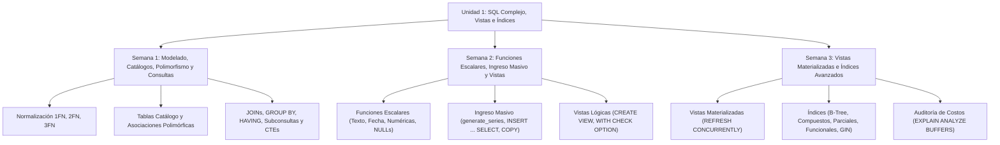
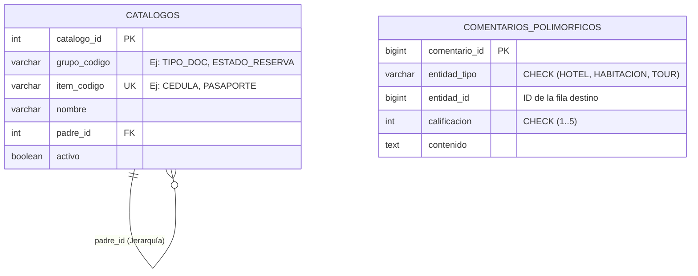
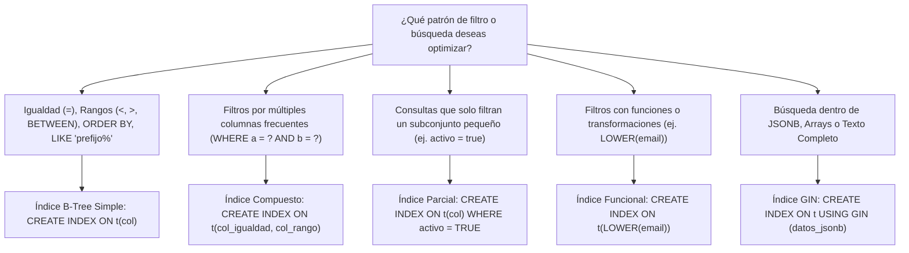
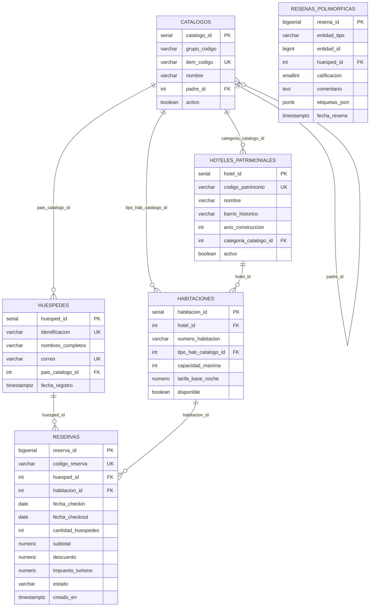
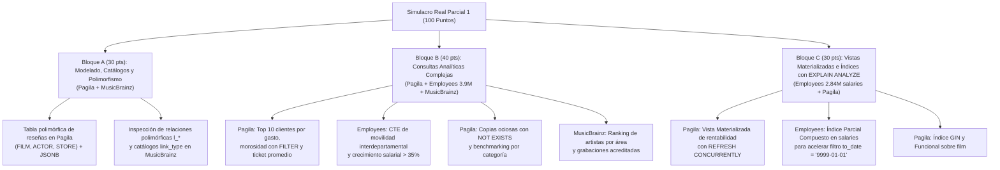

# 🎓 Semana 4: Repaso Integral de la Unidad 1 y Evaluación del Primer Parcial

> **Instituto Superior Tecnológico de Turismo y Patrimonio Yavirac**  
> **Carrera:** Tecnología Superior en Desarrollo de Software  
> **Asignatura:** Base de Datos Avanzada (`DS4AC1-215`) | **Paralelo:** Paralelo D  
> **Docente:** Ing. Byron Moreno  
> **Unidad 1:** Sentencias SQL complejas, vistas e índices  
> **Periodo Académico:** 2026-II | **Semestre:** Segundo | **Modalidad:** Dual  

---

## 📋 1. Ficha Técnica de la Sesión y Planificación Curricular

| Parámetro | Detalle Oficial según PEA y Planificación de Unidades (Paralelo D) |
| :--- | :--- |
| **Institución** | Instituto Superior Tecnológico de Turismo y Patrimonio Yavirac |
| **Carrera / Nivel** | Desarrollo de Software — Segundo Semestre (Modalidad Dual) |
| **Periodo Académico** | 2026-II |
| **Docente** | Ing. Byron Moreno |
| **Asignatura / Código** | Base de Datos Avanzada (`DS4AC1-215`) |
| **Paralelo** | Paralelo D |
| **Unidad Curricular** | Unidad 1: Sentencias SQL complejas, vistas e índices (ID Unidad: 347552) |
| **Semana Académica** | Semana 4 de 9 |
| **Carga Horaria Semanal** | **5 Horas Presenciales** (ACD: 2h | APECD: 3h | APEA: 0h | AA: 0h) |
| **Clase 7 (2 Horas — ACD)** | **Fecha:** Lunes 16 de noviembre de 2026 \| **Tipo:** Aula (ACD - Presencial Teórico-Práctico) \| **Contenido:** Retroalimentación académica: Espacio de preguntas, respuestas y resolución de dudas sobre sentencias SQL complejas, vistas e índices. |
| **Clase 8 (3 Horas — APECD)** | **Fecha:** Miércoles 18 de noviembre de 2026 \| **Tipo:** Laboratorio (APECD - Práctico-Experimental) \| **Contenido:** Evaluación práctica del Primer Parcial: Aplicación práctica y resolución de casos de sentencias SQL complejas, vistas e índices en laboratorio. |
| **Prerrequisitos** | Fundamentos de Bases de Datos, Modelo Entidad-Relación (MER), Álgebra Relacional básica |
| **Entorno Tecnológico** | PostgreSQL 16+, pgAdmin 4, psql, DBeaver, Visual Studio Code |

---

## 🎯 2. Objetivos de las Clases, Resultados de Aprendizaje y Competencias

### 2.1. Objetivos de las Clases (Redactados con Verbo en Infinitivo)

- **Objetivo General de la Semana 4:**  
  Consolidar las competencias adquiridas en la Unidad 1 mediante retroalimentación reflexiva, clínica de dudas frecuentes y evaluación sumativa integral del Primer Parcial en laboratorio.
- **Objetivo Específico de la Clase 7 (2 Horas (120 min) — ACD / Aula — Lunes 16 de noviembre de 2026):**  
  Sintetizar los contenidos de la Unidad 1 mediante la resolución de dudas, análisis de errores frecuentes y estudio de casos integradores de modelado DDL, consultas analíticas, vistas e índices.
- **Objetivo Específico de la Clase 8 (3 Horas (180 min) — APECD / Laboratorio — Miércoles 18 de noviembre de 2026):**  
  Evaluar en entorno de laboratorio las destrezas prácticas de modelamiento relacional, sentencias DDL, consultas complejas, vistas y optimización con índices a través de la resolución de un caso empresarial integral.

### 2.2. Resultados de Aprendizaje (RdA) y Competencias
> [!IMPORTANT]
> **Norma Pedagógica de Redacción:** Los Resultados de Aprendizaje describen lo que el estudiante demuestra al finalizar la clase; se redactan en **tercera persona del presente de indicativo** (NUNCA en infinitivo terminado en *-ar*, *-er*, *-ir*).

| Componente Curricular | Redacción Oficial (Sin Verbos en Infinitivo) |
| :--- | :--- |
| **Resultados de Aprendizaje Institucionales (PEA)** | **RdA 1 (PEA):** Brinda asistencia técnica en el diseño, modelamiento e ilustración del proceso de base de datos.<br>**RdA 2 (PEA):** Utiliza herramientas y tecnologías de programación para llevar a cabo tareas específicas en el campo de desarrollo de software. |
| **Resultado de Aprendizaje Específico de la Semana** | **Resuelve problemas complejos de modelado, extracción y optimización de datos en PostgreSQL, demostrando dominio técnico de los contenidos de la Unidad 1 bajo condiciones de evaluación sumativa.** |
| **Competencia de la Asignatura** | Diseñar, implementar y optimizar estructuras relacionales, consultas analíticas y esquemas de indexación para garantizar un procesamiento de datos eficiente en aplicaciones de software. |
| **Habilidades Blandas Priorizadas (PEA)** | • **Trabajo en equipo:** Realiza trabajos de investigación grupales y prácticas colaborativas.<br>• **Pensamiento crítico:** Utiliza herramientas específicas para el diseño y optimización de bases de datos.<br>• **Gestión del tiempo:** Realiza las prácticas en laboratorio dentro del horario establecido.<br>• **Comunicación técnica efectiva:** Expone y sustenta con claridad decisiones de arquitectura relacional. |

---

## ⏱️ 3. Agenda Detallada y Cronograma Semanal (5 Horas)

### 📅 CLASE 7: Lunes 16 de noviembre de 2026 (2 Horas (120 min)) — ACD (Aula / Teoría Magistral y Ejemplos Guiados)
| Bloque | Tiempo | Componente | Actividad Pedagógica y Contenido |
| :---: | :---: | :---: | :--- |
| **Bloque 7.1** | 40 min | **ACD** | Síntesis Ejecutiva de la Unidad 1: Mapa conceptual integrador de modelado lógico relacional, tablas catálogo unificadas, arcos polimórficos, orden lógico de consultas SQL y taxonomía de índices. |
| **Bloque 7.2** | 40 min | **ACD** | Clínica de Dudas y Errores Frecuentes (FAQ Técnico): Análisis interactivo de los 6 errores típicos en exámenes (trampa de `NOT IN` con nulos, expresiones no SARGables, división entera, orden de índices compuestos). |
| **Bloque 7.3** | 40 min | **ACD** | Espacio de Preguntas y Respuestas Abiertas: Resolución guiada de inquietudes de los estudiantes y simulacro rápido de reactivos. |

### 🔬 CLASE 8: Miércoles 18 de noviembre de 2026 (3 Horas (180 min)) — APECD (Laboratorio de Cómputo / Taller Práctico y Solucionario)
| Bloque | Tiempo | Componente | Actividad Pedagógica y Contenido |
| :---: | :---: | :---: | :--- |
| **Bloque 8.1** | 30 min | **APECD** | Evaluación Parte 1: Teoría Aplicada y Análisis de Planes de Ejecución (25 Puntos): Interpretación de planes `EXPLAIN ANALYZE` y preguntas conceptuales de arquitectura. |
| **Bloque 8.2** | 45 min | **APECD** | Evaluación Parte 2: Modelamiento Lógico, Catálogos, Polimorfismo y DDL (25 Puntos): Implementación de esquemas relacionales empresariales y restricciones. |
| **Bloque 8.3** | 60 min | **APECD** | Evaluación Parte 3: Consultas Complejas, Vistas e Índices (30 Puntos): Formulación de consultas analíticas avanzadas, creación de vistas materializadas y diseño de índices óptimos. |
| **Bloque 8.4** | 45 min | **APECD** | Evaluación Parte 4 y Cierre: Optimización de Rendimiento y Rúbrica Oficial (20 Puntos): Entrega del script final, retroalimentación y aplicación de rúbrica. |

---

## 📚 4. PARTE I: CLASE 7 (16/11/2026 — 2 Horas / ACD) — Retroalimentación Académica y Síntesis de Unidad 1

Esta primera parte de la sesión (**2 horas ACD**) funciona como un espacio abierto de preguntas y respuestas apoyado en hojas de referencia rápida (*Cheat Sheets*) para despejar cualquier duda antes de iniciar la evaluación práctica.

### 4.1 Mapa Conceptual Integrador de la Unidad 1



---

### 4.2 Repaso Express: Modelado Lógico, Tablas Catálogo y Asociaciones Polimórficas

#### A. Resumen de Formas Normales (1FN a 3FN)

| Forma Normal | Regla de Oro | Antipatrón Común | Solución en PostgreSQL |
| :--- | :--- | :--- | :--- |
| **1FN (Primera)** | Atributos atómicos, sin grupos repetitivos. | Columna `telefonos VARCHAR` con `'099111222, 022333444'`. | Crear tabla hija `cliente_telefonos` o usar relación `1:N`. |
| **2FN (Segunda)** | 1FN + Sin dependencias parciales respecto a una PK compuesta. | En `detalle_factura(factura_id, producto_id)`, guardar `nombre_producto`. | Mover `nombre_producto` exclusivamente a la tabla `productos(producto_id)`. |
| **3FN (Tercera)** | 2FN + Sin dependencias transitivas entre atributos no clave. | En `empleados`, guardar `departamento_id` y también `nombre_departamento`. | Mantener `nombre_departamento` en la tabla `departamentos`. |

#### B. Tablas Catálogo Unificadas vs. Asociaciones Polimórficas



> **💡 Pregunta típica de examen:** *¿Por qué una Asociación Polimórfica (`entidad_tipo`, `entidad_id`) no puede tener una restricción `FOREIGN KEY` nativa hacia múltiples tablas a la vez?*
> **Respuesta:** Porque una clave foránea en SQL estándar apunta exactamente a **una** tabla destino fija. Para mitigar esto en la Unidad 1 usamos:
> 1. Un `CHECK (entidad_tipo IN ('HOTEL', 'HABITACION'))` para restringir los dominios válidos.
> 2. Un **índice compuesto** `CREATE INDEX idx_polimorfico ON tabla (entidad_tipo, entidad_id);` para acelerar los `JOIN` filtrados. *(Nota: En la Unidad 2 aprenderemos a validar la existencia real del `entidad_id` mediante **Triggers** en PL/pgSQL).*

---

### 4.3 Cheat Sheet: Orden de Evaluación Lógica en SQL y Consultas Complejas

Uno de los errores más frecuentes al escribir consultas complejas es intentar usar un alias definido en el `SELECT` dentro del `WHERE` o del `GROUP BY`. Recordemos el **orden real en que el motor de PostgreSQL ejecuta una consulta**:


#### Tabla de Referencia Rápida: Cláusulas y Patrones Analíticos

| Necesidad Analítica | Herramienta Recomendada | Sintaxis Clave en PostgreSQL |
| :--- | :--- | :--- |
| Filtrar filas individuales **antes** de agrupar | `WHERE` | `WHERE fecha_reserva >= '2026-01-01'` |
| Filtrar grupos **después** de calcular agregados | `HAVING` | `HAVING COUNT(*) >= 5 AND SUM(total) > 1000` |
| Contar o sumar condicionalmente dentro de una columna | `FILTER (WHERE ...)` | `COUNT(*) FILTER (WHERE estado = 'PAGADA') AS pagadas` |
| Reemplazar valores `NULL` por un valor por defecto | `COALESCE(v1, v2, ...)` | `COALESCE(descuento, 0.00)` |
| Evitar división para cero devolviendo `NULL` | `NULLIF(a, b)` | `total / NULLIF(cantidad_huespedes, 0)` |
| Verificar existencia sin sufrir el problema de `NULL`s | `EXISTS` / `NOT EXISTS` | `WHERE NOT EXISTS (SELECT 1 FROM pagos p WHERE p.reserva_id = r.id)` |
| Modularizar consultas complejas de múltiples pasos | `CTE (WITH)` | `WITH ventas_mes AS (SELECT ...) SELECT * FROM ventas_mes` |
| Obtener los Top-N registros por cada categoría | `JOIN LATERAL` | `LEFT JOIN LATERAL (SELECT ... WHERE ... ORDER BY ... LIMIT 3) sub ON TRUE` |

---

### 4.4 Cheat Sheet: Vistas, Vistas Materializadas e Índices

#### Comparativa Arquitectónica: Vistas vs. Vistas Materializadas

| Característica | Vista Estándar (`VIEW`) | Vista Materializada (`MATERIALIZED VIEW`) |
| :--- | :--- | :--- |
| **Almacenamiento en disco** | No almacena filas (solo guarda la definición SQL en el catálogo). | Sí almacena físicamente el resultado en disco como una tabla. |
| **Frescura de los datos** | **Tiempo real (100% actualizada)** en cada `SELECT`. | **Instantánea histórica** (datos vigentes al último `REFRESH`). |
| **Velocidad de lectura** | Depende de la complejidad de la consulta subyacente. | **Ultra rápida** (lectura directa del resultado precalculado). |
| **Soporte de Índices** | No se pueden crear índices sobre la vista (usa los de las tablas base). | **Sí permite índices propios** (incluyendo `UNIQUE INDEX`). |
| **Actualización sin bloqueo** | N/A (siempre está al día). | `REFRESH MATERIALIZED VIEW CONCURRENTLY nombre_mv;` (requiere `UNIQUE INDEX`). |

#### Árbol de Decisión para Selección de Índices en PostgreSQL



---

## 💻 5. CLASE 7: Clínica de Dudas y Errores Frecuentes (FAQ Técnico Ejecutable — ACD 2 Horas)

Durante las primeras tres semanas, los siguientes **6 antipatrones** suelen provocar pérdidas de puntos en las evaluaciones. Analicemos cada uno en vivo con su respectiva corrección.

### Error #1: La Trampa Mortal de `NOT IN` cuando hay valores `NULL`

Si una subconsulta dentro de `NOT IN (...)` devuelve **al menos un valor `NULL`**, toda la expresión se evalúa como `UNKNOWN` y la consulta principal devuelve **0 filas**, aunque existan datos.

```sql
-- ❌ ANTIPATRÓN PELIGROSO: Si algún cupón tiene cliente_id IS NULL, devuelve 0 filas
SELECT c.cliente_id, c.nombre
FROM clientes c
WHERE c.cliente_id NOT IN (
    SELECT cu.cliente_id FROM cupones_usados cu -- ¡Peligro si cliente_id permite NULL!
);

-- ✅ SOLUCIÓN PROFESIONAL: Usar NOT EXISTS (inmune a NULLs y optimizable con Anti-Join)
SELECT c.cliente_id, c.nombre
FROM clientes c
WHERE NOT EXISTS (
    SELECT 1
    FROM cupones_usados cu
    WHERE cu.cliente_id = c.cliente_id
);
```

### Error #2: Destruir el uso de un Índice por aplicar funciones a la columna (No-SARGable)

Si tienes un índice B-Tree sobre `fecha_registro` o `correo`, envolver la columna en una función (`EXTRACT`, `DATE_PART`, `LOWER`) dentro del `WHERE` impide usar el índice normal y fuerza un `Seq Scan`.

```sql
-- ❌ ANTIPATRÓN: Fuerza Seq Scan aunque exista índice en fecha_reserva
SELECT * FROM reservas
WHERE EXTRACT(YEAR FROM fecha_reserva) = 2026;

-- ✅ SOLUCIÓN 1 (Reescribir predicado a rango SARGable): Usa el índice B-Tree existente
SELECT * FROM reservas
WHERE fecha_reserva >= '2026-01-01 00:00:00-05'
  AND fecha_reserva <  '2027-01-01 00:00:00-05';

-- ✅ SOLUCIÓN 2 (Para textos): Crear un Índice Funcional que coincida exactamente con la expresión
CREATE INDEX idx_clientes_correo_lower ON clientes (LOWER(correo));
SELECT * FROM clientes WHERE LOWER(correo) = LOWER('Usuario@Yavirac.edu.ec');
```

### Error #3: División Entera Truncada al Calcular Porcentajes

En PostgreSQL, dividir un `INTEGER` o `BIGINT` para otro entero (`COUNT(*) / total`) trunca los decimales a `0`.

```sql
-- ❌ ANTIPATRÓN: 45 / 100 devuelve 0 en lugar de 0.45
SELECT (COUNT(*) FILTER (WHERE estado = 'CANCELADA') / COUNT(*)) * 100 AS pct_cancelacion
FROM reservas;

-- ✅ SOLUCIÓN: Multiplicar por 100.0 o hacer cast explícito a NUMERIC
SELECT ROUND(
    (COUNT(*) FILTER (WHERE estado = 'CANCELADA')::NUMERIC * 100.0) / NULLIF(COUNT(*), 0),
    2
) AS pct_cancelacion
FROM reservas;
```

### Error #4: Confundir el orden de las columnas en un Índice Compuesto

```sql
-- Si nuestras consultas frecuentes son:
-- Consulta A: WHERE hotel_id = 10
-- Consulta B: WHERE hotel_id = 10 AND fecha_entrada >= '2026-06-01'

-- ✅ CORRECTO: Primero la columna de igualdad (y filtro individual común), luego el rango
CREATE INDEX idx_reservas_hotel_fecha ON reservas (hotel_id, fecha_entrada);
```

### Error #5: Fuga de Filas en Vistas Editables sin `WITH CHECK OPTION`

Si creas una vista `vw_habitaciones_activas` con `WHERE activo = TRUE` pero omites `WITH CHECK OPTION`, un usuario podría hacer un `INSERT` o `UPDATE` poniendo `activo = FALSE` a través de la vista, haciendo que el registro desaparezca de la vista sin error.

```sql
-- ✅ SOLUCIÓN: Blindar la vista editable
CREATE OR REPLACE VIEW vw_habitaciones_activas AS
SELECT habitacion_id, hotel_id, numero_habitacion, tarifa_noche, activo
FROM habitaciones
WHERE activo = TRUE
WITH LOCAL CHECK OPTION;
```

### Error #6: Fallo al ejecutar `REFRESH MATERIALIZED VIEW CONCURRENTLY`

```sql
-- ❌ ERROR: "cannot refresh materialized view concurrently without a unique index"
REFRESH MATERIALIZED VIEW CONCURRENTLY mv_ingresos_mensuales;

-- ✅ SOLUCIÓN: Crear primero un índice ÚNICO sobre la(s) columna(s) identificadora(s) de la vista materializada
CREATE UNIQUE INDEX idx_uq_mv_ingresos_mensuales
ON mv_ingresos_mensuales (hotel_id, mes_anio);

-- Ahora sí se puede refrescar sin bloquear a los lectores:
REFRESH MATERIALIZED VIEW CONCURRENTLY mv_ingresos_mensuales;
```

---

### 📺 Video Tutorial Recomendado en Español — Clase 7 (2 Horas — ACD / Aula)

> [!TIP]
> **Video de Apoyo Académico (Español):**  
> 🎬 **[Los Errores más Comunes al Escribir Consultas SQL](https://www.youtube.com/watch?v=TP9gg2vICGM)**  
> **Canal / Autor:** BettaTech / TodoCode • **Duración estimada:** ~22 min • **Idioma:** Español  
> **Temas clave explicados:** Resolución de errores típicos en exámenes: trampa de nulos con NOT IN, funciones aplicadas a columnas indexadas (expresiones no SARGables) y optimización de consultas complejas.

---

## 🛠️ 6. PARTE II: CLASE 8 (18/11/2026 — 3 Horas / APECD) — Examen Práctico del Primer Parcial Oficial

### 🏛️ Caso Empresarial Integrador: Plataforma "Yavirac Heritage Stays"

El Distrito Metropolitano de Quito y el consorcio turístico **"Yavirac Heritage Stays"** están desarrollando el motor de base de datos en **PostgreSQL** para administrar su red de **Hoteles Patrimoniales**, sus **Habitaciones**, el registro de **Huéspedes** nacionales y extranjeros, las **Reservas de Alojamiento**, un **Catálogo Unificado** de configuraciones del sistema y una galería de **Multimedia y Reseñas Polimórficas** (que pueden asociarse tanto a un Hotel como a una Habitación específica).

#### Instrucciones Generales de la Evaluación
- **Duración total:** 180 minutos (3 horas).
- **Puntaje total:** 100 puntos.
- **Entregable:** Un único script SQL ordenado, documentado con comentarios y 100% ejecutable de principio a fin.

---

### 📝 Parte 1: Evaluación Teórica y Análisis de Planes de Ejecución (25 Puntos / 30 min)

Responde las siguientes **10 preguntas de opción múltiple**, justificando brevemente en un comentario SQL (`--`) por qué tu elección es correcta:

1. **(2.5 pts)** En una tabla `detalle_reserva(reserva_id, servicio_id, nombre_servicio, cantidad, precio_unitario)` cuya clave primaria es `(reserva_id, servicio_id)`, el atributo `nombre_servicio` depende únicamente de `servicio_id`. ¿Qué forma normal se está violando directamente?
   - a) Primera Forma Normal (1FN)
   - b) Segunda Forma Normal (2FN)
   - c) Tercera Forma Normal (3FN)
   - d) Ninguna, está completamente normalizada

2. **(2.5 pts)** ¿Cuál es el resultado de ejecutar `SELECT COALESCE(NULL, NULLIF(10, 10), '50'::INTEGER, 100);` en PostgreSQL?
   - a) `10`
   - b) `NULL`
   - c) `50`
   - d) `100`

3. **(2.5 pts)** ¿Por qué razón técnica una cláusula `WHERE` **no** puede utilizar una función de agregación como `WHERE SUM(monto) > 500`?
   - a) Porque `SUM()` solo acepta tipos de datos `INTEGER`.
   - b) Porque en el orden de evaluación lógica de SQL, `WHERE` se ejecuta **antes** de `GROUP BY` y del cálculo de agregaciones.
   - c) Porque `SUM()` requiere obligatoriamente una subconsulta correlacionada.
   - d) Porque en PostgreSQL solo se permite `COUNT(*)` dentro del `WHERE`.

4. **(2.5 pts)** Si deseas obtener **todos** los hoteles patrimoniales registrados en la base de datos, incluyendo aquellos que **nunca han recibido una reserva**, mostrando `0` en su total de reservas, ¿qué combinación es la correcta?
   - a) `INNER JOIN reservas` con `COUNT(r.reserva_id)`
   - b) `LEFT JOIN reservas` con `COUNT(*)`
   - c) `LEFT JOIN reservas` con `COUNT(r.reserva_id)`
   - d) `RIGHT JOIN reservas` con `COUNT(h.hotel_id)`

5. **(2.5 pts)** ¿Qué ocurre en PostgreSQL si ejecutas `CREATE OR REPLACE VIEW vw_resumen AS ...` cambiando el **orden** o eliminando una de las columnas que ya existían en la vista original?
   - a) PostgreSQL actualiza la vista automáticamente sin advertencias.
   - b) PostgreSQL lanza un error porque `CREATE OR REPLACE VIEW` solo permite mantener las mismas columnas en el mismo orden (y opcionalmente añadir nuevas columnas al final).
   - c) PostgreSQL convierte automáticamente la vista en una Vista Materializada.
   - d) PostgreSQL borra todas las tablas base asociadas.

6. **(2.5 pts)** Analiza el siguiente resultado de `EXPLAIN ANALYZE`:
   ```text
   Seq Scan on reservas r  (cost=0.00..4520.00 rows=120 width=64) (actual time=0.045..38.912 rows=95 loops=1)
     Filter: (lower((codigo_cupon)::text) = 'quito2026'::text)
     Rows Removed by Filter: 199905
   ```
   Existe un índice `CREATE INDEX idx_reservas_cupon ON reservas(codigo_cupon);`. ¿Por qué PostgreSQL NO usó el índice y leyó las 200,000 filas completas?
   - a) Porque la tabla tiene demasiadas filas para usar un índice B-Tree.
   - b) Porque el filtro aplica la función `lower(codigo_cupon)` y el índice fue creado sobre la columna cruda `codigo_cupon`, no sobre la expresión `lower(codigo_cupon)`.
   - c) Porque `EXPLAIN ANALYZE` desactiva todos los índices automáticamente.
   - d) Porque los índices B-Tree no soportan el operador `=`.

7. **(2.5 pts)** En el diseño de una tabla `resenas_polimorficas` con las columnas `(resena_id, entidad_tipo, entidad_id, calificacion)`, ¿cuál es el índice más eficiente para acelerar la búsqueda de todas las reseñas de un hotel específico (`WHERE entidad_tipo = 'HOTEL' AND entidad_id = 42`)?
   - a) Dos índices separados: uno en `(calificacion)` y otro en `(resena_id)`.
   - b) Un índice compuesto B-Tree sobre `(entidad_tipo, entidad_id)`.
   - c) Un índice GIN sobre `(resena_id)`.
   - d) No es posible crear índices en tablas polimórficas.

8. **(2.5 pts)** ¿Cuál es el requisito obligatorio en PostgreSQL para poder ejecutar `REFRESH MATERIALIZED VIEW CONCURRENTLY mv_ocupacion_hoteles;`?
   - a) Que la vista materializada tenga menos de 1,000 filas.
   - b) Que la vista materializada no utilice cláusulas `JOIN`.
   - c) Que exista al menos un `UNIQUE INDEX` sobre la vista materializada que identifique de forma única cada fila (sin valores `NULL` duplicados).
   - d) Que se ejecute primero `TRUNCATE` sobre la vista materializada.

9. **(2.5 pts)** ¿Para qué sirve la cláusula `INCLUDE (tarifa_total, estado)` al crear un índice B-Tree en PostgreSQL (`CREATE INDEX idx_res_huesped ON reservas (huesped_id) INCLUDE (tarifa_total, estado)`)?
   - a) Para encriptar las columnas `tarifa_total` y `estado`.
   - b) Para almacenar esas columnas como carga útil (*payload*) en los nodos hoja del índice, permitiendo un **Index Only Scan** sin tener que visitar la tabla física (*Heap*).
   - c) Para obligar a que `tarifa_total` y `estado` sean claves primarias.
   - d) Para eliminar duplicados de `huesped_id`.

10. **(2.5 pts)** ¿Qué devuelve la función `generate_series('2026-03-01'::DATE, '2026-03-05'::DATE, '2 days'::INTERVAL)`?
    - a) 5 filas (del 1 al 5 de marzo).
    - b) 3 filas (`2026-03-01`, `2026-03-03`, `2026-03-05`).
    - c) 2 filas (`2026-03-01` y `2026-03-05`).
    - d) Un error de sintaxis porque `generate_series` solo acepta números enteros.

---

### 🏗️ Parte 2: Modelamiento Lógico, Tablas Catálogo, Polimórficas y DDL Avanzado (25 Puntos / 45 min)

Implementa el esquema físico en PostgreSQL cumpliendo **3FN** y todas las restricciones de integridad solicitadas:



#### Requerimientos DDL Exactos:
1. **`catalogos`**:
   - `catalogo_id SERIAL PRIMARY KEY`, `grupo_codigo VARCHAR(40) NOT NULL`, `item_codigo VARCHAR(40) NOT NULL UNIQUE`, `nombre VARCHAR(100) NOT NULL`, `padre_id INTEGER REFERENCES catalogos(catalogo_id)`, `activo BOOLEAN NOT NULL DEFAULT TRUE`.
2. **`hoteles_patrimoniales`**:
   - `hotel_id SERIAL PRIMARY KEY`, `codigo_patrimonio VARCHAR(20) NOT NULL UNIQUE`, `nombre VARCHAR(120) NOT NULL`, `barrio_historico VARCHAR(80) NOT NULL`, `anio_construccion INTEGER NOT NULL CHECK (anio_construccion BETWEEN 1534 AND 1980)`, `categoria_catalogo_id INTEGER NOT NULL REFERENCES catalogos(catalogo_id)`, `activo BOOLEAN NOT NULL DEFAULT TRUE`.
3. **`habitaciones`**:
   - `habitacion_id SERIAL PRIMARY KEY`, `hotel_id INTEGER NOT NULL REFERENCES hoteles_patrimoniales(hotel_id) ON DELETE RESTRICT`, `numero_habitacion VARCHAR(15) NOT NULL`, `tipo_hab_catalogo_id INTEGER NOT NULL REFERENCES catalogos(catalogo_id)`, `capacidad_maxima SMALLINT NOT NULL CHECK (capacidad_maxima BETWEEN 1 AND 8)`, `tarifa_base_noche NUMERIC(10,2) NOT NULL CHECK (tarifa_base_noche > 0)`, `disponible BOOLEAN NOT NULL DEFAULT TRUE`.
   - Restricción única compuesta: un mismo hotel no puede repetir el `numero_habitacion` (`UNIQUE (hotel_id, numero_habitacion)`).
4. **`huespedes`**:
   - `huesped_id SERIAL PRIMARY KEY`, `identificacion VARCHAR(25) NOT NULL UNIQUE`, `nombres_completos VARCHAR(120) NOT NULL`, `correo VARCHAR(120) NOT NULL UNIQUE CHECK (correo LIKE '%_@_%.__%')`, `pais_catalogo_id INTEGER NOT NULL REFERENCES catalogos(catalogo_id)`, `fecha_registro TIMESTAMPTZ NOT NULL DEFAULT NOW()`.
5. **`reservas`**:
   - `reserva_id BIGSERIAL PRIMARY KEY`, `codigo_reserva VARCHAR(30) NOT NULL UNIQUE`, `huesped_id INTEGER NOT NULL REFERENCES huespedes(huesped_id)`, `habitacion_id INTEGER NOT NULL REFERENCES habitaciones(habitacion_id)`, `fecha_checkin DATE NOT NULL`, `fecha_checkout DATE NOT NULL`, `cantidad_huespedes SMALLINT NOT NULL CHECK (cantidad_huespedes >= 1)`, `subtotal NUMERIC(12,2) NOT NULL CHECK (subtotal >= 0)`, `descuento NUMERIC(12,2) DEFAULT 0.00 CHECK (descuento >= 0 AND descuento <= subtotal)`, `impuesto_turismo NUMERIC(12,2) NOT NULL DEFAULT 0.00`, `estado VARCHAR(20) NOT NULL CHECK (estado IN ('PENDIENTE', 'CONFIRMADA', 'COMPLETADA', 'CANCELADA'))`, `creado_en TIMESTAMPTZ NOT NULL DEFAULT NOW()`.
   - Restricción de tabla: `CHECK (fecha_checkout > fecha_checkin)`.
6. **`resenas_polimorficas`**:
   - `resena_id BIGSERIAL PRIMARY KEY`, `entidad_tipo VARCHAR(20) NOT NULL CHECK (entidad_tipo IN ('HOTEL', 'HABITACION'))`, `entidad_id BIGINT NOT NULL`, `huesped_id INTEGER NOT NULL REFERENCES huespedes(huesped_id)`, `calificacion SMALLINT NOT NULL CHECK (calificacion BETWEEN 1 AND 5)`, `comentario TEXT`, `etiquetas_json JSONB NOT NULL DEFAULT '[]'::JSONB`, `fecha_resena TIMESTAMPTZ NOT NULL DEFAULT NOW()`.

---

### 🚀 Parte 3: Poblamiento Masivo y Consultas SQL Complejas (30 Puntos / 60 min)

1. **(6 pts) Poblamiento Masivo con `generate_series`**:
   - Inserta los catálogos base (Categorías de hotel: `'CAT_BOUTIQUE'`, `'CAT_MONASTERIO'`, `'CAT_CASONA'`; Tipos de habitación: `'HAB_SUITE'`, `'HAB_DOBLE'`, `'HAB_SIMPLE'`; Países: `'PAIS_EC'`, `'PAIS_CO'`, `'PAIS_US'`, `'PAIS_ES'`).
   - Inserta **6 hoteles patrimoniales** en el Centro Histórico de Quito.
   - Genera **60 habitaciones** (10 por hotel) usando `generate_series(1, 60)`.
   - Genera **500 huéspedes** sintéticos usando `generate_series(1, 500)`.
   - Genera **10,000 reservas** históricas y futuras usando `generate_series(1, 10000)` con fechas, montos, descuentos (algunos `NULL` para evaluar `COALESCE`) y estados variados.
   - Genera **2,000 reseñas polimórficas** (mitad para `'HOTEL'` y mitad para `'HABITACION'`) con etiquetas en `JSONB`.

2. **(6 pts) Consulta 1 — Reporte Financiero por Hotel (JOINs + Agregaciones + `FILTER` + `HAVING` + Funciones Escalares)**:
   - Obtén para cada hotel patrimonial: `codigo_patrimonio`, `nombre` en mayúsculas, nombre de su categoría en el catálogo, total de reservas históricas, reservas completadas (`FILTER`), reservas canceladas (`FILTER`), porcentaje de cancelación redondeado a 2 decimales, e **ingreso neto recaudado** (`SUM(subtotal - COALESCE(descuento, 0) + impuesto_turismo)` solo de reservas `'COMPLETADA'` o `'CONFIRMADA'`).
   - Filtra con `HAVING` únicamente los hoteles cuyo ingreso neto supere los `$15,000.00`. Ordena de mayor a menor ingreso neto.

3. **(6 pts) Consulta 2 — Benchmarking de Habitaciones Estrella mediante `CTE` (`WITH`)**:
   - Utilizando al menos dos CTEs (`ingresos_habitacion` y `promedio_por_hotel`), lista aquellas habitaciones cuyo ingreso total histórico sea **estrictamente superior al ingreso promedio de las habitaciones de su propio hotel**.
   - Muestra: nombre del hotel, número de habitación, tarifa base, ingreso total de la habitación, promedio de su hotel y la diferencia porcentual sobre el promedio.

4. **(6 pts) Consulta 3 — Búsqueda de Disponibilidad Real con `NOT EXISTS` (Subconsulta Correlacionada)**:
   - Lista todas las habitaciones activas (`disponible = TRUE`) con capacidad para al menos 2 personas que **NO tengan ninguna reserva** en estado `'CONFIRMADA'` o `'PENDIENTE'` que se solape con el rango de Semana Santa: desde `'2026-04-01'` hasta `'2026-04-05'` (recuerda que dos rangos se solapan si `r.fecha_checkin < '2026-04-05' AND r.fecha_checkout > '2026-04-01'`).

5. **(6 pts) Consulta 4 — Auditoría de Reseñas Polimórficas y Top Huéspedes VIP**:
   - Construye una consulta que una `resenas_polimorficas` con `hoteles_patrimoniales` (cuando `entidad_tipo = 'HOTEL'`) y con `habitaciones` (cuando `entidad_tipo = 'HABITACION'`), mostrando el tipo de entidad, el nombre del hotel o número de habitación evaluado, el promedio de calificación y el total de reseñas recibidas.

---

### ⚡ Parte 4: Vistas, Vistas Materializadas y Optimización con Índices (20 Puntos / 45 min)

1. **(5 pts) Vista Operativa Editable (`CREATE OR REPLACE VIEW ... WITH CHECK OPTION`)**:
   - Crea la vista `vw_habitaciones_tarifa_premium` que exponga `habitacion_id`, `hotel_id`, `numero_habitacion`, `capacidad_maxima`, `tarifa_base_noche` y `disponible` únicamente para las habitaciones cuya `tarifa_base_noche >= 120.00` y `disponible = TRUE`, garantizando con `WITH LOCAL CHECK OPTION` que ningún `UPDATE` o `INSERT` a través de la vista permita rebajar la tarifa por debajo de `$120.00`.

2. **(5 pts) Vista Materializada de Inteligencia de Negocios (`CREATE MATERIALIZED VIEW`)**:
   - Crea la vista materializada `mv_kpis_mensuales_hotel` que consolide por `hotel_id` y `mes_anio` (`DATE_TRUNC('month', fecha_checkin)::DATE`): cantidad de reservas, noches totales vendidas (`SUM(fecha_checkout - fecha_checkin)`), ingreso neto y ticket promedio.
   - Crea el **índice único** requerido y demuestra la ejecución de `REFRESH MATERIALIZED VIEW CONCURRENTLY mv_kpis_mensuales_hotel;`.

3. **(10 pts) Laboratorio de Optimización con `EXPLAIN (ANALYZE, BUFFERS)`**:
   - **Caso A:** Ejecuta `EXPLAIN (ANALYZE, BUFFERS)` sobre una consulta que busque reservas activas (`estado IN ('CONFIRMADA', 'PENDIENTE')`) de una habitación específica en un rango de fechas (`fecha_checkin`). Crea un **Índice Compuesto y Parcial** óptimo y vuelve a ejecutar `EXPLAIN (ANALYZE, BUFFERS)` comparando el costo y el tiempo.
   - **Caso B:** Ejecuta `EXPLAIN (ANALYZE, BUFFERS)` sobre una búsqueda de reseñas polimórficas por `entidad_tipo`, `entidad_id` y etiqueta JSONB (`etiquetas_json @> '["limpieza"]'::jsonb`). Crea los índices apropiados (Compuesto B-Tree y GIN) y comprueba la mejora.

---

### 🔑 Solucionario Oficial Completo del Examen Parcial 1 (Para Revisión Docente y Estudio)

<details>
<summary>✅ Ver Solución Oficial — Parte 1: Evaluación Teórica (10 Preguntas)</summary>

| # | Respuesta Correcta | Justificación Técnica |
| :---: | :---: | :--- |
| **1** | **b) Segunda Forma Normal (2FN)** | La PK es compuesta `(reserva_id, servicio_id)` y `nombre_servicio` depende solo de una parte de la PK (`servicio_id`), lo que constituye una **dependencia funcional parcial**. |
| **2** | **c) `50`** | `NULLIF(10, 10)` devuelve `NULL` porque ambos argumentos son iguales. Luego `COALESCE(NULL, NULL, 50, 100)` retorna el primer valor no nulo, que es `50`. |
| **3** | **b) Orden de evaluación lógica** | En SQL, `WHERE` filtra filas base en el paso 2, antes de que `GROUP BY` (paso 3) forme los grupos. Para filtrar agregados se usa `HAVING` (paso 4). |
| **4** | **c) `LEFT JOIN` con `COUNT(r.reserva_id)`** | `LEFT JOIN` preserva los hoteles sin reservas (con `r.reserva_id IS NULL`). Si se usara `COUNT(*)`, contaría la fila nula como `1`; en cambio `COUNT(r.reserva_id)` ignora los `NULL` y devuelve `0`. |
| **5** | **b) Lanza un error** | En PostgreSQL, `CREATE OR REPLACE VIEW` exige que las columnas existentes conserven exactamente su nombre, tipo de dato y posición ordinal. Para eliminar o reordenar columnas se requiere `DROP VIEW` + `CREATE VIEW`. |
| **6** | **b) Predicado no SARGable (`lower(codigo_cupon)`)** | El optimizador no puede usar un índice B-Tree sobre `(codigo_cupon)` si la consulta filtra por `lower(codigo_cupon)`. Se requiere un índice funcional `CREATE INDEX ON reservas (LOWER(codigo_cupon));`. |
| **7** | **b) Índice compuesto B-Tree `(entidad_tipo, entidad_id)`** | Permite localizar directamente en el árbol B-Tree la combinación exacta de tipo de entidad e identificador en $O(\log N)$. |
| **8** | **c) Existencia de un `UNIQUE INDEX`** | PostgreSQL necesita comparar fila por fila la versión anterior con la nueva versión mediante una clave única sin bloquear las lecturas concurrentes. |
| **9** | **b) Habilitar `Index Only Scan`** | `INCLUDE` agrega columnas no clave en las hojas del índice (Covering Index), evitando accesos aleatorios a las páginas de la tabla (*Heap Fetches*). |
| **10** | **b) 3 filas (`03-01`, `03-03`, `03-05`)** | El paso del intervalo es `'2 days'`, por lo que genera las fechas sumando 2 días en cada iteración hasta alcanzar el límite superior. |

</details>

<details>
<summary>✅ Ver Solución Oficial — Parte 2: Implementación DDL Completa en PostgreSQL</summary>

```sql
-- =============================================================================
-- SOLUCIONARIO OFICIAL PARCIAL 1 - PARTE 2: DDL "YAVIRAC HERITAGE STAYS"
-- =============================================================================
DROP SCHEMA IF EXISTS heritage_stays CASCADE;
CREATE SCHEMA heritage_stays;
SET search_path TO heritage_stays, public;

-- 1. Tabla Catálogo Unificada (con soporte jerárquico recursivo)
CREATE TABLE catalogos (
    catalogo_id SERIAL PRIMARY KEY,
    grupo_codigo VARCHAR(40) NOT NULL,
    item_codigo VARCHAR(40) NOT NULL UNIQUE,
    nombre VARCHAR(100) NOT NULL,
    padre_id INTEGER REFERENCES catalogos(catalogo_id) ON DELETE RESTRICT,
    activo BOOLEAN NOT NULL DEFAULT TRUE
);

-- 2. Tabla de Hoteles Patrimoniales
CREATE TABLE hoteles_patrimoniales (
    hotel_id SERIAL PRIMARY KEY,
    codigo_patrimonio VARCHAR(20) NOT NULL UNIQUE,
    nombre VARCHAR(120) NOT NULL,
    barrio_historico VARCHAR(80) NOT NULL,
    anio_construccion INTEGER NOT NULL CHECK (anio_construccion BETWEEN 1534 AND 1980),
    categoria_catalogo_id INTEGER NOT NULL REFERENCES catalogos(catalogo_id) ON DELETE RESTRICT,
    activo BOOLEAN NOT NULL DEFAULT TRUE
);

-- 3. Tabla de Habitaciones
CREATE TABLE habitaciones (
    habitacion_id SERIAL PRIMARY KEY,
    hotel_id INTEGER NOT NULL REFERENCES hoteles_patrimoniales(hotel_id) ON DELETE RESTRICT,
    numero_habitacion VARCHAR(15) NOT NULL,
    tipo_hab_catalogo_id INTEGER NOT NULL REFERENCES catalogos(catalogo_id) ON DELETE RESTRICT,
    capacidad_maxima SMALLINT NOT NULL CHECK (capacidad_maxima BETWEEN 1 AND 8),
    tarifa_base_noche NUMERIC(10,2) NOT NULL CHECK (tarifa_base_noche > 0),
    disponible BOOLEAN NOT NULL DEFAULT TRUE,
    CONSTRAINT uq_hotel_numero_hab UNIQUE (hotel_id, numero_habitacion)
);

-- 4. Tabla de Huéspedes
CREATE TABLE huespedes (
    huesped_id SERIAL PRIMARY KEY,
    identificacion VARCHAR(25) NOT NULL UNIQUE,
    nombres_completos VARCHAR(120) NOT NULL,
    correo VARCHAR(120) NOT NULL UNIQUE CHECK (correo LIKE '%_@_%.__%'),
    pais_catalogo_id INTEGER NOT NULL REFERENCES catalogos(catalogo_id) ON DELETE RESTRICT,
    fecha_registro TIMESTAMPTZ NOT NULL DEFAULT NOW()
);

-- 5. Tabla de Reservas
CREATE TABLE reservas (
    reserva_id BIGSERIAL PRIMARY KEY,
    codigo_reserva VARCHAR(30) NOT NULL UNIQUE,
    huesped_id INTEGER NOT NULL REFERENCES huespedes(huesped_id) ON DELETE RESTRICT,
    habitacion_id INTEGER NOT NULL REFERENCES habitaciones(habitacion_id) ON DELETE RESTRICT,
    fecha_checkin DATE NOT NULL,
    fecha_checkout DATE NOT NULL,
    cantidad_huespedes SMALLINT NOT NULL CHECK (cantidad_huespedes >= 1),
    subtotal NUMERIC(12,2) NOT NULL CHECK (subtotal >= 0),
    descuento NUMERIC(12,2) DEFAULT 0.00 CHECK (descuento >= 0 AND descuento <= subtotal),
    impuesto_turismo NUMERIC(12,2) NOT NULL DEFAULT 0.00 CHECK (impuesto_turismo >= 0),
    estado VARCHAR(20) NOT NULL CHECK (estado IN ('PENDIENTE', 'CONFIRMADA', 'COMPLETADA', 'CANCELADA')),
    creado_en TIMESTAMPTZ NOT NULL DEFAULT NOW(),
    CONSTRAINT chk_fechas_reserva CHECK (fecha_checkout > fecha_checkin)
);

-- 6. Tabla de Reseñas Polimórficas
CREATE TABLE resenas_polimorficas (
    resena_id BIGSERIAL PRIMARY KEY,
    entidad_tipo VARCHAR(20) NOT NULL CHECK (entidad_tipo IN ('HOTEL', 'HABITACION')),
    entidad_id BIGINT NOT NULL,
    huesped_id INTEGER NOT NULL REFERENCES huespedes(huesped_id) ON DELETE CASCADE,
    calificacion SMALLINT NOT NULL CHECK (calificacion BETWEEN 1 AND 5),
    comentario TEXT,
    etiquetas_json JSONB NOT NULL DEFAULT '[]'::JSONB,
    fecha_resena TIMESTAMPTZ NOT NULL DEFAULT NOW()
);
```

</details>

<details>
<summary>✅ Ver Solución Oficial — Parte 3: Poblamiento Masivo y Consultas Complejas</summary>

```sql
-- =============================================================================
-- SOLUCIONARIO OFICIAL PARCIAL 1 - PARTE 3: POBLAMIENTO MASIVO Y CONSULTAS
-- =============================================================================

-- 3.1 Poblamiento de Catálogos Base
INSERT INTO catalogos (grupo_codigo, item_codigo, nombre) VALUES
('CATEGORIA_HOTEL', 'CAT_BOUTIQUE', 'Hotel Boutique Patrimonial 5 Estrellas'),
('CATEGORIA_HOTEL', 'CAT_MONASTERIO', 'Antiguo Claustro / Casa Conventual'),
('CATEGORIA_HOTEL', 'CAT_CASONA', 'Casona Republicana Restaurada'),
('TIPO_HABITACION', 'HAB_SUITE', 'Suite Presidencial Balcón Colonial'),
('TIPO_HABITACION', 'HAB_DOBLE', 'Habitación Doble Patrimonial'),
('TIPO_HABITACION', 'HAB_SIMPLE', 'Habitación Individual Estándar'),
('PAIS', 'PAIS_EC', 'Ecuador'),
('PAIS', 'PAIS_CO', 'Colombia'),
('PAIS', 'PAIS_US', 'Estados Unidos'),
('PAIS', 'PAIS_ES', 'España');

-- 3.2 Inserción de 6 Hoteles Patrimoniales en Quito
INSERT INTO hoteles_patrimoniales (codigo_patrimonio, nombre, barrio_historico, anio_construccion, categoria_catalogo_id) VALUES
('QTO-PAT-001', 'Casa Gangotena Heritage', 'San Francisco', 1926, 1),
('QTO-PAT-002', 'Claustro de La Ronda', 'La Ronda', 1740, 2),
('QTO-PAT-003', 'Casona del Panecillo Real', 'San Sebastián', 1895, 3),
('QTO-PAT-004', 'Palacio Plaza Grande Suites', 'Centro Histórico', 1810, 1),
('QTO-PAT-005', 'Solar de Santo Domingo', 'Santo Domingo', 1785, 2),
('QTO-PAT-006', 'Mansión Santa Bárbara', 'Santa Bárbara', 1912, 3);

-- 3.3 Generación Masiva de 60 Habitaciones (10 por cada hotel)
INSERT INTO habitaciones (hotel_id, numero_habitacion, tipo_hab_catalogo_id, capacidad_maxima, tarifa_base_noche, disponible)
SELECT
    ((gs - 1) / 10) + 1 AS hotel_id,
    'HAB-' || LPAD(gs::TEXT, 3, '0') AS numero_habitacion,
    CASE
        WHEN gs % 5 = 0 THEN 4 -- Suite
        WHEN gs % 2 = 0 THEN 5 -- Doble
        ELSE 6                 -- Simple
    END AS tipo_hab_catalogo_id,
    CASE
        WHEN gs % 5 = 0 THEN 4
        WHEN gs % 2 = 0 THEN 2
        ELSE 1
    END AS capacidad_maxima,
    ROUND((65.00 + (gs % 5) * 45.00 + ((gs - 1) / 10) * 15.00)::NUMERIC, 2) AS tarifa_base_noche,
    (gs % 15 <> 0) AS disponible
FROM generate_series(1, 60) AS gs;

-- 3.4 Generación Masiva de 500 Huéspedes
INSERT INTO huespedes (identificacion, nombres_completos, correo, pais_catalogo_id, fecha_registro)
SELECT
    'ID-' || LPAD(gs::TEXT, 8, '0'),
    'Huésped Patrimonial ' || gs,
    'huesped' || gs || '@correo-turismo.org',
    7 + (gs % 4), -- IDs 7..10 corresponden a los países en catalogos
    NOW() - ((gs % 365) || ' days')::INTERVAL
FROM generate_series(1, 500) AS gs;

-- 3.5 Generación Masiva de 10,000 Reservas
INSERT INTO reservas (
    codigo_reserva, huesped_id, habitacion_id,
    fecha_checkin, fecha_checkout, cantidad_huespedes,
    subtotal, descuento, impuesto_turismo, estado, creado_en
)
SELECT
    'RES-2026-' || LPAD(gs::TEXT, 6, '0') AS codigo_reserva,
    ((gs * 7) % 500) + 1 AS huesped_id,
    ((gs * 3) % 60) + 1 AS habitacion_id,
    ('2025-06-01'::DATE + ((gs % 360) || ' days')::INTERVAL)::DATE AS fecha_checkin,
    ('2025-06-01'::DATE + (((gs % 360) + 1 + (gs % 5)) || ' days')::INTERVAL)::DATE AS fecha_checkout,
    1 + (gs % 3) AS cantidad_huespedes,
    ROUND((120.00 + (gs % 8) * 55.00)::NUMERIC, 2) AS subtotal,
    CASE WHEN gs % 4 = 0 THEN NULL ELSE ROUND(((gs % 5) * 10.00)::NUMERIC, 2) END AS descuento,
    ROUND(((120.00 + (gs % 8) * 55.00) * 0.15)::NUMERIC, 2) AS impuesto_turismo,
    CASE
        WHEN gs % 10 = 0 THEN 'CANCELADA'
        WHEN gs % 6 = 0  THEN 'PENDIENTE'
        WHEN gs % 3 = 0  THEN 'CONFIRMADA'
        ELSE 'COMPLETADA'
    END AS estado,
    NOW() - ((gs % 180) || ' days')::INTERVAL
FROM generate_series(1, 10000) AS gs;

-- 3.6 Generación Masiva de 2,000 Reseñas Polimórficas
INSERT INTO resenas_polimorficas (
    entidad_tipo, entidad_id, huesped_id, calificacion, comentario, etiquetas_json, fecha_resena
)
SELECT
    CASE WHEN gs % 2 = 0 THEN 'HOTEL' ELSE 'HABITACION' END AS entidad_tipo,
    CASE WHEN gs % 2 = 0 THEN ((gs % 6) + 1) ELSE ((gs % 60) + 1) END AS entidad_id,
    ((gs * 11) % 500) + 1 AS huesped_id,
    3 + (gs % 3) AS calificacion, -- Calificaciones entre 3 y 5
    'Experiencia registrada en auditoría de calidad #' || gs,
    CASE
        WHEN gs % 3 = 0 THEN '["limpieza", "arquitectura", "desayuno"]'::JSONB
        WHEN gs % 2 = 0 THEN '["ubicacion", "atencion"]'::JSONB
        ELSE '["limpieza", "silencio"]'::JSONB
    END AS etiquetas_json,
    NOW() - ((gs % 90) || ' days')::INTERVAL
FROM generate_series(1, 2000) AS gs;

-- =============================================================================
-- CONSULTA 1: Reporte Financiero por Hotel (JOINs + FILTER + HAVING + Escalares)
-- =============================================================================
SELECT
    hp.codigo_patrimonio,
    UPPER(hp.nombre) AS hotel_patrimonial,
    cat.nombre AS categoria_oficial,
    COUNT(r.reserva_id) AS total_reservas,
    COUNT(r.reserva_id) FILTER (WHERE r.estado = 'COMPLETADA') AS reservas_completadas,
    COUNT(r.reserva_id) FILTER (WHERE r.estado = 'CANCELADA') AS reservas_canceladas,
    ROUND(
        (COUNT(r.reserva_id) FILTER (WHERE r.estado = 'CANCELADA')::NUMERIC * 100.0)
        / NULLIF(COUNT(r.reserva_id), 0),
        2
    ) AS pct_cancelacion,
    TO_CHAR(
        COALESCE(
            SUM(r.subtotal - COALESCE(r.descuento, 0) + r.impuesto_turismo)
            FILTER (WHERE r.estado IN ('COMPLETADA', 'CONFIRMADA')),
            0
        ),
        'FM$999,999,990.00'
    ) AS ingreso_neto_formateado,
    COALESCE(
        SUM(r.subtotal - COALESCE(r.descuento, 0) + r.impuesto_turismo)
        FILTER (WHERE r.estado IN ('COMPLETADA', 'CONFIRMADA')),
        0
    ) AS ingreso_neto_num
FROM hoteles_patrimoniales hp
INNER JOIN catalogos cat ON cat.catalogo_id = hp.categoria_catalogo_id
LEFT JOIN habitaciones hab ON hab.hotel_id = hp.hotel_id
LEFT JOIN reservas r ON r.habitacion_id = hab.habitacion_id
GROUP BY hp.hotel_id, hp.codigo_patrimonio, hp.nombre, cat.nombre
HAVING COALESCE(
    SUM(r.subtotal - COALESCE(r.descuento, 0) + r.impuesto_turismo)
    FILTER (WHERE r.estado IN ('COMPLETADA', 'CONFIRMADA')),
    0
) > 15000.00
ORDER BY ingreso_neto_num DESC;

-- =============================================================================
-- CONSULTA 2: Benchmarking de Habitaciones Estrella con CTEs
-- =============================================================================
WITH ingresos_habitacion AS (
    SELECT
        hab.habitacion_id,
        hab.hotel_id,
        hab.numero_habitacion,
        hab.tarifa_base_noche,
        COALESCE(
            SUM(r.subtotal - COALESCE(r.descuento, 0) + r.impuesto_turismo)
            FILTER (WHERE r.estado IN ('COMPLETADA', 'CONFIRMADA')),
            0
        ) AS ingreso_total_hab
    FROM habitaciones hab
    LEFT JOIN reservas r ON r.habitacion_id = hab.habitacion_id
    GROUP BY hab.habitacion_id, hab.hotel_id, hab.numero_habitacion, hab.tarifa_base_noche
),
promedio_por_hotel AS (
    SELECT
        hotel_id,
        ROUND(AVG(ingreso_total_hab), 2) AS promedio_hotel
    FROM ingresos_habitacion
    GROUP BY hotel_id
)
SELECT
    hp.nombre AS hotel,
    ih.numero_habitacion,
    ih.tarifa_base_noche,
    ih.ingreso_total_hab,
    pph.promedio_hotel,
    ROUND(((ih.ingreso_total_hab - pph.promedio_hotel) * 100.0) / NULLIF(pph.promedio_hotel, 0), 2) AS pct_sobre_promedio
FROM ingresos_habitacion ih
INNER JOIN promedio_por_hotel pph ON pph.hotel_id = ih.hotel_id
INNER JOIN hoteles_patrimoniales hp ON hp.hotel_id = ih.hotel_id
WHERE ih.ingreso_total_hab > pph.promedio_hotel
ORDER BY hp.nombre, ih.ingreso_total_hab DESC;

-- =============================================================================
-- CONSULTA 3: Disponibilidad Real con NOT EXISTS (Sin solapamiento de fechas)
-- =============================================================================
SELECT
    hp.nombre AS hotel,
    hab.habitacion_id,
    hab.numero_habitacion,
    hab.capacidad_maxima,
    hab.tarifa_base_noche
FROM habitaciones hab
INNER JOIN hoteles_patrimoniales hp ON hp.hotel_id = hab.hotel_id
WHERE hab.disponible = TRUE
  AND hab.capacidad_maxima >= 2
  AND NOT EXISTS (
      SELECT 1
      FROM reservas r
      WHERE r.habitacion_id = hab.habitacion_id
        AND r.estado IN ('CONFIRMADA', 'PENDIENTE')
        AND r.fecha_checkin < '2026-04-05'::DATE
        AND r.fecha_checkout > '2026-04-01'::DATE
  )
ORDER BY hab.tarifa_base_noche ASC;

-- =============================================================================
-- CONSULTA 4: Auditoría Consolidada de Reseñas Polimórficas
-- =============================================================================
SELECT
    rp.entidad_tipo,
    COALESCE(hp.nombre, 'Habitación ' || hab.numero_habitacion) AS elemento_evaluado,
    COUNT(rp.resena_id) AS total_resenas,
    ROUND(AVG(rp.calificacion), 2) AS calificacion_promedio
FROM resenas_polimorficas rp
LEFT JOIN hoteles_patrimoniales hp
    ON rp.entidad_tipo = 'HOTEL' AND rp.entidad_id = hp.hotel_id
LEFT JOIN habitaciones hab
    ON rp.entidad_tipo = 'HABITACION' AND rp.entidad_id = hab.habitacion_id
GROUP BY rp.entidad_tipo, COALESCE(hp.nombre, 'Habitación ' || hab.numero_habitacion)
ORDER BY rp.entidad_tipo, calificacion_promedio DESC;
```

</details>

<details>
<summary>✅ Ver Solución Oficial — Parte 4: Vistas, Vistas Materializadas e Índices con EXPLAIN ANALYZE</summary>

```sql
-- =============================================================================
-- SOLUCIONARIO OFICIAL PARCIAL 1 - PARTE 4: VISTAS E ÍNDICES
-- =============================================================================

-- 4.1 Vista Operativa Editable con WITH LOCAL CHECK OPTION
CREATE OR REPLACE VIEW vw_habitaciones_tarifa_premium AS
SELECT
    habitacion_id,
    hotel_id,
    numero_habitacion,
    capacidad_maxima,
    tarifa_base_noche,
    disponible
FROM habitaciones
WHERE tarifa_base_noche >= 120.00
  AND disponible = TRUE
WITH LOCAL CHECK OPTION;

-- 4.2 Vista Materializada de KPIs Mensuales por Hotel
CREATE MATERIALIZED VIEW mv_kpis_mensuales_hotel AS
SELECT
    hab.hotel_id,
    DATE_TRUNC('month', r.fecha_checkin)::DATE AS mes_anio,
    COUNT(r.reserva_id) AS total_reservas,
    SUM(r.fecha_checkout - r.fecha_checkin) AS noches_vendidas,
    SUM(r.subtotal - COALESCE(r.descuento, 0) + r.impuesto_turismo) AS ingreso_neto,
    ROUND(AVG(r.subtotal - COALESCE(r.descuento, 0) + r.impuesto_turismo), 2) AS ticket_promedio
FROM reservas r
INNER JOIN habitaciones hab ON hab.habitacion_id = r.habitacion_id
WHERE r.estado IN ('COMPLETADA', 'CONFIRMADA')
GROUP BY hab.hotel_id, DATE_TRUNC('month', r.fecha_checkin)::DATE
WITH DATA;

-- Creación del Índice Único obligatorio para refresco concurrente
CREATE UNIQUE INDEX idx_uq_mv_kpis_hotel_mes
ON mv_kpis_mensuales_hotel (hotel_id, mes_anio);

-- Refresco sin bloqueo de lecturas
REFRESH MATERIALIZED VIEW CONCURRENTLY mv_kpis_mensuales_hotel;

-- 4.3 Laboratorio de Optimización con EXPLAIN (ANALYZE, BUFFERS)

-- CASO A: Antes del índice (Seq Scan sobre las 10,000 reservas)
EXPLAIN (ANALYZE, BUFFERS)
SELECT reserva_id, codigo_reserva, fecha_checkin, fecha_checkout
FROM reservas
WHERE habitacion_id = 15
  AND estado IN ('CONFIRMADA', 'PENDIENTE')
  AND fecha_checkin >= '2026-01-01'::DATE;

-- Creación de Índice Compuesto y Parcial (solo indexa reservas activas)
CREATE INDEX idx_reservas_hab_checkin_activas
ON reservas (habitacion_id, fecha_checkin)
INCLUDE (codigo_reserva, fecha_checkout)
WHERE estado IN ('CONFIRMADA', 'PENDIENTE');

ANALYZE reservas;

-- CASO A: Después del índice (Index Only Scan / Index Scan ultrarrápido)
EXPLAIN (ANALYZE, BUFFERS)
SELECT reserva_id, codigo_reserva, fecha_checkin, fecha_checkout
FROM reservas
WHERE habitacion_id = 15
  AND estado IN ('CONFIRMADA', 'PENDIENTE')
  AND fecha_checkin >= '2026-01-01'::DATE;

-- CASO B: Optimización de la Tabla Polimórfica + JSONB
CREATE INDEX idx_resenas_polimorfica_entidad
ON resenas_polimorficas (entidad_tipo, entidad_id);

CREATE INDEX idx_resenas_etiquetas_gin
ON resenas_polimorficas USING GIN (etiquetas_json);

ANALYZE resenas_polimorficas;

EXPLAIN (ANALYZE, BUFFERS)
SELECT resena_id, calificacion, comentario
FROM resenas_polimorficas
WHERE entidad_tipo = 'HOTEL'
  AND entidad_id = 1
  AND etiquetas_json @> '["limpieza"]'::JSONB;
```

</details>

---

### 📺 Video Tutorial Recomendado en Español — Clase 8 (3 Horas — APECD / Laboratorio)

> [!TIP]
> **Video de Apoyo Académico (Español):**  
> 🎬 **[Resolución Práctica de Examen y Ejercicios de Base de Datos](https://www.youtube.com/watch?v=5fxcSskfgxE)**  
> **Canal / Autor:** La Geekipedia de Ernesto / PicaCódigo • **Duración estimada:** ~40 min • **Idioma:** Español  
> **Temas clave explicados:** Guía práctica de resolución de un caso empresarial integral de evaluación: modelado DDL, consultas analíticas, vistas e indexación bajo tiempo cronometrado.

---

## 🚀 7. PARTE III: Actividades de Refuerzo, Examen Alternativo, Rúbrica y Bibliografía

Para fortalecer la habilidad blanda del PEA (*"Realiza ejercicios extras de Funciones y Triggers de forma autónoma"*), una vez concluido el Examen Parcial 1 se propone el siguiente reto preparatorio para la **Semana 05**:

1. **Reflexión Arquitectónica sobre Lógica de Negocio en el Motor:**
   - En el Examen Parcial 1 tuviste que escribir manualmente la fórmula `subtotal - COALESCE(descuento, 0) + impuesto_turismo` en múltiples consultas y vistas.
   - ¿Qué pasaría si el Municipio de Quito cambia la regla del impuesto turístico el próximo mes? Tendrías que modificar 20 consultas distintas.
   - **Reto Autónomo:** Investiga cómo encapsular ese cálculo en una **Función Escalar en PL/pgSQL** (`CREATE FUNCTION calcular_total_reserva(...) RETURNS NUMERIC`) para que todas las consultas y vistas llamen a una única fuente de verdad.

---

## 🌐 Examen Práctico Alternativo / Simulacro Real con Employees (3.9M), Pagila y MusicBrainz

Para los docentes y estudiantes que deseen ejecutar la evaluación del **Primer Parcial** (o un simulacro de alto rendimiento previo al examen) directamente sobre las **3 bases de datos reales de referencia internacional** instaladas en el laboratorio, se presenta este instrumento integrador de **100 puntos (3 horas)**:

1. **Employees (`employees`)** — *3,9 millones de registros (~3.919.015 filas, 333 MB, 6 tablas: `employees`, `departments`, `dept_emp`, `dept_manager`, `titles`, `salaries`)* de [Neon Sample Databases](https://github.com/neondatabase/postgres-sample-dbs).
2. **Pagila (`pagila`)** — *33 tablas (~62.322 filas: `film`, `actor`, `film_actor`, `category`, `film_category`, `language`, `inventory`, `rental`, `payment` [particionada], `customer`, `staff`, `store`, `address`, `city`, `country`)* de [Pagila en GitHub](https://github.com/xzilla/pagila).
3. **MusicBrainz (`musicbrainz`)** — *Esquema enciclopédico musical (`artist`, `artist_type`, `gender`, `area`, `area_type`, `recording`, `release`, `release_group`, `track`, `medium`, `link`, `link_type`, `l_artist_recording`, `l_artist_release`, `l_recording_work`)* de [MusicBrainz Database](https://musicbrainz.org/doc/MusicBrainz_Database).



---

### 🧩 Bloque A: Extensión de Modelado, Tablas Catálogo y Polimorfismo en `Pagila` y `MusicBrainz` (30 Puntos)

1. **(15 pts) Extensión Polimórfica y de Catálogo en `Pagila`:**
   - Conectado a la base de datos `pagila`, crea una tabla catálogo auto-referenciada llamada `catalogo_atributos_pagila` (`catalogo_id SERIAL PK`, `grupo VARCHAR(40)`, `codigo VARCHAR(40) UNIQUE`, `nombre VARCHAR(100)`, `padre_id INT REFERENCES catalogo_atributos_pagila(catalogo_id)`, `activo BOOLEAN DEFAULT TRUE`).
   - Crea una tabla polimórfica llamada `resenas_comunidad_pagila` que permita a los clientes (`customer_id REFERENCES customer(customer_id)`) registrar reseñas tanto sobre una **Película (`'FILM'`)**, un **Actor (`'ACTOR'`)** o una **Tienda (`'STORE'`)**:
     - Columnas requeridas: `resena_id BIGSERIAL PK`, `customer_id INT NOT NULL REFERENCES customer(customer_id)`, `entidad_tipo VARCHAR(15) NOT NULL CHECK (entidad_tipo IN ('FILM', 'ACTOR', 'STORE'))`, `entidad_id INT NOT NULL`, `calificacion SMALLINT NOT NULL CHECK (calificacion BETWEEN 1 AND 5)`, `comentario TEXT`, `metadatos_json JSONB NOT NULL DEFAULT '{}'::JSONB`, `fecha_creacion TIMESTAMPTZ NOT NULL DEFAULT NOW()`.
   - Inserta **3,000 reseñas sintéticas** usando `generate_series(1, 3000)` combinadas con IDs reales de `customer` (`1..599`), `film` (`1..1000`), `actor` (`1..200`) y `store` (`1..2`).

2. **(15 pts) Auditoría de Enlaces Polimórficos/Relacionales en `MusicBrainz`:**
   - En `MusicBrainz`, en lugar de usar una sola tabla polimórfica sin claves foráneas, la arquitectura utiliza un catálogo maestro de tipos de relaciones (`link_type` y `link`) junto con tablas puente tipadas (`l_artist_recording`, `l_artist_release`, `l_recording_work`) donde `entity0` y `entity1` representan las dos entidades conectadas.
   - Escribe una consulta que inspeccione las tablas `l_artist_recording`, `link`, `link_type`, `artist`, `artist_type`, `area` y `recording` para mostrar: nombre del artista, su tipo (`Person`, `Group`, etc.), país/área de origen, el nombre del vínculo en el catálogo (`link_type.name`, ej. `'vocal'`, `'instrument'`, `'producer'`), y el total de grabaciones (`recording`) asociadas bajo ese rol.

---

### 📊 Bloque B: Consultas Complejas de Negocio en `Pagila`, `Employees` (3.9M) y `MusicBrainz` (40 Puntos)

1. **(10 pts) Consulta B.1 (`Pagila`) — Auditoría de Clientes VIP y Morosidad en Devoluciones (`JOIN` + `FILTER` + `HAVING` + Escalares):**
   - Construye una consulta sobre `customer`, `rental`, `inventory`, `film` y `payment` que obtenga el **Top 10 de clientes con mayor monto total pagado**.
   - Debe proyectar: `customer_id`, nombre completo formateado (`INITCAP(first_name || ' ' || last_name)`), correo en minúsculas, total de alquileres realizados, cantidad de alquileres devueltos **a tiempo** (`EXTRACT(DAY FROM (r.return_date - r.rental_date)) <= f.rental_duration`), cantidad de alquileres devueltos **con atraso** (`EXTRACT(DAY FROM (r.return_date - r.rental_date)) > f.rental_duration`) usando `FILTER (WHERE ...)`, porcentaje de atraso redondeado a 2 decimales y gasto total acumulado (`SUM(p.amount)`).
   - Filtra con `HAVING` solo clientes con al menos **25 alquileres** registrados.

2. **(15 pts) Consulta B.2 (`Employees` - 3.9M filas) — Movilidad Interdepartamental y Crecimiento Salarial con `CTEs`:**
   - En la base de datos `employees` (que contiene ~2.84 millones de registros en `salaries` y ~331,603 en `dept_emp`), utiliza bloques `WITH` (CTEs) para identificar a los empleados que cumplen simultáneamente:
     1. Han trabajado en **2 o más departamentos distintos** a lo largo de su historia en `dept_emp`.
     2. Tienen un contrato salarial vigente actualmente (`salaries.to_date = '9999-01-01'`).
     3. Su salario actual supera en **más de un 35%** a su primer salario histórico en la empresa.
   - Muestra: `emp_no`, nombre completo (`first_name || ' ' || last_name`), fecha de contratación (`hire_date`), cantidad de departamentos por los que pasó, primer salario, salario vigente actual, porcentaje de crecimiento salarial y el título de su cargo actual (`titles.title` con `to_date = '9999-01-01'`). Limita a los 20 empleados con mayor porcentaje de crecimiento.

3. **(10 pts) Consulta B.3 (`Pagila`) — Detección de Inventario Inmovilizado de Alto Valor (`CTE` + `NOT EXISTS`):**
   - Encuentra todas las películas (`film`) cuyo costo de reposición (`replacement_cost`) sea estrictamente mayor al promedio de `replacement_cost` de su propia categoría (`category`), y que además posean al menos un ejemplar físico en la tabla `inventory` que **nunca haya sido alquilado** (o que actualmente no tenga ningún alquiler activo `return_date IS NULL`) verificándolo mediante una subconsulta correlacionada con `EXISTS` / `NOT EXISTS`.

4. **(5 pts) Consulta B.4 (`Pagila`) — Análisis Polimórfico Unificado:**
   - Sobre la tabla `resenas_comunidad_pagila` creada en el Bloque A, escribe una consulta que resuelva el nombre real de la entidad evaluada (`film.title` cuando es `'FILM'`, `actor.first_name || ' ' || actor.last_name` cuando es `'ACTOR'`, y `'Tienda #' || store.store_id` cuando es `'STORE'`), mostrando el promedio de calificación y el total de reseñas por cada elemento.

---

### ⚡ Bloque C: Vistas, Vistas Materializadas y Optimización con Índices sobre Datos Masivos (30 Puntos)

1. **(10 pts) Vista Materializada de Rentabilidad por Sucursal y Categoría en `Pagila`:**
   - Crea la vista materializada `mv_pagila_rentabilidad_categoria` que consolide por `store_id`, `category_id` y `nombre_categoria`: total de copias en inventario, total de alquileres, ingresos recaudados (`SUM(payment.amount)`) y recaudación promedio por alquiler.
   - Crea el `UNIQUE INDEX` correspondiente sobre `(store_id, category_id)` y ejecuta `REFRESH MATERIALIZED VIEW CONCURRENTLY mv_pagila_rentabilidad_categoria;`.

2. **(15 pts) Optimización de Consulta Pesada sobre 2.84 Millones de Salarios en `Employees` (`EXPLAIN ANALYZE`):**
   - Ejecuta `EXPLAIN (ANALYZE, BUFFERS)` sobre la siguiente consulta analítica en `employees`:
     ```sql
     SELECT e.emp_no, e.first_name, e.last_name, s.salary, s.from_date
     FROM employees e
     INNER JOIN salaries s ON s.emp_no = e.emp_no
     WHERE s.to_date = '9999-01-01'
       AND s.salary >= 120000
     ORDER BY s.salary DESC;
     ```
   - Diseña y crea un **Índice Compuesto, Parcial y Cubriente (`INCLUDE`)** sobre la tabla `salaries` que indexe únicamente los salarios vigentes (`WHERE to_date = '9999-01-01'`), actualiza estadísticas con `ANALYZE salaries;` y vuelve a ejecutar `EXPLAIN (ANALYZE, BUFFERS)` demostrando el paso de un `Seq Scan` sobre 2.84M de filas a un `Index Only Scan` en pocos milisegundos.

3. **(5 pts) Índice Compuesto y GIN para Reseñas Polimórficas en `Pagila`:**
   - Crea el índice compuesto `(entidad_tipo, entidad_id)` y el índice `GIN` sobre `metadatos_json` en `resenas_comunidad_pagila`, comprobando su uso con `EXPLAIN (ANALYZE, BUFFERS)`.

---

### 🔑 Solucionario Oficial del Simulacro Real (`Employees`, `Pagila` y `MusicBrainz`)

<details>
<summary>✅ Ver Solución Oficial — Bloque A: Extensión Polimórfica en Pagila y Auditoría en MusicBrainz</summary>

```sql
-- =============================================================================
-- SOLUCIÓN BLOQUE A.1: CATÁLOGO Y TABLA POLIMÓRFICA EN PAGILA
-- (Ejecutar conectado a la base de datos: pagila)
-- =============================================================================

CREATE TABLE IF NOT EXISTS catalogo_atributos_pagila (
    catalogo_id SERIAL PRIMARY KEY,
    grupo VARCHAR(40) NOT NULL,
    codigo VARCHAR(40) NOT NULL UNIQUE,
    nombre VARCHAR(100) NOT NULL,
    padre_id INTEGER REFERENCES catalogo_atributos_pagila(catalogo_id) ON DELETE RESTRICT,
    activo BOOLEAN NOT NULL DEFAULT TRUE
);

INSERT INTO catalogo_atributos_pagila (grupo, codigo, nombre, padre_id) VALUES
('MOTIVO_RESENA', 'MOT_CALIDAD', 'Calidad de Producción y Contenido', NULL),
('MOTIVO_RESENA', 'MOT_ATENCION', 'Experiencia de Atención en Sucursal', NULL),
('SUBMOTIVO', 'SUB_GUION', 'Guion y Dirección Cinematográfica', 1),
('SUBMOTIVO', 'SUB_ACTUACION', 'Desempeño Actoral Destacado', 1)
ON CONFLICT (codigo) DO NOTHING;

CREATE TABLE IF NOT EXISTS resenas_comunidad_pagila (
    resena_id BIGSERIAL PRIMARY KEY,
    customer_id INTEGER NOT NULL REFERENCES customer(customer_id) ON DELETE CASCADE,
    entidad_tipo VARCHAR(15) NOT NULL CHECK (entidad_tipo IN ('FILM', 'ACTOR', 'STORE')),
    entidad_id INTEGER NOT NULL,
    calificacion SMALLINT NOT NULL CHECK (calificacion BETWEEN 1 AND 5),
    comentario TEXT,
    metadatos_json JSONB NOT NULL DEFAULT '{}'::JSONB,
    fecha_creacion TIMESTAMPTZ NOT NULL DEFAULT NOW()
);

-- Poblamiento masivo de 3,000 reseñas vinculadas a IDs reales de Pagila
INSERT INTO resenas_comunidad_pagila (
    customer_id, entidad_tipo, entidad_id, calificacion, comentario, metadatos_json, fecha_creacion
)
SELECT
    ((gs * 7) % 599) + 1 AS customer_id,
    CASE
        WHEN gs % 3 = 0 THEN 'FILM'
        WHEN gs % 3 = 1 THEN 'ACTOR'
        ELSE 'STORE'
    END AS entidad_tipo,
    CASE
        WHEN gs % 3 = 0 THEN ((gs % 1000) + 1) -- film_id 1..1000
        WHEN gs % 3 = 1 THEN ((gs % 200) + 1)  -- actor_id 1..200
        ELSE ((gs % 2) + 1)                    -- store_id 1..2
    END AS entidad_id,
    1 + (gs % 5) AS calificacion,
    'Reseña verificada de cliente #' || gs,
    jsonb_build_object(
        'verificado', (gs % 2 = 0),
        'plataforma', CASE WHEN gs % 2 = 0 THEN 'web' ELSE 'app_movil' END,
        'tags', CASE WHEN gs % 3 = 0 THEN '["recomendada", "hd"]'::jsonb ELSE '["clasico"]'::jsonb END
    ),
    NOW() - ((gs % 120) || ' days')::INTERVAL
FROM generate_series(1, 3000) AS gs;

-- =============================================================================
-- SOLUCIÓN BLOQUE A.2: AUDITORÍA DE ENLACES EN MUSICBRAINZ
-- (Ejecutar conectado a la base de datos: musicbrainz)
-- =============================================================================
SELECT
    a.name AS nombre_artista,
    COALESCE(at.name, 'No especificado') AS tipo_artista,
    COALESCE(ar.name, 'Global / Desconocido') AS pais_origen,
    lt.name AS rol_en_catalogo_link_type,
    COUNT(lar.id) AS total_grabaciones_vinculadas
FROM artist a
LEFT JOIN artist_type at ON at.id = a.type
LEFT JOIN area ar ON ar.id = a.area
INNER JOIN l_artist_recording lar ON lar.entity0 = a.id
INNER JOIN link l ON l.id = lar.link
INNER JOIN link_type lt ON lt.id = l.link_type
INNER JOIN recording rec ON rec.id = lar.entity1
GROUP BY a.id, a.name, at.name, ar.name, lt.name
HAVING COUNT(lar.id) >= 5
ORDER BY total_grabaciones_vinculadas DESC
LIMIT 25;
```

</details>

<details>
<summary>✅ Ver Solución Oficial — Bloque B: Consultas Complejas en Pagila y Employees (3.9M filas)</summary>

```sql
-- =============================================================================
-- SOLUCIÓN CONSULTA B.1 (PAGILA): TOP 10 CLIENTES POR GASTO Y TASA DE ATRASO
-- =============================================================================
WITH metricas_alquiler AS (
    SELECT
        r.customer_id,
        COUNT(r.rental_id) AS total_alquileres,
        COUNT(r.rental_id) FILTER (
            WHERE r.return_date IS NOT NULL
              AND EXTRACT(DAY FROM (r.return_date - r.rental_date)) <= f.rental_duration
        ) AS devueltos_a_tiempo,
        COUNT(r.rental_id) FILTER (
            WHERE r.return_date IS NOT NULL
              AND EXTRACT(DAY FROM (r.return_date - r.rental_date)) > f.rental_duration
        ) AS devueltos_con_atraso
    FROM rental r
    INNER JOIN inventory i ON i.inventory_id = r.inventory_id
    INNER JOIN film f ON f.film_id = i.film_id
    GROUP BY r.customer_id
    HAVING COUNT(r.rental_id) >= 25
),
gasto_cliente AS (
    SELECT
        p.customer_id,
        SUM(p.amount) AS monto_total_pagado,
        ROUND(AVG(p.amount), 2) AS ticket_promedio_pago
    FROM payment p
    GROUP BY p.customer_id
)
SELECT
    c.customer_id,
    INITCAP(c.first_name || ' ' || c.last_name) AS cliente,
    LOWER(c.email) AS correo,
    ma.total_alquileres,
    ma.devueltos_a_tiempo,
    ma.devueltos_con_atraso,
    ROUND((ma.devueltos_con_atraso::NUMERIC * 100.0) / NULLIF(ma.total_alquileres, 0), 2) AS pct_morosidad,
    gc.monto_total_pagado,
    gc.ticket_promedio_pago
FROM customer c
INNER JOIN metricas_alquiler ma ON ma.customer_id = c.customer_id
INNER JOIN gasto_cliente gc ON gc.customer_id = c.customer_id
ORDER BY gc.monto_total_pagado DESC
LIMIT 10;

-- =============================================================================
-- SOLUCIÓN CONSULTA B.2 (EMPLOYEES - 3.9M FILAS): MOVILIDAD Y CRECIMIENTO > 35%
-- =============================================================================
WITH empleados_multidepto AS (
    SELECT
        de.emp_no,
        COUNT(DISTINCT de.dept_no) AS total_departamentos
    FROM dept_emp de
    GROUP BY de.emp_no
    HAVING COUNT(DISTINCT de.dept_no) >= 2
),
primer_salario AS (
    SELECT DISTINCT ON (s.emp_no)
        s.emp_no,
        s.salary AS salario_inicial,
        s.from_date AS fecha_primer_salario
    FROM salaries s
    ORDER BY s.emp_no, s.from_date ASC
),
salario_actual AS (
    SELECT
        s.emp_no,
        s.salary AS salario_vigente
    FROM salaries s
    WHERE s.to_date = '9999-01-01'::DATE
)
SELECT
    e.emp_no,
    e.first_name || ' ' || e.last_name AS empleado,
    e.hire_date,
    em.total_departamentos,
    ps.salario_inicial,
    sa.salario_vigente,
    ROUND(((sa.salario_vigente - ps.salario_inicial)::NUMERIC * 100.0) / ps.salario_inicial, 2) AS pct_crecimiento,
    t.title AS cargo_actual
FROM employees e
INNER JOIN empleados_multidepto em ON em.emp_no = e.emp_no
INNER JOIN primer_salario ps ON ps.emp_no = e.emp_no
INNER JOIN salario_actual sa ON sa.emp_no = e.emp_no
LEFT JOIN titles t ON t.emp_no = e.emp_no AND t.to_date = '9999-01-01'::DATE
WHERE ((sa.salario_vigente - ps.salario_inicial)::NUMERIC / ps.salario_inicial) > 0.35
ORDER BY pct_crecimiento DESC
LIMIT 20;

-- =============================================================================
-- SOLUCIÓN CONSULTA B.3 (PAGILA): PELÍCULAS CARAS CON COPIAS JAMÁS ALQUILADAS
-- =============================================================================
WITH promedio_reposicion_cat AS (
    SELECT
        fc.category_id,
        ROUND(AVG(f.replacement_cost), 2) AS avg_replacement_cat
    FROM film f
    INNER JOIN film_category fc ON fc.film_id = f.film_id
    GROUP BY fc.category_id
)
SELECT
    c.name AS categoria,
    f.film_id,
    f.title AS pelicula,
    f.replacement_cost,
    prc.avg_replacement_cat,
    i.inventory_id AS copia_ociosa_id,
    i.store_id
FROM film f
INNER JOIN film_category fc ON fc.film_id = f.film_id
INNER JOIN category c ON c.category_id = fc.category_id
INNER JOIN promedio_reposicion_cat prc ON prc.category_id = fc.category_id
INNER JOIN inventory i ON i.film_id = f.film_id
WHERE f.replacement_cost > prc.avg_replacement_cat
  AND NOT EXISTS (
      SELECT 1
      FROM rental r
      WHERE r.inventory_id = i.inventory_id
  )
ORDER BY f.replacement_cost DESC, f.title ASC;

-- =============================================================================
-- SOLUCIÓN CONSULTA B.4 (PAGILA): REPORTE CONSOLIDADO DE RESEÑAS POLIMÓRFICAS
-- =============================================================================
SELECT
    rcp.entidad_tipo,
    COALESCE(
        f.title,
        a.first_name || ' ' || a.last_name,
        'Sucursal Pagila #' || s.store_id
    ) AS nombre_entidad_evaluada,
    COUNT(rcp.resena_id) AS total_resenas,
    ROUND(AVG(rcp.calificacion), 2) AS calificacion_promedio
FROM resenas_comunidad_pagila rcp
LEFT JOIN film f  ON rcp.entidad_tipo = 'FILM'  AND rcp.entidad_id = f.film_id
LEFT JOIN actor a ON rcp.entidad_tipo = 'ACTOR' AND rcp.entidad_id = a.actor_id
LEFT JOIN store s ON rcp.entidad_tipo = 'STORE' AND rcp.entidad_id = s.store_id
GROUP BY
    rcp.entidad_tipo,
    COALESCE(f.title, a.first_name || ' ' || a.last_name, 'Sucursal Pagila #' || s.store_id)
ORDER BY rcp.entidad_tipo, calificacion_promedio DESC
LIMIT 30;
```

</details>

<details>
<summary>✅ Ver Solución Oficial — Bloque C: Vistas Materializadas e Índices en Employees y Pagila</summary>

```sql
-- =============================================================================
-- SOLUCIÓN BLOQUE C.1 (PAGILA): VISTA MATERIALIZADA CON REFRESCO CONCURRENTE
-- =============================================================================
CREATE MATERIALIZED VIEW IF NOT EXISTS mv_pagila_rentabilidad_categoria AS
SELECT
    i.store_id,
    c.category_id,
    c.name AS nombre_categoria,
    COUNT(DISTINCT i.inventory_id) AS copias_en_inventario,
    COUNT(DISTINCT r.rental_id) AS total_alquileres,
    COALESCE(SUM(p.amount), 0.00) AS ingresos_recaudados,
    ROUND(COALESCE(AVG(p.amount), 0.00), 2) AS ticket_promedio
FROM inventory i
INNER JOIN film_category fc ON fc.film_id = i.film_id
INNER JOIN category c ON c.category_id = fc.category_id
LEFT JOIN rental r ON r.inventory_id = i.inventory_id
LEFT JOIN payment p ON p.rental_id = r.rental_id
GROUP BY i.store_id, c.category_id, c.name
WITH DATA;

CREATE UNIQUE INDEX IF NOT EXISTS idx_uq_mv_pagila_rentabilidad
ON mv_pagila_rentabilidad_categoria (store_id, category_id);

REFRESH MATERIALIZED VIEW CONCURRENTLY mv_pagila_rentabilidad_categoria;

-- =============================================================================
-- SOLUCIÓN BLOQUE C.2 (EMPLOYEES - 2.84M SALARIES): ÍNDICE PARCIAL Y CUBRIENTE
-- =============================================================================
-- 1. Medición Antes del Índice (Realiza Seq Scan sobre ~2.84 millones de filas)
EXPLAIN (ANALYZE, BUFFERS)
SELECT e.emp_no, e.first_name, e.last_name, s.salary, s.from_date
FROM employees e
INNER JOIN salaries s ON s.emp_no = e.emp_no
WHERE s.to_date = '9999-01-01'::DATE
  AND s.salary >= 120000
ORDER BY s.salary DESC;

-- 2. Creación de Índice Parcial (solo indexa contratos vigentes) + INCLUDE
CREATE INDEX IF NOT EXISTS idx_salaries_vigentes_altos
ON salaries (salary DESC, emp_no)
INCLUDE (from_date)
WHERE to_date = '9999-01-01'::DATE;

ANALYZE salaries;

-- 3. Medición Después del Índice (Index Only Scan sobre salaries + Nested Loop)
EXPLAIN (ANALYZE, BUFFERS)
SELECT e.emp_no, e.first_name, e.last_name, s.salary, s.from_date
FROM employees e
INNER JOIN salaries s ON s.emp_no = e.emp_no
WHERE s.to_date = '9999-01-01'::DATE
  AND s.salary >= 120000
ORDER BY s.salary DESC;

-- =============================================================================
-- SOLUCIÓN BLOQUE C.3 (PAGILA): ÍNDICES POLIMÓRFICOS Y GIN
-- =============================================================================
CREATE INDEX IF NOT EXISTS idx_resenas_pagila_entidad
ON resenas_comunidad_pagila (entidad_tipo, entidad_id);

CREATE INDEX IF NOT EXISTS idx_resenas_pagila_json_gin
ON resenas_comunidad_pagila USING GIN (metadatos_json);

ANALYZE resenas_comunidad_pagila;

EXPLAIN (ANALYZE, BUFFERS)
SELECT resena_id, customer_id, calificacion, comentario
FROM resenas_comunidad_pagila
WHERE entidad_tipo = 'FILM'
  AND entidad_id = 10
  AND metadatos_json @> '{"verificado": true}'::JSONB;
```

</details>

---

## 📊 8. Rúbrica Oficial de Evaluación del Examen Parcial 1

| Criterio de Evaluación | Excelente (100%) | Satisfactorio (75%) | En Proceso (50%) | Insuficiente (<25%) | Peso |
| :--- | :--- | :--- | :--- | :--- | :---: |
| **1. Dominio Teórico y Lectura de Planes (Parte 1)** | Responde y justifica con precisión técnica las 10 preguntas de arquitectura SQL e interpretación de `EXPLAIN ANALYZE`. | Responde correctamente entre 7 y 8 preguntas con justificaciones válidas. | Responde entre 5 y 6 preguntas, con confusiones entre `WHERE`/`HAVING` o tipos de índices. | Menos de 5 respuestas correctas o sin justificación técnica. | **25%** |
| **2. Modelamiento Lógico y DDL Avanzado (Parte 2)** | Crea las 6 tablas en 3FN sin errores sintácticos, incluyendo catálogo recursivo, tabla polimórfica y todos los `CHECK`, `UNIQUE` y `FK`. | Crea las tablas pero omite 1 o 2 restricciones `CHECK` secundarias o claves únicas compuestas. | El script presenta errores de orden de creación de claves foráneas o viola la 3FN. | El script DDL no compila en PostgreSQL. | **25%** |
| **3. Poblamiento Masivo y Consultas Complejas (Parte 3)** | Genera los datos con `generate_series` y resuelve las 4 consultas usando `FILTER`, `HAVING`, `CTE`, `NOT EXISTS` y funciones escalares sin errores. | Resuelve al menos 3 consultas correctamente; usa `LEFT JOIN` en vez de `NOT EXISTS` o presenta detalles menores de redondeo. | Resuelve solo 1 o 2 consultas; confunde `WHERE` con `HAVING` o falla con valores `NULL`. | Consultas incompletas o con errores de sintaxis que impiden su ejecución. | **30%** |
| **4. Vistas, Vistas Materializadas e Índices (Parte 4)** | Implementa la vista con `WITH CHECK OPTION`, la vista materializada con refresco concurrente y demuestra la mejora en `EXPLAIN ANALYZE`. | Crea las vistas e índices pero olvida el `UNIQUE INDEX` para `CONCURRENTLY` o no incluye `BUFFERS`. | Crea vistas simples e índices B-Tree básicos sin considerar predicados parciales o compuestos. | No implementa las vistas ni demuestra el uso de índices. | **20%** |

---

## 📖 9. Bibliografía y Recursos Recomendados

1. **PostgreSQL Global Development Group.** (2026). *PostgreSQL 16 Official Documentation — Chapter 7: Queries, Chapter 11: Indexes & Chapter 41: Rules and Views*. Disponible en: `https://www.postgresql.org/docs/current/`
2. **Silberschatz, A., Korth, H. F., & Sudarshan, S.** (2020). *Fundamentos de Bases de Datos* (7.ª ed.). McGraw-Hill.
3. **Winand, M.** (2023). *SQL Performance Explained Everything Developers Need to Know about SQL Performance*. Disponible en: `https://use-the-index-luke.com/`
4. **Instituto Superior Tecnológico de Turismo y Patrimonio Yavirac.** (2026). *Programa de Estudio de la Asignatura (PEA) — Base de Datos Avanzada (DS4AC1-215)*. Quito, Ecuador.

---

<div align="center">

⬅️ [Semana 03: Vistas, Índices y Rendimiento](./semana-03-vistas-indices-rendimiento.md) &nbsp;|&nbsp; 🏠 [Volver al Sílabo General (README)](../README.md) &nbsp;|&nbsp; [Semana 05: Funciones y Procedimientos en PL/pgSQL](./semana-05-funciones-procedimientos-plpgsql.md) ➡️

</div>
