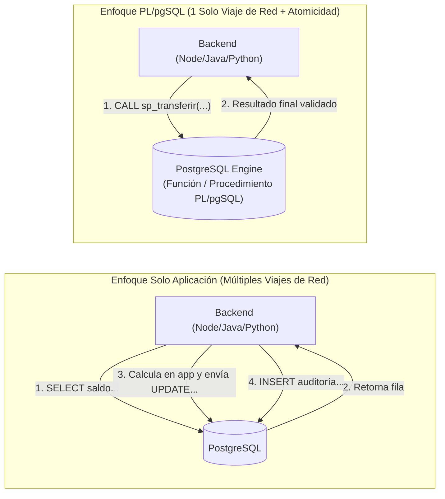
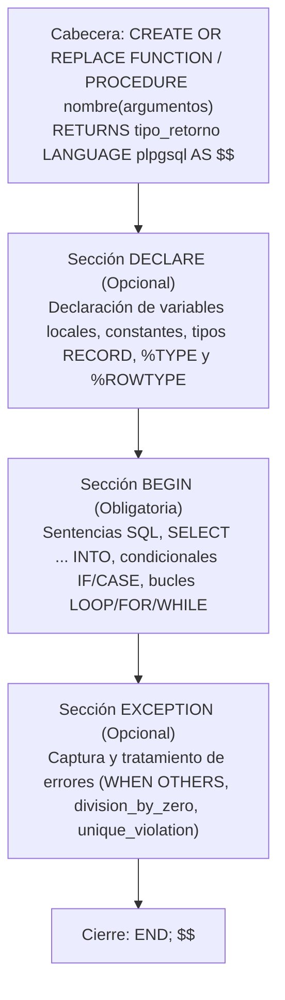
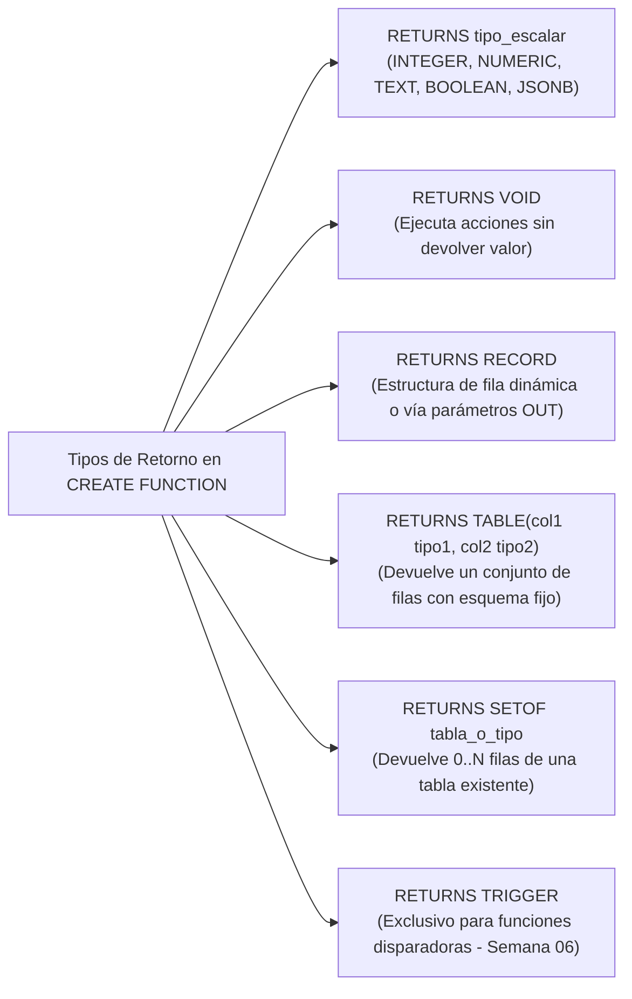
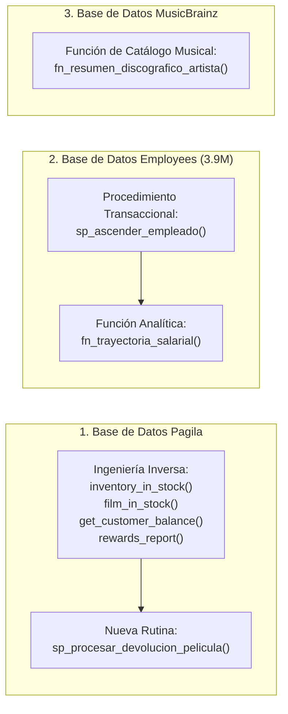

# ⚙️ Semana 5: Programación en el Servidor con Funciones y Procedimientos Almacenados en PL/pgSQL

> **Instituto Superior Tecnológico de Turismo y Patrimonio Yavirac**  
> **Carrera:** Tecnología Superior en Desarrollo de Software  
> **Asignatura:** Base de Datos Avanzada (`DS4AC1-215`) | **Paralelo:** Paralelo D  
> **Docente:** Ing. Yoli Moya, MSc. (Representante del Colectivo de Asignatura)  
> **Unidad 2:** Generación de procedimientos, funciones y triggers  
> **Periodo Académico:** 2026-II | **Semestre:** Segundo | **Modalidad:** Dual  

---

## 📋 1. Ficha Técnica de la Sesión y Planificación Curricular

| Parámetro | Detalle Oficial según PEA y Planificación de Unidades (Paralelo D) |
| :--- | :--- |
| **Institución** | Instituto Superior Tecnológico de Turismo y Patrimonio Yavirac |
| **Carrera / Nivel** | Desarrollo de Software — Segundo Semestre (Modalidad Dual) |
| **Periodo Académico** | 2026-II |
| **Docente** | Ing. Yoli Moya, MSc. |
| **Asignatura / Código** | Base de Datos Avanzada (`DS4AC1-215`) |
| **Paralelo** | Paralelo D |
| **Unidad Curricular** | Unidad 2: Generación de procedimientos, funciones y triggers (ID Unidad: 347553) |
| **Semana Académica** | Semana 5 de 9 |
| **Carga Horaria Semanal** | **5 Horas Presenciales** (ACD: 2h | APECD: 3h | APEA: 0h | AA: 0h) |
| **Clase 9 (2 Horas — ACD)** | **Fecha:** Lunes 23 de noviembre de 2026 \| **Tipo:** Aula (ACD - Presencial Teórico-Práctico) \| **Contenido:** Funciones y Procedimientos Almacenados: Análisis de sintaxis, argumentos, tipos de retornos, uso de tipo RECORD (NEW, OLD), cláusula INTO y fundamentos de PL/pgSQL. |
| **Clase 10 (3 Horas — APECD)** | **Fecha:** Miércoles 25 de noviembre de 2026 \| **Tipo:** Laboratorio (APECD - Práctico-Experimental) \| **Contenido:** Laboratorio práctico: Ejercicios de desarrollo, creación, invocación, modificación y eliminación de funciones y procedimientos almacenados en PostgreSQL. |
| **Prerrequisitos** | Fundamentos de Bases de Datos, Modelo Entidad-Relación (MER), Álgebra Relacional básica |
| **Entorno Tecnológico** | PostgreSQL 16+, pgAdmin 4, psql, DBeaver, Visual Studio Code |

---

## 🎯 2. Objetivos de las Clases, Resultados de Aprendizaje y Competencias

### 2.1. Objetivos de las Clases (Redactados con Verbo en Infinitivo)

- **Objetivo General de la Semana 5:**  
  Desarrollar la lógica de negocio en el motor de bases de datos mediante funciones y procedimientos almacenados en PL/pgSQL, aplicando estructuras de control, manejo de registros dinámicos y control transaccional.
- **Objetivo Específico de la Clase 9 (2 Horas (120 min) — ACD / Aula — Lunes 23 de noviembre de 2026):**  
  Comprender los fundamentos de la programación procedural en PL/pgSQL, analizando la sintaxis, modos de argumentos, tipos de retorno, uso del tipo RECORD y cláusula INTO en funciones y procedimientos almacenados.
- **Objetivo Específico de la Clase 10 (3 Horas (180 min) — APECD / Laboratorio — Miércoles 25 de noviembre de 2026):**  
  Desarrollar, invocar, modificar y eliminar funciones escalares, tabulares y procedimientos con control transaccional autónomo en PostgreSQL mediante ejercicios prácticos de laboratorio.

### 2.2. Resultados de Aprendizaje (RdA) y Competencias
> [!IMPORTANT]
> **Norma Pedagógica de Redacción:** Los Resultados de Aprendizaje describen lo que el estudiante demuestra al finalizar la clase; se redactan en **tercera persona del presente de indicativo** (NUNCA en infinitivo terminado en *-ar*, *-er*, *-ir*).

| Componente Curricular | Redacción Oficial (Sin Verbos en Infinitivo) |
| :--- | :--- |
| **Resultados de Aprendizaje Institucionales (PEA)** | **RdA 2 (PEA):** Utiliza herramientas y tecnologías de programación para llevar a cabo tareas específicas en el campo de desarrollo de software. |
| **Resultado de Aprendizaje Específico de la Semana** | **Desarrolla funciones y procedimientos almacenados en PL/pgSQL aplicando parámetros avanzados, variables de registro y estructuras de control para encapsular lógica de negocio en el motor de base de datos.** |
| **Competencia de la Asignatura** | Aplicar herramientas y tecnologías de bases de datos avanzadas para implementar mecanismos de procesamiento y gestión eficiente de la información en aplicaciones de software. |
| **Habilidades Blandas Priorizadas (PEA)** | • **Trabajo en equipo:** Realiza trabajos de investigación grupales y prácticas colaborativas.<br>• **Pensamiento crítico:** Utiliza herramientas específicas para el diseño y optimización de bases de datos.<br>• **Gestión del tiempo:** Realiza las prácticas en laboratorio dentro del horario establecido.<br>• **Comunicación técnica efectiva:** Expone y sustenta con claridad decisiones de arquitectura relacional. |

---

## ⏱️ 3. Agenda Detallada y Cronograma Semanal (5 Horas)

### 📅 CLASE 9: Lunes 23 de noviembre de 2026 (2 Horas (120 min)) — ACD (Aula / Teoría Magistral y Ejemplos Guiados)
| Bloque | Tiempo | Componente | Actividad Pedagógica y Contenido |
| :---: | :---: | :---: | :--- |
| **Bloque 9.1** | 40 min | **ACD** | Fundamentos de Rutinas y Diferencias Arquitectónicas: `FUNCTION` vs `PROCEDURE` en PostgreSQL, control transaccional (`COMMIT`/`ROLLBACK` en procedimientos), modos de argumentos (`IN`, `OUT`, `INOUT`, `VARIADIC`) y tipos de retorno (`SCALAR`, `TABLE`, `SETOF`, `VOID`). |
| **Bloque 9.2** | 40 min | **ACD** | Anatomía del Lenguaje `PL/pgSQL`: Bloques estructurados (`DECLARE ... BEGIN ... EXCEPTION ... END`), variables `RECORD`, `%TYPE`, `%ROWTYPE`, cláusula `SELECT ... INTO` (`STRICT`/`FOUND`), estructuras condicionales y bucles. |
| **Bloque 9.3** | 40 min | **ACD** | Ejemplos Guiados Paso a Paso: Implementación de función escalar inmutable financiera, función con `RECORD` y `OUT`, función tabular (`RETURNS TABLE`) y procedimiento almacenado de transferencias atómicas. |

### 🔬 CLASE 10: Miércoles 25 de noviembre de 2026 (3 Horas (180 min)) — APECD (Laboratorio de Cómputo / Taller Práctico y Solucionario)
| Bloque | Tiempo | Componente | Actividad Pedagógica y Contenido |
| :---: | :---: | :---: | :--- |
| **Bloque 10.1** | 50 min | **APECD** | Laboratorio Fase 1: Creación de Funciones Escalares y de Decisión: Desarrollo de función de evaluación de riesgo y cupo crediticio con `SELECT ... INTO` y `CASE`. |
| **Bloque 10.2** | 80 min | **APECD** | Laboratorio Fase 2: Funciones Tabulares y Procedimientos Almacenados: Generador de tablas de amortización con `RETURNS TABLE`, `FOR` loop y `RETURN NEXT`; función variadic y procedimiento transaccional de dispersión de fondos. |
| **Bloque 10.3** | 50 min | **APECD** | Laboratorio Fase 3: Pruebas, Modificación (`CREATE OR REPLACE`), Eliminación (`DROP`) y Solucionario: Manejo de sobrecarga de funciones, depuración con `RAISE NOTICE/EXCEPTION`, feedback docente y rúbrica. |

---

## 📚 4. PARTE I: CLASE 9 (23/11/2026 — 2 Horas / ACD) — Funciones y Procedimientos Almacenados en PL/pgSQL

### 4.1 ¿Por qué llevar Lógica al Motor de Base de Datos con `PL/pgSQL`?

Mientras el SQL estándar (visto en la Unidad 1) es un lenguaje **declarativo** (le decimos al motor *qué* datos queremos obtener), **`PL/pgSQL` (Procedural Language / PostgreSQL)** es un lenguaje **imperativo y procedural** nativo que añade variables, estructuras condicionales, bucles, cursores y control de errores directamente dentro del servidor PostgreSQL.



#### Ventajas clave de `PL/pgSQL`:
1. **Eliminación de latencia de red (*Round-trips*):** Múltiples consultas `SELECT`, `INSERT` y `UPDATE` se ejecutan en la memoria local del motor en microsegundos.
2. **Consistencia y Centralización:** Si cinco aplicaciones distintas (Web, App Móvil, ERP, Batch nocturno, BI) se conectan a la misma base de datos, todas comparten exactamente la misma regla de cálculo o validación.
3. **Seguridad Granular (`SECURITY DEFINER`):** Permite que un usuario sin permisos directos de escritura sobre una tabla sensible ejecute únicamente un procedimiento controlado y auditado.

---

### 4.2 Diferencias Arquitectónicas: `FUNCTION` vs. `PROCEDURE` en PostgreSQL

A partir de PostgreSQL 11 se introdujo `CREATE PROCEDURE` como ciudadano de primera clase, separando claramente las responsabilidades respecto a `CREATE FUNCTION`:

| Característica Técnica | Función (`CREATE FUNCTION`) | Procedimiento Almacenado (`CREATE PROCEDURE`) |
| :--- | :--- | :--- |
| **Propósito Principal** | Cálculos, transformaciones, consultas encapsuladas y funciones de Trigger. | Orquestación de procesos de negocio, cargas por lotes (ETL) y operaciones transaccionales. |
| **Forma de Invocación** | Dentro de expresiones SQL: `SELECT fn_nombre(...);` o en `FROM`, `WHERE`, `JOIN`. | Sentencia independiente: `CALL sp_nombre(...);` (no puede usarse dentro de un `SELECT`). |
| **Valor de Retorno** | **Obligatorio** declarar `RETURNS <tipo>` (puede ser escalar, `TABLE`, `SETOF`, `RECORD`, `VOID` o `TRIGGER`). | **No tiene cláusula `RETURNS`**. Puede devolver valores únicamente mediante parámetros `OUT` o `INOUT`. |
| **Control Transaccional Interno** | **No permite** ejecutar `COMMIT` ni `ROLLBACK` dentro de su cuerpo (corre dentro de la transacción externa). | **Sí permite** ejecutar `COMMIT` y `ROLLBACK` dentro de su cuerpo (si no se invoca dentro de un bloque `BEGIN` explícito). |
| **Uso en Índices Funcionales** | Sí (si se declara como `IMMUTABLE`). | No aplica. |

---

### 4.3 Anatomía de un Bloque `PL/pgSQL` y Delimitadores Dollar-Quoting (`$$`)

En PostgreSQL, el cuerpo de una función o procedimiento es técnicamente un literal de cadena. Para evitar escapar las comillas simples (`'`) dentro del código, se utiliza el estándar de PostgreSQL llamado **Dollar-Quoting (`$$` o `$body$`)**:



```sql
CREATE OR REPLACE FUNCTION esquema.nombre_funcion(
    p_parametro1 INTEGER,
    p_parametro2 VARCHAR DEFAULT 'VALOR_DEFECTO'
)
RETURNS NUMERIC(12,2)
LANGUAGE plpgsql
AS $$
DECLARE
    -- 1. Declaración de variables locales y constantes
    v_subtotal      NUMERIC(12,2) := 0.00;
    c_iva  CONSTANT NUMERIC(4,2)  := 0.15;
BEGIN
    -- 2. Lógica procedural y consultas SQL
    v_subtotal := p_parametro1 * (1 + c_iva);
    RETURN ROUND(v_subtotal, 2);
EXCEPTION
    -- 3. Manejo de excepciones (opcional pero recomendado)
    WHEN OTHERS THEN
        RAISE WARNING 'Ocurrió un error inesperado: %', SQLERRM;
        RETURN 0.00;
END;
$$;
```

> **📏 Convención de Nombres Profesional (Evita colisiones de nombres):**
> - Prefijo `p_` para **parámetros/argumentos** (ej. `p_cliente_id`).
> - Prefijo `v_` para **variables locales** (ej. `v_saldo_actual`).
> - Prefijo `c_` para **constantes** (ej. `c_tasa_impuesto`).
> - Prefijo `r_` para **registros / filas** (`RECORD` o `%ROWTYPE`, ej. `r_cuenta`).
> *¿Por qué es vital?* Si llamas a un parámetro `cliente_id` igual que la columna `cliente_id` de la tabla, dentro de un `WHERE cliente_id = cliente_id` generarás un error de **referencia ambigua** (`column reference "cliente_id" is ambiguous`).

---

### 4.4 Argumentos y Modos de Parámetros (`IN`, `OUT`, `INOUT`, `VARIADIC`, `DEFAULT`)

| Modo | Dirección | ¿Se puede modificar dentro? | Comportamiento en PostgreSQL |
| :---: | :---: | :---: | :--- |
| **`IN`** *(Por defecto)* | Entrada (`Caller -> Rutina`) | Sí (como variable local en PG) | Recibe el valor enviado por el usuario. Si omites el modo, PostgreSQL asume `IN`. |
| **`OUT`** | Salida (`Rutina -> Caller`) | Sí (inicia en `NULL`) | Define una columna o valor de salida. Si hay varios parámetros `OUT`, la función devuelve automáticamente un registro compuesto (`RECORD`) sin necesidad de escribir `RETURN`. |
| **`INOUT`** | Entrada y Salida (`Bidireccional`) | Sí | Recibe un valor inicial del llamador, se transforma dentro de la rutina y se devuelve modificado al finalizar. |
| **`VARIADIC`** | Entrada de longitud variable | Sí (como `ARRAY`) | Permite pasar un número variable de argumentos del mismo tipo (ej. `VARIADIC p_montos NUMERIC[]`). |

####Formas de Invocar Argumentos:
1. **Notación Posicional:** `SELECT fn_calcular_interes(1000.00, 12, 0.08);`
2. **Notación por Nombre (`=>`):** `SELECT fn_calcular_interes(p_plazo_meses => 12, p_capital => 1000.00, p_tasa => 0.08);` *(Más legible y autodocumentada).*
3. **Notación Mixta:** Primero los posicionales y al final los nombrados.

---

### 4.5 Tipos de Retorno (`RETURNS`) en Funciones PostgreSQL



- **En funciones escalares:** Se utiliza `RETURN expresion;` para finalizar y devolver el valor.
- **En funciones `RETURNS TABLE(...)` o `RETURNS SETOF`:**
  - Se utiliza `RETURN QUERY SELECT ...;` para agregar el resultado de una consulta al conjunto de salida sin terminar aún la función.
  - O se utiliza `RETURN NEXT;` dentro de un bucle para emitir fila por fila.

---

### 4.6 El Tipo `RECORD`, `%TYPE`, `%ROWTYPE` y Variables Especiales

En `PL/pgSQL` disponemos de tres mecanismos de tipado dinámico para trabajar con columnas y filas completas sin acoplar el código a tipos rígidos:

| Mecanismo | Declaración en `DECLARE` | Descripción Técnica |
| :--- | :--- | :--- |
| **Anclaje de Columna (`%TYPE`)** | `v_precio productos.precio_unitario%TYPE;` | Copia dinámicamente el tipo de dato exacto de una columna de una tabla. Si mañana la columna cambia de `NUMERIC(8,2)` a `NUMERIC(12,4)`, la función se adapta sola. |
| **Anclaje de Fila (`%ROWTYPE`)** | `r_cliente clientes%ROWTYPE;` | Declara una variable compuesta que tiene **exactamente las mismas columnas** que la tabla `clientes`. Se accede a sus campos con notación punto: `r_cliente.nombre`. |
| **Registro Dinámico (`RECORD`)** | `r_dato RECORD;` | No tiene estructura fija al declararse; **adopta la estructura de la fila que se le asigne** en un `SELECT ... INTO r_dato` o en un bucle `FOR r_dato IN SELECT ... LOOP`. |
| **Registros de Trigger (`NEW` / `OLD`)** | *(Automáticos en funciones `RETURNS TRIGGER`)* | Variables especiales tipo `RECORD` que contienen la fila nueva (`NEW`) o anterior (`OLD`) durante un `INSERT`, `UPDATE` o `DELETE` (se profundizarán en la Semana 06). |

---

### 4.7 Uso de `SELECT ... INTO`, `STRICT` y la Variable Booleana `FOUND`

Dentro de `PL/pgSQL`, un `SELECT` normal sin destino no está permitido (lanza el error `query has no destination for result data`). Para guardar el resultado de una consulta de **una sola fila** en variables o en un `RECORD`, usamos `SELECT ... INTO`:

```sql
-- Variante A: SELECT ... INTO normal + verificación con FOUND
SELECT c.saldo_disponible, c.estado
INTO v_saldo, v_estado
FROM cuentas_ahorro c
WHERE c.cuenta_id = p_cuenta_id;

IF NOT FOUND THEN
    RAISE EXCEPTION 'La cuenta con ID % no existe en el sistema.', p_cuenta_id
        USING ERRCODE = 'P0002', HINT = 'Verifique el número de cuenta antes de reintentar.';
END IF;
```

```sql
-- Variante B: SELECT ... INTO STRICT (Garantiza exactamente 1 fila)
-- Si devuelve 0 filas -> lanza NO_DATA_FOUND
-- Si devuelve >1 filas -> lanza TOO_MANY_ROWS
SELECT c.saldo_disponible, c.estado
INTO STRICT r_cuenta
FROM cuentas_ahorro c
WHERE c.cuenta_id = p_cuenta_id;
```

| Comportamiento cuando la consulta devuelve... | `SELECT ... INTO` (Sin `STRICT`) | `SELECT ... INTO STRICT` |
| :--- | :--- | :--- |
| **0 filas** | Asigna `NULL` a las variables y pone `FOUND = FALSE`. No lanza error. | Lanza excepción inmediata `NO_DATA_FOUND` (`P0002`). |
| **1 fila** | Asigna los valores a las variables y pone `FOUND = TRUE`. | Asigna los valores a las variables y pone `FOUND = TRUE`. |
| **2 o más filas** | Asigna únicamente la **primera fila** encontrada (indeterminista si no hay `ORDER BY`) y descarta el resto. | Lanza excepción inmediata `TOO_MANY_ROWS` (`P0003`). |

---

### 4.8 Estructuras de Control, Mensajes (`RAISE`), Volatilidad y Ciclo de Vida

#### A. Condicionales y Bucles en `PL/pgSQL`
- **Condicional `IF`:** `IF condicion THEN ... ELSIF otra_condicion THEN ... ELSE ... END IF;`
- **Condicional `CASE`:** `CASE WHEN cond1 THEN ... WHEN cond2 THEN ... ELSE ... END CASE;`
- **Bucle `FOR` sobre consulta (el más usado en BD):**
  ```sql
  FOR r_item IN
      SELECT producto_id, stock FROM productos WHERE categoria_id = p_cat_id
  LOOP
      -- Procesar cada fila usando r_item.producto_id y r_item.stock
  END LOOP;
  ```
- **Bucle `FOR` numérico:** `FOR i IN 1..10 LOOP ... END LOOP;` (o `FOR i IN REVERSE 10..1 BY 2 LOOP`).
- **Bucle `WHILE`:** `WHILE v_contador < 100 LOOP ... END LOOP;`

#### B. Niveles de `RAISE` en PostgreSQL
- `RAISE DEBUG 'Mensaje técnico: %', v_var;` (Para trazas internas de bajo nivel).
- `RAISE NOTICE 'Procesando registro ID: %', v_id;` (Informativo en consola, **no aborta** la transacción).
- `RAISE WARNING 'Advertencia: stock bajo (%)', v_stock;` (Alerta al cliente, **no aborta** la transacción).
- `RAISE EXCEPTION 'Saldo insuficiente: disponible % vs solicitado %', v_disp, p_monto;` (**Aborta inmediatamente** la transacción actual y hace rollback de los cambios).

#### C. Categorías de Volatilidad (Optimización del Planificador)
Al declarar una función, debemos indicar su volatilidad para ayudar al optimizador de PostgreSQL:
- **`IMMUTABLE`**: No consulta tablas y para los mismos argumentos **siempre** devuelve el mismo resultado (ej. cálculo matemático o formato de texto). *Puede usarse en índices funcionales.*
- **`STABLE`**: Puede hacer `SELECT` a tablas, pero no modifica datos y dentro de una misma sentencia devuelve resultados consistentes.
- **`VOLATILE`** *(Por defecto)*: Puede modificar tablas (`INSERT`, `UPDATE`, `DELETE`) o devolver valores cambiantes (`NOW()`, `RANDOM()`).

#### D. Ciclo de Vida: Crear, Modificar y Eliminar Rutinas
```sql
-- 1. Crear o Modificar (Reemplazar cuerpo manteniendo la misma firma y tipo de retorno)
CREATE OR REPLACE FUNCTION fn_ejemplo(p_id INT) RETURNS TEXT ...;

-- 2. Si necesitas cambiar el TIPO DE RETORNO o los nombres de parámetros OUT,
--    debes eliminarla primero especificando los tipos de sus argumentos de entrada:
DROP FUNCTION IF EXISTS fn_ejemplo(INT);

-- 3. Eliminar un procedimiento almacenado:
DROP PROCEDURE IF EXISTS sp_cierre_diario(DATE, INTEGER);
```

---

## 💻 5. CLASE 9: Ejemplos Guiados Paso a Paso en PostgreSQL / PL/pgSQL (ACD — 2 Horas)

Antes de iniciar el taller de 4 horas, construyamos el entorno empresarial de una **Cooperativa de Ahorro y Crédito / FinTech ("CoopYavirac Digital")** y ejecutemos **4 ejemplos guiados progresivos**.

### 5.1 Script Base del Entorno de Demostración y Taller

```sql
-- =============================================================================
-- ENTORNO BASE SEMANA 05: SISTEMA FINANCIERO "COOPYAVIRAC DIGITAL"
-- =============================================================================
DROP SCHEMA IF EXISTS coop_yavirac CASCADE;
CREATE SCHEMA coop_yavirac;
SET search_path TO coop_yavirac, public;

-- 1. Tabla de Socios / Clientes
CREATE TABLE socios (
    socio_id SERIAL PRIMARY KEY,
    cedula VARCHAR(15) NOT NULL UNIQUE,
    nombres_completos VARCHAR(120) NOT NULL,
    correo VARCHAR(120) NOT NULL UNIQUE,
    score_crediticio SMALLINT NOT NULL DEFAULT 700 CHECK (score_crediticio BETWEEN 300 AND 999),
    segmento VARCHAR(20) NOT NULL DEFAULT 'ESTANDAR' CHECK (segmento IN ('ESTANDAR', 'PREFERENTE', 'VIP')),
    activo BOOLEAN NOT NULL DEFAULT TRUE,
    fecha_vinculacion DATE NOT NULL DEFAULT CURRENT_DATE
);

-- 2. Tabla de Cuentas de Ahorro
CREATE TABLE cuentas (
    cuenta_id SERIAL PRIMARY KEY,
    numero_cuenta VARCHAR(20) NOT NULL UNIQUE,
    socio_id INTEGER NOT NULL REFERENCES socios(socio_id) ON DELETE RESTRICT,
    tipo_cuenta VARCHAR(20) NOT NULL CHECK (tipo_cuenta IN ('AHORRO_VISTA', 'AHORRO_PROGRAMADO', 'CORRIENTE')),
    saldo_contable NUMERIC(14,2) NOT NULL DEFAULT 0.00 CHECK (saldo_contable >= 0),
    saldo_bloqueado NUMERIC(14,2) NOT NULL DEFAULT 0.00 CHECK (saldo_bloqueado >= 0),
    estado VARCHAR(20) NOT NULL DEFAULT 'ACTIVA' CHECK (estado IN ('ACTIVA', 'INACTIVA', 'BLOQUEADA', 'CERRADA')),
    ultima_transaccion TIMESTAMPTZ,
    CONSTRAINT chk_bloqueo_menor_contable CHECK (saldo_bloqueado <= saldo_contable)
);

-- 3. Tabla de Movimientos / Transacciones Financieras
CREATE TABLE movimientos (
    movimiento_id BIGSERIAL PRIMARY KEY,
    cuenta_id INTEGER NOT NULL REFERENCES cuentas(cuenta_id) ON DELETE RESTRICT,
    tipo_movimiento VARCHAR(25) NOT NULL CHECK (tipo_movimiento IN ('DEPOSITO', 'RETIRO', 'TRANSFERENCIA_ENV', 'TRANSFERENCIA_REC', 'INTERES', 'COMISION')),
    monto NUMERIC(14,2) NOT NULL CHECK (monto > 0),
    saldo_anterior NUMERIC(14,2) NOT NULL,
    saldo_posterior NUMERIC(14,2) NOT NULL,
    referencia VARCHAR(150) NOT NULL,
    fecha_movimiento TIMESTAMPTZ NOT NULL DEFAULT NOW()
);

-- 4. Tabla de Créditos Otorgados
CREATE TABLE creditos (
    credito_id SERIAL PRIMARY KEY,
    socio_id INTEGER NOT NULL REFERENCES socios(socio_id) ON DELETE RESTRICT,
    monto_aprobado NUMERIC(14,2) NOT NULL CHECK (monto_aprobado > 0),
    tasa_anual_pct NUMERIC(5,2) NOT NULL CHECK (tasa_anual_pct > 0),
    plazo_meses SMALLINT NOT NULL CHECK (plazo_meses BETWEEN 3 AND 120),
    cuota_mensual NUMERIC(14,2) NOT NULL,
    estado VARCHAR(20) NOT NULL DEFAULT 'VIGENTE' CHECK (estado IN ('VIGENTE', 'CANCELADO', 'VENCIDO')),
    fecha_desembolso DATE NOT NULL DEFAULT CURRENT_DATE
);

-- Poblamiento inicial
INSERT INTO socios (cedula, nombres_completos, correo, score_crediticio, segmento, fecha_vinculacion) VALUES
('1710020031', 'Valeria Andrade Viteri', 'valeria.andrade@yavirac.edu.ec', 890, 'VIP', '2022-03-15'),
('1720030042', 'Mateo Cevallos Paredes', 'mateo.cevallos@yavirac.edu.ec', 745, 'PREFERENTE', '2023-07-10'),
('1730040053', 'Camila Zambrano Rojas', 'camila.zambrano@yavirac.edu.ec', 610, 'ESTANDAR', '2024-11-05'),
('0910050064', 'Diego Montalvo Espinoza', 'diego.montalvo@yavirac.edu.ec', 480, 'ESTANDAR', '2025-02-20');

INSERT INTO cuentas (numero_cuenta, socio_id, tipo_cuenta, saldo_contable, saldo_bloqueado, estado, ultima_transaccion) VALUES
('400-0001-99', 1, 'AHORRO_VISTA', 8500.00, 500.00, 'ACTIVA', NOW() - INTERVAL '2 days'),
('400-0002-88', 1, 'AHORRO_PROGRAMADO', 12000.00, 0.00, 'ACTIVA', NOW() - INTERVAL '15 days'),
('400-0003-77', 2, 'AHORRO_VISTA', 2350.50, 150.50, 'ACTIVA', NOW() - INTERVAL '1 day'),
('400-0004-66', 3, 'AHORRO_VISTA', 420.00, 0.00, 'ACTIVA', NOW() - INTERVAL '5 days'),
('400-0005-55', 4, 'AHORRO_VISTA', 80.00, 80.00, 'BLOQUEADA', NOW() - INTERVAL '60 days');
```

---

### Ejemplo Guiado 1: Función Escalar `IMMUTABLE` con Fórmula Financiera (Cuota Francés)

Crearemos una función que calcule la cuota mensual fija de un préstamo bajo el sistema de amortización francés:
$$C = P \cdot \frac{i (1 + i)^n}{(1 + i)^n - 1}$$
donde $P$ es el capital, $i$ es la tasa mensual ($\text{tasa\_anual} / 12 / 100$) y $n$ el número de meses.

```sql
CREATE OR REPLACE FUNCTION fn_calcular_cuota_francesa(
    p_capital        NUMERIC,
    p_tasa_anual_pct NUMERIC,
    p_plazo_meses    INTEGER
)
RETURNS NUMERIC(14,2)
LANGUAGE plpgsql
IMMUTABLE
AS $$
DECLARE
    v_tasa_mensual NUMERIC;
    v_factor       NUMERIC;
    v_cuota        NUMERIC(14,2);
BEGIN
    -- Validaciones defensivas de dominio
    IF p_capital <= 0 OR p_plazo_meses <= 0 THEN
        RAISE EXCEPTION 'El capital (%) y el plazo (%) deben ser mayores que cero.', p_capital, p_plazo_meses
            USING ERRCODE = '22023'; -- invalid_parameter_value
    END IF;

    IF p_tasa_anual_pct <= 0 THEN
        RETURN ROUND(p_capital / p_plazo_meses, 2);
    END IF;

    v_tasa_mensual := (p_tasa_anual_pct / 100.0) / 12.0;
    v_factor       := POWER(1 + v_tasa_mensual, p_plazo_meses);
    v_cuota        := p_capital * ((v_tasa_mensual * v_factor) / (v_factor - 1));

    RETURN ROUND(v_cuota, 2);
END;
$$;

-- Prueba posicional y por nombre:
SELECT
    fn_calcular_cuota_francesa(10000.00, 11.50, 36) AS cuota_posicional,
    fn_calcular_cuota_francesa(
        p_plazo_meses    => 36,
        p_capital        => 10000.00,
        p_tasa_anual_pct => 11.50
    ) AS cuota_por_nombre;
```

---

### Ejemplo Guiado 2: Uso de `RECORD`, `SELECT ... INTO` y Parámetros `OUT`

Crearemos una función que reciba el `numero_cuenta`, busque la fila con `SELECT ... INTO` en una variable `RECORD` y devuelva múltiples métricas mediante parámetros `OUT`:

```sql
CREATE OR REPLACE FUNCTION fn_diagnosticar_cuenta(
    IN  p_numero_cuenta    VARCHAR,
    OUT o_titular          VARCHAR,
    OUT o_saldo_disponible NUMERIC(14,2),
    OUT o_estado_cuenta    VARCHAR,
    OUT o_mensaje_alerta   TEXT
)
RETURNS RECORD
LANGUAGE plpgsql
STABLE
AS $$
DECLARE
    r_info RECORD; -- Variable dinámica RECORD que adoptará las columnas del SELECT
BEGIN
    SELECT
        s.nombres_completos,
        c.saldo_contable,
        c.saldo_bloqueado,
        (c.saldo_contable - c.saldo_bloqueado) AS disponible_real,
        c.estado
    INTO r_info
    FROM cuentas c
    INNER JOIN socios s ON s.socio_id = c.socio_id
    WHERE c.numero_cuenta = TRIM(p_numero_cuenta);

    -- Verificamos con la variable especial FOUND si el SELECT devolvió una fila
    IF NOT FOUND THEN
        RAISE EXCEPTION 'La cuenta [%] no existe en el catálogo de CoopYavirac.', p_numero_cuenta
            USING ERRCODE = 'P0002', HINT = 'Verifique el formato 400-XXXX-XX.';
    END IF;

    -- Asignamos los parámetros OUT usando los campos del RECORD r_info
    o_titular          := r_info.nombres_completos;
    o_saldo_disponible := r_info.disponible_real;
    o_estado_cuenta    := r_info.estado;

    IF r_info.estado <> 'ACTIVA' THEN
        o_mensaje_alerta := 'ALERTA: La cuenta no está operativa (' || r_info.estado || ').';
    ELSIF r_info.disponible_real < 100.00 THEN
        o_mensaje_alerta := 'AVISO: Saldo disponible inferior al mínimo recomendado ($100.00).';
    ELSE
        o_mensaje_alerta := 'OK: Cuenta operativa y con liquidez saludable.';
    END IF;
END;
$$;

-- Invocación desestructurando el RECORD retornado con SELECT * FROM:
SELECT * FROM fn_diagnosticar_cuenta('400-0001-99');
SELECT * FROM fn_diagnosticar_cuenta('400-0005-55');
```

---

### Ejemplo Guiado 3: Función Tabular (`RETURNS TABLE`) con `RETURN QUERY`

Cuando una aplicación necesita un reporte parametrizado que pueda cruzarse en un `JOIN`, usamos `RETURNS TABLE`:

```sql
CREATE OR REPLACE FUNCTION fn_listar_cuentas_por_segmento(
    p_segmento      VARCHAR DEFAULT 'VIP',
    p_saldo_minimo  NUMERIC DEFAULT 0.00
)
RETURNS TABLE (
    socio_cedula       VARCHAR,
    socio_nombre       VARCHAR,
    numero_cuenta      VARCHAR,
    tipo_cuenta        VARCHAR,
    saldo_disponible   NUMERIC(14,2)
)
LANGUAGE plpgsql
STABLE
AS $$
BEGIN
    RETURN QUERY
    SELECT
        s.cedula,
        s.nombres_completos,
        c.numero_cuenta,
        c.tipo_cuenta,
        (c.saldo_contable - c.saldo_bloqueado)::NUMERIC(14,2) AS disp
    FROM socios s
    INNER JOIN cuentas c ON c.socio_id = s.socio_id
    WHERE s.segmento = UPPER(TRIM(p_segmento))
      AND (c.saldo_contable - c.saldo_bloqueado) >= p_saldo_minimo
      AND s.activo = TRUE
    ORDER BY disp DESC;
END;
$$;

-- Invocación como si fuera una tabla o vista parametrizada:
SELECT * FROM fn_listar_cuentas_por_segmento('VIP', 1000.00);
```

---

### Ejemplo Guiado 4: Procedimiento Almacenado (`CREATE PROCEDURE`) para Transferencias Bancarias Atómicas

Observa cómo un procedimiento almacenado coordina bloqueos de fila (`FOR UPDATE`), validaciones de negocio, actualización de ambas cuentas y registro doble en `movimientos`:

```sql
CREATE OR REPLACE PROCEDURE sp_transferir_fondos(
    IN    p_cuenta_origen   VARCHAR,
    IN    p_cuenta_destino  VARCHAR,
    IN    p_monto           NUMERIC(14,2),
    IN    p_concepto        VARCHAR,
    INOUT io_codigo_estado  VARCHAR DEFAULT NULL,
    INOUT io_mensaje        TEXT    DEFAULT NULL
)
LANGUAGE plpgsql
AS $$
DECLARE
    r_origen          cuentas%ROWTYPE;
    r_destino         cuentas%ROWTYPE;
    v_disp_origen     NUMERIC(14,2);
BEGIN
    -- 1. Validaciones básicas de entrada
    IF p_monto <= 0 THEN
        RAISE EXCEPTION 'El monto a transferir debe ser estrictamente positivo (%).', p_monto;
    END IF;

    IF TRIM(p_cuenta_origen) = TRIM(p_cuenta_destino) THEN
        RAISE EXCEPTION 'La cuenta de origen y destino no pueden ser la misma (%).', p_cuenta_origen;
    END IF;

    -- 2. Obtener y bloquear fila de cuenta origen (SELECT ... INTO STRICT)
    SELECT * INTO STRICT r_origen
    FROM cuentas
    WHERE numero_cuenta = TRIM(p_cuenta_origen)
    FOR UPDATE;

    -- 3. Obtener y bloquear fila de cuenta destino
    SELECT * INTO STRICT r_destino
    FROM cuentas
    WHERE numero_cuenta = TRIM(p_cuenta_destino)
    FOR UPDATE;

    -- 4. Validar estados operativos y fondos disponibles
    IF r_origen.estado <> 'ACTIVA' THEN
        RAISE EXCEPTION 'La cuenta origen % se encuentra en estado %.', p_cuenta_origen, r_origen.estado;
    END IF;

    IF r_destino.estado <> 'ACTIVA' THEN
        RAISE EXCEPTION 'La cuenta destino % se encuentra en estado %.', p_cuenta_destino, r_destino.estado;
    END IF;

    v_disp_origen := r_origen.saldo_contable - r_origen.saldo_bloqueado;
    IF v_disp_origen < p_monto THEN
        RAISE EXCEPTION 'Fondos insuficientes en cuenta %. Disponible: $%, Solicitado: $%',
            p_cuenta_origen, v_disp_origen, p_monto;
    END IF;

    -- 5. Debitar cuenta origen y acreditar cuenta destino
    UPDATE cuentas
    SET saldo_contable     = saldo_contable - p_monto,
        ultima_transaccion = NOW()
    WHERE cuenta_id = r_origen.cuenta_id;

    UPDATE cuentas
    SET saldo_contable     = saldo_contable + p_monto,
        ultima_transaccion = NOW()
    WHERE cuenta_id = r_destino.cuenta_id;

    -- 6. Insertar trazabilidad contable en la tabla movimientos
    INSERT INTO movimientos (cuenta_id, tipo_movimiento, monto, saldo_anterior, saldo_posterior, referencia)
    VALUES
    (
        r_origen.cuenta_id, 'TRANSFERENCIA_ENV', p_monto,
        r_origen.saldo_contable, r_origen.saldo_contable - p_monto,
        'Transferencia hacia ' || p_cuenta_destino || ': ' || COALESCE(p_concepto, 'Sin concepto')
    ),
    (
        r_destino.cuenta_id, 'TRANSFERENCIA_REC', p_monto,
        r_destino.saldo_contable, r_destino.saldo_contable + p_monto,
        'Transferencia desde ' || p_cuenta_origen || ': ' || COALESCE(p_concepto, 'Sin concepto')
    );

    io_codigo_estado := 'OK-200';
    io_mensaje       := FORMAT('Transferencia exitosa de $%s desde %s hacia %s.', p_monto, p_cuenta_origen, p_cuenta_destino);
    RAISE NOTICE '%', io_mensaje;

EXCEPTION
    WHEN NO_DATA_FOUND THEN
        io_codigo_estado := 'ERR-404';
        io_mensaje       := 'Una de las cuentas especificadas no existe en el sistema.';
        RAISE WARNING '%', io_mensaje;
    WHEN OTHERS THEN
        io_codigo_estado := 'ERR-400';
        io_mensaje       := SQLERRM;
        RAISE WARNING 'Transferencia rechazada: %', SQLERRM;
END;
$$;

-- Invocación del procedimiento con CALL:
CALL sp_transferir_fondos('400-0001-99', '400-0003-77', 250.00, 'Pago de consultoría de software');
```

---

## 🛠️ 6. PARTE II: CLASE 10 (25/11/2026 — 3 Horas / APECD) — Taller Práctico-Experimental en Laboratorio

Trabajando sobre el esquema `coop_yavirac` creado en la sección anterior, desarrolla los siguientes **6 ejercicios progresivos** en tu archivo `semana05_plpgsql_rutinas.sql`.

---

### Ejercicio 1: Función de Evaluación de Riesgo y Cupo de Crédito (`SELECT ... INTO` + `CASE`)
**Requerimiento:**
Crea la función `fn_evaluar_cupo_credito(p_cedula VARCHAR)` que retorne un `NUMERIC(14,2)` correspondiente al cupo máximo de crédito preaprobado para un socio según las siguientes reglas:
1. Usa `SELECT ... INTO` sobre una variable `r_socio RECORD` para consultar el `socio_id`, `score_crediticio`, `segmento`, `activo` y la suma del saldo disponible (`saldo_contable - saldo_bloqueado`) de todas sus cuentas activas.
2. Si el socio no existe (`NOT FOUND`), lanza `RAISE EXCEPTION` indicando la cédula buscada.
3. Si `activo = FALSE` o `score_crediticio < 500`, retorna `0.00` y emite un `RAISE NOTICE` explicando el motivo.
4. En caso contrario, calcula el cupo multiplicando su liquidez total por un factor según su `score_crediticio`:
   - `score_crediticio >= 800`: factor `3.5` (y bono adicional de `$2,000.00` si es segmento `'VIP'`).
   - `score_crediticio BETWEEN 650 AND 799`: factor `2.0`.
   - `score_crediticio BETWEEN 500 AND 649`: factor `1.2`.
5. Prueba la función con las cédulas `'1710020031'`, `'1720030042'` y `'0910050064'`.

<details>
<summary>✅ Ver Solución Propuesta — Ejercicio 1</summary>

```sql
CREATE OR REPLACE FUNCTION fn_evaluar_cupo_credito(p_cedula VARCHAR)
RETURNS NUMERIC(14,2)
LANGUAGE plpgsql
STABLE
AS $$
DECLARE
    r_socio  RECORD;
    v_factor NUMERIC(4,2);
    v_cupo   NUMERIC(14,2) := 0.00;
BEGIN
    SELECT
        s.socio_id,
        s.nombres_completos,
        s.score_crediticio,
        s.segmento,
        s.activo,
        COALESCE(SUM(c.saldo_contable - c.saldo_bloqueado) FILTER (WHERE c.estado = 'ACTIVA'), 0.00) AS liquidez_total
    INTO r_socio
    FROM socios s
    LEFT JOIN cuentas c ON c.socio_id = s.socio_id
    WHERE s.cedula = TRIM(p_cedula)
    GROUP BY s.socio_id, s.nombres_completos, s.score_crediticio, s.segmento, s.activo;

    IF NOT FOUND THEN
        RAISE EXCEPTION 'No existe ningún socio registrado con la cédula [%].', p_cedula
            USING ERRCODE = 'P0002';
    END IF;

    IF NOT r_socio.activo OR r_socio.score_crediticio < 500 THEN
        RAISE NOTICE 'Socio % no califica para crédito (Activo: %, Score: %).',
            r_socio.nombres_completos, r_socio.activo, r_socio.score_crediticio;
        RETURN 0.00;
    END IF;

    v_factor := CASE
        WHEN r_socio.score_crediticio >= 800 THEN 3.50
        WHEN r_socio.score_crediticio >= 650 THEN 2.00
        ELSE 1.20
    END;

    v_cupo := ROUND(r_socio.liquidez_total * v_factor, 2);

    IF r_socio.score_crediticio >= 800 AND r_socio.segmento = 'VIP' THEN
        v_cupo := v_cupo + 2000.00;
    END IF;

    RETURN v_cupo;
END;
$$;

-- Pruebas de verificación:
SELECT
    cedula,
    nombres_completos,
    score_crediticio,
    fn_evaluar_cupo_credito(cedula) AS cupo_preaprobado
FROM socios;
```

</details>

---

### Ejercicio 2: Función Generadora de Tabla de Amortización (`RETURNS TABLE` + Bucle `FOR` + `RETURN NEXT`)
**Requerimiento:**
Crea la función `fn_simular_tabla_amortizacion(p_capital NUMERIC, p_tasa_anual_pct NUMERIC, p_plazo_meses INTEGER)` que retorne una tabla con las columnas:
- `numero_cuota INTEGER`
- `fecha_vencimiento DATE` (sumando `numero_cuota` meses a `CURRENT_DATE`)
- `saldo_inicial NUMERIC(14,2)`
- `valor_cuota NUMERIC(14,2)` (reutilizando `fn_calcular_cuota_francesa`)
- `interes_mes NUMERIC(14,2)`
- `abono_capital NUMERIC(14,2)`
- `saldo_final NUMERIC(14,2)`

Usa un bucle `FOR v_mes IN 1..p_plazo_meses LOOP` y emite cada fila calculada con `RETURN NEXT;`.

<details>
<summary>✅ Ver Solución Propuesta — Ejercicio 2</summary>

```sql
CREATE OR REPLACE FUNCTION fn_simular_tabla_amortizacion(
    p_capital        NUMERIC,
    p_tasa_anual_pct NUMERIC,
    p_plazo_meses    INTEGER
)
RETURNS TABLE (
    numero_cuota      INTEGER,
    fecha_vencimiento DATE,
    saldo_inicial     NUMERIC(14,2),
    valor_cuota       NUMERIC(14,2),
    interes_mes       NUMERIC(14,2),
    abono_capital     NUMERIC(14,2),
    saldo_final       NUMERIC(14,2)
)
LANGUAGE plpgsql
IMMUTABLE
AS $$
DECLARE
    v_tasa_mensual NUMERIC;
    v_cuota_fija   NUMERIC(14,2);
    v_saldo_actual NUMERIC(14,2);
BEGIN
    v_cuota_fija   := fn_calcular_cuota_francesa(p_capital, p_tasa_anual_pct, p_plazo_meses);
    v_tasa_mensual := (p_tasa_anual_pct / 100.0) / 12.0;
    v_saldo_actual := ROUND(p_capital, 2);

    FOR v_mes IN 1..p_plazo_meses LOOP
        numero_cuota      := v_mes;
        fecha_vencimiento := (CURRENT_DATE + (v_mes || ' months')::INTERVAL)::DATE;
        saldo_inicial     := v_saldo_actual;
        interes_mes       := ROUND(v_saldo_actual * v_tasa_mensual, 2);

        -- Ajuste de última cuota por redondeo de centavos
        IF v_mes = p_plazo_meses THEN
            abono_capital := v_saldo_actual;
            valor_cuota   := abono_capital + interes_mes;
            saldo_final   := 0.00;
        ELSE
            valor_cuota   := v_cuota_fija;
            abono_capital := valor_cuota - interes_mes;
            saldo_final   := v_saldo_actual - abono_capital;
        END IF;

        v_saldo_actual := saldo_final;
        RETURN NEXT;
    END LOOP;
END;
$$;

-- Prueba: Simular un crédito de $6,000 a 12% anual por 6 meses
SELECT * FROM fn_simular_tabla_amortizacion(6000.00, 12.00, 6);
```

</details>

---

### Ejercicio 3: Función con Argumento `VARIADIC` para Depósito Múltiple de Cheques
**Requerimiento:**
Crea la función `fn_sumar_lote_cheques(p_comision_por_cheque NUMERIC, VARIADIC p_montos_cheques NUMERIC[])` que reciba el costo de comisión por cada cheque y una lista variable de montos de cheques.
- Recorre el arreglo o usa `unnest(p_montos_cheques)` para validar que ningún cheque sea negativo o cero.
- Retorna un `RECORD` mediante parámetros `OUT`: `o_cantidad_cheques INT`, `o_total_bruto NUMERIC(14,2)`, `o_total_comision NUMERIC(14,2)` y `o_total_neto NUMERIC(14,2)`.

<details>
<summary>✅ Ver Solución Propuesta — Ejercicio 3</summary>

```sql
CREATE OR REPLACE FUNCTION fn_sumar_lote_cheques(
    IN       p_comision_por_cheque NUMERIC,
    VARIADIC p_montos_cheques      NUMERIC[],
    OUT      o_cantidad_cheques    INTEGER,
    OUT      o_total_bruto         NUMERIC(14,2),
    OUT      o_total_comision      NUMERIC(14,2),
    OUT      o_total_neto          NUMERIC(14,2)
)
RETURNS RECORD
LANGUAGE plpgsql
IMMUTABLE
AS $$
DECLARE
    v_monto NUMERIC;
BEGIN
    o_cantidad_cheques := 0;
    o_total_bruto      := 0.00;

    FOREACH v_monto IN ARRAY p_montos_cheques LOOP
        IF v_monto IS NULL OR v_monto <= 0 THEN
            RAISE EXCEPTION 'Monto de cheque inválido (%). Todos los cheques deben ser > 0.', v_monto;
        END IF;
        o_cantidad_cheques := o_cantidad_cheques + 1;
        o_total_bruto      := o_total_bruto + v_monto;
    END LOOP;

    o_total_comision := ROUND(o_cantidad_cheques * COALESCE(p_comision_por_cheque, 0), 2);
    o_total_neto     := ROUND(o_total_bruto - o_total_comision, 2);
END;
$$;

-- Prueba enviando 4 cheques en una sola llamada:
SELECT * FROM fn_sumar_lote_cheques(0.50, 120.00, 350.25, 80.00, 1500.75);
```

</details>

---

### Ejercicio 4: Procedimiento Almacenado de Capitalización Mensual de Intereses (`FOR r_cuenta IN SELECT ... LOOP`)
**Requerimiento:**
Crea el procedimiento almacenado `sp_capitalizar_intereses_mensuales(IN p_tasa_anual_vista NUMERIC DEFAULT 3.50, IN p_tasa_anual_programado NUMERIC DEFAULT 6.00, OUT o_cuentas_procesadas INTEGER, OUT o_monto_total_acreditado NUMERIC(14,2))` que:
1. Recorra con un bucle `FOR r_cuenta IN SELECT ... LOOP` todas las cuentas con `estado = 'ACTIVA'` y `saldo_contable >= 100.00`.
2. Calcule el interés mensual según `tipo_cuenta` (`AHORRO_VISTA` vs `AHORRO_PROGRAMADO`).
3. Si el interés calculado es `>= 0.01`, actualice `saldo_contable` en `cuentas` e inserte el movimiento tipo `'INTERES'` en la tabla `movimientos`.
4. Al finalizar, devuelva en los parámetros `OUT` el total de cuentas beneficiadas y la suma acreditada, emitiendo un `RAISE NOTICE` con el resumen.

<details>
<summary>✅ Ver Solución Propuesta — Ejercicio 4</summary>

```sql
CREATE OR REPLACE PROCEDURE sp_capitalizar_intereses_mensuales(
    IN  p_tasa_anual_vista       NUMERIC DEFAULT 3.50,
    IN  p_tasa_anual_programado  NUMERIC DEFAULT 6.00,
    OUT o_cuentas_procesadas     INTEGER,
    OUT o_monto_total_acreditado NUMERIC(14,2)
)
LANGUAGE plpgsql
AS $$
DECLARE
    r_cuenta  RECORD;
    v_tasa    NUMERIC;
    v_interes NUMERIC(14,2);
BEGIN
    o_cuentas_procesadas     := 0;
    o_monto_total_acreditado := 0.00;

    FOR r_cuenta IN
        SELECT cuenta_id, numero_cuenta, tipo_cuenta, saldo_contable
        FROM cuentas
        WHERE estado = 'ACTIVA'
          AND saldo_contable >= 100.00
          AND tipo_cuenta IN ('AHORRO_VISTA', 'AHORRO_PROGRAMADO')
        FOR UPDATE
    LOOP
        v_tasa := CASE
            WHEN r_cuenta.tipo_cuenta = 'AHORRO_PROGRAMADO' THEN p_tasa_anual_programado
            ELSE p_tasa_anual_vista
        END;

        v_interes := ROUND(r_cuenta.saldo_contable * ((v_tasa / 100.0) / 12.0), 2);

        IF v_interes >= 0.01 THEN
            UPDATE cuentas
            SET saldo_contable     = saldo_contable + v_interes,
                ultima_transaccion = NOW()
            WHERE cuenta_id = r_cuenta.cuenta_id;

            INSERT INTO movimientos (cuenta_id, tipo_movimiento, monto, saldo_anterior, saldo_posterior, referencia)
            VALUES (
                r_cuenta.cuenta_id,
                'INTERES',
                v_interes,
                r_cuenta.saldo_contable,
                r_cuenta.saldo_contable + v_interes,
                FORMAT('Capitalización mensual (%s%% anual)', v_tasa)
            );

            o_cuentas_procesadas     := o_cuentas_procesadas + 1;
            o_monto_total_acreditado := o_monto_total_acreditado + v_interes;
        END IF;
    END LOOP;

    RAISE NOTICE 'Cierre mensual completado: % cuentas capitalizadas por un total de $%.',
        o_cuentas_procesadas, o_monto_total_acreditado;
END;
$$;

-- Invocación con CALL:
CALL sp_capitalizar_intereses_mensuales(3.50, 6.00, NULL, NULL);
```

</details>

---

### Ejercicio 5: Procedimiento de Otorgamiento y Desembolso Automático de Crédito
**Requerimiento:**
Crea el procedimiento `sp_desembolsar_credito(p_cedula VARCHAR, p_numero_cuenta_destino VARCHAR, p_monto NUMERIC, p_tasa_anual NUMERIC, p_plazo_meses SMALLINT)` que:
1. Verifique el cupo preaprobado llamando a tu función `fn_evaluar_cupo_credito(p_cedula)`. Si `p_monto > v_cupo`, lance `RAISE EXCEPTION` indicando el exceso.
2. Verifique con `SELECT ... INTO STRICT` que la cuenta destino pertenezca a ese socio y esté `'ACTIVA'`.
3. Calcule la cuota mensual usando `fn_calcular_cuota_francesa`.
4. Inserte el registro en la tabla `creditos`.
5. Acredite el `p_monto` en la cuenta del socio e inserte el movimiento `'DEPOSITO'` por concepto de desembolso de crédito.

<details>
<summary>✅ Ver Solución Propuesta — Ejercicio 5</summary>

```sql
CREATE OR REPLACE PROCEDURE sp_desembolsar_credito(
    p_cedula                VARCHAR,
    p_numero_cuenta_destino VARCHAR,
    p_monto                 NUMERIC,
    p_tasa_anual            NUMERIC,
    p_plazo_meses           SMALLINT
)
LANGUAGE plpgsql
AS $$
DECLARE
    v_socio_id     INTEGER;
    v_cupo_maximo  NUMERIC(14,2);
    v_cuota        NUMERIC(14,2);
    v_credito_id   INTEGER;
    r_cuenta       cuentas%ROWTYPE;
BEGIN
    -- 1. Obtener socio_id
    SELECT socio_id INTO STRICT v_socio_id
    FROM socios
    WHERE cedula = TRIM(p_cedula);

    -- 2. Validar cupo máximo preaprobado
    v_cupo_maximo := fn_evaluar_cupo_credito(p_cedula);
    IF p_monto > v_cupo_maximo THEN
        RAISE EXCEPTION 'Monto solicitado ($%) supera el cupo máximo aprobado ($%) para la cédula %.',
            p_monto, v_cupo_maximo, p_cedula;
    END IF;

    -- 3. Verificar que la cuenta pertenezca al socio y esté activa
    SELECT * INTO STRICT r_cuenta
    FROM cuentas
    WHERE numero_cuenta = TRIM(p_numero_cuenta_destino)
      AND socio_id = v_socio_id
    FOR UPDATE;

    IF r_cuenta.estado <> 'ACTIVA' THEN
        RAISE EXCEPTION 'La cuenta % no está ACTIVA (Estado actual: %).',
            p_numero_cuenta_destino, r_cuenta.estado;
    END IF;

    -- 4. Calcular cuota mensual e insertar crédito
    v_cuota := fn_calcular_cuota_francesa(p_monto, p_tasa_anual, p_plazo_meses);

    INSERT INTO creditos (socio_id, monto_aprobado, tasa_anual_pct, plazo_meses, cuota_mensual, estado)
    VALUES (v_socio_id, p_monto, p_tasa_anual, p_plazo_meses, v_cuota, 'VIGENTE')
    RETURNING credito_id INTO v_credito_id;

    -- 5. Acreditar desembolso en cuenta y registrar movimiento
    UPDATE cuentas
    SET saldo_contable     = saldo_contable + p_monto,
        ultima_transaccion = NOW()
    WHERE cuenta_id = r_cuenta.cuenta_id;

    INSERT INTO movimientos (cuenta_id, tipo_movimiento, monto, saldo_anterior, saldo_posterior, referencia)
    VALUES (
        r_cuenta.cuenta_id,
        'DEPOSITO',
        p_monto,
        r_cuenta.saldo_contable,
        r_cuenta.saldo_contable + p_monto,
        FORMAT('Desembolso automático Crédito #%s (%s meses, cuota $%s)', v_credito_id, p_plazo_meses, v_cuota)
    );

    RAISE NOTICE 'Crédito #% desembolsado con éxito. Cuota mensual: $%. Nuevo saldo cuenta %: $%.',
        v_credito_id, v_cuota, r_cuenta.numero_cuenta, r_cuenta.saldo_contable + p_monto;
END;
$$;

-- Prueba de desembolso exitoso para Valeria Andrade:
CALL sp_desembolsar_credito('1710020031', '400-0001-99', 5000.00, 10.50, 24::SMALLINT);
```

</details>

---

### Ejercicio 6: Administración del Ciclo de Vida (Modificación y Eliminación de Funciones y Procedimientos)
**Requerimiento:**
1. Modifica (`CREATE OR REPLACE FUNCTION`) la función `fn_listar_cuentas_por_segmento` para que filtre únicamente cuentas con `estado = 'ACTIVA'`.
2. Crea una función temporal de prueba `fn_temporal_auditoria(INTEGER, VARCHAR)` y un procedimiento `sp_temporal_limpieza(DATE)`, y luego demuestra su eliminación segura usando `DROP FUNCTION IF EXISTS` y `DROP PROCEDURE IF EXISTS` especificando sus firmas de tipos.
3. Escribe una consulta al catálogo del sistema (`pg_proc` unido con `pg_namespace`) que liste todas las funciones y procedimientos creados hoy en el esquema `coop_yavirac`.

<details>
<summary>✅ Ver Solución Propuesta — Ejercicio 6</summary>

```sql
-- 1. Modificación de la lógica interna con CREATE OR REPLACE FUNCTION
CREATE OR REPLACE FUNCTION fn_listar_cuentas_por_segmento(
    p_segmento      VARCHAR DEFAULT 'VIP',
    p_saldo_minimo  NUMERIC DEFAULT 0.00
)
RETURNS TABLE (
    socio_cedula       VARCHAR,
    socio_nombre       VARCHAR,
    numero_cuenta      VARCHAR,
    tipo_cuenta        VARCHAR,
    saldo_disponible   NUMERIC(14,2)
)
LANGUAGE plpgsql
STABLE
AS $$
BEGIN
    RETURN QUERY
    SELECT
        s.cedula,
        s.nombres_completos,
        c.numero_cuenta,
        c.tipo_cuenta,
        (c.saldo_contable - c.saldo_bloqueado)::NUMERIC(14,2) AS disp
    FROM socios s
    INNER JOIN cuentas c ON c.socio_id = s.socio_id
    WHERE s.segmento = UPPER(TRIM(p_segmento))
      AND (c.saldo_contable - c.saldo_bloqueado) >= p_saldo_minimo
      AND s.activo = TRUE
      AND c.estado = 'ACTIVA' -- Nuevo filtro agregado sin romper la firma
    ORDER BY disp DESC;
END;
$$;

-- 2. Creación y eliminación explícita con firma de argumentos
CREATE OR REPLACE FUNCTION fn_temporal_auditoria(p_id INTEGER, p_tag VARCHAR)
RETURNS VOID LANGUAGE plpgsql AS $$
BEGIN
    RAISE NOTICE 'Auditoría temporal % - %', p_id, p_tag;
END;
$$;

CREATE OR REPLACE PROCEDURE sp_temporal_limpieza(p_fecha_corte DATE)
LANGUAGE plpgsql AS $$
BEGIN
    RAISE NOTICE 'Limpieza hasta %', p_fecha_corte;
END;
$$;

-- Eliminación segura especificando los tipos de datos de la firma:
DROP FUNCTION IF EXISTS fn_temporal_auditoria(INTEGER, VARCHAR);
DROP PROCEDURE IF EXISTS sp_temporal_limpieza(DATE);

-- 3. Consulta al catálogo de PostgreSQL (pg_proc) para auditar nuestras rutinas:
SELECT
    n.nspname AS esquema,
    p.proname AS nombre_rutina,
    CASE p.prokind
        WHEN 'f' THEN 'FUNCTION'
        WHEN 'p' THEN 'PROCEDURE'
    END AS tipo_objeto,
    pg_get_function_arguments(p.oid) AS argumentos,
    COALESCE(pg_get_function_result(p.oid), 'N/A (PROCEDURE)') AS retorno
FROM pg_proc p
INNER JOIN pg_namespace n ON n.oid = p.pronamespace
WHERE n.nspname = 'coop_yavirac'
ORDER BY tipo_objeto, nombre_rutina;
```

</details>

---

## 🚀 7. PARTE III: Actividades de Refuerzo, Casos Reales en Producción, Rúbrica y Bibliografía

En cumplimiento de la habilidad blanda del PEA (*"Realiza ejercicios extras de Funciones y Triggers de forma autónoma"*), resuelve los siguientes retos fuera del aula:

1. **Reto Autónomo 1 — Función de Estado de Cuenta en `JSONB`:**
   - Crea la función `fn_exportar_estado_cuenta_json(p_numero_cuenta VARCHAR, p_ultimos_n INT DEFAULT 5) RETURNS JSONB` que utilice `SELECT ... INTO` y `jsonb_build_object` / `jsonb_agg` para devolver en un solo documento JSONB los datos del titular, los saldos de la cuenta y un arreglo con sus últimos `N` movimientos.
2. **Reto Autónomo 2 — Procedimiento de Reclasificación Masiva de Segmentos:**
   - Crea el procedimiento `sp_reclasificar_segmentos_socios()` que actualice automáticamente la columna `segmento` de todos los socios activos: si la suma de sus saldos supera `$15,000` y su score es `>= 800`, pasa a `'VIP'`; si supera `$3,000` y su score es `>= 650`, pasa a `'PREFERENTE'`; caso contrario `'ESTANDAR'`.

---

## 🌐 Laboratorio en Bases de Datos Reales: Funciones y Procedimientos sobre Pagila, Employees y MusicBrainz

Para dominar `PL/pgSQL` a nivel de producción, no basta con escribir funciones desde cero: un ingeniero de software debe saber **leer, auditar y extender rutinas existentes** en bases de datos reales y de gran escala:
- **[Pagila](https://github.com/xzilla/pagila):** Incluye de fábrica funciones reales en `PL/pgSQL` y `SQL` (`inventory_in_stock`, `film_in_stock`, `get_customer_balance`, `rewards_report`) que constituyen un caso de estudio clásico de PostgreSQL.
- **[Employees (3.9M filas)](https://github.com/neondatabase/postgres-sample-dbs):** Utiliza la convención temporal `to_date = '9999-01-01'` en `salaries` (~2.84M filas), `titles` (~443k filas) y `dept_emp` (~331k filas), ideal para encapsular ascensos y cambios salariales mediante `CREATE PROCEDURE`.
- **[MusicBrainz](https://musicbrainz.org/doc/MusicBrainz_Database):** Permite construir funciones consolidadoras de metadatos discográficos sobre `artist`, `release_group`, `release`, `recording` y `l_artist_recording`.



---

### 🔍 1. Ingeniería Inversa de las Funciones Nativas de `Pagila`

Si abres la base de datos `pagila` en DBeaver o pgAdmin (`Schemas -> public -> Functions`), encontrarás varias funciones preinstaladas. Analicemos línea por línea cómo están construidas las **4 funciones más importantes**:

#### A. `inventory_in_stock(p_inventory_id INTEGER) RETURNS BOOLEAN`
Determina si un DVD físico específico (`inventory_id`) está disponible en el estante de la tienda o si se encuentra alquilado actualmente.

```sql
-- Código nativo en Pagila (comentado línea por línea para estudio):
CREATE OR REPLACE FUNCTION public.inventory_in_stock(p_inventory_id integer)
RETURNS boolean
LANGUAGE plpgsql
AS $function$
DECLARE
    v_rentals INTEGER;
    v_out     INTEGER;
BEGIN
    -- Paso 1: Contar cuántas veces se ha alquilado este ejemplar en la historia
    SELECT count(*) INTO v_rentals
    FROM rental
    WHERE inventory_id = p_inventory_id;

    -- Si nunca se ha alquilado (0), significa que está en el estante disponible (TRUE)
    IF v_rentals = 0 THEN
        RETURN TRUE;
    END IF;

    -- Paso 2: Contar cuántos alquileres de este ejemplar tienen return_date IS NULL (no devueltos aún)
    SELECT COUNT(rental_id) INTO v_out
    FROM inventory LEFT JOIN rental USING(inventory_id)
    WHERE inventory.inventory_id = p_inventory_id
      AND rental.return_date IS NULL;

    -- Si hay algún alquiler abierto (v_out > 0), NO está en stock (FALSE); caso contrario TRUE
    IF v_out > 0 THEN
        RETURN FALSE;
    ELSE
        RETURN TRUE;
    END IF;
END $function$;

-- Prueba directa en Pagila:
SELECT inventory_id, film_id, store_id, inventory_in_stock(inventory_id) AS disponible
FROM inventory
LIMIT 10;
```

#### B. `film_in_stock(p_film_id INTEGER, p_store_id INTEGER, OUT p_film_count INTEGER) RETURNS SETOF INTEGER`
Observa cómo esta función combina un parámetro `OUT` con `RETURNS SETOF INTEGER` para devolver la lista de `inventory_id` disponibles de una película en una tienda específica, reutilizando `inventory_in_stock`:

```sql
CREATE OR REPLACE FUNCTION public.film_in_stock(
    p_film_id integer,
    p_store_id integer,
    OUT p_film_count integer
)
RETURNS SETOF integer
LANGUAGE sql
AS $function$
     SELECT inventory_id
     FROM inventory
     WHERE film_id = $1
       AND store_id = $2
       AND inventory_in_stock(inventory_id);
$function$;

-- Invocación en Pagila: ¿Qué ejemplares físicos de la película #1 están disponibles en la Tienda #1?
SELECT * FROM film_in_stock(1, 1);
```

#### C. `get_customer_balance(p_customer_id INTEGER, p_effective_date TIMESTAMPTZ) RETURNS NUMERIC`
Es la función financiera más importante de `Pagila`. Calcula el saldo deudor de un cliente hasta una fecha de corte aplicando **3 reglas de negocio**:
1. **`v_rentfees`**: Suma la tarifa base (`film.rental_rate`) de todas las películas alquiladas por el cliente hasta la fecha de corte.
2. **`v_overfees`**: Suma `$1.00` por cada día de retraso cuando `(return_date - rental_date) > rental_duration`. Además, si el retraso supera **el doble del plazo permitido (`rental_duration * 2`)**, cobra una penalización adicional equivalente al **costo de reposición de la película (`film.replacement_cost`)**.
3. **`v_payments`**: Suma todos los pagos realizados por el cliente en `payment` y retorna `v_rentfees + v_overfees - v_payments`.

```sql
-- Prueba real en Pagila: Consultar el balance financiero de los primeros 10 clientes
SELECT
    c.customer_id,
    c.first_name || ' ' || c.last_name AS cliente,
    get_customer_balance(c.customer_id, NOW()) AS saldo_pendiente_actual
FROM customer c
ORDER BY saldo_pendiente_actual DESC
LIMIT 10;
```

#### D. `rewards_report(min_monthly_purchases INT, min_dollar_amount_purchased NUMERIC) RETURNS SETOF customer`
Esta función nativa de `Pagila` demuestra:
- Validación de argumentos de entrada con `RAISE EXCEPTION`.
- Construcción de rangos dinámicos del mes anterior.
- Uso de una variable `rr RECORD` en un bucle `FOR rr IN EXECUTE ... LOOP` emitiendo filas tipo `customer` mediante **`RETURN NEXT rr;`**.

---

### 🛠️ 2. Desarrollo de Nuevas Rutinas Empresariales en `Pagila`, `Employees` y `MusicBrainz`

#### Caso Práctico Real 1 (`Pagila`): Procedimiento de Devolución y Cobro Automático (`sp_procesar_devolucion_pelicula`)
Construyamos un procedimiento en `Pagila` que reciba un `p_rental_id`, registre su devolución, calcule si existen días de mora y genere automáticamente el recibo en la tabla `payment`:

```sql
-- Ejecutar en la base de datos: pagila
CREATE OR REPLACE PROCEDURE sp_procesar_devolucion_pelicula(
    IN    p_rental_id     INTEGER,
    IN    p_staff_id      INTEGER,
    INOUT io_dias_atraso  INTEGER        DEFAULT 0,
    INOUT io_monto_multa  NUMERIC(10,2)  DEFAULT 0.00,
    INOUT io_mensaje      TEXT           DEFAULT NULL
)
LANGUAGE plpgsql
AS $$
DECLARE
    r_alquiler RECORD;
    v_dias_uso INTEGER;
BEGIN
    -- 1. Obtener datos del alquiler, inventario y película bloqueando la fila
    SELECT
        r.rental_id,
        r.rental_date,
        r.return_date,
        r.customer_id,
        f.title,
        f.rental_duration,
        f.rental_rate,
        f.replacement_cost
    INTO STRICT r_alquiler
    FROM rental r
    INNER JOIN inventory i ON i.inventory_id = r.inventory_id
    INNER JOIN film f ON f.film_id = i.film_id
    WHERE r.rental_id = p_rental_id
    FOR UPDATE OF r;

    -- 2. Validar que no haya sido devuelto previamente
    IF r_alquiler.return_date IS NOT NULL THEN
        RAISE EXCEPTION 'El alquiler #% (%) ya fue devuelto en la fecha %.',
            p_rental_id, r_alquiler.title, r_alquiler.return_date;
    END IF;

    -- 3. Calcular días transcurridos y recargos por atraso
    v_dias_uso := GREATEST(1, EXTRACT(DAY FROM (NOW() - r_alquiler.rental_date))::INTEGER);

    IF v_dias_uso > r_alquiler.rental_duration THEN
        io_dias_atraso := v_dias_uso - r_alquiler.rental_duration;
        -- $1.00 por cada día de atraso
        io_monto_multa := io_dias_atraso * 1.00;

        -- Si supera el doble de rental_duration, se añade el costo de reposición pero acotado a un tope razonable de demostración
        IF io_dias_atraso > (r_alquiler.rental_duration * 2) THEN
            io_monto_multa := r_alquiler.replacement_cost;
        END IF;
    ELSE
        io_dias_atraso := 0;
        io_monto_multa := 0.00;
    END IF;

    -- 4. Marcar el alquiler como devuelto
    UPDATE rental
    SET return_date = NOW(),
        last_update = NOW()
    WHERE rental_id = p_rental_id;

    -- 5. Si existe multa o recargo pendiente, registrar el cobro en payment
    IF io_monto_multa > 0 THEN
        INSERT INTO payment (customer_id, staff_id, rental_id, amount, payment_date)
        VALUES (r_alquiler.customer_id, p_staff_id, p_rental_id, io_monto_multa, NOW());
    END IF;

    io_mensaje := FORMAT(
        'Película "%s" devuelta exitosamente. Días atraso: %s | Recargo cobrado: $%s',
        r_alquiler.title, io_dias_atraso, io_monto_multa
    );
    RAISE NOTICE '%', io_mensaje;
END;
$$;
```

---

#### Caso Práctico Real 2 (`Employees` - 3.9M filas): Procedimiento de Ascenso y Promoción Salarial (`sp_ascender_empleado`)
En la base de datos `employees`, los registros vigentes tienen `to_date = '9999-01-01'`. Cuando un empleado es ascendido, debemos cerrar sus registros anteriores en `salaries`, `titles` y (si cambia de área) `dept_emp`, e insertar los nuevos registros vigentes de forma 100% atómica:

```sql
-- Ejecutar en la base de datos: employees
CREATE OR REPLACE PROCEDURE sp_ascender_empleado(
    IN p_emp_no        INTEGER,
    IN p_nuevo_titulo  VARCHAR(50),
    IN p_nuevo_salario INTEGER,
    IN p_nuevo_dept_no CHAR(4) DEFAULT NULL
)
LANGUAGE plpgsql
AS $$
DECLARE
    r_emp             employees%ROWTYPE;
    v_salario_actual  INTEGER;
    v_titulo_actual   VARCHAR(50);
    v_dept_actual     CHAR(4);
BEGIN
    -- 1. Verificar existencia del empleado
    SELECT * INTO STRICT r_emp
    FROM employees
    WHERE emp_no = p_emp_no;

    -- 2. Obtener salario vigente actual y validar incremento positivo
    SELECT salary INTO STRICT v_salario_actual
    FROM salaries
    WHERE emp_no = p_emp_no AND to_date = '9999-01-01'::DATE
    FOR UPDATE;

    IF p_nuevo_salario <= v_salario_actual THEN
        RAISE EXCEPTION 'En un ascenso, el nuevo salario ($%) debe ser mayor al salario vigente ($%).',
            p_nuevo_salario, v_salario_actual;
    END IF;

    -- 3. Cerrar el registro salarial vigente e insertar el nuevo
    UPDATE salaries
    SET to_date = CURRENT_DATE
    WHERE emp_no = p_emp_no AND to_date = '9999-01-01'::DATE;

    INSERT INTO salaries (emp_no, salary, from_date, to_date)
    VALUES (p_emp_no, p_nuevo_salario, CURRENT_DATE, '9999-01-01'::DATE);

    -- 4. Actualizar cargo en titles si cambió el título
    SELECT title INTO v_titulo_actual
    FROM titles
    WHERE emp_no = p_emp_no AND to_date = '9999-01-01'::DATE;

    IF v_titulo_actual IS DISTINCT FROM TRIM(p_nuevo_titulo) THEN
        UPDATE titles
        SET to_date = CURRENT_DATE
        WHERE emp_no = p_emp_no AND to_date = '9999-01-01'::DATE;

        INSERT INTO titles (emp_no, title, from_date, to_date)
        VALUES (p_emp_no, TRIM(p_nuevo_titulo), CURRENT_DATE, '9999-01-01'::DATE);
    END IF;

    -- 5. Si se especificó un nuevo departamento distinto al actual, reasignar en dept_emp
    IF p_nuevo_dept_no IS NOT NULL THEN
        SELECT dept_no INTO v_dept_actual
        FROM dept_emp
        WHERE emp_no = p_emp_no AND to_date = '9999-01-01'::DATE;

        IF v_dept_actual IS DISTINCT FROM p_nuevo_dept_no THEN
            UPDATE dept_emp
            SET to_date = CURRENT_DATE
            WHERE emp_no = p_emp_no AND to_date = '9999-01-01'::DATE;

            INSERT INTO dept_emp (emp_no, dept_no, from_date, to_date)
            VALUES (p_emp_no, p_nuevo_dept_no, CURRENT_DATE, '9999-01-01'::DATE);
        END IF;
    END IF;

    RAISE NOTICE 'Ascenso completado para % % (ID %): Cargo [%] | Salario [$% -> $%].',
        r_emp.first_name, r_emp.last_name, p_emp_no, p_nuevo_titulo, v_salario_actual, p_nuevo_salario;
END;
$$;
```

---

#### Caso Práctico Real 3 (`MusicBrainz`): Función Consolidada de Perfil Discográfico (`fn_resumen_discografico_artista`)

```sql
-- Ejecutar en la base de datos: musicbrainz
CREATE OR REPLACE FUNCTION fn_resumen_discografico_artista(p_artist_id INTEGER)
RETURNS TABLE (
    artista_id             INTEGER,
    nombre_artista         VARCHAR,
    tipo_artista           VARCHAR,
    pais_area              VARCHAR,
    anio_inicio            SMALLINT,
    total_grupos_albumes   BIGINT,
    total_grabaciones_link BIGINT
)
LANGUAGE plpgsql
STABLE
AS $$
BEGIN
    RETURN QUERY
    SELECT
        a.id AS artista_id,
        a.name::VARCHAR AS nombre_artista,
        COALESCE(at.name, 'No definido')::VARCHAR AS tipo_artista,
        COALESCE(ar.name, 'No definido')::VARCHAR AS pais_area,
        a.begin_date_year AS anio_inicio,
        (
            SELECT COUNT(DISTINCT lar_rel.entity1)
            FROM l_artist_release lar_rel
            WHERE lar_rel.entity0 = a.id
        ) AS total_grupos_albumes,
        (
            SELECT COUNT(DISTINCT lar_rec.entity1)
            FROM l_artist_recording lar_rec
            WHERE lar_rec.entity0 = a.id
        ) AS total_grabaciones_link
    FROM artist a
    LEFT JOIN artist_type at ON at.id = a.type
    LEFT JOIN area ar ON ar.id = a.area
    WHERE a.id = p_artist_id;

    IF NOT FOUND THEN
        RAISE EXCEPTION 'No existe el artista con ID % en MusicBrainz.', p_artist_id;
    END IF;
END;
$$;
```

---

### 🏆 3. Taller Práctico Adicional sobre Bases de Datos Reales (6 Retos con Solucionario)

Resuelve los siguientes **6 retos prácticos** conectándote a tus instancias locales de `pagila`, `employees` y `musicbrainz`:

1. **Reto Real 1 (`Employees`):** Crea la función `fn_trayectoria_salarial(p_emp_no INT)` que retorne una tabla (`numero_contrato INT`, `fecha_desde DATE`, `fecha_hasta DATE`, `salario INT`, `diferencia_usd INT`, `variacion_pct NUMERIC(6,2)`) recorriendo con un bucle `FOR r_sal IN SELECT ... LOOP` todos los salarios históricos del empleado ordenados por `from_date ASC` y calculando el incremento respecto al contrato inmediato anterior.
2. **Reto Real 2 (`Pagila`):** Crea la función `fn_disponibilidad_pelicula_tiendas(p_film_id INT)` que retorne una tabla con `store_id`, `titulo_pelicula`, `copias_totales`, `copias_disponibles` (usando `inventory_in_stock`) y `copias_alquiladas`.
3. **Reto Real 3 (`Pagila`):** Crea el procedimiento `sp_alquilar_pelicula_seguro(p_customer_id INT, p_film_id INT, p_store_id INT, p_staff_id INT, OUT o_rental_id INT, OUT o_inventory_id INT)` que verifique si el cliente está activo (`activebool = TRUE`), busque el primer `inventory_id` disponible usando `film_in_stock(p_film_id, p_store_id)`, inserte el registro en `rental` y cobre por adelantado la tarifa base (`film.rental_rate`) en `payment`.
4. **Reto Real 4 (`Employees`):** Crea la función `fn_resumen_nomina_departamento(p_dept_no CHAR(4))` que use `SELECT ... INTO` y parámetros `OUT` para devolver el nombre del departamento, el nombre del manager actual (`dept_manager` con `to_date = '9999-01-01'`), la cantidad de empleados activos y el gasto salarial anual vigente.
5. **Reto Real 5 (`MusicBrainz`):** Crea la función `fn_buscar_grabaciones_por_duracion(p_artist_name VARCHAR, p_min_segundos INT, p_max_segundos INT)` que retorne `TABLE (recording_id INT, titulo_grabacion VARCHAR, duracion_mm_ss TEXT, rol_artista VARCHAR)` convirtiendo `recording.length` (que en MusicBrainz está en **milisegundos**) a formato `'MM:SS'`.
6. **Reto Real 6 (Ciclo de Vida Multi-Base):** Escribe las sentencias `DROP FUNCTION IF EXISTS` y `DROP PROCEDURE IF EXISTS` con la firma exacta de tipos para limpiar de forma controlada cualquiera de las rutinas anteriores en caso de redespliegue.

<details>
<summary>✅ Ver Solucionario Completo de los 6 Retos sobre Pagila, Employees y MusicBrainz</summary>

```sql
-- =============================================================================
-- SOLUCIÓN RETO REAL 1 (EMPLOYEES): FUNCIÓN DE TRAYECTORIA SALARIAL CON BUCLE FOR
-- =============================================================================
CREATE OR REPLACE FUNCTION fn_trayectoria_salarial(p_emp_no INTEGER)
RETURNS TABLE (
    numero_contrato INTEGER,
    fecha_desde     DATE,
    fecha_hasta     DATE,
    salario         INTEGER,
    diferencia_usd  INTEGER,
    variacion_pct   NUMERIC(6,2)
)
LANGUAGE plpgsql
STABLE
AS $$
DECLARE
    r_sal            RECORD;
    v_contador       INTEGER := 0;
    v_salario_previo INTEGER := NULL;
BEGIN
    FOR r_sal IN
        SELECT s.from_date, s.to_date, s.salary
        FROM salaries s
        WHERE s.emp_no = p_emp_no
        ORDER BY s.from_date ASC
    LOOP
        v_contador      := v_contador + 1;
        numero_contrato := v_contador;
        fecha_desde     := r_sal.from_date;
        fecha_hasta     := r_sal.to_date;
        salario         := r_sal.salary;

        IF v_salario_previo IS NULL THEN
            diferencia_usd := 0;
            variacion_pct  := 0.00;
        ELSE
            diferencia_usd := r_sal.salary - v_salario_previo;
            variacion_pct  := ROUND(((r_sal.salary - v_salario_previo)::NUMERIC * 100.0) / v_salario_previo, 2);
        END IF;

        v_salario_previo := r_sal.salary;
        RETURN NEXT;
    END LOOP;

    IF v_contador = 0 THEN
        RAISE EXCEPTION 'El empleado % no existe o no posee historial en salaries.', p_emp_no;
    END IF;
END;
$$;

-- Prueba en Employees (ej. empleado 10001):
SELECT * FROM fn_trayectoria_salarial(10001);

-- =============================================================================
-- SOLUCIÓN RETO REAL 2 (PAGILA): DISPONIBILIDAD DE PELÍCULA POR SUCURSAL
-- =============================================================================
CREATE OR REPLACE FUNCTION fn_disponibilidad_pelicula_tiendas(p_film_id INTEGER)
RETURNS TABLE (
    store_id           INTEGER,
    titulo_pelicula    TEXT,
    copias_totales     BIGINT,
    copias_disponibles BIGINT,
    copias_alquiladas  BIGINT
)
LANGUAGE plpgsql
STABLE
AS $$
BEGIN
    RETURN QUERY
    SELECT
        i.store_id::INTEGER,
        f.title::TEXT AS titulo_pelicula,
        COUNT(i.inventory_id) AS copias_totales,
        COUNT(i.inventory_id) FILTER (WHERE inventory_in_stock(i.inventory_id) = TRUE) AS copias_disponibles,
        COUNT(i.inventory_id) FILTER (WHERE inventory_in_stock(i.inventory_id) = FALSE) AS copias_alquiladas
    FROM film f
    INNER JOIN inventory i ON i.film_id = f.film_id
    WHERE f.film_id = p_film_id
    GROUP BY i.store_id, f.title
    ORDER BY i.store_id;
END;
$$;

-- Prueba en Pagila:
SELECT * FROM fn_disponibilidad_pelicula_tiendas(1);

-- =============================================================================
-- SOLUCIÓN RETO REAL 3 (PAGILA): PROCEDIMIENTO DE ALQUILER SEGURO Y COBRO BASE
-- =============================================================================
CREATE OR REPLACE PROCEDURE sp_alquilar_pelicula_seguro(
    IN  p_customer_id  INTEGER,
    IN  p_film_id      INTEGER,
    IN  p_store_id     INTEGER,
    IN  p_staff_id     INTEGER,
    OUT o_rental_id    INTEGER,
    OUT o_inventory_id INTEGER
)
LANGUAGE plpgsql
AS $$
DECLARE
    v_activo      BOOLEAN;
    v_tarifa_base NUMERIC(4,2);
BEGIN
    -- 1. Validar que el cliente exista y esté activo
    SELECT activebool INTO STRICT v_activo
    FROM customer
    WHERE customer_id = p_customer_id;

    IF NOT v_activo THEN
        RAISE EXCEPTION 'El cliente ID % se encuentra INACTIVO y no puede alquilar películas.', p_customer_id;
    END IF;

    -- 2. Obtener tarifa base de la película
    SELECT rental_rate INTO STRICT v_tarifa_base
    FROM film
    WHERE film_id = p_film_id;

    -- 3. Buscar el primer ejemplar físico disponible usando film_in_stock de Pagila
    SELECT p_film_count INTO o_inventory_id
    FROM film_in_stock(p_film_id, p_store_id)
    LIMIT 1;

    IF o_inventory_id IS NULL THEN
        RAISE EXCEPTION 'No hay copias disponibles en stock para film_id=% en store_id=%.',
            p_film_id, p_store_id;
    END IF;

    -- 4. Registrar el alquiler en rental
    INSERT INTO rental (rental_date, inventory_id, customer_id, staff_id)
    VALUES (NOW(), o_inventory_id, p_customer_id, p_staff_id)
    RETURNING rental_id INTO o_rental_id;

    -- 5. Registrar el pago inicial de la tarifa de alquiler
    INSERT INTO payment (customer_id, staff_id, rental_id, amount, payment_date)
    VALUES (p_customer_id, p_staff_id, o_rental_id, v_tarifa_base, NOW());

    RAISE NOTICE 'Alquiler #% registrado exitosamente (Ejemplar #% | Cobro inicial: $%).',
        o_rental_id, o_inventory_id, v_tarifa_base;
END;
$$;

-- =============================================================================
-- SOLUCIÓN RETO REAL 4 (EMPLOYEES): RESUMEN DE NÓMINA POR DEPARTAMENTO
-- =============================================================================
CREATE OR REPLACE FUNCTION fn_resumen_nomina_departamento(
    IN  p_dept_no               CHAR(4),
    OUT o_nombre_departamento   VARCHAR(40),
    OUT o_manager_actual        TEXT,
    OUT o_empleados_vigentes    BIGINT,
    OUT o_nomina_anual_vigente  NUMERIC(18,2),
    OUT o_salario_promedio      NUMERIC(12,2)
)
RETURNS RECORD
LANGUAGE plpgsql
STABLE
AS $$
BEGIN
    -- 1. Obtener departamento y su manager vigente
    SELECT
        d.dept_name,
        COALESCE(e.first_name || ' ' || e.last_name, 'Sin Manager Vigente')
    INTO STRICT o_nombre_departamento, o_manager_actual
    FROM departments d
    LEFT JOIN dept_manager dm
        ON dm.dept_no = d.dept_no AND dm.to_date = '9999-01-01'::DATE
    LEFT JOIN employees e
        ON e.emp_no = dm.emp_no
    WHERE d.dept_no = p_dept_no;

    -- 2. Calcular métricas salariales de empleados vigentes del departamento
    SELECT
        COUNT(de.emp_no),
        COALESCE(SUM(s.salary), 0.00),
        ROUND(COALESCE(AVG(s.salary), 0.00), 2)
    INTO o_empleados_vigentes, o_nomina_anual_vigente, o_salario_promedio
    FROM dept_emp de
    INNER JOIN salaries s
        ON s.emp_no = de.emp_no AND s.to_date = '9999-01-01'::DATE
    WHERE de.dept_no = p_dept_no
      AND de.to_date = '9999-01-01'::DATE;
END;
$$;

-- Prueba en Employees (ej. Departamento d005 'Development'):
SELECT * FROM fn_resumen_nomina_departamento('d005');

-- =============================================================================
-- SOLUCIÓN RETO REAL 5 (MUSICBRAINZ): BÚSQUEDA DE GRABACIONES CON FORMATO MM:SS
-- =============================================================================
CREATE OR REPLACE FUNCTION fn_buscar_grabaciones_por_duracion(
    p_artist_name  VARCHAR,
    p_min_segundos INTEGER DEFAULT 120,
    p_max_segundos INTEGER DEFAULT 360
)
RETURNS TABLE (
    recording_id     INTEGER,
    titulo_grabacion VARCHAR,
    duracion_mm_ss   TEXT,
    rol_artista      VARCHAR
)
LANGUAGE plpgsql
STABLE
AS $$
BEGIN
    RETURN QUERY
    SELECT
        rec.id AS recording_id,
        rec.name::VARCHAR AS titulo_grabacion,
        LPAD(((rec.length / 1000) / 60)::TEXT, 2, '0') || ':' ||
        LPAD(((rec.length / 1000) % 60)::TEXT, 2, '0') AS duracion_mm_ss,
        lt.name::VARCHAR AS rol_artista
    FROM artist a
    INNER JOIN l_artist_recording lar ON lar.entity0 = a.id
    INNER JOIN recording rec ON rec.id = lar.entity1
    INNER JOIN link l ON l.id = lar.link
    INNER JOIN link_type lt ON lt.id = l.link_type
    WHERE a.name ILIKE '%' || TRIM(p_artist_name) || '%'
      AND rec.length IS NOT NULL
      AND (rec.length / 1000) BETWEEN p_min_segundos AND p_max_segundos
    ORDER BY rec.length DESC
    LIMIT 50;
END;
$$;

-- =============================================================================
-- SOLUCIÓN RETO REAL 6: ELIMINACIÓN EXPLÍCITA CON FIRMAS DE TIPOS
-- =============================================================================
-- Ejemplo de limpieza controlada especificando la firma de argumentos:
-- DROP FUNCTION IF EXISTS fn_trayectoria_salarial(INTEGER);
-- DROP FUNCTION IF EXISTS fn_disponibilidad_pelicula_tiendas(INTEGER);
-- DROP PROCEDURE IF EXISTS sp_alquilar_pelicula_seguro(INTEGER, INTEGER, INTEGER, INTEGER);
-- DROP FUNCTION IF EXISTS fn_resumen_nomina_departamento(CHAR(4));
-- DROP FUNCTION IF EXISTS fn_buscar_grabaciones_por_duracion(VARCHAR, INTEGER, INTEGER);
```

</details>

---

## 📊 8. Rúbrica de Evaluación y Preguntas de Autoevaluación

### 8.1 Rúbrica del Taller Práctico (APECD - Semana 05)

| Criterio | Excelente (10 pts) | Satisfactorio (7.5 pts) | En Proceso (5 pts) | Insuficiente (<2.5 pts) |
| :--- | :--- | :--- | :--- | :--- |
| **Uso de `FUNCTION` vs `PROCEDURE`** | Selecciona e invoca correctamente `SELECT` para funciones y `CALL` para procedimientos, respetando los tipos de retorno. | Crea ambos tipos de rutinas pero confunde la invocación de parámetros `OUT`/`INOUT` en `CALL`. | Implementa todo como `FUNCTION` ignorando `CREATE PROCEDURE`. | El código presenta errores de sintaxis en las cabeceras. |
| **Manejo de `RECORD`, `%ROWTYPE` y `SELECT INTO`** | Usa `RECORD` y `%ROWTYPE` apropiadamente, validando `NOT FOUND` o `STRICT` y previniendo ambigüedad de nombres. | Usa `SELECT INTO` pero omite validar qué sucede cuando una consulta devuelve 0 filas. | Declara múltiples variables sueltas innecesarias o sufre colisiones de nombres con columnas. | No utiliza `SELECT ... INTO` o deja consultas sin destino en `PL/pgSQL`. |
| **Control de Flujo y Excepciones (`RAISE`)** | Implementa bucles `FOR`, condicionales y bloques `EXCEPTION` informativos con `ERRCODE` y `FOR UPDATE` en transacciones financieras. | Usa `RAISE EXCEPTION` básico pero omite bloqueos `FOR UPDATE` o captura de errores. | Lógica condicional incompleta que permite saldos negativos o transferencias inválidas. | No valida datos de entrada ni maneja errores. |

---

### 8.2 Preguntas de Autoevaluación

1. **¿Qué sucede si dentro de una función `PL/pgSQL` ejecutas `SELECT saldo_contable INTO v_saldo FROM cuentas WHERE cuenta_id = 99999;` (sin la palabra `STRICT`) y el `cuenta_id` no existe?**
2. **¿Por qué no es posible cambiar el tipo de retorno de una función existente usando únicamente `CREATE OR REPLACE FUNCTION`?**
3. **¿Cuál es la diferencia práctica entre declarar una variable como `r_fila cuentas%ROWTYPE;` frente a `r_fila RECORD;`?**
4. **¿Cómo se invoca una función que retorna `TABLE(...)` para ver sus columnas separadas en lugar de una sola tupla empaquetada?**

<details>
<summary>✅ Ver Respuestas de Autoevaluación</summary>

1. **Sin `STRICT`:** PostgreSQL **no lanza ninguna excepción**; asigna `NULL` a la variable `v_saldo` y establece la variable interna `FOUND` en `FALSE`. Por ello es obligatorio verificar `IF NOT FOUND THEN ...` inmediatamente después, o bien usar `SELECT ... INTO STRICT`.
2. **Cambio de tipo de retorno:** Porque PostgreSQL almacena la firma de salida en el catálogo `pg_proc` y otras vistas o funciones pueden depender de ese tipo exacto. Para cambiar el `RETURNS`, primero debes ejecutar `DROP FUNCTION nombre(tipos_argumentos);` y luego `CREATE FUNCTION`.
3. **`%ROWTYPE` vs `RECORD`:** `cuentas%ROWTYPE` fija su estructura desde el momento de la declaración con todas las columnas exactas de la tabla `cuentas`. En cambio, `RECORD` es una estructura comodín cuya forma se define en tiempo de ejecución según las columnas que proyecte el `SELECT ... INTO` o el bucle `FOR` (ideal cuando hacemos `JOIN` entre varias tablas).
4. **Invocación de `RETURNS TABLE`:** Se debe colocar la llamada en la cláusula `FROM`: `SELECT * FROM fn_nombre_funcion(arg1, arg2);` (si se llama como `SELECT fn_nombre_funcion(...)`, PostgreSQL devuelve una sola columna de tipo compuesto `(col1,col2,...)`).

</details>

---

## 📖 9. Bibliografía y Recursos Recomendados

1. **PostgreSQL Global Development Group.** (2026). *PostgreSQL 16 Official Documentation — Chapter 43: PL/pgSQL — SQL Procedural Language*. Disponible en: `https://www.postgresql.org/docs/current/plpgsql.html`
2. **Riggs, S., & Ciolli, G.** (2022). *PostgreSQL 14 Administration Cookbook*. Packt Publishing.
3. **Schönig, H.-J.** (2023). *Mastering PostgreSQL 15: Advanced techniques to build and administer scalable and reliable PostgreSQL database applications* (5.ª ed.). Packt Publishing.
4. **Instituto Superior Tecnológico de Turismo y Patrimonio Yavirac.** (2026). *Programa de Estudio de la Asignatura (PEA) — Base de Datos Avanzada (DS4AC1-215)*. Quito, Ecuador.

---

<div align="center">

⬅️ [Semana 04: Repaso y Examen Parcial 1](./semana-04-repaso-examen-parcial-1.md) &nbsp;|&nbsp; 🏠 [Volver al Sílabo General (README)](../README.md) &nbsp;|&nbsp; [Semana 06: Fundamentos y Creación de Triggers](./semana-06-fundamentos-creacion-triggers.md) ➡️

</div>
