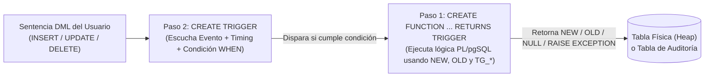
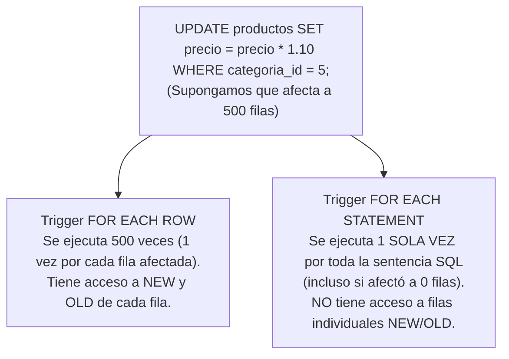

# ⚡ Semana 06: Fundamentos, Arquitectura y Creación de Triggers (Disparadores) en PostgreSQL

---

## 📋 1. Portada y Ficha Técnica de la Sesión

| Campo | Detalle Oficial |
| :--- | :--- |
| **Institución** | Instituto Superior Tecnológico de Turismo y Patrimonio Yavirac |
| **Carrera** | Tecnología Superior en Desarrollo de Software |
| **Asignatura** | Base de Datos Avanzada |
| **Código de Asignatura** | `DS4AC1-215` |
| **Semestre / Periodo** | Segundo Semestre / 2026-II |
| **Modalidad** | Dual |
| **Unidad Didáctica** | Unidad 2: Generación de procedimientos, funciones y triggers |
| **Semana** | Semana 06 de 16 |
| **Carga Horaria Semanal** | **ACD:** 1 hora \| **APECD:** 4 horas \| **Total:** 5 horas |
| **Contenidos (PEA)** | Generación de Trigger; Crea, invoca y elimina Trigger (`BEFORE`, `AFTER`, `INSTEAD OF`, `FOR EACH ROW/STATEMENT`, `NEW`, `OLD`, `TG_OP`) |
| **Resultado de Aprendizaje (RdA 2)** | Desarrollo de procedimientos almacenados, funciones o triggers. |
| **Software y Herramientas** | PostgreSQL 16+, pgAdmin 4 / DBeaver, Extensión `plpgsql`, Git |

---

## 🎯 2. Objetivos de Aprendizaje, Competencias, Evidencias y Habilidades Blandas

### 2.1 Objetivos de la Sesión
1. **Comprender la arquitectura de dos capas de los Triggers en PostgreSQL**, distinguiendo la creación de la **Función de Trigger (`RETURNS TRIGGER`)** de la vinculación del **Disparador (`CREATE TRIGGER`)** sobre una tabla o vista.
2. **Dominar la matriz de eventos (`INSERT`, `UPDATE`, `DELETE`, `TRUNCATE`), tiempos (`BEFORE`, `AFTER`, `INSTEAD OF`) y niveles (`FOR EACH ROW`, `FOR EACH STATEMENT`)**, así como el uso de los registros especiales `NEW`, `OLD` y metadatos `TG_*`.
3. **Implementar, invocar, depurar y administrar el ciclo de vida** de triggers de normalización, validación compleja de reglas de negocio, integridad polimórfica y auditoría automática en un taller práctico de 4 horas.

### 2.2 Matriz de Competencias y Evidencias

| Componente | Descripción Aplicada a la Semana 06 |
| :--- | :--- |
| **Resultado de Aprendizaje (RdA 2)** | Desarrollo de procedimientos almacenados, funciones o triggers que garanticen la integridad activa y la trazabilidad automática de los datos. |
| **Competencia Específica** | Diseña triggers `BEFORE` para higienizar y validar registros (`NEW`/`OLD`) y triggers `AFTER` para mantener bitácoras de auditoría (`JSONB`) y sincronizar tablas resumen. |
| **Evidencia de Aprendizaje** | Script `semana06_triggers_fundamentos.sql` con funciones disparadoras, triggers asociados y suite de pruebas de invocación (`INSERT`, `UPDATE`, `DELETE`) documentada. |
| **Habilidades Blandas (PEA)** | **Aprendizaje autónomo:** Realiza ejercicios extras de Funciones y Triggers de forma autónoma; pensamiento sistémico orientando a eventos y prevención de efectos secundarios (recursión infinita). |

---

## ⏱️ 3. Agenda Detallada de la Sesión (5 Horas)

| Fase | Tiempo | Componente | Actividad Pedagógica |
| :--- | :---: | :---: | :--- |
| **Fase 1** | `00:00 - 00:30` (30 min) | **ACD** | **Arquitectura de Triggers en PostgreSQL:** El modelo de 2 pasos (`FUNCTION RETURNS TRIGGER` + `CREATE TRIGGER`), eventos (`INSERT`, `UPDATE`, `DELETE`, `TRUNCATE`) y tiempos (`BEFORE`, `AFTER`, `INSTEAD OF`). |
| **Fase 2** | `00:30 - 01:00` (30 min) | **ACD** | **Registros `NEW`/`OLD`, Variables `TG_*` y Ciclo de Vida:** Diferencia entre retornar `NEW`, `OLD` o `NULL`, cláusula `WHEN (...)`, `ENABLE/DISABLE` y `DROP TRIGGER`. |
| **Fase 3** | `01:00 - 01:45` (45 min) | **APECD** | **Práctica Guiada:** Despliegue del esquema Logístico/Inventario y creación de nuestros primeros triggers `BEFORE INSERT/UPDATE` y `AFTER`. |
| **Fase 4** | `01:45 - 03:00` (75 min) | **APECD** | **Taller Experimental (Parte 1):** Triggers de normalización automática, validación de reglas de negocio complejas y validación de integridad en tablas polimórficas. |
| **Fase 5** | `03:00 - 04:30` (90 min) | **APECD** | **Taller Experimental (Parte 2):** Triggers `AFTER` para control automático de Kardex/Stock, bitácoras de auditoría multi-evento (`TG_OP`) y triggers `INSTEAD OF` sobre vistas. |
| **Fase 6** | `04:30 - 05:00` (30 min) | **APECD** | **Administración y Pruebas de Invocación:** Pruebas exhaustivas de disparo e inspección del catálogo `pg_trigger` / `information_schema.triggers`. |

---

## 📚 4. Desarrollo Teórico-Conceptual Profundo (ACD - 1 Hora)

### 4.1 ¿Qué es un Trigger y por qué PostgreSQL utiliza una Arquitectura de 2 Pasos?

Un **Trigger (Disparador)** es una rutina reactiva gobernada por eventos que el motor de base de datos ejecuta **automáticamente** cuando ocurre una operación de modificación de datos (`INSERT`, `UPDATE`, `DELETE` o `TRUNCATE`) sobre una tabla o vista determinada.

> **🔑 Diferencia fundamental de PostgreSQL frente a otros SGBD (MySQL / SQL Server / Oracle):**
> En PostgreSQL, **un Trigger nunca contiene código directamente dentro de `CREATE TRIGGER`**. Su arquitectura está desacoplada en **dos objetos independientes**:
> 1. **Paso 1 — La Función Disparadora (`CREATE FUNCTION ... RETURNS TRIGGER`):** Contiene toda la lógica en `PL/pgSQL`. No declara parámetros en su cabecera `()` y puede ser **reutilizada** por múltiples triggers en distintas tablas.
> 2. **Paso 2 — La Definición del Trigger (`CREATE TRIGGER ... ON tabla`):** Conecta un evento específico de una tabla con la función disparadora creada en el Paso 1.



---

### 4.2 Dimensiones de un Trigger: Momento (`Timing`), Evento (`Event`) y Nivel (`Level`)

Cuando diseñamos un trigger en PostgreSQL, debemos tomar tres decisiones arquitectónicas:

#### A. Momento de Ejecución (`Timing`): ¿Cuándo se dispara?

| Timing | Cuándo se ejecuta | Caso de Uso Ideal | ¿Puede modificar la fila `NEW`? | ¿Puede cancelar la operación retornando `NULL`? |
| :--- | :--- | :--- | :---: | :---: |
| **`BEFORE`** | **Antes** de que la fila se escriba, modifique o borre en la tabla física (y antes de verificar algunas restricciones). | 1. Normalizar datos (`UPPER`, `TRIM`, calcular totales, actualizar `actualizado_en`).<br>2. Validar reglas de negocio antes de tocar el disco. | **SÍ** (`NEW.campo := valor`) | **SÍ** (Retornar `NULL` omite silenciosamente la operación para esa fila). |
| **`AFTER`** | **Después** de que la fila ya fue insertada, actualizada o eliminada exitosamente y pasó todos los `CHECK`/`FK`. | 1. Registrar auditoría histórica (`INSERT` en bitácora).<br>2. Sincronizar el stock en una tabla padre o resumen. | **NO** (La fila ya se escribió en la tabla). | **NO** (Retornar `NULL` es ignorado; para cancelar todo debe usar `RAISE EXCEPTION`). |
| **`INSTEAD OF`** | **En lugar de** la operación original (exclusivo para **Vistas `VIEW`**). | Hacer editable una vista compleja que une múltiples tablas con `JOIN` o agregaciones. | Sí (redirige los datos de `NEW`/`OLD` a las tablas base). | Sí (Retornar `NULL` omite la operación sobre la vista). |

#### B. Nivel de Granularidad (`FOR EACH ROW` vs. `FOR EACH STATEMENT`)



#### C. Matriz de Combinaciones Válidas en PostgreSQL

| Momento (`Timing`) | Eventos Soportados | `FOR EACH ROW` (Fila) | `FOR EACH STATEMENT` (Sentencia) |
| :--- | :--- | :---: | :---: |
| **`BEFORE`** | `INSERT`, `UPDATE`, `DELETE` | ✅ Soportado | ✅ Soportado |
| **`BEFORE`** | `TRUNCATE` | ❌ No aplica | ✅ Soportado |
| **`AFTER`** | `INSERT`, `UPDATE`, `DELETE` | ✅ Soportado | ✅ Soportado |
| **`AFTER`** | `TRUNCATE` | ❌ No aplica | ✅ Soportado |
| **`INSTEAD OF`** | `INSERT`, `UPDATE`, `DELETE` | ✅ Soportado *(Solo en Vistas)* | ❌ No soportado |

---

### 4.3 Las Variables Especiales Automáticas dentro de una Función de Trigger

Cuando una función es declarada con `RETURNS TRIGGER`, PostgreSQL inyecta automáticamente en su ámbito local los registros **`NEW`** y **`OLD`**, además de un conjunto de variables de metadatos con prefijo **`TG_`**:

#### 1. Disponibilidad de los Registros `NEW` y `OLD` (en Triggers `FOR EACH ROW`)

| Evento Disparador (`TG_OP`) | Registro `NEW` (Fila Nueva / Propuesta) | Registro `OLD` (Fila Anterior / Existente) | ¿Qué debe retornar un Trigger `BEFORE` para permitir la operación? |
| :--- | :--- | :--- | :--- |
| **`INSERT`** | ✅ **Disponible** (Contiene los valores a insertar). | ❌ `NULL` (No existía fila previa). | **`RETURN NEW;`** |
| **`UPDATE`** | ✅ **Disponible** (Contiene los nuevos valores). | ✅ **Disponible** (Contiene los valores antes del cambio). | **`RETURN NEW;`** |
| **`DELETE`** | ❌ `NULL` (La fila dejará de existir). | ✅ **Disponible** (Contiene la fila que se va a borrar). | **`RETURN OLD;`** |

> **⚠️ Atención con `RETURN` en un Trigger `BEFORE DELETE`:**
> Si en un trigger `BEFORE DELETE` escribes por descuido `RETURN NEW;`, como `NEW` vale `NULL` durante un `DELETE`, ¡estarás retornando `NULL` y **cancelarás silenciosamente el borrado** sin que ninguna fila se elimine!
> - En `BEFORE INSERT` o `BEFORE UPDATE` ➡️ `RETURN NEW;`
> - En `BEFORE DELETE` ➡️ `RETURN OLD;`
> - En un trigger `AFTER` (cualquier evento) ➡️ Puedes retornar `NULL` (o `NEW`/`OLD`), ya que el motor ignora el valor de retorno en `AFTER`.

#### 2. Diccionario de Variables de Metadatos `TG_*`

| Variable Especial | Tipo de Dato | Descripción y Valores Posibles |
| :--- | :---: | :--- |
| **`TG_OP`** | `TEXT` | Operación que disparó el trigger: `'INSERT'`, `'UPDATE'`, `'DELETE'` o `'TRUNCATE'`. |
| **`TG_WHEN`** | `TEXT` | Momento del disparo: `'BEFORE'`, `'AFTER'` o `'INSTEAD OF'`. |
| **`TG_LEVEL`** | `TEXT` | Nivel de ejecución: `'ROW'` o `'STATEMENT'`. |
| **`TG_NAME`** | `NAME` | Nombre exacto del trigger que invocó la función. |
| **`TG_TABLE_NAME`** | `NAME` | Nombre de la tabla (o vista) sobre la cual se disparó el evento. |
| **`TG_TABLE_SCHEMA`** | `NAME` | Esquema al que pertenece la tabla que disparó el evento. |
| **`TG_NARGS`** | `INTEGER` | Cantidad de argumentos estáticos de texto pasados en `EXECUTE FUNCTION fn('arg1', 'arg2')`. |
| **`TG_ARGV[]`** | `TEXT[]` | Arreglo de texto (indexado desde **`0`**) con los argumentos pasados en `CREATE TRIGGER` (`TG_ARGV[0]`, `TG_ARGV[1]`, etc.). |

---

### 4.4 Sintaxis Oficial y Optimización con la Cláusula `WHEN (...)`

```sql
-- PASO 1: Crear la función de trigger (sin parámetros en los paréntesis)
CREATE OR REPLACE FUNCTION fn_trg_ejemplo()
RETURNS TRIGGER
LANGUAGE plpgsql
AS $$
BEGIN
    -- Lógica usando NEW, OLD y TG_OP
    RETURN NEW;
END;
$$;

-- PASO 2: Crear (o reemplazar en PG 14+) el trigger sobre la tabla
CREATE OR REPLACE TRIGGER trg_ejemplo_tabla
BEFORE INSERT OR UPDATE OF precio_unitario, stock_actual ON productos
FOR EACH ROW
WHEN (NEW.precio_unitario IS DISTINCT FROM OLD.precio_unitario OR TG_OP = 'INSERT')
EXECUTE FUNCTION fn_trg_ejemplo();
```

#### ¿Por qué usar `UPDATE OF col1, col2` y `WHEN (...)` en la definición del Trigger?
Si una tabla `productos` recibe 10,000 `UPDATE` por minuto que solo actualizan un contador de visitas (`vistas_web = vistas_web + 1`), pero tu trigger solo audita cambios de `precio_unitario`:
- Restringir el evento a `BEFORE UPDATE OF precio_unitario` y añadir `WHEN (OLD.precio_unitario IS DISTINCT FROM NEW.precio_unitario)` evita que PostgreSQL invoque siquiera el motor `PL/pgSQL` cuando el precio no cambió, reduciendo drásticamente el consumo de CPU.
- **Tip experto:** Usa `OLD.col IS DISTINCT FROM NEW.col` en lugar de `OLD.col <> NEW.col`, porque `IS DISTINCT FROM` detecta correctamente cuando un valor pasa de `NULL` a un valor real (o viceversa), mientras que `NULL <> 10` devuelve `UNKNOWN`.

---

### 4.5 Ciclo de Vida de un Trigger: Cómo se Invoca, Modifica, Desactiva y Elimina

1. **¿Cómo se invoca un Trigger?**
   - **Nunca** se invoca manualmente con `SELECT` ni con `CALL`.
   - Un trigger se invoca **ejecutando la sentencia DML (`INSERT`, `UPDATE`, `DELETE`, `TRUNCATE`)** sobre la tabla o vista vigilada.
2. **¿Cómo se modifica un Trigger?**
   - Si solo cambia la lógica interna: basta con ejecutar `CREATE OR REPLACE FUNCTION fn_trg_...()`.
   - Si cambia el evento, el timing o la cláusula `WHEN`: en PostgreSQL 14+ usamos `CREATE OR REPLACE TRIGGER nombre_trg ... ON tabla ...`.
3. **¿Cómo se desactiva temporalmente (ej. para una migración masiva) y se reactiva?**
   ```sql
   -- Desactivar un trigger específico en una tabla:
   ALTER TABLE productos DISABLE TRIGGER trg_ejemplo_tabla;

   -- Reactivar el trigger:
   ALTER TABLE productos ENABLE TRIGGER trg_ejemplo_tabla;

   -- Desactivar TODOS los triggers de usuario de una tabla:
   ALTER TABLE productos DISABLE TRIGGER USER;
   ALTER TABLE productos ENABLE TRIGGER USER;
   ```
4. **¿Cómo se elimina un Trigger definitivamente?**
   ```sql
   -- En PostgreSQL SIEMPRE se debe especificar ON <nombre_tabla> al borrar un trigger:
   DROP TRIGGER IF EXISTS trg_ejemplo_tabla ON productos;

   -- Y si ya ningún otro trigger usa la función disparadora, podemos borrar la función:
   DROP FUNCTION IF EXISTS fn_trg_ejemplo();
   ```

---

## 💻 5. Ejemplos Guiados Paso a Paso en PostgreSQL / PL/pgSQL

Construyamos un sistema empresarial de **Comercio Electrónico, Inventario y Auditoría Patrimonial ("Yavirac Market & Logistics")** para demostrar cómo crear, invocar y verificar cada tipo de trigger.

### 5.1 Script Base del Esquema de Trabajo

```sql
-- =============================================================================
-- ENTORNO BASE SEMANA 06: "YAVIRAC MARKET & LOGISTICS" (SISTEMA CON TRIGGERS)
-- =============================================================================
DROP SCHEMA IF EXISTS yavirac_logistics CASCADE;
CREATE SCHEMA yavirac_logistics;
SET search_path TO yavirac_logistics, public;

-- 1. Tabla de Productos e Inventario
CREATE TABLE productos (
    producto_id SERIAL PRIMARY KEY,
    sku VARCHAR(30) NOT NULL UNIQUE,
    nombre VARCHAR(120) NOT NULL,
    costo_promedio NUMERIC(12,2) NOT NULL CHECK (costo_promedio >= 0),
    precio_venta NUMERIC(12,2) NOT NULL CHECK (precio_venta >= 0),
    stock_actual INTEGER NOT NULL DEFAULT 0 CHECK (stock_actual >= 0),
    stock_minimo INTEGER NOT NULL DEFAULT 5 CHECK (stock_minimo >= 0),
    activo BOOLEAN NOT NULL DEFAULT TRUE,
    creado_en TIMESTAMPTZ NOT NULL DEFAULT NOW(),
    actualizado_en TIMESTAMPTZ NOT NULL DEFAULT NOW()
);

-- 2. Tabla de Movimientos de Bodega (Kardex)
CREATE TABLE movimientos_kardex (
    kardex_id BIGSERIAL PRIMARY KEY,
    producto_id INTEGER NOT NULL REFERENCES productos(producto_id) ON DELETE RESTRICT,
    tipo_movimiento VARCHAR(15) NOT NULL CHECK (tipo_movimiento IN ('ENTRADA', 'SALIDA', 'AJUSTE_POS', 'AJUSTE_NEG')),
    cantidad INTEGER NOT NULL CHECK (cantidad > 0),
    motivo VARCHAR(150) NOT NULL,
    usuario_responsable VARCHAR(60) NOT NULL DEFAULT CURRENT_USER,
    fecha_movimiento TIMESTAMPTZ NOT NULL DEFAULT NOW()
);

-- 3. Tabla de Pedidos (Cabecera)
CREATE TABLE pedidos (
    pedido_id SERIAL PRIMARY KEY,
    codigo_pedido VARCHAR(25) NOT NULL UNIQUE,
    cliente_nombre VARCHAR(120) NOT NULL,
    cliente_correo VARCHAR(120) NOT NULL,
    estado VARCHAR(20) NOT NULL DEFAULT 'BORRADOR' CHECK (estado IN ('BORRADOR', 'CONFIRMADO', 'DESPACHADO', 'ANULADO')),
    total_pedido NUMERIC(14,2) NOT NULL DEFAULT 0.00,
    actualizado_en TIMESTAMPTZ NOT NULL DEFAULT NOW()
);

-- 4. Tabla de Detalle de Pedidos
CREATE TABLE pedido_detalles (
    detalle_id BIGSERIAL PRIMARY KEY,
    pedido_id INTEGER NOT NULL REFERENCES pedidos(pedido_id) ON DELETE CASCADE,
    producto_id INTEGER NOT NULL REFERENCES productos(producto_id) ON DELETE RESTRICT,
    cantidad INTEGER NOT NULL CHECK (cantidad > 0),
    precio_unitario NUMERIC(12,2) NOT NULL CHECK (precio_unitario >= 0),
    subtotal_linea NUMERIC(14,2) NOT NULL DEFAULT 0.00,
    CONSTRAINT uq_pedido_producto UNIQUE (pedido_id, producto_id)
);

-- 5. Tabla Universal de Auditoría Forense (JSONB)
CREATE TABLE auditoria_eventos (
    auditoria_id BIGSERIAL PRIMARY KEY,
    esquema_tabla VARCHAR(100) NOT NULL,
    operacion VARCHAR(15) NOT NULL,
    usuario_bd VARCHAR(60) NOT NULL,
    fecha_evento TIMESTAMPTZ NOT NULL DEFAULT NOW(),
    datos_anteriores JSONB,
    datos_nuevos JSONB
);

-- 6. Tabla de Documentos Adjuntos Polimórficos (Asociables a PRODUCTO o PEDIDO)
CREATE TABLE adjuntos_polimorficos (
    adjunto_id BIGSERIAL PRIMARY KEY,
    entidad_tipo VARCHAR(20) NOT NULL CHECK (entidad_tipo IN ('PRODUCTO', 'PEDIDO')),
    entidad_id BIGINT NOT NULL,
    url_archivo VARCHAR(255) NOT NULL,
    subido_en TIMESTAMPTZ NOT NULL DEFAULT NOW()
);
```

---

### Ejemplo Guiado 1: Trigger `BEFORE INSERT OR UPDATE` para Higienización, Normalización y Reglas de Margen

**Problema:** Los operadores suelen ingresar el `sku` con espacios o minúsculas (`'  art-001 '`), olvidar actualizar `actualizado_en` y en ocasiones fijar por error un `precio_venta` menor que el `costo_promedio` (vendiendo a pérdida) o hacer rebajas bruscas mayores al 40% en un `UPDATE`.

```sql
-- PASO 1: Crear la Función Disparadora
CREATE OR REPLACE FUNCTION fn_trg_normalizar_y_validar_producto()
RETURNS TRIGGER
LANGUAGE plpgsql
AS $$
BEGIN
    -- 1. Higienización y normalización automática sobre el registro NEW
    NEW.sku            := UPPER(TRIM(NEW.sku));
    NEW.nombre         := INITCAP(TRIM(NEW.nombre));
    NEW.actualizado_en := NOW();

    IF TG_OP = 'INSERT' THEN
        NEW.creado_en := NOW();
    END IF;

    -- 2. Regla de negocio: Prohibido vender por debajo del costo promedio
    IF NEW.precio_venta < NEW.costo_promedio THEN
        RAISE EXCEPTION 'Operación rechazada en [%]: El precio de venta ($%) no puede ser inferior al costo promedio ($%).',
            NEW.sku, NEW.precio_venta, NEW.costo_promedio
            USING ERRCODE = '23514'; -- check_violation
    END IF;

    -- 3. Regla exclusiva para UPDATE: Prohibido reducir el precio más de un 40% de golpe
    IF TG_OP = 'UPDATE' THEN
        IF NEW.precio_venta < (OLD.precio_venta * 0.60) THEN
            RAISE EXCEPTION 'Alerta de seguridad en [%]: No se permite rebajar el precio más del 40%% en un solo cambio (Precio anterior: $%, Nuevo intento: $%).',
                NEW.sku, OLD.precio_venta, NEW.precio_venta;
        END IF;
    END IF;

    -- En un trigger BEFORE INSERT/UPDATE, retornar NEW confirma y guarda la fila modificada
    RETURN NEW;
END;
$$;

-- PASO 2: Asociar el Trigger a la tabla productos
CREATE OR REPLACE TRIGGER trg_biu_productos_normalizar
BEFORE INSERT OR UPDATE ON productos
FOR EACH ROW
EXECUTE FUNCTION fn_trg_normalizar_y_validar_producto();

-- PASO 3: Invocar el Trigger mediante sentencias INSERT y UPDATE
INSERT INTO productos (sku, nombre, costo_promedio, precio_venta, stock_actual, stock_minimo)
VALUES
('  tel-qto-01 ', '  poncho artesanal de otavalo ', 25.00, 45.00, 20, 5),
('  cer-cue-02 ', '  vajilla cerámica de cuenca  ', 18.00, 32.00, 15, 4),
('  caf-loj-03 ', '  café de especialidad loja   ', 8.50,  15.00, 50, 10);

-- Verificamos que el trigger limpió los espacios y puso el SKU en mayúsculas y el nombre en InitCap:
SELECT producto_id, sku, nombre, costo_promedio, precio_venta, stock_actual FROM productos;

-- Prueba de bloqueo: Si descomentas la siguiente línea, el trigger abortará el UPDATE:
-- UPDATE productos SET precio_venta = 20.00 WHERE sku = 'TEL-QTO-01'; -- Rebaja > 40% ($45 -> $20)
```

---

### Ejemplo Guiado 2: Trigger `AFTER INSERT` para Sincronizar Stock Automáticamente desde el Kardex

Cada vez que bodega inserta un movimiento en `movimientos_kardex`, un trigger actualizará automáticamente el `stock_actual` del producto (validando que nunca quede negativo) y emitirá una alerta si el stock cae por debajo del `stock_minimo`.

```sql
-- PASO 1: Función Disparadora
CREATE OR REPLACE FUNCTION fn_trg_actualizar_stock_desde_kardex()
RETURNS TRIGGER
LANGUAGE plpgsql
AS $$
DECLARE
    r_prod       productos%ROWTYPE;
    v_nuevo_stock INTEGER;
BEGIN
    -- Bloqueamos la fila del producto para evitar condiciones de carrera
    SELECT * INTO STRICT r_prod
    FROM productos
    WHERE producto_id = NEW.producto_id
    FOR UPDATE;

    IF NEW.tipo_movimiento IN ('ENTRADA', 'AJUSTE_POS') THEN
        v_nuevo_stock := r_prod.stock_actual + NEW.cantidad;
    ELSIF NEW.tipo_movimiento IN ('SALIDA', 'AJUSTE_NEG') THEN
        IF r_prod.stock_actual < NEW.cantidad THEN
            RAISE EXCEPTION 'Stock insuficiente para el producto [%] (%). Stock actual: %, Salida solicitada: %.',
                r_prod.sku, r_prod.nombre, r_prod.stock_actual, NEW.cantidad;
        END IF;
        v_nuevo_stock := r_prod.stock_actual - NEW.cantidad;
    END IF;

    -- Actualizamos el stock en la tabla maestra de productos
    UPDATE productos
    SET stock_actual   = v_nuevo_stock,
        actualizado_en = NOW()
    WHERE producto_id = NEW.producto_id;

    -- Alerta preventiva si cae en o bajo el stock mínimo
    IF v_nuevo_stock <= r_prod.stock_minimo THEN
        RAISE WARNING 'ALERTA DE REABASTECIMIENTO: El producto [%] quedó con % unidades (Mínimo requerido: %).',
            r_prod.sku, v_nuevo_stock, r_prod.stock_minimo;
    END IF;

    RETURN NULL; -- En un trigger AFTER, el valor retornado es ignorado
END;
$$;

-- PASO 2: Crear el Trigger AFTER INSERT sobre movimientos_kardex
CREATE OR REPLACE TRIGGER trg_ai_kardex_sincronizar_stock
AFTER INSERT ON movimientos_kardex
FOR EACH ROW
EXECUTE FUNCTION fn_trg_actualizar_stock_desde_kardex();

-- PASO 3: Invocar el Trigger insertando movimientos de bodega
INSERT INTO movimientos_kardex (producto_id, tipo_movimiento, cantidad, motivo)
VALUES
(1, 'ENTRADA', 10, 'Recepción de lote artesanal #402'),
(2, 'SALIDA',  12, 'Despacho a tienda Centro Histórico'); -- Dejará stock en 3 (<= mínimo 4) y lanzará WARNING

-- Comprobamos que el stock en productos cambió automáticamente (Producto 1: 30, Producto 2: 3):
SELECT producto_id, sku, nombre, stock_actual, stock_minimo FROM productos ORDER BY producto_id;
```

---

### Ejemplo Guiado 3: Trigger Genérico Multi-Tabla de Auditoría Forense en `JSONB` (`AFTER INSERT OR UPDATE OR DELETE`)

Gracias a la función nativa `to_jsonb(record)` y a las variables especiales `TG_OP`, `TG_TABLE_SCHEMA` y `TG_TABLE_NAME`, podemos crear **una sola función de auditoría** y conectarla a **cualquier tabla** del sistema.

```sql
-- PASO 1: Función Genérica de Auditoría en JSONB
CREATE OR REPLACE FUNCTION fn_trg_auditoria_universal_jsonb()
RETURNS TRIGGER
LANGUAGE plpgsql
AS $$
BEGIN
    IF TG_OP = 'INSERT' THEN
        INSERT INTO auditoria_eventos (esquema_tabla, operacion, usuario_bd, datos_anteriores, datos_nuevos)
        VALUES (TG_TABLE_SCHEMA || '.' || TG_TABLE_NAME, TG_OP, CURRENT_USER, NULL, to_jsonb(NEW));
        RETURN NEW;

    ELSIF TG_OP = 'UPDATE' THEN
        INSERT INTO auditoria_eventos (esquema_tabla, operacion, usuario_bd, datos_anteriores, datos_nuevos)
        VALUES (TG_TABLE_SCHEMA || '.' || TG_TABLE_NAME, TG_OP, CURRENT_USER, to_jsonb(OLD), to_jsonb(NEW));
        RETURN NEW;

    ELSIF TG_OP = 'DELETE' THEN
        INSERT INTO auditoria_eventos (esquema_tabla, operacion, usuario_bd, datos_anteriores, datos_nuevos)
        VALUES (TG_TABLE_SCHEMA || '.' || TG_TABLE_NAME, TG_OP, CURRENT_USER, to_jsonb(OLD), NULL);
        RETURN OLD;
    END IF;

    RETURN NULL;
END;
$$;

-- PASO 2: Conectar la misma función a múltiples tablas (productos y pedidos)
CREATE OR REPLACE TRIGGER trg_auditoria_productos
AFTER INSERT OR UPDATE OR DELETE ON productos
FOR EACH ROW
EXECUTE FUNCTION fn_trg_auditoria_universal_jsonb();

CREATE OR REPLACE TRIGGER trg_auditoria_pedidos
AFTER INSERT OR UPDATE OR DELETE ON pedidos
FOR EACH ROW
EXECUTE FUNCTION fn_trg_auditoria_universal_jsonb();

-- PASO 3: Invocar los triggers realizando cambios en productos y pedidos
UPDATE productos SET precio_venta = 48.50 WHERE sku = 'TEL-QTO-01';

INSERT INTO pedidos (codigo_pedido, cliente_nombre, cliente_correo, estado)
VALUES ('PED-2026-001', 'Elena Grijalva', 'elena.grijalva@yavirac.edu.ec', 'BORRADOR');

-- Consultamos la bitácora forense comparando el antes y el después en JSONB:
SELECT
    auditoria_id,
    esquema_tabla,
    operacion,
    datos_anteriores ->> 'precio_venta' AS precio_antes,
    datos_nuevos ->> 'precio_venta' AS precio_despues,
    fecha_evento
FROM auditoria_eventos
ORDER BY auditoria_id DESC;
```

---

## 🛠️ 6. Taller Práctico-Experimental en Contacto con el Docente (APECD - 4 Horas)

Sobre el esquema `yavirac_logistics` desplegado en la sección 5.1, resuelve los siguientes **6 ejercicios prácticos de ingeniería de triggers** en tu archivo `semana06_triggers_fundamentos.sql`. Para cada ejercicio debes escribir:
1. La función disparadora (`CREATE OR REPLACE FUNCTION ... RETURNS TRIGGER`).
2. La definición del trigger (`CREATE OR REPLACE TRIGGER ...`).
3. Las sentencias DML (`INSERT`, `UPDATE`, `DELETE`) que **invocan** y comprueban su funcionamiento.

---

### Ejercicio 1: Trigger `BEFORE INSERT OR UPDATE` para Cálculo Automático de Línea de Pedido y Toma de Precio Oficial
**Requerimiento:**
En la tabla `pedido_detalles`:
1. Crea la función `fn_trg_calcular_detalle_pedido()` y el trigger `trg_biu_pedido_detalles_calculo` (`BEFORE INSERT OR UPDATE ON pedido_detalles FOR EACH ROW`).
2. Cuando se inserte un detalle, si `NEW.precio_unitario` es `0` o `NULL`, el trigger debe buscar automáticamente el `precio_venta` actual de la tabla `productos` y asignarlo a `NEW.precio_unitario` (además de verificar que el producto esté `activo = TRUE`).
3. El trigger debe calcular siempre de forma automática `NEW.subtotal_linea := ROUND(NEW.cantidad * NEW.precio_unitario, 2);`.
4. Prueba insertando 2 líneas para el pedido `'PED-2026-001'` enviando `0` como `precio_unitario` y verifica que el trigger complete el precio real y el subtotal.

<details>
<summary>✅ Ver Solución Propuesta — Ejercicio 1</summary>

```sql
-- 1. Función Disparadora
CREATE OR REPLACE FUNCTION fn_trg_calcular_detalle_pedido()
RETURNS TRIGGER
LANGUAGE plpgsql
AS $$
DECLARE
    v_precio_catalogo NUMERIC(12,2);
    v_activo          BOOLEAN;
BEGIN
    SELECT precio_venta, activo
    INTO STRICT v_precio_catalogo, v_activo
    FROM productos
    WHERE producto_id = NEW.producto_id;

    IF NOT v_activo THEN
        RAISE EXCEPTION 'El producto ID % se encuentra INACTIVO y no puede agregarse al pedido.', NEW.producto_id;
    END IF;

    -- Si no se especifica precio unitario (o se envía 0), tomamos el precio oficial de catálogo
    IF NEW.precio_unitario IS NULL OR NEW.precio_unitario = 0 THEN
        NEW.precio_unitario := v_precio_catalogo;
    END IF;

    -- Cálculo automático del subtotal de la línea
    NEW.subtotal_linea := ROUND(NEW.cantidad * NEW.precio_unitario, 2);

    RETURN NEW;
END;
$$;

-- 2. Creación del Trigger
CREATE OR REPLACE TRIGGER trg_biu_pedido_detalles_calculo
BEFORE INSERT OR UPDATE ON pedido_detalles
FOR EACH ROW
EXECUTE FUNCTION fn_trg_calcular_detalle_pedido();

-- 3. Invocación del Trigger mediante INSERT
INSERT INTO pedido_detalles (pedido_id, producto_id, cantidad, precio_unitario)
VALUES
(1, 1, 2, 0), -- Tomará el precio de TEL-QTO-01 ($48.50) y calculará subtotal $97.00
(1, 3, 4, 0); -- Tomará el precio de CAF-LOJ-03 ($15.00) y calculará subtotal $60.00

SELECT * FROM pedido_detalles WHERE pedido_id = 1;
```

</details>

---

### Ejercicio 2: Trigger `AFTER INSERT OR UPDATE OR DELETE` para Recalcular el Total de la Cabecera del Pedido
**Requerimiento:**
Cada vez que se inserte, actualice o elimine una fila en `pedido_detalles`, el campo `total_pedido` y `actualizado_en` de la tabla padre `pedidos` debe recalcularse automáticamente:
1. Crea la función `fn_trg_recalcular_total_pedido()` y el trigger `trg_aiud_pedido_detalles_total` (`AFTER INSERT OR UPDATE OR DELETE ON pedido_detalles FOR EACH ROW`).
2. Ten en cuenta que en `INSERT` o `UPDATE` el ID del pedido está en `NEW.pedido_id`, pero en `DELETE` el ID del pedido está únicamente en **`OLD.pedido_id`** (puedes usar `COALESCE(NEW.pedido_id, OLD.pedido_id)`).
3. Invoca el trigger haciendo un `INSERT`, un `UPDATE` de cantidad y un `DELETE` sobre `pedido_detalles`, y comprueba que `pedidos.total_pedido` siempre refleje la suma exacta.

<details>
<summary>✅ Ver Solución Propuesta — Ejercicio 2</summary>

```sql
-- 1. Función Disparadora
CREATE OR REPLACE FUNCTION fn_trg_recalcular_total_pedido()
RETURNS TRIGGER
LANGUAGE plpgsql
AS $$
DECLARE
    v_pedido_id INTEGER;
BEGIN
    -- Obtenemos el pedido_id tanto para INSERT/UPDATE (NEW) como para DELETE (OLD)
    v_pedido_id := COALESCE(NEW.pedido_id, OLD.pedido_id);

    UPDATE pedidos p
    SET total_pedido = COALESCE((
            SELECT SUM(d.subtotal_linea)
            FROM pedido_detalles d
            WHERE d.pedido_id = v_pedido_id
        ), 0.00),
        actualizado_en = NOW()
    WHERE p.pedido_id = v_pedido_id;

    RETURN NULL;
END;
$$;

-- 2. Creación del Trigger AFTER INSERT OR UPDATE OR DELETE
CREATE OR REPLACE TRIGGER trg_aiud_pedido_detalles_total
AFTER INSERT OR UPDATE OR DELETE ON pedido_detalles
FOR EACH ROW
EXECUTE FUNCTION fn_trg_recalcular_total_pedido();

-- 3. Invocación del Trigger:
-- Actualizamos la cantidad de un ítem existente para disparar el recálculo
UPDATE pedido_detalles SET cantidad = 3 WHERE pedido_id = 1 AND producto_id = 1;

-- Verificamos que la cabecera pedidos se actualizó sola (3 * 48.50 + 4 * 15.00 = $205.50):
SELECT pedido_id, codigo_pedido, total_pedido, actualizado_en FROM pedidos WHERE pedido_id = 1;
```

</details>

---

### Ejercicio 3: Trigger `BEFORE DELETE` de Protección contra Borrado de Pedidos Confirmados o Despachados
**Requerimiento:**
En la tabla `pedidos`, está estrictamente prohibido eliminar físicamente (`DELETE`) un pedido cuyo estado sea `'CONFIRMADO'` o `'DESPACHADO'` (solo se pueden borrar pedidos en `'BORRADOR'`).
1. Crea la función `fn_trg_proteger_borrado_pedidos()` y el trigger `trg_bd_pedidos_proteger`.
2. Si `OLD.estado <> 'BORRADOR'`, lanza un `RAISE EXCEPTION` indicando el código del pedido (`OLD.codigo_pedido`) y su estado actual, sugiriendo cambiar su estado a `'ANULADO'` en lugar de borrarlo.
3. Si `OLD.estado = 'BORRADOR'`, permite el borrado retornando **`OLD`**.
4. Crea un segundo pedido en estado `'CONFIRMADO'` e intenta borrarlo con `DELETE` para demostrar que el trigger protege el registro.

<details>
<summary>✅ Ver Solución Propuesta — Ejercicio 3</summary>

```sql
-- 1. Función Disparadora
CREATE OR REPLACE FUNCTION fn_trg_proteger_borrado_pedidos()
RETURNS TRIGGER
LANGUAGE plpgsql
AS $$
BEGIN
    IF OLD.estado <> 'BORRADOR' THEN
        RAISE EXCEPTION 'Prohibido eliminar físicamente el pedido [%] porque se encuentra en estado [%].',
            OLD.codigo_pedido, OLD.estado
            USING HINT = 'Realice un UPDATE cambiando el estado a ANULADO en lugar de DELETE.';
    END IF;

    -- ¡CRÍTICO!: En un trigger BEFORE DELETE se debe retornar OLD para que el borrado proceda
    RETURN OLD;
END;
$$;

-- 2. Creación del Trigger BEFORE DELETE
CREATE OR REPLACE TRIGGER trg_bd_pedidos_proteger
BEFORE DELETE ON pedidos
FOR EACH ROW
EXECUTE FUNCTION fn_trg_proteger_borrado_pedidos();

-- 3. Pruebas de invocación:
INSERT INTO pedidos (codigo_pedido, cliente_nombre, cliente_correo, estado)
VALUES ('PED-2026-TEMP', 'Pedido Borrador Temporal', 'temp@yavirac.edu.ec', 'BORRADOR');

-- Este DELETE sí funciona porque está en BORRADOR y retorna OLD:
DELETE FROM pedidos WHERE codigo_pedido = 'PED-2026-TEMP';

-- Si cambiamos PED-2026-001 a CONFIRMADO e intentamos borrarlo, el trigger lo impide:
UPDATE pedidos SET estado = 'CONFIRMADO' WHERE codigo_pedido = 'PED-2026-001';
-- Descomentar para verificar la excepción:
-- DELETE FROM pedidos WHERE codigo_pedido = 'PED-2026-001';
```

</details>

---

### Ejercicio 4: Trigger `BEFORE INSERT OR UPDATE` para Garantizar Integridad Referencial en Asociaciones Polimórficas
**Requerimiento:**
En la Unidad 1 aprendimos que una tabla polimórfica (`adjuntos_polimorficos`) no puede usar una `FOREIGN KEY` estándar porque `entidad_id` apunta a `productos(producto_id)` cuando `entidad_tipo = 'PRODUCTO'`, y a `pedidos(pedido_id)` cuando `entidad_tipo = 'PEDIDO'`. ¡Con un Trigger en `PL/pgSQL` podemos resolver este problema al 100%!
1. Crea la función `fn_trg_validar_fk_polimorfica()` y el trigger `trg_biu_adjuntos_polimorficos_fk` (`BEFORE INSERT OR UPDATE ON adjuntos_polimorficos FOR EACH ROW`).
2. Si `NEW.entidad_tipo = 'PRODUCTO'`, verifica con `EXISTS` que exista el `producto_id = NEW.entidad_id` en `productos`.
3. Si `NEW.entidad_tipo = 'PEDIDO'`, verifica con `EXISTS` que exista el `pedido_id = NEW.entidad_id` en `pedidos`.
4. Si no existe la entidad padre correspondiente, lanza `RAISE EXCEPTION` con código `'23503'` (`foreign_key_violation`).

<details>
<summary>✅ Ver Solución Propuesta — Ejercicio 4</summary>

```sql
-- 1. Función Disparadora de Integridad Polimórfica
CREATE OR REPLACE FUNCTION fn_trg_validar_fk_polimorfica()
RETURNS TRIGGER
LANGUAGE plpgsql
AS $$
DECLARE
    v_existe BOOLEAN := FALSE;
BEGIN
    IF NEW.entidad_tipo = 'PRODUCTO' THEN
        SELECT EXISTS (
            SELECT 1 FROM productos WHERE producto_id = NEW.entidad_id
        ) INTO v_existe;
    ELSIF NEW.entidad_tipo = 'PEDIDO' THEN
        SELECT EXISTS (
            SELECT 1 FROM pedidos WHERE pedido_id = NEW.entidad_id
        ) INTO v_existe;
    END IF;

    IF NOT v_existe THEN
        RAISE EXCEPTION 'Violación de integridad polimórfica: No existe ningún registro en [%] con ID [%].',
            NEW.entidad_tipo, NEW.entidad_id
            USING ERRCODE = '23503'; -- foreign_key_violation
    END IF;

    RETURN NEW;
END;
$$;

-- 2. Creación del Trigger
CREATE OR REPLACE TRIGGER trg_biu_adjuntos_polimorficos_fk
BEFORE INSERT OR UPDATE ON adjuntos_polimorficos
FOR EACH ROW
EXECUTE FUNCTION fn_trg_validar_fk_polimorfica();

-- 3. Invocación del Trigger:
-- Inserción válida (Producto 1 y Pedido 1 sí existen):
INSERT INTO adjuntos_polimorficos (entidad_tipo, entidad_id, url_archivo)
VALUES
('PRODUCTO', 1, 'https://cdn.yavirac.edu.ec/productos/poncho-ficha.pdf'),
('PEDIDO',   1, 'https://cdn.yavirac.edu.ec/pedidos/factura-ped-001.pdf');

-- Prueba de rechazo: si intentamos adjuntar un archivo al Producto 9999 (inexistente), lanza error 23503:
-- INSERT INTO adjuntos_polimorficos (entidad_tipo, entidad_id, url_archivo)
-- VALUES ('PRODUCTO', 9999, 'https://cdn.yavirac.edu.ec/fantasma.pdf');
```

</details>

---

### Ejercicio 5: Trigger `INSTEAD OF INSERT` sobre una Vista Compleja
**Requerimiento:**
1. Crea una vista `vw_ingreso_rapido_kardex` que muestre `sku`, `nombre_producto`, `stock_actual`, `tipo_movimiento`, `cantidad` y `motivo` uniendo `productos` y `movimientos_kardex`.
2. Como esta vista tiene un `INNER JOIN`, no es directamente insertable por defecto. Crea la función `fn_trg_instead_of_ingreso_kardex()` y el trigger `trg_ioi_vw_ingreso_rapido_kardex` (`INSTEAD OF INSERT ON vw_ingreso_rapido_kardex FOR EACH ROW`).
3. Cuando alguien haga un `INSERT INTO vw_ingreso_rapido_kardex (sku, tipo_movimiento, cantidad, motivo)`, el trigger debe buscar el `producto_id` por su `NEW.sku` e insertar automáticamente el movimiento en `movimientos_kardex` (lo cual a su vez disparará en cascada el trigger del Ejercicio Guiado 2 que actualiza el stock).

<details>
<summary>✅ Ver Solución Propuesta — Ejercicio 5</summary>

```sql
-- 1. Creación de la Vista con JOIN
CREATE OR REPLACE VIEW vw_ingreso_rapido_kardex AS
SELECT
    p.sku,
    p.nombre AS nombre_producto,
    p.stock_actual,
    mk.tipo_movimiento,
    mk.cantidad,
    mk.motivo,
    mk.fecha_movimiento
FROM productos p
INNER JOIN movimientos_kardex mk ON mk.producto_id = p.producto_id;

-- 2. Función Disparadora INSTEAD OF INSERT
CREATE OR REPLACE FUNCTION fn_trg_instead_of_ingreso_kardex()
RETURNS TRIGGER
LANGUAGE plpgsql
AS $$
DECLARE
    v_producto_id INTEGER;
BEGIN
    SELECT producto_id INTO STRICT v_producto_id
    FROM productos
    WHERE sku = UPPER(TRIM(NEW.sku));

    INSERT INTO movimientos_kardex (producto_id, tipo_movimiento, cantidad, motivo)
    VALUES (v_producto_id, UPPER(TRIM(NEW.tipo_movimiento)), NEW.cantidad, NEW.motivo);

    RETURN NEW;
EXCEPTION
    WHEN NO_DATA_FOUND THEN
        RAISE EXCEPTION 'No existe ningún producto con el SKU [%] para registrar en el Kardex.', NEW.sku;
END;
$$;

-- 3. Creación del Trigger INSTEAD OF sobre la Vista
CREATE OR REPLACE TRIGGER trg_ioi_vw_ingreso_rapido_kardex
INSTEAD OF INSERT ON vw_ingreso_rapido_kardex
FOR EACH ROW
EXECUTE FUNCTION fn_trg_instead_of_ingreso_kardex();

-- 4. Invocación del Trigger insertando directamente en la VISTA usando solo el SKU:
INSERT INTO vw_ingreso_rapido_kardex (sku, tipo_movimiento, cantidad, motivo)
VALUES ('CAF-LOJ-03', 'SALIDA', 5, 'Venta corporativa cafetería Yavirac');

-- Verificamos que el stock de CAF-LOJ-03 bajó de 50 a 45:
SELECT sku, nombre, stock_actual FROM productos WHERE sku = 'CAF-LOJ-03';
```

</details>

---

### Ejercicio 6: Administración del Ciclo de Vida (Inspección, Desactivación, Reactivación y Eliminación de Triggers)
**Requerimiento:**
1. Escribe una consulta sobre `pg_trigger` y `pg_class` (o `information_schema.triggers`) que liste todos los triggers activos en el esquema `yavirac_logistics`.
2. Crea un trigger temporal `trg_bs_productos_bloqueo_truncate` (`BEFORE TRUNCATE ON productos FOR EACH STATEMENT`) que impida vaciar la tabla `productos` con `TRUNCATE`.
3. Demuestra cómo desactivar temporalmente (`ALTER TABLE ... DISABLE TRIGGER`), reactivar (`ENABLE TRIGGER`) y finalmente eliminar (`DROP TRIGGER IF EXISTS ... ON productos`) dicho trigger temporal junto con su función.

<details>
<summary>✅ Ver Solución Propuesta — Ejercicio 6</summary>

```sql
-- 1. Consulta al catálogo para auditar todos los triggers creados
SELECT
    event_object_schema AS esquema,
    event_object_table  AS tabla_o_vista,
    trigger_name        AS nombre_trigger,
    action_timing       AS momento,
    STRING_AGG(event_manipulation, ', ') AS eventos,
    action_orientation  AS nivel
FROM information_schema.triggers
WHERE event_object_schema = 'yavirac_logistics'
GROUP BY event_object_schema, event_object_table, trigger_name, action_timing, action_orientation
ORDER BY tabla_o_vista, nombre_trigger;

-- 2. Trigger a nivel de sentencia (FOR EACH STATEMENT) contra TRUNCATE
CREATE OR REPLACE FUNCTION fn_trg_impedir_truncate()
RETURNS TRIGGER LANGUAGE plpgsql AS $$
BEGIN
    RAISE EXCEPTION 'Operación TRUNCATE prohibida por seguridad en la tabla [%.%].',
        TG_TABLE_SCHEMA, TG_TABLE_NAME;
END;
$$;

CREATE OR REPLACE TRIGGER trg_bs_productos_bloqueo_truncate
BEFORE TRUNCATE ON productos
FOR EACH STATEMENT
EXECUTE FUNCTION fn_trg_impedir_truncate();

-- 3. Desactivación, reactivación y eliminación del trigger
ALTER TABLE productos DISABLE TRIGGER trg_bs_productos_bloqueo_truncate;
ALTER TABLE productos ENABLE TRIGGER trg_bs_productos_bloqueo_truncate;

-- Eliminación limpia del Trigger y su Función
DROP TRIGGER IF EXISTS trg_bs_productos_bloqueo_truncate ON productos;
DROP FUNCTION IF EXISTS fn_trg_impedir_truncate();
```

</details>

---

## 🚀 7. Actividades de Refuerzo Autónomo

Alineados a la habilidad blanda del PEA (*"Realiza ejercicios extras de Funciones y Triggers de forma autónoma"*), desarrolla los siguientes desafíos complementarios:

1. **Reto Autónomo 1 — Despacho Automático de Kardex al Confirmar Pedido:**
   - Crea un trigger `AFTER UPDATE OF estado ON pedidos FOR EACH ROW WHEN (OLD.estado = 'BORRADOR' AND NEW.estado = 'DESPACHADO')` que recorra todos los ítems de `pedido_detalles` de ese pedido e inserte automáticamente las respectivas filas de `'SALIDA'` en `movimientos_kardex`.
2. **Reto Autónomo 2 — Parametrización con `TG_ARGV[]`:**
   - Modifica la función `fn_trg_auditoria_universal_jsonb()` para que lea un argumento opcional `TG_ARGV[0]` (por ejemplo, `'NIVEL_CRITICO'` o `'NIVEL_NORMAL'`) pasado desde `EXECUTE FUNCTION fn_trg_auditoria_universal_jsonb('NIVEL_CRITICO')` y lo guarde en la tabla de auditoría.

---

## 📊 8. Rúbrica de Evaluación y Preguntas de Autoevaluación

### 8.1 Rúbrica del Taller Práctico (APECD - Semana 06)

| Criterio | Excelente (10 pts) | Satisfactorio (7.5 pts) | En Proceso (5 pts) | Insuficiente (<2.5 pts) |
| :--- | :--- | :--- | :--- | :--- |
| **Arquitectura en 2 Pasos y Selección de Timing** | Separa impecablemente `FUNCTION RETURNS TRIGGER` y `CREATE TRIGGER`, eligiendo `BEFORE` para validar/modificar `NEW` y `AFTER` para efectos colaterales y auditoría. | Implementa los triggers pero usa `AFTER` donde correspondía `BEFORE` (haciendo `UPDATE` extra sobre la misma tabla). | Confunde la sintaxis de creación o intenta declarar argumentos normales en la función de trigger. | Los triggers no compilan o provocan bucles infinitos. |
| **Manejo de `NEW`, `OLD` y `TG_OP`** | Retorna siempre `NEW` en `BEFORE INSERT/UPDATE` y `OLD` en `BEFORE DELETE`, utilizando `TG_OP` y `COALESCE(NEW.id, OLD.id)` sin errores. | Maneja `NEW` y `OLD` pero olvida retornar `OLD` en un trigger `BEFORE DELETE`. | Intenta leer `NEW` durante un `DELETE` o `OLD` durante un `INSERT`. | Desconoce el uso de `NEW`, `OLD` y `TG_OP`. |
| **Pruebas de Invocación y Ciclo de Vida** | Incluye casos de prueba completos (`INSERT`, `UPDATE`, `DELETE`) y demuestra el uso de `DISABLE/ENABLE` y `DROP TRIGGER ... ON tabla`. | Incluye pruebas básicas de `INSERT` pero omite probar `UPDATE`, `DELETE` o eliminación de triggers. | Crea el código del trigger pero nunca lo invoca con sentencias DML. | No entrega pruebas ni administración del ciclo de vida. |

---

### 8.2 Preguntas de Autoevaluación

1. **¿Qué ocurre si una función de trigger ejecutada en `BEFORE INSERT FOR EACH ROW` ejecuta `RETURN NULL;` en lugar de `RETURN NEW;`?**
2. **¿Por qué se considera un grave antipatrón hacer un `UPDATE` sobre la misma tabla `productos` dentro de un trigger `AFTER UPDATE ON productos` sin una condición de parada?**
3. **¿En qué se diferencia cancelar una operación con `RETURN NULL;` (en un trigger `BEFORE`) frente a cancelarla con `RAISE EXCEPTION`?**
4. **Si dos triggers del mismo tipo (`BEFORE INSERT FOR EACH ROW`) están asociados a la misma tabla en PostgreSQL, ¿en qué orden se ejecutan?**

<details>
<summary>✅ Ver Respuestas de Autoevaluación</summary>

1. **`RETURN NULL` en `BEFORE`:** El motor cancela **silenciosamente** la inserción (o actualización/borrado) de esa fila en particular sin lanzar ningún error ni abortar el resto de la transacción ni los triggers `AFTER` de esa fila.
2. **Recursión infinita:** Si un trigger `AFTER UPDATE ON productos` ejecuta otro `UPDATE productos ...`, ese segundo `UPDATE` volverá a disparar el mismo trigger una y otra vez hasta agotar el límite de pila (`stack depth limit exceeded`). Por eso, para modificar columnas de la misma fila que se está guardando, **siempre** se debe usar un trigger **`BEFORE`** asignando `NEW.columna := valor`.
3. **`RETURN NULL` vs `RAISE EXCEPTION`:** `RETURN NULL` ignora únicamente la fila actual pero la sentencia SQL termina con éxito (`COMMIT` permitido) y otras filas afectadas por el mismo `UPDATE` sí se guardan. En cambio, `RAISE EXCEPTION` aborta toda la sentencia y marca la transacción como fallida (`ROLLBACK` obligatorio), devolviendo un mensaje de error claro al cliente.
4. **Orden de ejecución de múltiples triggers:** PostgreSQL ejecuta los triggers que comparten el mismo `Timing` y `Event` en **orden alfabético (ASCII)** según el nombre del trigger (`tgname`).

</details>

---

## 📖 9. Bibliografía y Recursos Recomendados

1. **PostgreSQL Global Development Group.** (2026). *PostgreSQL 16 Official Documentation — Chapter 39: Triggers & Section 43.10: Trigger Functions in PL/pgSQL*. Disponible en: `https://www.postgresql.org/docs/current/plpgsql-trigger.html`
2. **Schönig, H.-J.** (2023). *Mastering PostgreSQL 15* (5.ª ed.). Packt Publishing.
3. **Obe, R., & Hsu, L.** (2021). *PostgreSQL: Up and Running: A Practical Guide to the Advanced Open Source Database* (4.ª ed.). O'Reilly Media.
4. **Instituto Superior Tecnológico de Turismo y Patrimonio Yavirac.** (2026). *Programa de Estudio de la Asignatura (PEA) — Base de Datos Avanzada (DS4AC1-215)*. Quito, Ecuador.

---

<div align="center">

⬅️ [Semana 05: Funciones y Procedimientos en PL/pgSQL](./semana-05-funciones-procedimientos-plpgsql.md) &nbsp;|&nbsp; 🏠 [Volver al Sílabo General (README)](../README.md) &nbsp;|&nbsp; [Semana 07: Implementación Avanzada de Triggers](./semana-07-implementacion-avanzada-triggers.md) ➡️

</div>
