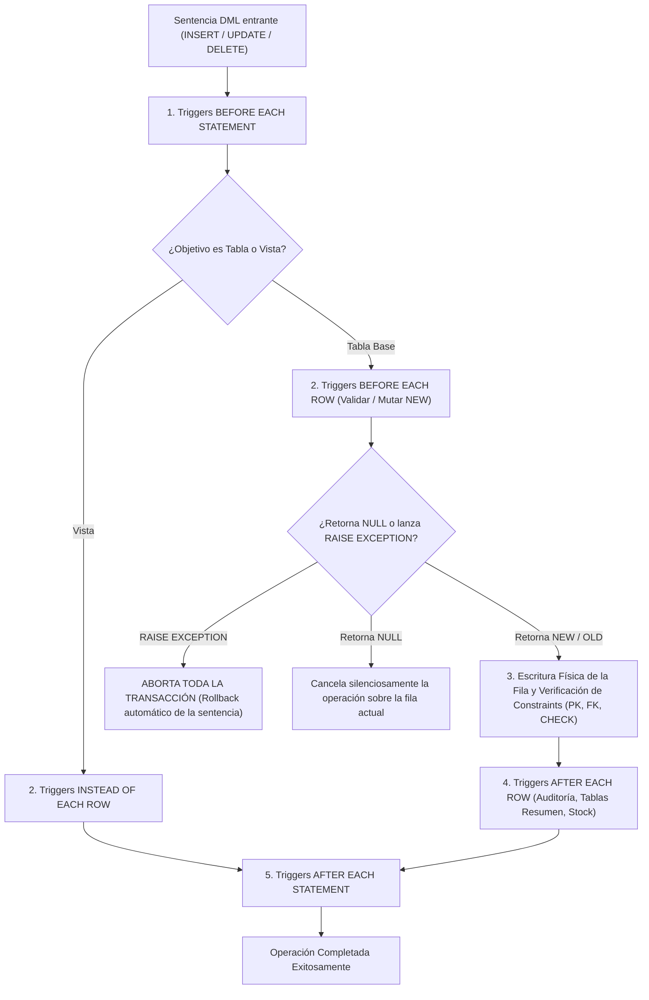
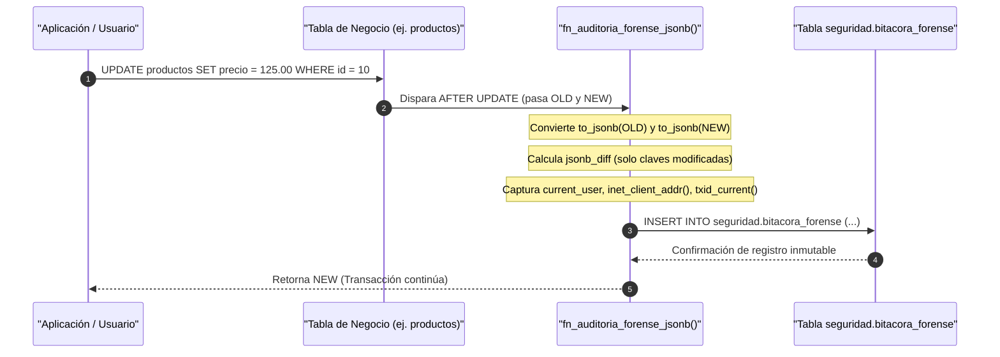
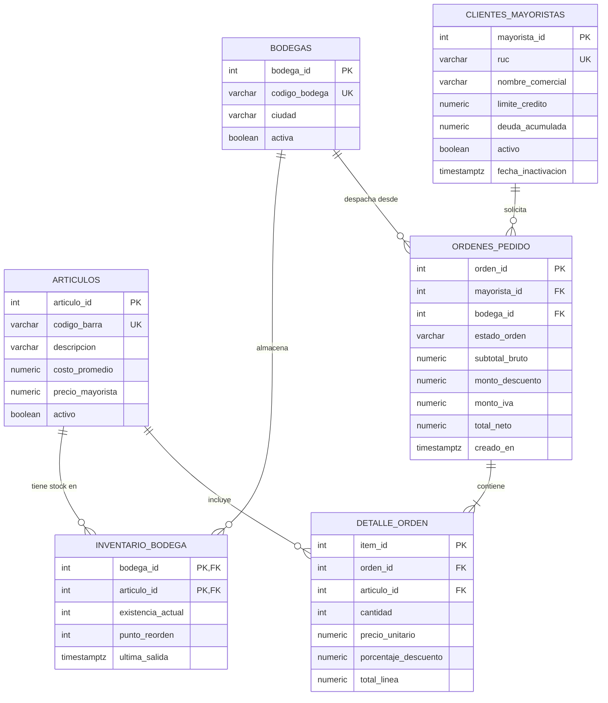

# ⚡ Semana 7: Implementación Avanzada de Triggers en Entornos Empresariales

> **Instituto Superior Tecnológico de Turismo y Patrimonio Yavirac**  
> **Carrera:** Tecnología Superior en Desarrollo de Software  
> **Asignatura:** Base de Datos Avanzada (`DS4AC1-215`) | **Paralelo:** Paralelo D  
> **Docente:** Ing. Yoli Moya, MSc. (Representante del Colectivo de Asignatura)  
> **Unidad 2:** Generación de procedimientos, funciones y triggers  
> **Periodo Académico:** 2026-II | **Semestre:** Segundo | **Modalidad:** Dual  

---

## 📋 1. Ficha Técnica de la Sesión y Planificación Curricular

| Parámetro | Detalle Oficial según PEA y Planificación de Unidades (Paralelo D) |
| :--- | :--- |
| **Institución** | Instituto Superior Tecnológico de Turismo y Patrimonio Yavirac |
| **Carrera / Nivel** | Desarrollo de Software — Segundo Semestre (Modalidad Dual) |
| **Periodo Académico** | 2026-II |
| **Docente** | Ing. Yoli Moya, MSc. |
| **Asignatura / Código** | Base de Datos Avanzada (`DS4AC1-215`) |
| **Paralelo** | Paralelo D |
| **Unidad Curricular** | Unidad 2: Generación de procedimientos, funciones y triggers (ID Unidad: 347553) |
| **Semana Académica** | Semana 7 de 9 |
| **Carga Horaria Semanal** | **5 Horas Presenciales** (ACD: 2h | APECD: 3h | APEA: 0h | AA: 0h) |
| **Clase 13 (2 Horas — ACD)** | **Fecha:** Lunes 07 de diciembre de 2026 \| **Tipo:** Aula (ACD - Presencial Teórico-Práctico) \| **Contenido:** Implementación de Triggers: Casos avanzados de aplicación, triggers condicionales y manejo de reglas de integridad referencial compleja. |
| **Clase 14 (3 Horas — APECD)** | **Fecha:** Miércoles 09 de diciembre de 2026 \| **Tipo:** Laboratorio (APECD - Práctico-Experimental) \| **Contenido:** Laboratorio práctico: Implementación, pruebas integrales e invocación de triggers combinados con procedimientos almacenados. |
| **Prerrequisitos** | Fundamentos de Bases de Datos, Modelo Entidad-Relación (MER), Álgebra Relacional básica |
| **Entorno Tecnológico** | PostgreSQL 16+, pgAdmin 4, psql, DBeaver, Visual Studio Code |

---

## 🎯 2. Objetivos de las Clases, Resultados de Aprendizaje y Competencias

### 2.1. Objetivos de las Clases (Redactados con Verbo en Infinitivo)

- **Objetivo General de la Semana 7:**  
  Implementar arquitecturas avanzadas de automatización en bases de datos integrando triggers condicionales, reglas de negocio complejas y procedimientos almacenados en PostgreSQL.
- **Objetivo Específico de la Clase 13 (2 Horas (120 min) — ACD / Aula — Lunes 07 de diciembre de 2026):**  
  Analizar patrones avanzados de disparadores en entornos de alta concurrencia, abordando triggers condicionales con WHEN, control de inventarios/stock, arcos de integridad referencial compleja y prevención de recursividad infinita.
- **Objetivo Específico de la Clase 14 (3 Horas (180 min) — APECD / Laboratorio — Miércoles 09 de diciembre de 2026):**  
  Implementar y evaluar flujos transaccionales combinando disparadores con procedimientos almacenados, auditoría forense con JSONB y borrado lógico mediante vistas editables con INSTEAD OF.

### 2.2. Resultados de Aprendizaje (RdA) y Competencias
> [!IMPORTANT]
> **Norma Pedagógica de Redacción:** Los Resultados de Aprendizaje describen lo que el estudiante demuestra al finalizar la clase; se redactan en **tercera persona del presente de indicativo** (NUNCA en infinitivo terminado en *-ar*, *-er*, *-ir*).

| Componente Curricular | Redacción Oficial (Sin Verbos en Infinitivo) |
| :--- | :--- |
| **Resultados de Aprendizaje Institucionales (PEA)** | **RdA 2 (PEA):** Utiliza herramientas y tecnologías de programación para llevar a cabo tareas específicas en el campo de desarrollo de software.<br>**RdA 3 (PEA):** Brinda asistencia técnica en el diseño de bases de datos mediante procesos de control y seguimiento de las operaciones para el manejo adecuado de la información. |
| **Resultado de Aprendizaje Específico de la Semana** | **Diseña e implementa soluciones automatizadas avanzadas mediante triggers condicionales y procedimientos almacenados en PostgreSQL, garantizando la consistencia y trazabilidad de los datos.** |
| **Competencia de la Asignatura** | Administrar y controlar las operaciones de bases de datos mediante mecanismos de seguimiento, integridad y gestión de transacciones que garanticen la confiabilidad de la información. |
| **Habilidades Blandas Priorizadas (PEA)** | • **Trabajo en equipo:** Realiza trabajos de investigación grupales y prácticas colaborativas.<br>• **Pensamiento crítico:** Utiliza herramientas específicas para el diseño y optimización de bases de datos.<br>• **Gestión del tiempo:** Realiza las prácticas en laboratorio dentro del horario establecido.<br>• **Comunicación técnica efectiva:** Expone y sustenta con claridad decisiones de arquitectura relacional. |

---

## ⏱️ 3. Agenda Detallada y Cronograma Semanal (5 Horas)

### 📅 CLASE 13: Lunes 07 de diciembre de 2026 (2 Horas (120 min)) — ACD (Aula / Teoría Magistral y Ejemplos Guiados)
| Bloque | Tiempo | Componente | Actividad Pedagógica y Contenido |
| :---: | :---: | :---: | :--- |
| **Bloque 13.1** | 40 min | **ACD** | Tubería Completa de Ejecución y Casos Avanzados: Prioridad de constraints vs triggers, orden lexicográfico de disparadores, triggers condicionales con `WHEN`, y prevención de bucles recursivos con `pg_trigger_depth()`. |
| **Bloque 13.2** | 40 min | **ACD** | Patrones Arquitectónicos Empresariales: Control estricto de inventarios con bloqueo de filas, auditoría forense diferencial con `JSONB`, mantenimiento de agregados desnormalizados y borrado lógico (*soft delete*) con vistas e `INSTEAD OF`. |
| **Bloque 13.3** | 40 min | **ACD** | Ejemplos Guiados Paso a Paso: Implementación y verificación integral de los 5 patrones en PostgreSQL sobre un esquema de facturación y stock. |

### 🔬 CLASE 14: Miércoles 09 de diciembre de 2026 (3 Horas (180 min)) — APECD (Laboratorio de Cómputo / Taller Práctico y Solucionario)
| Bloque | Tiempo | Componente | Actividad Pedagógica y Contenido |
| :---: | :---: | :---: | :--- |
| **Bloque 14.1** | 50 min | **APECD** | Laboratorio Fase 1: Configuración de Esquema y Reglas de Inventario: Despliegue de la base *TechAndes*, triggers de validación de crédito y reserva automática de existencias. |
| **Bloque 14.2** | 80 min | **APECD** | Laboratorio Fase 2: Integración de Triggers con Procedimientos Almacenados: Procedimiento transaccional de facturación que dispara validación de stock, cálculo de kardex y auditoría diferencial. |
| **Bloque 14.3** | 50 min | **APECD** | Laboratorio Fase 3: Pruebas de Estrés Transaccional y Solucionario: Simulación de cancelaciones, devoluciones y soft delete; validación de consistencia, feedback docente y rúbrica. |

---

## 📚 4. PARTE I: CLASE 13 (07/12/2026 — 2 Horas / ACD) — Implementación Avanzada de Triggers en Producción

En la Semana 6 estudiamos la anatomía sintáctica de un *trigger* (`CREATE FUNCTION ... RETURNS TRIGGER` + `CREATE TRIGGER`), las pseudovariables `NEW` y `OLD`, y la diferencia básica entre `BEFORE` y `AFTER`. En esta **Semana 7**, damos el salto de la sintaxis básica a la **ingeniería de software en producción**: ¿cómo se diseñan triggers robustos que soportan miles de operaciones por minuto sin corromper saldos contables ni generar bucles infinitos?

### 4.1. Tubería Completa de Ejecución de Triggers en PostgreSQL

Cuando una aplicación envía una sentencia DML (`INSERT`, `UPDATE` o `DELETE`) a PostgreSQL, el motor ejecuta una secuencia determinista de pasos. Comprender esta tubería es vital para decidir dónde colocar cada regla de negocio:



> [!IMPORTANT]
> **Regla de Oro en Producción:**
> - Usa **`BEFORE EACH ROW`** para **validar datos** (`RAISE EXCEPTION` si una regla falla) o **normalizar/modificar la propia fila** que se está guardando (`NEW.updated_at := NOW()`).
> - Usa **`AFTER EACH ROW`** cuando necesites **propagar efectos a otras tablas** (descontar inventario en `productos`, recalcular `facturas.total`, o insertar un registro en `auditoria_forense`), porque en el momento `AFTER` ya tienes la certeza de que la fila superó todas las restricciones `NOT NULL`, `UNIQUE`, `CHECK` y `FOREIGN KEY`.

---

### 4.2. Patrón 1: Control de Stock e Inventario en Tiempo Real con Bloqueo de Saldos Negativos

Uno de los errores más frecuentes en desarrolladores junior es programar el trigger de inventario pensando únicamente en el evento `INSERT` de una venta. En un sistema real en producción, un ítem de factura o pedido puede sufrir **tres operaciones distintas**, y el trigger debe manejar la matemática exacta de cada una:

| Operación en `detalle_venta` | Efecto Matemático sobre `productos.stock_actual` | Validación Crítica |
| :--- | :--- | :--- |
| **`INSERT`** | `stock_actual = stock_actual - NEW.cantidad` | Verificar que `stock_actual >= NEW.cantidad` antes de descontar. |
| **`DELETE`** | `stock_actual = stock_actual + OLD.cantidad` | Devolver las unidades al inventario cuando se elimina una línea. |
| **`UPDATE`** (Mismo producto) | `stock_actual = stock_actual + OLD.cantidad - NEW.cantidad` | Si `NEW.cantidad > OLD.cantidad`, verificar disponibilidad de la diferencia `(NEW.cantidad - OLD.cantidad)`. |
| **`UPDATE`** (Cambio de `producto_id`) | Sumar `OLD.cantidad` al producto `OLD.producto_id` y restar `NEW.cantidad` al producto `NEW.producto_id`. | Verificar stock suficiente en el nuevo producto `NEW.producto_id`. |

#### Bloqueo de Filas y `RAISE EXCEPTION` con `SQLSTATE`
Para evitar que dos cajeros vendan simultáneamente la última unidad disponible (*condición de carrera*), dentro de la función trigger realizamos un `SELECT stock_actual INTO v_stock FROM productos WHERE id = NEW.producto_id FOR UPDATE;`. Si el stock resultante sería negativo, abortamos inmediatamente con:

```sql
RAISE EXCEPTION 'Stock insuficiente para el producto ID %. Disponible: %, Solicitado: %',
    NEW.producto_id, v_stock, v_requerido
    USING ERRCODE = 'P0001',
          HINT = 'Solicite reabastecimiento a bodega o reduzca la cantidad del ítem.';
```

---

### 4.3. Patrón 2: Auditoría Forense Avanzada con `JSONB` y Cálculo de Diferencias

En la Semana 6 creamos tablas de auditoría guardando todo el registro antiguo y nuevo. En producción, cuando una tabla tiene 40 columnas y un usuario solo modifica el campo `precio_unitario`, queremos saber **exactamente qué columnas cambiaron**, además del estado completo en formato `JSONB` indexable y los metadatos de red de la conexión.

PostgreSQL provee la función nativa `to_jsonb(record)` que convierte cualquier fila `OLD` o `NEW` en un documento binario `JSONB` sin importar la estructura de la tabla. Esto nos permite crear **una única función de auditoría universal** que sirve para auditar 5, 20 o 100 tablas distintas sin reescribir código.



#### Metadatos Forenses Clave en PostgreSQL
- `TG_TABLE_SCHEMA` y `TG_TABLE_NAME`: Esquema y nombre de la tabla afectada.
- `TG_OP`: Operación ejecutada (`'INSERT'`, `'UPDATE'`, `'DELETE'`, `'TRUNCATE'`).
- `session_user` vs `current_user`: Usuario autenticado originalmente vs rol efectivo actual.
- `inet_client_addr()` y `inet_client_port()`: Dirección IP y puerto desde donde se conectó el cliente.
- `current_setting('application_name', true)`: Nombre de la aplicación o microservicio que ejecutó el cambio.
- `txid_current()` / `pg_current_xact_id()`: Identificador único de la transacción (permite agrupar todos los cambios ocurridos dentro de un mismo `BEGIN ... COMMIT`).

---

### 4.4. Patrón 3: Mantenimiento Automático de Tablas Resumen y Campos Calculados Desnormalizados

Aunque la Tercera Forma Normal (3FN) sugiere no almacenar campos calculados como `total_factura` en la tabla `facturas` (pues se pueden obtener con `SUM(subtotal)` desde `detalle_factura`), en sistemas de alto tráfico **consultar sumatorias sobre millones de líneas en cada listado de facturas degrada el rendimiento**.

La solución de ingeniería consiste en aplicar **desnormalización controlada por triggers**:
1. La tabla cabecera `facturas` almacena físicamente las columnas `subtotal`, `iva` y `total`.
2. La tabla `clientes` almacena físicamente la columna `saldo_pendiente`.
3. Un trigger `AFTER INSERT OR UPDATE OR DELETE` en `detalle_factura` calcula el delta exacto (`v_delta := COALESCE(NEW.subtotal_linea, 0) - COALESCE(OLD.subtotal_linea, 0)`) y actualiza de forma atómica tanto la factura como el saldo del cliente.

> [!TIP]
> **¿Actualizar con `SUM()` completo o aplicar el Delta (`NEW - OLD`)?**
> - **Recálculo completo (`SELECT COALESCE(SUM(...), 0)`)**: Es inmune a desincronizaciones previas y muy seguro cuando una factura tiene entre 1 y 100 líneas.
> - **Actualización incremental por Delta (`total = total + v_delta`)**: Es $O(1)$ y no requiere escanear las demás filas del detalle, ideal para tablas resumen mensuales o saldos acumulados con millones de movimientos.

---

### 4.5. Patrón 4: Borrado Lógico (*Soft Delete*) y Triggers `INSTEAD OF` sobre Vistas

En sistemas empresariales, médicos o financieros, **está prohibido eliminar físicamente registros maestros o históricos** (`DELETE FROM clientes`). Sin embargo, a menudo el software heredado (*legacy*) o ciertos ORMs siguen enviando sentencias `DELETE`. Existen dos estrategias profesionales con triggers para resolverlo:

#### Estrategia A: Interceptar `BEFORE DELETE` en la Tabla Base
En un trigger `BEFORE DELETE FOR EACH ROW`, si la función ejecuta un `UPDATE` marcando `activo = FALSE, eliminado_en = NOW()` y luego **retorna `NULL`**, PostgreSQL cancela silenciosamente el borrado físico de la fila pero conserva el `UPDATE` realizado dentro de la función:

```sql
CREATE OR REPLACE FUNCTION fn_soft_delete_tabla()
RETURNS TRIGGER LANGUAGE plpgsql AS $$
BEGIN
    UPDATE clientes
       SET activo = FALSE,
           fecha_baja = NOW(),
           usuario_baja = current_user
     WHERE id = OLD.id;

    -- Al retornar NULL en un trigger BEFORE DELETE, el borrado físico se cancela
    RETURN NULL;
END;
$$;
```

#### Estrategia B: Vistas de Negocio con Triggers `INSTEAD OF`
Las vistas que combinan múltiples tablas con `JOIN` o agregaciones no son actualizables directamente por PostgreSQL. Los triggers **`INSTEAD OF`** ("en lugar de") solo pueden definirse sobre **Vistas (`VIEW`)** a nivel `FOR EACH ROW` y le indican al motor exactamente qué hacer en las tablas subyacentes cuando alguien ejecuta `INSERT`, `UPDATE` o `DELETE` contra la vista.

| Característica | Trigger `BEFORE` / `AFTER` | Trigger `INSTEAD OF` |
| :--- | :--- | :--- |
| **Objetos soportados** | Tablas (y vistas extranjeras) | **Exclusivamente Vistas (`VIEW`)** |
| **Granularidad** | `FOR EACH ROW` o `FOR EACH STATEMENT` | **Exclusivamente `FOR EACH ROW`** |
| **Propósito principal** | Validar, transformar o auditar datos | Hacer que vistas complejas (`JOIN`) sean editables y aplicar *Soft Delete* transparente |

---

### 4.6. Patrón 5: Prevención de Recursividad Infinita, Orden de Ejecución y Rendimiento

#### 1. El Peligro de la Recursividad Infinita y `pg_trigger_depth()`
Imagina que un trigger `AFTER UPDATE` sobre la tabla `empleados` ejecuta un `UPDATE empleados SET fecha_modificacion = NOW() WHERE id = NEW.id;`. Ese segundo `UPDATE` volverá a disparar el mismo trigger, el cual hará otro `UPDATE`, provocando un desbordamiento de pila (`stack depth limit exceeded`).
- **Regla 1:** Si necesitas modificar la misma fila que se está actualizando, hazlo en un trigger **`BEFORE UPDATE`** asignando `NEW.fecha_modificacion := NOW();` sin ejecutar otra sentencia `UPDATE`.
- **Regla 2:** Cuando sea estrictamente necesario que un trigger ejecute DML sobre su propia tabla (por ejemplo, recalcular jerarquías o ajustar otra fila de la misma tabla) o exista recursividad mutua entre Tabla A y Tabla B, utiliza la función **`pg_trigger_depth()`**, que devuelve el nivel de anidamiento actual (`0` fuera de triggers, `1` en el primer disparo, `2` en un disparo provocado por otro trigger):

```sql
IF pg_trigger_depth() > 1 THEN
    RETURN NEW; -- Corta la recursividad en el segundo nivel
END IF;
```
También puedes limitar el disparo desde la propia definición DDL del trigger usando la cláusula **`WHEN`**:
```sql
CREATE TRIGGER trg_evitar_recursividad
AFTER UPDATE ON cuentas
FOR EACH ROW
WHEN (pg_trigger_depth() < 1 AND OLD.saldo IS DISTINCT FROM NEW.saldo)
EXECUTE FUNCTION fn_sincronizar_cuentas();
```

#### 2. Orden de Ejecución cuando existen Múltiples Triggers
¿Qué ocurre si una tabla tiene tres triggers `BEFORE UPDATE`?
En PostgreSQL (siguiendo el estándar SQL moderno), los triggers del **mismo momento (`BEFORE`/`AFTER`) y mismo nivel (`STATEMENT`/`ROW`) se ejecutan en estricto ORDEN ALFABÉTICO por su nombre**.
- Por convención profesional, cuando el orden importa se prefijan los nombres con números:
  - `trg_01_normalizar_datos` (se ejecuta primero)
  - `trg_02_validar_reglas_negocio` (recibe el `NEW` ya modificado por `trg_01`)
  - `trg_99_auditoria_forense` (se ejecuta al final)

#### 3. Impacto en el Rendimiento y Tablas de Transición (`REFERENCING`)
Si ejecutas `UPDATE productos SET precio = precio * 1.05;` sobre 50,000 productos:
- Un trigger `FOR EACH ROW` invocará la función PL/pgSQL **50,000 veces**.
- Un trigger `AFTER UPDATE ... REFERENCING OLD TABLE AS tabla_old NEW TABLE AS tabla_new FOR EACH STATEMENT` invocará la función **una sola vez**, entregándole dos tablas temporales en memoria (`tabla_old` y `tabla_new`) para insertar las 50,000 filas de auditoría en una única operación masiva (`INSERT INTO auditoria SELECT ... FROM tabla_new`).

---

## 💻 5. CLASE 13: Ejemplos Guiados Paso a Paso en PostgreSQL (ACD — 2 Horas)

A continuación, construimos un laboratorio completo y 100% ejecutable que demuestra en acción los **5 patrones de arquitectura en producción**.

### 5.1. Preparación del Esquema y Tablas del Laboratorio Guiado

```sql
-- ============================================================================
-- LABORATORIO GUIADO SEMANA 7: ARQUITECTURA DE TRIGGERS EN PRODUCCIÓN
-- ============================================================================
DROP SCHEMA IF EXISTS lab_s7 CASCADE;
CREATE SCHEMA lab_s7;
SET search_path TO lab_s7, public;

-- 1. Tabla de Clientes (Con saldo desnormalizado y soporte Soft Delete)
CREATE TABLE clientes (
    cliente_id       SERIAL PRIMARY KEY,
    ruc_cedula       VARCHAR(13) UNIQUE NOT NULL,
    razon_social     VARCHAR(120) NOT NULL,
    cupo_credito     NUMERIC(12,2) NOT NULL DEFAULT 1000.00 CHECK (cupo_credito >= 0),
    saldo_pendiente  NUMERIC(12,2) NOT NULL DEFAULT 0.00 CHECK (saldo_pendiente >= 0),
    activo           BOOLEAN NOT NULL DEFAULT TRUE,
    eliminado_en     TIMESTAMPTZ,
    eliminado_por    VARCHAR(60)
);

-- 2. Tabla de Productos (Control estricto de inventario)
CREATE TABLE productos (
    producto_id      SERIAL PRIMARY KEY,
    sku              VARCHAR(20) UNIQUE NOT NULL,
    nombre           VARCHAR(120) NOT NULL,
    precio_unitario  NUMERIC(12,2) NOT NULL CHECK (precio_unitario > 0),
    stock_actual     INTEGER NOT NULL DEFAULT 0,
    stock_minimo     INTEGER NOT NULL DEFAULT 5,
    alerta_reposicion BOOLEAN NOT NULL DEFAULT FALSE,
    actualizado_en   TIMESTAMPTZ NOT NULL DEFAULT NOW()
);

-- 3. Tabla Cabecera de Facturas (Con totales desnormalizados)
CREATE TABLE facturas (
    factura_id       SERIAL PRIMARY KEY,
    cliente_id       INTEGER NOT NULL REFERENCES clientes(cliente_id),
    fecha_emision    TIMESTAMPTZ NOT NULL DEFAULT NOW(),
    estado           VARCHAR(20) NOT NULL DEFAULT 'EMITIDA'
                     CHECK (estado IN ('EMITIDA', 'PAGADA', 'ANULADA')),
    subtotal         NUMERIC(12,2) NOT NULL DEFAULT 0.00,
    iva_15           NUMERIC(12,2) NOT NULL DEFAULT 0.00,
    total            NUMERIC(12,2) NOT NULL DEFAULT 0.00
);

-- 4. Tabla Detalle de Facturas
CREATE TABLE detalle_factura (
    detalle_id       SERIAL PRIMARY KEY,
    factura_id       INTEGER NOT NULL REFERENCES facturas(factura_id) ON DELETE CASCADE,
    producto_id      INTEGER NOT NULL REFERENCES productos(producto_id),
    cantidad         INTEGER NOT NULL CHECK (cantidad > 0),
    precio_venta     NUMERIC(12,2) NOT NULL CHECK (precio_venta > 0),
    subtotal_linea   NUMERIC(12,2) NOT NULL DEFAULT 0.00
);

-- 5. Tabla Universal de Auditoría Forense JSONB
CREATE TABLE auditoria_forense (
    auditoria_id     BIGSERIAL PRIMARY KEY,
    fecha_evento     TIMESTAMPTZ NOT NULL DEFAULT clock_timestamp(),
    txid             BIGINT NOT NULL DEFAULT txid_current(),
    esquema_tabla    TEXT NOT NULL,
    operacion        VARCHAR(10) NOT NULL,
    usuario_bd       TEXT NOT NULL DEFAULT current_user,
    ip_cliente       INET DEFAULT inet_client_addr(),
    aplicacion       TEXT DEFAULT current_setting('application_name', true),
    datos_anteriores JSONB,
    datos_nuevos     JSONB,
    diferencias      JSONB
);

-- Datos semilla iniciales
INSERT INTO clientes (ruc_cedula, razon_social, cupo_credito) VALUES
('1790011223001', 'Comercializadora Pichincha S.A.', 5000.00),
('1712345678001', 'Inversiones Quiteñas Cía. Ltda.', 800.00);

INSERT INTO productos (sku, nombre, precio_unitario, stock_actual, stock_minimo) VALUES
('LAP-PRO-16', 'Laptop Workstation 16GB RAM', 1200.00, 10, 3),
('MON-4K-27',  'Monitor UltraHD 27 Pulgadas',  350.00,  4, 2),
('TEC-MEC-RGB','Teclado Mecánico Industrial',   80.00, 25, 5);
```

---

### 5.2. Implementación del Patrón 1 y 3: Control de Stock + Cálculo de Línea y Totales de Factura

Observa cómo separamos responsabilidades usando el orden de disparo:
1. Un trigger `BEFORE INSERT OR UPDATE` en `detalle_factura` calcula automáticamente `NEW.subtotal_linea := ROUND(NEW.cantidad * NEW.precio_venta, 2)` y valida/actualiza el stock del producto.
2. Un trigger `AFTER INSERT OR UPDATE OR DELETE` en `detalle_factura` recalcula los totales (`subtotal`, `iva_15`, `total`) en la tabla `facturas` y ajusta el `saldo_pendiente` del cliente verificando que no supere su `cupo_credito`.

```sql
-- ============================================================================
-- PATRÓN 1: CONTROL DE STOCK EN TIEMPO REAL Y CÁLCULO DE SUBTOTAL DE LÍNEA
-- ============================================================================
CREATE OR REPLACE FUNCTION fn_trg_01_control_stock_detalle()
RETURNS TRIGGER
LANGUAGE plpgsql
AS $$
DECLARE
    v_stock_actual INTEGER;
    v_diferencia   INTEGER;
BEGIN
    -- Caso 1: INSERT (Nueva línea de factura)
    IF TG_OP = 'INSERT' THEN
        -- Bloqueamos la fila del producto para evitar condiciones de carrera
        SELECT stock_actual INTO v_stock_actual
          FROM productos
         WHERE producto_id = NEW.producto_id
           FOR UPDATE;

        IF v_stock_actual < NEW.cantidad THEN
            RAISE EXCEPTION 'STOCK INSUFICIENTE: Producto ID % tiene % unidades disponibles y se intentan facturar %.',
                NEW.producto_id, v_stock_actual, NEW.cantidad
                USING ERRCODE = 'P0001';
        END IF;

        -- Descontamos el stock
        UPDATE productos
           SET stock_actual = stock_actual - NEW.cantidad
         WHERE producto_id = NEW.producto_id;

        -- Calculamos el subtotal de la línea antes de guardar
        NEW.subtotal_linea := ROUND(NEW.cantidad * NEW.precio_venta, 2);
        RETURN NEW;

    -- Caso 2: UPDATE (Modificación de cantidad, precio o cambio de producto)
    ELSIF TG_OP = 'UPDATE' THEN
        -- Si cambió de producto_id, devolvemos stock al producto anterior y descontamos del nuevo
        IF OLD.producto_id <> NEW.producto_id THEN
            UPDATE productos
               SET stock_actual = stock_actual + OLD.cantidad
             WHERE producto_id = OLD.producto_id;

            SELECT stock_actual INTO v_stock_actual
              FROM productos
             WHERE producto_id = NEW.producto_id
               FOR UPDATE;

            IF v_stock_actual < NEW.cantidad THEN
                RAISE EXCEPTION 'STOCK INSUFICIENTE al cambiar al Producto ID %: Disponible %, Solicitado %.',
                    NEW.producto_id, v_stock_actual, NEW.cantidad
                    USING ERRCODE = 'P0001';
            END IF;

            UPDATE productos
               SET stock_actual = stock_actual - NEW.cantidad
             WHERE producto_id = NEW.producto_id;
        ELSE
            -- Es el mismo producto: calculamos la diferencia neta solicitada
            v_diferencia := NEW.cantidad - OLD.cantidad;

            IF v_diferencia > 0 THEN
                SELECT stock_actual INTO v_stock_actual
                  FROM productos
                 WHERE producto_id = NEW.producto_id
                   FOR UPDATE;

                IF v_stock_actual < v_diferencia THEN
                    RAISE EXCEPTION 'STOCK INSUFICIENTE para ampliar cantidad del Producto ID %: Stock adicional disponible %, adicional solicitado %.',
                        NEW.producto_id, v_stock_actual, v_diferencia
                        USING ERRCODE = 'P0001';
                END IF;
            END IF;

            UPDATE productos
               SET stock_actual = stock_actual - v_diferencia
             WHERE producto_id = NEW.producto_id;
        END IF;

        NEW.subtotal_linea := ROUND(NEW.cantidad * NEW.precio_venta, 2);
        RETURN NEW;

    -- Caso 3: DELETE (Eliminación de línea de factura -> devolver stock)
    ELSIF TG_OP = 'DELETE' THEN
        UPDATE productos
           SET stock_actual = stock_actual + OLD.cantidad
         WHERE producto_id = OLD.producto_id;
        RETURN OLD;
    END IF;
END;
$$;

CREATE TRIGGER trg_01_control_stock_detalle
BEFORE INSERT OR UPDATE OR DELETE ON detalle_factura
FOR EACH ROW
EXECUTE FUNCTION fn_trg_01_control_stock_detalle();
```

Ahora implementamos el **Patrón 3 (Sincronización de Totales y Saldo del Cliente)**:

```sql
-- ============================================================================
-- PATRÓN 3: MANTENIMIENTO AUTOMÁTICO DE TOTALES Y CUPO DE CRÉDITO DEL CLIENTE
-- ============================================================================
CREATE OR REPLACE FUNCTION fn_trg_02_sincronizar_totales_factura()
RETURNS TRIGGER
LANGUAGE plpgsql
AS $$
DECLARE
    v_factura_id     INTEGER;
    v_cliente_id     INTEGER;
    v_total_anterior NUMERIC(12,2);
    v_nuevo_subtotal NUMERIC(12,2);
    v_nuevo_iva      NUMERIC(12,2);
    v_nuevo_total    NUMERIC(12,2);
    v_delta_total    NUMERIC(12,2);
    v_saldo_nuevo    NUMERIC(12,2);
    v_cupo_credito   NUMERIC(12,2);
BEGIN
    -- Determinar qué factura fue afectada
    v_factura_id := COALESCE(NEW.factura_id, OLD.factura_id);

    -- Obtener datos actuales de la cabecera de factura
    SELECT cliente_id, total
      INTO v_cliente_id, v_total_anterior
      FROM facturas
     WHERE factura_id = v_factura_id
       FOR UPDATE;

    -- Recalcular sumatoria exacta desde el detalle
    SELECT COALESCE(SUM(subtotal_linea), 0.00)
      INTO v_nuevo_subtotal
      FROM detalle_factura
     WHERE factura_id = v_factura_id;

    v_nuevo_iva   := ROUND(v_nuevo_subtotal * 0.15, 2);
    v_nuevo_total := v_nuevo_subtotal + v_nuevo_iva;
    v_delta_total := v_nuevo_total - v_total_anterior;

    -- Actualizar cabecera de factura
    UPDATE facturas
       SET subtotal = v_nuevo_subtotal,
           iva_15   = v_nuevo_iva,
           total    = v_nuevo_total
     WHERE factura_id = v_factura_id;

    -- Actualizar saldo pendiente del cliente y validar cupo de crédito
    UPDATE clientes
       SET saldo_pendiente = saldo_pendiente + v_delta_total
     WHERE cliente_id = v_cliente_id
    RETURNING saldo_pendiente, cupo_credito INTO v_saldo_nuevo, v_cupo_credito;

    IF v_saldo_nuevo > v_cupo_credito THEN
        RAISE EXCEPTION 'CUPO DE CRÉDITO EXCEDIDO: El cliente ID % tiene un cupo de $% y su nuevo saldo sería $%.',
            v_cliente_id, v_cupo_credito, v_saldo_nuevo
            USING ERRCODE = 'P0002';
    END IF;

    RETURN NULL; -- En triggers AFTER el valor de retorno se ignora
END;
$$;

CREATE TRIGGER trg_02_sincronizar_totales_factura
AFTER INSERT OR UPDATE OR DELETE ON detalle_factura
FOR EACH ROW
EXECUTE FUNCTION fn_trg_02_sincronizar_totales_factura();
```

---

### 5.3. Implementación del Patrón 2 y 5: Auditoría Forense `JSONB` y Prevención de Recursividad

Creamos primero la función universal de auditoría que extrae únicamente los campos que cambiaron en un `UPDATE`, y luego un trigger en `productos` que demuestra el uso de `pg_trigger_depth()` para evitar recursividad cuando actualiza la bandera `alerta_reposicion`.

```sql
-- ============================================================================
-- PATRÓN 2: AUDITORÍA FORENSE UNIVERSAL CON DIFERENCIAS JSONB
-- ============================================================================
CREATE OR REPLACE FUNCTION fn_auditoria_forense_jsonb()
RETURNS TRIGGER
LANGUAGE plpgsql
AS $$
DECLARE
    v_old_jsonb JSONB := NULL;
    v_new_jsonb JSONB := NULL;
    v_diff      JSONB := '{}'::JSONB;
    v_key       TEXT;
    v_val       JSONB;
BEGIN
    IF TG_OP IN ('UPDATE', 'DELETE') THEN
        v_old_jsonb := to_jsonb(OLD);
    END IF;

    IF TG_OP IN ('INSERT', 'UPDATE') THEN
        v_new_jsonb := to_jsonb(NEW);
    END IF;

    -- Si es UPDATE, calculamos exactamente qué claves cambiaron (antes vs después)
    IF TG_OP = 'UPDATE' THEN
        FOR v_key, v_val IN SELECT * FROM jsonb_each(v_new_jsonb)
        LOOP
            IF v_old_jsonb -> v_key IS DISTINCT FROM v_val THEN
                v_diff := v_diff || jsonb_build_object(
                    v_key, jsonb_build_object(
                        'antes',   v_old_jsonb -> v_key,
                        'despues', v_val
                    )
                );
            END IF;
        END LOOP;
    END IF;

    INSERT INTO auditoria_forense (
        esquema_tabla, operacion, datos_anteriores, datos_nuevos, diferencias
    ) VALUES (
        TG_TABLE_SCHEMA || '.' || TG_TABLE_NAME,
        TG_OP,
        v_old_jsonb,
        v_new_jsonb,
        CASE WHEN TG_OP = 'UPDATE' THEN v_diff ELSE NULL END
    );

    RETURN COALESCE(NEW, OLD);
END;
$$;

-- Conectamos la misma función de auditoría a múltiples tablas críticas
CREATE TRIGGER trg_99_auditoria_productos
AFTER INSERT OR UPDATE OR DELETE ON productos
FOR EACH ROW EXECUTE FUNCTION fn_auditoria_forense_jsonb();

CREATE TRIGGER trg_99_auditoria_facturas
AFTER INSERT OR UPDATE OR DELETE ON facturas
FOR EACH ROW EXECUTE FUNCTION fn_auditoria_forense_jsonb();

-- ============================================================================
-- PATRÓN 5: PREVENCIÓN DE RECURSIVIDAD CON pg_trigger_depth()
-- ============================================================================
CREATE OR REPLACE FUNCTION fn_verificar_alerta_reposicion()
RETURNS TRIGGER
LANGUAGE plpgsql
AS $$
BEGIN
    -- Si este trigger fue disparado por el propio UPDATE interno, salimos de inmediato
    IF pg_trigger_depth() > 1 THEN
        RETURN NEW;
    END IF;

    UPDATE productos
       SET alerta_reposicion = (NEW.stock_actual <= NEW.stock_minimo),
           actualizado_en    = NOW()
     WHERE producto_id = NEW.producto_id;

    RETURN NEW;
END;
$$;

CREATE TRIGGER trg_50_alerta_reposicion
AFTER UPDATE OF stock_actual ON productos
FOR EACH ROW
EXECUTE FUNCTION fn_verificar_alerta_reposicion();
```

---

### 5.4. Implementación del Patrón 4: *Soft Delete* y Vista Editable con `INSTEAD OF`

```sql
-- ============================================================================
-- PATRÓN 4: BORRADO LÓGICO (SOFT DELETE) E INSTEAD OF TRIGGER SOBRE VISTA
-- ============================================================================
-- 4A. Impedir borrado físico en tabla clientes y convertirlo en Soft Delete
CREATE OR REPLACE FUNCTION fn_soft_delete_clientes()
RETURNS TRIGGER
LANGUAGE plpgsql
AS $$
BEGIN
    UPDATE clientes
       SET activo        = FALSE,
           eliminado_en  = NOW(),
           eliminado_por = current_user
     WHERE cliente_id = OLD.cliente_id;

    RAISE NOTICE 'BORRADO LÓGICO APLICADO: El cliente "%" (ID %) fue desactivado sin eliminar su historial.',
        OLD.razon_social, OLD.cliente_id;

    RETURN NULL; -- Cancela el DELETE físico
END;
$$;

CREATE TRIGGER trg_01_soft_delete_clientes
BEFORE DELETE ON clientes
FOR EACH ROW
EXECUTE FUNCTION fn_soft_delete_clientes();

-- 4B. Vista de clientes activos con resumen financiero editable vía INSTEAD OF
CREATE OR REPLACE VIEW vw_clientes_activos AS
SELECT cliente_id,
       ruc_cedula,
       razon_social,
       cupo_credito,
       saldo_pendiente,
       (cupo_credito - saldo_pendiente) AS cupo_disponible
  FROM clientes
 WHERE activo = TRUE;

CREATE OR REPLACE FUNCTION fn_instead_of_vw_clientes_activos()
RETURNS TRIGGER
LANGUAGE plpgsql
AS $$
BEGIN
    IF TG_OP = 'INSERT' THEN
        INSERT INTO clientes (ruc_cedula, razon_social, cupo_credito)
        VALUES (NEW.ruc_cedula, UPPER(TRIM(NEW.razon_social)), COALESCE(NEW.cupo_credito, 1000.00))
        RETURNING cliente_id, ruc_cedula, razon_social, cupo_credito, saldo_pendiente,
                  (cupo_credito - saldo_pendiente)
             INTO NEW;
        RETURN NEW;

    ELSIF TG_OP = 'UPDATE' THEN
        UPDATE clientes
           SET razon_social = UPPER(TRIM(NEW.razon_social)),
               cupo_credito = NEW.cupo_credito
         WHERE cliente_id = OLD.cliente_id;
        RETURN NEW;

    ELSIF TG_OP = 'DELETE' THEN
        -- Delegamos al DELETE de la tabla base (que a su vez ejecuta el Soft Delete)
        DELETE FROM clientes WHERE cliente_id = OLD.cliente_id;
        RETURN OLD;
    END IF;
END;
$$;

CREATE TRIGGER trg_instead_of_clientes_activos
INSTEAD OF INSERT OR UPDATE OR DELETE ON vw_clientes_activos
FOR EACH ROW
EXECUTE FUNCTION fn_instead_of_vw_clientes_activos();
```

---

### 5.5. Script de Prueba y Verificación de los 5 Patrones

```sql
-- 1. Crear una factura para Comercializadora Pichincha S.A. (cliente_id = 1, cupo = $5000)
INSERT INTO facturas (cliente_id) VALUES (1); -- Genera factura_id = 1

-- 2. Insertar 2 monitores ($350 c/u) y 1 laptop ($1200)
INSERT INTO detalle_factura (factura_id, producto_id, cantidad, precio_venta)
VALUES (1, 2, 2, 350.00),
       (1, 1, 1, 1200.00);

-- 3. Verificar totales calculados automáticamente en la factura y saldo del cliente
SELECT factura_id, subtotal, iva_15, total FROM facturas WHERE factura_id = 1;
-- Resultado esperado: subtotal = 1900.00 | iva_15 = 285.00 | total = 2185.00

SELECT cliente_id, razon_social, cupo_credito, saldo_pendiente, cupo_disponible
  FROM vw_clientes_activos WHERE cliente_id = 1;
-- Resultado esperado: saldo_pendiente = 2185.00 | cupo_disponible = 2815.00

-- 4. Verificar que el Monitor (tenía stock 4, vendimos 2, mínimo es 2) activó alerta_reposicion = TRUE
SELECT sku, nombre, stock_actual, stock_minimo, alerta_reposicion FROM productos;

-- 5. Probar el Soft Delete desde la vista
DELETE FROM vw_clientes_activos WHERE cliente_id = 2;
SELECT cliente_id, razon_social, activo, eliminado_en, eliminado_por FROM clientes;

-- 6. Consultar las diferencias JSONB registradas en la bitácora forense
SELECT auditoria_id, esquema_tabla, operacion, diferencias
  FROM auditoria_forense
 WHERE operacion = 'UPDATE'
 ORDER BY auditoria_id;
```

---

### 📺 Video Tutorial Recomendado en Español — Clase 13 (2 Horas — ACD / Aula)

> [!TIP]
> **Video de Apoyo Académico (Español):**  
> 🎬 **[Triggers Avanzados en PostgreSQL: Cláusula WHEN, Triggers Condicionales y Recursividad](https://www.youtube.com/results?search_query=postgresql+triggers+avanzados+when+recursividad)**  
> **Canal / Autor:** El Laboratorio de Rafa • **Duración estimada:** ~30 min • **Idioma:** Español  
> **Temas clave explicados:** Optimización de disparadores con la cláusula WHEN, prevención de bucles recursivos mediante pg_trigger_depth(), orden de disparo y manejo de reglas de integridad complejas.

---

## 🛠️ 6. PARTE II: CLASE 14 (09/12/2026 — 3 Horas / APECD) — Taller Práctico-Experimental en Laboratorio

### Caso de Estudio Integrador de Cierre de Unidad 2: *Distribuidora Mayorista TechAndes S.A.*

La empresa **TechAndes S.A.** requiere blindar su base de datos en PostgreSQL para evitar pérdidas por errores de aplicación. El equipo de arquitectura ha decidido implementar todas las reglas críticas directamente en el motor de base de datos mediante **Triggers y Funciones PL/pgSQL**.



### 6.1. Script Base del Taller (Ejecutar antes de iniciar los retos)

```sql
-- ============================================================================
-- TALLER APECD SEMANA 7: MOTOR DE REGLAS Y AUDITORÍA TECHANDES S.A.
-- ============================================================================
DROP SCHEMA IF EXISTS techandes CASCADE;
CREATE SCHEMA techandes;
SET search_path TO techandes, public;

CREATE TABLE bodegas (
    bodega_id     SERIAL PRIMARY KEY,
    codigo_bodega VARCHAR(15) UNIQUE NOT NULL,
    ciudad        VARCHAR(60) NOT NULL,
    activa        BOOLEAN NOT NULL DEFAULT TRUE
);

CREATE TABLE articulos (
    articulo_id      SERIAL PRIMARY KEY,
    codigo_barra     VARCHAR(25) UNIQUE NOT NULL,
    descripcion      VARCHAR(150) NOT NULL,
    costo_promedio   NUMERIC(12,2) NOT NULL CHECK (costo_promedio > 0),
    precio_mayorista NUMERIC(12,2) NOT NULL CHECK (precio_mayorista > 0),
    activo           BOOLEAN NOT NULL DEFAULT TRUE,
     fecha_baja       TIMESTAMPTZ
);

CREATE TABLE inventario_bodega (
    bodega_id         INTEGER NOT NULL REFERENCES bodegas(bodega_id),
    articulo_id       INTEGER NOT NULL REFERENCES articulos(articulo_id),
    existencia_actual INTEGER NOT NULL DEFAULT 0,
    punto_reorden     INTEGER NOT NULL DEFAULT 10,
    ultima_salida     TIMESTAMPTZ,
    PRIMARY KEY (bodega_id, articulo_id)
);

CREATE TABLE clientes_mayoristas (
    mayorista_id       SERIAL PRIMARY KEY,
    ruc                VARCHAR(13) UNIQUE NOT NULL,
    nombre_comercial   VARCHAR(120) NOT NULL,
    limite_credito     NUMERIC(12,2) NOT NULL DEFAULT 3000.00,
    deuda_acumulada    NUMERIC(12,2) NOT NULL DEFAULT 0.00,
    activo             BOOLEAN NOT NULL DEFAULT TRUE,
    fecha_inactivacion TIMESTAMPTZ
);

CREATE TABLE ordenes_pedido (
    orden_id        SERIAL PRIMARY KEY,
    mayorista_id    INTEGER NOT NULL REFERENCES clientes_mayoristas(mayorista_id),
    bodega_id       INTEGER NOT NULL REFERENCES bodegas(bodega_id),
    estado_orden    VARCHAR(20) NOT NULL DEFAULT 'ABIERTA'
                    CHECK (estado_orden IN ('ABIERTA', 'CONFIRMADA', 'ANULADA')),
    subtotal_bruto  NUMERIC(12,2) NOT NULL DEFAULT 0.00,
    monto_descuento NUMERIC(12,2) NOT NULL DEFAULT 0.00,
    monto_iva       NUMERIC(12,2) NOT NULL DEFAULT 0.00,
    total_neto      NUMERIC(12,2) NOT NULL DEFAULT 0.00,
    creado_en       TIMESTAMPTZ NOT NULL DEFAULT NOW()
);

CREATE TABLE detalle_orden (
    item_id              SERIAL PRIMARY KEY,
    orden_id             INTEGER NOT NULL REFERENCES ordenes_pedido(orden_id) ON DELETE CASCADE,
    articulo_id          INTEGER NOT NULL REFERENCES articulos(articulo_id),
    cantidad             INTEGER NOT NULL CHECK (cantidad > 0),
    precio_unitario      NUMERIC(12,2) NOT NULL CHECK (precio_unitario > 0),
    porcentaje_descuento NUMERIC(5,2) NOT NULL DEFAULT 0.00
                         CHECK (porcentaje_descuento BETWEEN 0 AND 30),
    total_linea          NUMERIC(12,2) NOT NULL DEFAULT 0.00
);

CREATE TABLE bitacora_cambios_jsonb (
    log_id         BIGSERIAL PRIMARY KEY,
    momento        TIMESTAMPTZ NOT NULL DEFAULT clock_timestamp(),
    txid           BIGINT NOT NULL DEFAULT txid_current(),
    tabla          VARCHAR(60) NOT NULL,
    operacion      VARCHAR(10) NOT NULL,
    usuario        VARCHAR(60) NOT NULL DEFAULT current_user,
    estado_previo  JSONB,
    estado_actual  JSONB,
    campos_mutados JSONB
);

-- Datos semilla
INSERT INTO bodegas (codigo_bodega, ciudad) VALUES
('BOD-UIO-01', 'Quito'),
('BOD-GYE-01', 'Guayaquil');

INSERT INTO articulos (codigo_barra, descripcion, costo_promedio, precio_mayorista) VALUES
('78610001', 'Router Empresarial Wi-Fi 6E Dual WAN', 140.00, 210.00),
('78610002', 'Switch Administrable PoE+ 24 Puertos', 260.00, 390.00),
('78610003', 'Bobina Cable UTP Cat 6A 305m Blindado', 110.00, 165.00);

INSERT INTO inventario_bodega (bodega_id, articulo_id, existencia_actual, punto_reorden) VALUES
(1, 1, 15, 5),
(1, 2,  8, 3),
(1, 3, 30, 10),
(2, 1,  6, 4),
(2, 2,  4, 2);

INSERT INTO clientes_mayoristas (ruc, nombre_comercial, limite_credito) VALUES
('1792345678001', 'Redes & Telecomunicaciones del Ecuador S.A.', 4500.00),
('0991122334001', 'Soluciones Digitales del Pacífico Cía. Ltda.', 1500.00);
```

---

### 6.2. Enunciados de los Retos del Taller

#### Reto 1: Trigger de Validación de Precio Mínimo y Control de Inventario por Bodega (`BEFORE INSERT OR UPDATE OR DELETE` en `detalle_orden`)
Crea la función `fn_trg_detalle_orden_inventario()` y su trigger `trg_01_detalle_orden_inventario`:
1. En `INSERT` o `UPDATE`, verifica que la orden padre (`ordenes_pedido`) esté en estado `'ABIERTA'`. Si está `'CONFIRMADA'` o `'ANULADA'`, lanza `RAISE EXCEPTION` impidiendo modificar sus ítems.
2. Verifica que el precio neto unitario después del descuento (`precio_unitario * (1 - porcentaje_descuento / 100.0)`) **nunca sea inferior al `costo_promedio` del artículo** (prohibido vender a pérdida).
3. Calcula automáticamente `NEW.total_linea := ROUND(NEW.cantidad * NEW.precio_unitario * (1 - NEW.porcentaje_descuento / 100.0), 2)`.
4. Descuenta o revierte `existencia_actual` en la tabla `inventario_bodega` correspondiente a la `bodega_id` de la orden padre, bloqueando saldos negativos con `RAISE EXCEPTION` y actualizando `ultima_salida = NOW()`.

<details>
<summary>✅ Ver Solución Propuesta — Reto 1</summary>

```sql
CREATE OR REPLACE FUNCTION fn_trg_detalle_orden_inventario()
RETURNS TRIGGER
LANGUAGE plpgsql
AS $$
DECLARE
    v_bodega_id   INTEGER;
    v_estado      VARCHAR(20);
    v_costo_prom  NUMERIC(12,2);
    v_precio_neto NUMERIC(12,2);
    v_stock_bod   INTEGER;
    v_delta_cant  INTEGER;
BEGIN
    -- Obtener bodega y estado de la orden padre
    SELECT bodega_id, estado_orden
      INTO v_bodega_id, v_estado
      FROM ordenes_pedido
     WHERE orden_id = COALESCE(NEW.orden_id, OLD.orden_id);

    IF v_estado <> 'ABIERTA' THEN
        RAISE EXCEPTION 'ORDEN BLOQUEADA: No se permiten cambios en la orden % porque su estado es %.',
            COALESCE(NEW.orden_id, OLD.orden_id), v_estado
            USING ERRCODE = 'P0010';
    END IF;

    -- Validaciones para INSERT y UPDATE
    IF TG_OP IN ('INSERT', 'UPDATE') THEN
        SELECT costo_promedio INTO v_costo_prom
          FROM articulos
         WHERE articulo_id = NEW.articulo_id;

        v_precio_neto := ROUND(NEW.precio_unitario * (1.0 - (NEW.porcentaje_descuento / 100.0)), 2);

        IF v_precio_neto < v_costo_prom THEN
            RAISE EXCEPTION 'VENTA BAJO COSTO PROHIBIDA: Artículo ID % tiene costo promedio $% y el precio neto con descuento es $%.',
                NEW.articulo_id, v_costo_prom, v_precio_neto
                USING ERRCODE = 'P0011';
        END IF;

        NEW.total_linea := ROUND(NEW.cantidad * v_precio_neto, 2);
    END IF;

    -- Gestión de Inventario en la Bodega asignada a la orden
    IF TG_OP = 'INSERT' THEN
        SELECT existencia_actual INTO v_stock_bod
          FROM inventario_bodega
         WHERE bodega_id = v_bodega_id AND articulo_id = NEW.articulo_id
           FOR UPDATE;

        IF v_stock_bod IS NULL OR v_stock_bod < NEW.cantidad THEN
            RAISE EXCEPTION 'STOCK INSUFICIENTE en Bodega ID % para Artículo ID %: Disponible %, Solicitado %.',
                v_bodega_id, NEW.articulo_id, COALESCE(v_stock_bod, 0), NEW.cantidad
                USING ERRCODE = 'P0012';
        END IF;

        UPDATE inventario_bodega
           SET existencia_actual = existencia_actual - NEW.cantidad,
               ultima_salida     = NOW()
         WHERE bodega_id = v_bodega_id AND articulo_id = NEW.articulo_id;

        RETURN NEW;

    ELSIF TG_OP = 'UPDATE' THEN
        v_delta_cant := NEW.cantidad - OLD.cantidad;

        IF v_delta_cant > 0 THEN
            SELECT existencia_actual INTO v_stock_bod
              FROM inventario_bodega
             WHERE bodega_id = v_bodega_id AND articulo_id = NEW.articulo_id
               FOR UPDATE;

            IF v_stock_bod < v_delta_cant THEN
                RAISE EXCEPTION 'STOCK INSUFICIENTE en Bodega ID % para incrementar cantidad: Disponible %, Adicional solicitado %.',
                    v_bodega_id, v_stock_bod, v_delta_cant
                    USING ERRCODE = 'P0012';
            END IF;
        END IF;

        UPDATE inventario_bodega
           SET existencia_actual = existencia_actual - v_delta_cant,
               ultima_salida     = NOW()
         WHERE bodega_id = v_bodega_id AND articulo_id = NEW.articulo_id;

        RETURN NEW;

    ELSIF TG_OP = 'DELETE' THEN
        UPDATE inventario_bodega
           SET existencia_actual = existencia_actual + OLD.cantidad
         WHERE bodega_id = v_bodega_id AND articulo_id = OLD.articulo_id;

        RETURN OLD;
    END IF;
END;
$$;

CREATE TRIGGER trg_01_detalle_orden_inventario
BEFORE INSERT OR UPDATE OR DELETE ON detalle_orden
FOR EACH ROW
EXECUTE FUNCTION fn_trg_detalle_orden_inventario();
```
</details>

---

#### Reto 2: Trigger de Recálculo de Cabecera de Orden y Control de Límite de Crédito (`AFTER INSERT OR UPDATE OR DELETE` en `detalle_orden`)
Crea la función `fn_trg_recalcular_orden_y_credito()` y el trigger `trg_02_recalcular_orden_y_credito`:
1. Recalcula en `ordenes_pedido` los campos:
   - `subtotal_bruto = SUM(cantidad * precio_unitario)`
   - `monto_descuento = SUM(cantidad * precio_unitario) - SUM(total_linea)`
   - `monto_iva = ROUND(SUM(total_linea) * 0.15, 2)`
   - `total_neto = SUM(total_linea) + monto_iva`
2. Ajusta la columna `deuda_acumulada` en `clientes_mayoristas` sumando la diferencia entre el nuevo `total_neto` y el `total_neto` anterior.
3. Si `deuda_acumulada > limite_credito`, lanza `RAISE EXCEPTION` abortando la operación.

<details>
<summary>✅ Ver Solución Propuesta — Reto 2</summary>

```sql
CREATE OR REPLACE FUNCTION fn_trg_recalcular_orden_y_credito()
RETURNS TRIGGER
LANGUAGE plpgsql
AS $$
DECLARE
    v_orden_id       INTEGER;
    v_mayorista_id   INTEGER;
    v_total_previo   NUMERIC(12,2);
    v_bruto          NUMERIC(12,2);
    v_neto_lineas    NUMERIC(12,2);
    v_descuento      NUMERIC(12,2);
    v_iva            NUMERIC(12,2);
    v_total_nuevo    NUMERIC(12,2);
    v_delta_deuda    NUMERIC(12,2);
    v_deuda_actual   NUMERIC(12,2);
    v_limite_credito NUMERIC(12,2);
BEGIN
    v_orden_id := COALESCE(NEW.orden_id, OLD.orden_id);

    SELECT mayorista_id, total_neto
      INTO v_mayorista_id, v_total_previo
      FROM ordenes_pedido
     WHERE orden_id = v_orden_id
       FOR UPDATE;

    SELECT COALESCE(SUM(ROUND(cantidad * precio_unitario, 2)), 0.00),
           COALESCE(SUM(total_linea), 0.00)
      INTO v_bruto, v_neto_lineas
      FROM detalle_orden
     WHERE orden_id = v_orden_id;

    v_descuento   := v_bruto - v_neto_lineas;
    v_iva         := ROUND(v_neto_lineas * 0.15, 2);
    v_total_nuevo := v_neto_lineas + v_iva;
    v_delta_deuda := v_total_nuevo - v_total_previo;

    UPDATE ordenes_pedido
       SET subtotal_bruto  = v_bruto,
           monto_descuento = v_descuento,
           monto_iva       = v_iva,
           total_neto      = v_total_nuevo
     WHERE orden_id = v_orden_id;

    UPDATE clientes_mayoristas
       SET deuda_acumulada = deuda_acumulada + v_delta_deuda
     WHERE mayorista_id = v_mayorista_id
    RETURNING deuda_acumulada, limite_credito INTO v_deuda_actual, v_limite_credito;

    IF v_deuda_actual > v_limite_credito THEN
        RAISE EXCEPTION 'LÍMITE DE CRÉDITO SUPERADO: Mayorista ID % tiene límite $% y su deuda subiría a $%.',
            v_mayorista_id, v_limite_credito, v_deuda_actual
            USING ERRCODE = 'P0013';
    END IF;

    RETURN NULL;
END;
$$;

CREATE TRIGGER trg_02_recalcular_orden_y_credito
AFTER INSERT OR UPDATE OR DELETE ON detalle_orden
FOR EACH ROW
EXECUTE FUNCTION fn_trg_recalcular_orden_y_credito();
```
</details>

---

#### Reto 3: Trigger de Anulación Automática de Orden con Devolución de Stock y Liberación de Cupo (`AFTER UPDATE OF estado_orden` en `ordenes_pedido`)
Cuando una orden pasa de `'ABIERTA'` o `'CONFIRMADA'` al estado `'ANULADA'`, el sistema debe devolver automáticamente todas las unidades de esa orden a `inventario_bodega` y restar el `total_neto` de la `deuda_acumulada` del cliente mayorista. Además, usa `pg_trigger_depth()` o cláusula `WHEN` para evitar ciclos innecesarios.

<details>
<summary>✅ Ver Solución Propuesta — Reto 3</summary>

```sql
CREATE OR REPLACE FUNCTION fn_trg_anular_orden_reversion()
RETURNS TRIGGER
LANGUAGE plpgsql
AS $$
BEGIN
    IF OLD.estado_orden <> 'ANULADA' AND NEW.estado_orden = 'ANULADA' THEN
        -- 1. Devolver el stock de todos los ítems de la orden a la bodega respectiva
        UPDATE inventario_bodega ib
           SET existencia_actual = ib.existencia_actual + d.cantidad
          FROM detalle_orden d
         WHERE d.orden_id    = NEW.orden_id
           AND ib.bodega_id  = NEW.bodega_id
           AND ib.articulo_id = d.articulo_id;

        -- 2. Liberar la deuda acumulada del cliente mayorista
        UPDATE clientes_mayoristas
           SET deuda_acumulada = GREATEST(0.00, deuda_acumulada - NEW.total_neto)
         WHERE mayorista_id = NEW.mayorista_id;

        RAISE NOTICE 'Orden ID % ANULADA: Stock reintegrado a bodega % y deuda de $% liberada al cliente %.',
            NEW.orden_id, NEW.bodega_id, NEW.total_neto, NEW.mayorista_id;
    END IF;

    RETURN NEW;
END;
$$;

CREATE TRIGGER trg_03_anular_orden_reversion
AFTER UPDATE OF estado_orden ON ordenes_pedido
FOR EACH ROW
WHEN (OLD.estado_orden IS DISTINCT FROM NEW.estado_orden)
EXECUTE FUNCTION fn_trg_anular_orden_reversion();
```
</details>

---

#### Reto 4: Trigger de Auditoría Forense Diferencial `JSONB` (`AFTER INSERT OR UPDATE OR DELETE`)
Implementa la función `fn_trg_bitacora_jsonb()` que registre en `bitacora_cambios_jsonb` todos los cambios sobre `articulos`, `inventario_bodega` y `ordenes_pedido`, almacenando en `campos_mutados` únicamente los atributos que cambiaron de valor durante un `UPDATE`.

<details>
<summary>✅ Ver Solución Propuesta — Reto 4</summary>

```sql
CREATE OR REPLACE FUNCTION fn_trg_bitacora_jsonb()
RETURNS TRIGGER
LANGUAGE plpgsql
AS $$
DECLARE
    v_prev JSONB := NULL;
    v_curr JSONB := NULL;
    v_diff JSONB := '{}'::JSONB;
    v_k    TEXT;
    v_v    JSONB;
BEGIN
    IF TG_OP IN ('UPDATE', 'DELETE') THEN
        v_prev := to_jsonb(OLD);
    END IF;

    IF TG_OP IN ('INSERT', 'UPDATE') THEN
        v_curr := to_jsonb(NEW);
    END IF;

    IF TG_OP = 'UPDATE' THEN
        FOR v_k, v_v IN SELECT * FROM jsonb_each(v_curr)
        LOOP
            IF v_prev -> v_k IS DISTINCT FROM v_v THEN
                v_diff := v_diff || jsonb_build_object(
                    v_k, jsonb_build_object('antes', v_prev -> v_k, 'despues', v_v)
                );
            END IF;
        END LOOP;
    END IF;

    INSERT INTO bitacora_cambios_jsonb (
        tabla, operacion, estado_previo, estado_actual, campos_mutados
    ) VALUES (
        TG_TABLE_NAME, TG_OP, v_prev, v_curr,
        CASE WHEN TG_OP = 'UPDATE' THEN v_diff ELSE NULL END
    );

    RETURN COALESCE(NEW, OLD);
END;
$$;

CREATE TRIGGER trg_99_audit_articulos
AFTER INSERT OR UPDATE OR DELETE ON articulos
FOR EACH ROW EXECUTE FUNCTION fn_trg_bitacora_jsonb();

CREATE TRIGGER trg_99_audit_inventario
AFTER INSERT OR UPDATE OR DELETE ON inventario_bodega
FOR EACH ROW EXECUTE FUNCTION fn_trg_bitacora_jsonb();

CREATE TRIGGER trg_99_audit_ordenes
AFTER INSERT OR UPDATE OR DELETE ON ordenes_pedido
FOR EACH ROW EXECUTE FUNCTION fn_trg_bitacora_jsonb();
```
</details>

---

#### Reto 5: Vista de Catálogo por Bodega con `INSTEAD OF` Trigger y *Soft Delete* de Artículos
1. Crea un trigger `BEFORE DELETE` en `articulos` que impida el borrado físico y en su lugar marque `activo = FALSE, fecha_baja = NOW()`.
2. Crea la vista `vw_stock_bodega_quito` que muestre `articulo_id`, `codigo_barra`, `descripcion`, `precio_mayorista` y `existencia_actual` para la bodega `'BOD-UIO-01'` solo de artículos activos.
3. Crea un trigger `INSTEAD OF UPDATE OR DELETE` sobre `vw_stock_bodega_quito` que permita actualizar directamente el `precio_mayorista` (en `articulos`) y la `existencia_actual` (en `inventario_bodega`), o desactivar el artículo cuando se ejecute `DELETE` sobre la vista.

<details>
<summary>✅ Ver Solución Propuesta — Reto 5</summary>

```sql
-- 1. Soft Delete en articulos
CREATE OR REPLACE FUNCTION fn_soft_delete_articulos()
RETURNS TRIGGER
LANGUAGE plpgsql
AS $$
BEGIN
    UPDATE articulos
       SET activo     = FALSE,
           fecha_baja = NOW()
     WHERE articulo_id = OLD.articulo_id;
    RETURN NULL;
END;
$$;

CREATE TRIGGER trg_01_soft_delete_articulos
BEFORE DELETE ON articulos
FOR EACH ROW
EXECUTE FUNCTION fn_soft_delete_articulos();

-- 2. Vista de stock en Bodega Quito
CREATE OR REPLACE VIEW vw_stock_bodega_quito AS
SELECT a.articulo_id,
       a.codigo_barra,
       a.descripcion,
       a.precio_mayorista,
       ib.existencia_actual
  FROM articulos a
  JOIN inventario_bodega ib ON ib.articulo_id = a.articulo_id
  JOIN bodegas b            ON b.bodega_id = ib.bodega_id
 WHERE b.codigo_bodega = 'BOD-UIO-01'
   AND a.activo = TRUE;

-- 3. Trigger INSTEAD OF sobre la vista
CREATE OR REPLACE FUNCTION fn_instead_of_vw_stock_quito()
RETURNS TRIGGER
LANGUAGE plpgsql
AS $$
BEGIN
    IF TG_OP = 'UPDATE' THEN
        UPDATE articulos
           SET descripcion      = NEW.descripcion,
               precio_mayorista = NEW.precio_mayorista
         WHERE articulo_id = OLD.articulo_id;

        UPDATE inventario_bodega ib
           SET existencia_actual = NEW.existencia_actual
          FROM bodegas b
         WHERE ib.bodega_id   = b.bodega_id
           AND b.codigo_bodega = 'BOD-UIO-01'
           AND ib.articulo_id = OLD.articulo_id;

        RETURN NEW;

    ELSIF TG_OP = 'DELETE' THEN
        DELETE FROM articulos WHERE articulo_id = OLD.articulo_id;
        RETURN OLD;
    END IF;
END;
$$;

CREATE TRIGGER trg_instead_of_vw_stock_quito
INSTEAD OF UPDATE OR DELETE ON vw_stock_bodega_quito
FOR EACH ROW
EXECUTE FUNCTION fn_instead_of_vw_stock_quito();
```
</details>

---

### 📺 Video Tutorial Recomendado en Español — Clase 14 (3 Horas — APECD / Laboratorio)

> [!TIP]
> **Video de Apoyo Académico (Español):**  
> 🎬 **[Triggers Avanzados Combinados con Procedimientos Almacenados y Auditoría en JSONB](https://www.youtube.com/results?search_query=postgresql+triggers+procedimientos+jsonb+auditoria)**  
> **Canal / Autor:** SystemGuards / Fazt Code • **Duración estimada:** ~40 min • **Idioma:** Español  
> **Temas clave explicados:** Taller integrador de automatización: Procedimiento transaccional de facturación combinado con triggers de validación, auditoría diferencial en JSONB y soft delete con vistas editables.

---

## 🚀 7. PARTE III: Actividades de Refuerzo, Casos Reales en Producción, Rúbrica y Bibliografía

1. **Tablas de Transición (`REFERENCING NEW TABLE AS ...`):** Investiga e implementa una versión `FOR EACH STATEMENT` del trigger de auditoría forense de `productos` empleando tablas de transición, y compara con `EXPLAIN ANALYZE` el tiempo de ejecución al actualizar 10,000 registros de golpe frente al trigger `FOR EACH ROW`.
2. **Triggers Condicionales con Cláusula `WHEN`:** Refactoriza los triggers del taller para que el trigger de auditoría de `articulos` solo se dispare cuando cambie `costo_promedio`, `precio_mayorista` o `activo`, ignorando actualizaciones cosméticas en `descripcion`.

---

## 🌐 Implementación Avanzada de Triggers sobre Bases de Datos Reales: Pagila, Employees y MusicBrainz

Para consolidar el dominio de triggers en escenarios de escala real, aplicaremos los 5 patrones de producción sobre las **3 bases de datos estándar de la industria** utilizadas en la asignatura:

| Base de Datos | Escala y Dominio | Tablas Clave Intervenidas con Triggers | Fuente Oficial |
| :--- | :--- | :--- | :--- |
| **1. Pagila (`pagila`)** | ~62.322 filas en 33 tablas (Alquiler de películas en múltiples tiendas) | `film`, `payment`, `rental`, `inventory`, `customer`, vista `customer_list` | [Pagila en GitHub](https://github.com/xzilla/pagila) / [Neon Sample DBs](https://github.com/neondatabase/postgres-sample-dbs) |
| **2. Employees (`employees`)** | ~3.919.015 filas, 333 MB en 6 tablas (Nómina e historial laboral) | `salaries` (2,84M filas), `dept_emp`, `departments`, `employees` | [Neon Postgres Sample DBs](https://github.com/neondatabase/postgres-sample-dbs) |
| **3. MusicBrainz (`musicbrainz`)** | Catálogo enciclopédico global de metadatos musicales | `artist`, `recording`, `link`, `l_artist_recording` | [MusicBrainz Database Docs](https://musicbrainz.org/doc/MusicBrainz_Database) |

---

### A. Patrones Avanzados de Triggers sobre `Pagila` (Negocio de Alquiler de Películas)

#### Patrón Pagila 1: Auditoría Forense Diferencial con `JSONB` sobre `film` y `payment`
En el negocio de videoclubes de `Pagila`, cualquier alteración en las tarifas de alquiler (`rental_rate`), costo de reposición (`replacement_cost`) de la tabla `film` o en los montos cobrados (`amount`) de la tabla `payment` debe quedar registrada en una bitácora inmutable que almacene **únicamente las propiedades JSONB que sufrieron cambios**:

```sql
-- ============================================================================
-- PAGILA PATRÓN 1: AUDITORÍA FORENSE DIFERENCIAL JSONB EN FILM Y PAYMENT
-- ============================================================================
CREATE TABLE IF NOT EXISTS public.pagila_audit_forense_jsonb (
    audit_id        BIGSERIAL PRIMARY KEY,
    event_timestamp TIMESTAMPTZ NOT NULL DEFAULT clock_timestamp(),
    txid            BIGINT NOT NULL DEFAULT txid_current(),
    table_name      TEXT NOT NULL,
    operation       VARCHAR(10) NOT NULL,
    db_user         TEXT NOT NULL DEFAULT current_user,
    client_ip       INET DEFAULT inet_client_addr(),
    old_data        JSONB,
    new_data        JSONB,
    changed_fields  JSONB
);

CREATE OR REPLACE FUNCTION public.fn_pagila_audit_jsonb_diff()
RETURNS TRIGGER
LANGUAGE plpgsql
AS $$
DECLARE
    v_old  JSONB := NULL;
    v_new  JSONB := NULL;
    v_diff JSONB := '{}'::JSONB;
    v_key  TEXT;
    v_val  JSONB;
BEGIN
    IF TG_OP IN ('UPDATE', 'DELETE') THEN
        v_old := to_jsonb(OLD);
    END IF;

    IF TG_OP IN ('INSERT', 'UPDATE') THEN
        v_new := to_jsonb(NEW);
    END IF;

    IF TG_OP = 'UPDATE' THEN
        FOR v_key, v_val IN SELECT * FROM jsonb_each(v_new)
        LOOP
            -- Ignorar last_update para ver si hubo cambios reales de negocio
            IF v_key <> 'last_update' AND (v_old -> v_key IS DISTINCT FROM v_val) THEN
                v_diff := v_diff || jsonb_build_object(
                    v_key, jsonb_build_object('before', v_old -> v_key, 'after', v_val)
                );
            END IF;
        END LOOP;
    END IF;

    INSERT INTO public.pagila_audit_forense_jsonb (
        table_name, operation, old_data, new_data, changed_fields
    ) VALUES (
        TG_TABLE_NAME, TG_OP, v_old, v_new,
        CASE WHEN TG_OP = 'UPDATE' THEN v_diff ELSE NULL END
    );

    RETURN COALESCE(NEW, OLD);
END;
$$;

DROP TRIGGER IF EXISTS trg_99_pagila_audit_film ON public.film;
CREATE TRIGGER trg_99_pagila_audit_film
AFTER UPDATE OF rental_rate, replacement_cost, rating OR DELETE ON public.film
FOR EACH ROW
EXECUTE FUNCTION public.fn_pagila_audit_jsonb_diff();

DROP TRIGGER IF EXISTS trg_99_pagila_audit_payment ON public.payment;
CREATE TRIGGER trg_99_pagila_audit_payment
AFTER INSERT OR UPDATE OR DELETE ON public.payment
FOR EACH ROW
EXECUTE FUNCTION public.fn_pagila_audit_jsonb_diff();
```

---

#### Patrón Pagila 2: Mantenimiento Automático de Tabla Resumen Desnormalizada (`store_category_revenue_summary`)
Consultar en tiempo real la recaudación por tienda (`store_id`) y categoría de película (`category_id`) en `Pagila` exige unir `payment -> rental -> inventory -> film_category -> category`. Mediante un trigger `AFTER INSERT OR UPDATE OR DELETE ON payment`, mantenemos sincronizada al milisegundo la tabla resumen `store_category_revenue_summary` usando `INSERT ... ON CONFLICT DO UPDATE` (Upsert incremental):

```sql
-- ============================================================================
-- PAGILA PATRÓN 2: TABLA RESUMEN DE INGRESOS POR TIENDA Y CATEGORÍA EN TIEMPO REAL
-- ============================================================================
CREATE TABLE IF NOT EXISTS public.store_category_revenue_summary (
    store_id       INTEGER NOT NULL,
    category_id    INTEGER NOT NULL,
    category_name  TEXT NOT NULL,
    payment_count  BIGINT NOT NULL DEFAULT 0,
    total_revenue  NUMERIC(14,2) NOT NULL DEFAULT 0.00,
    last_refreshed TIMESTAMPTZ NOT NULL DEFAULT NOW(),
    PRIMARY KEY (store_id, category_id)
);

CREATE OR REPLACE FUNCTION public.fn_pagila_sync_revenue_summary()
RETURNS TRIGGER
LANGUAGE plpgsql
AS $$
DECLARE
    v_rental_id   INTEGER;
    v_store_id    INTEGER;
    v_category_id INTEGER;
    v_cat_name    TEXT;
    v_delta_amt   NUMERIC(14,2) := 0.00;
    v_delta_cnt   INTEGER := 0;
BEGIN
    v_rental_id := COALESCE(NEW.rental_id, OLD.rental_id);

    IF v_rental_id IS NULL THEN
        RETURN NULL;
    END IF;

    -- Resolver tienda y categoría a partir del alquiler (rental -> inventory -> film_category -> category)
    SELECT i.store_id, fc.category_id, c.name
      INTO v_store_id, v_category_id, v_cat_name
      FROM public.rental r
      JOIN public.inventory i      ON i.inventory_id = r.inventory_id
      JOIN public.film_category fc ON fc.film_id = i.film_id
      JOIN public.category c       ON c.category_id = fc.category_id
     WHERE r.rental_id = v_rental_id
     LIMIT 1;

    IF NOT FOUND THEN
        RETURN NULL;
    END IF;

    IF TG_OP = 'INSERT' THEN
        v_delta_amt := NEW.amount;
        v_delta_cnt := 1;
    ELSIF TG_OP = 'UPDATE' THEN
        v_delta_amt := NEW.amount - OLD.amount;
        v_delta_cnt := 0;
    ELSIF TG_OP = 'DELETE' THEN
        v_delta_amt := -OLD.amount;
        v_delta_cnt := -1;
    END IF;

    INSERT INTO public.store_category_revenue_summary (
        store_id, category_id, category_name, payment_count, total_revenue, last_refreshed
    ) VALUES (
        v_store_id, v_category_id, v_cat_name, GREATEST(0, v_delta_cnt), GREATEST(0.00, v_delta_amt), NOW()
    )
    ON CONFLICT (store_id, category_id) DO UPDATE
       SET payment_count  = GREATEST(0, public.store_category_revenue_summary.payment_count + EXCLUDED.payment_count),
           total_revenue  = GREATEST(0.00, public.store_category_revenue_summary.total_revenue + v_delta_amt),
           last_refreshed = NOW();

    RETURN NULL;
END;
$$;

DROP TRIGGER IF EXISTS trg_02_pagila_sync_revenue ON public.payment;
CREATE TRIGGER trg_02_pagila_sync_revenue
AFTER INSERT OR UPDATE OR DELETE ON public.payment
FOR EACH ROW
EXECUTE FUNCTION public.fn_pagila_sync_revenue_summary();
```

---

#### Patrón Pagila 3: Protección de Borrado Lógico (*Soft Delete*) en `customer` (`BEFORE DELETE`)
En `Pagila`, un cliente (`customer`) posee decenas de alquileres (`rental`) y pagos (`payment`) históricos. Eliminar físicamente un cliente destruiría la trazabilidad financiera o fallaría por restricción de clave foránea. Con un trigger `BEFORE DELETE`, interceptamos la orden de borrado, desactivamos al cliente (`activebool = FALSE`, `active = 0`) y retornamos `NULL`:

```sql
-- ============================================================================
-- PAGILA PATRÓN 3: SOFT DELETE AUTOMÁTICO EN CUSTOMER
-- ============================================================================
CREATE OR REPLACE FUNCTION public.fn_pagila_soft_delete_customer()
RETURNS TRIGGER
LANGUAGE plpgsql
AS $$
BEGIN
    -- Verificar si el cliente tiene alquileres abiertos sin devolver
    IF EXISTS (
        SELECT 1 FROM public.rental
         WHERE customer_id = OLD.customer_id
           AND return_date IS NULL
    ) THEN
        RAISE EXCEPTION 'BLOQUEO DE BAJA: El cliente ID % (%) tiene películas pendientes de devolución.',
            OLD.customer_id, OLD.first_name || ' ' || OLD.last_name
            USING ERRCODE = 'P0040';
    END IF;

    UPDATE public.customer
       SET activebool  = FALSE,
           active      = 0,
           last_update = NOW()
     WHERE customer_id = OLD.customer_id;

    RAISE NOTICE 'SOFT DELETE PAGILA: Cliente ID % (%) marcado como inactivo (activebool=false, active=0).',
        OLD.customer_id, OLD.first_name || ' ' || OLD.last_name;

    RETURN NULL; -- Cancela la eliminación física
END;
$$;

DROP TRIGGER IF EXISTS trg_01_pagila_soft_delete_customer ON public.customer;
CREATE TRIGGER trg_01_pagila_soft_delete_customer
BEFORE DELETE ON public.customer
FOR EACH ROW
EXECUTE FUNCTION public.fn_pagila_soft_delete_customer();
```

---

#### Patrón Pagila 4: Trigger `INSTEAD OF INSERT` sobre la Vista `customer_list` de Pagila
La base `Pagila` incluye la vista nativa `customer_list` (`id`, `name`, `address`, `zip code`, `phone`, `city`, `country`, `notes`, `sid`), que une 4 tablas (`customer`, `address`, `city`, `country`). Gracias a un trigger `INSTEAD OF INSERT`, permitimos registrar un cliente completo insertando una sola fila en `customer_list`:

```sql
-- ============================================================================
-- PAGILA PATRÓN 4: INSTEAD OF INSERT SOBRE LA VISTA NATIVA customer_list
-- ============================================================================
CREATE OR REPLACE FUNCTION public.fn_pagila_instead_of_customer_list()
RETURNS TRIGGER
LANGUAGE plpgsql
AS $$
DECLARE
    v_country_id INTEGER;
    v_city_id    INTEGER;
    v_address_id INTEGER;
    v_first_name TEXT;
    v_last_name  TEXT;
BEGIN
    -- 1. Separar el nombre completo ('NOMBRE APELLIDO') en first_name y last_name
    v_first_name := split_part(TRIM(NEW.name), ' ', 1);
    v_last_name  := COALESCE(NULLIF(SUBSTRING(TRIM(NEW.name) FROM POSITION(' ' IN TRIM(NEW.name)) + 1), ''), 'SIN_APELLIDO');

    -- 2. Buscar o crear el país (country)
    SELECT country_id INTO v_country_id
      FROM public.country
     WHERE UPPER(country) = UPPER(TRIM(NEW.country))
     LIMIT 1;

    IF v_country_id IS NULL THEN
        INSERT INTO public.country (country, last_update)
        VALUES (INITCAP(TRIM(NEW.country)), NOW())
        RETURNING country_id INTO v_country_id;
    END IF;

    -- 3. Buscar o crear la ciudad (city)
    SELECT city_id INTO v_city_id
      FROM public.city
     WHERE UPPER(city) = UPPER(TRIM(NEW.city))
       AND country_id = v_country_id
     LIMIT 1;

    IF v_city_id IS NULL THEN
        INSERT INTO public.city (city, country_id, last_update)
        VALUES (INITCAP(TRIM(NEW.city)), v_country_id, NOW())
        RETURNING city_id INTO v_city_id;
    END IF;

    -- 4. Crear la dirección (address)
    INSERT INTO public.address (address, district, city_id, postal_code, phone, last_update)
    VALUES (NEW.address, INITCAP(TRIM(NEW.city)), v_city_id, NEW."zip code", NEW.phone, NOW())
    RETURNING address_id INTO v_address_id;

    -- 5. Crear el cliente en customer
    INSERT INTO public.customer (
        store_id, first_name, last_name, email, address_id, activebool, create_date, active
    ) VALUES (
        COALESCE(NEW.sid, 1),
        UPPER(v_first_name),
        UPPER(v_last_name),
        LOWER(v_first_name || '.' || replace(v_last_name, ' ', '') || '@pagila.org'),
        v_address_id,
         COALESCE(NEW.notes = 'active', TRUE),
        CURRENT_DATE,
        CASE WHEN COALESCE(NEW.notes, 'active') = 'active' THEN 1 ELSE 0 END
    )
    RETURNING customer_id INTO NEW.id;

    RETURN NEW;
END;
$$;

DROP TRIGGER IF EXISTS trg_instead_of_insert_customer_list ON public.customer_list;
CREATE TRIGGER trg_instead_of_insert_customer_list
INSTEAD OF INSERT ON public.customer_list
FOR EACH ROW
EXECUTE FUNCTION public.fn_pagila_instead_of_customer_list();
```

---

### B. Patrones Avanzados sobre `Employees` (3,9 Millones de Registros)

En la base `employees`, la tabla `salaries` contiene **2.844.047 filas** históricas donde el salario actual de un empleado se identifica con `to_date = '9999-01-01'`. Cuando Recursos Humanos inserta un nuevo salario vigente (`to_date = '9999-01-01'`), suelen ocurrir dos problemas graves en producción:
1. Olvidan cerrar el registro vigente anterior (`to_date = NEW.from_date`), dejando al empleado con dos salarios "actuales" simultáneos.
2. Si un trigger intenta hacer `UPDATE salaries SET to_date = ...` sobre la misma tabla `salaries`, puede disparar recursivamente otros triggers de `salaries`.

A continuación, resolvemos ambos problemas sumando además un **control de incremento máximo permitido (tope del 30% anual)** y control de recursividad con `pg_trigger_depth()`:

```sql
-- ============================================================================
-- EMPLOYEES (3.9M FILAS): CIERRE AUTOMÁTICO DE SALARIO PREVIO Y CONTROL DE TOPE
-- ============================================================================
CREATE OR REPLACE FUNCTION employees.fn_trg_control_nuevo_salario()
RETURNS TRIGGER
LANGUAGE plpgsql
AS $$
DECLARE
    v_salario_actual INTEGER;
    v_from_actual    DATE;
BEGIN
    -- Cortar recursividad si este trigger se re-dispara por el UPDATE interno
    IF pg_trigger_depth() > 1 THEN
        RETURN NEW;
    END IF;

    -- Solo actuar cuando se inserta un nuevo salario marcado como vigente ('9999-01-01')
    IF TG_OP = 'INSERT' AND NEW.to_date = DATE '9999-01-01' THEN
        SELECT salary, from_date
          INTO v_salario_actual, v_from_actual
          FROM employees.salaries
         WHERE emp_no  = NEW.emp_no
           AND to_date = DATE '9999-01-01'
           FOR UPDATE;

        IF FOUND THEN
            -- Regla 1: El nuevo salario no puede superar en más del 30% al salario vigente
            IF NEW.salary > ROUND(v_salario_actual * 1.30) THEN
                RAISE EXCEPTION 'TOPE SALARIAL EXCEDIDO para emp_no %: Salario vigente $%, Nuevo solicitado $% (Máximo permitido +30%% = $%).',
                    NEW.emp_no, v_salario_actual, NEW.salary, ROUND(v_salario_actual * 1.30)
                    USING ERRCODE = 'P0050';
            END IF;

            -- Regla 2: Cerrar automáticamente la vigencia del salario anterior
            IF NEW.from_date > v_from_actual THEN
                UPDATE employees.salaries
                   SET to_date = NEW.from_date
                 WHERE emp_no    = NEW.emp_no
                   AND from_date = v_from_actual
                   AND to_date   = DATE '9999-01-01';
            END IF;
        END IF;
    END IF;

    RETURN NEW;
END;
$$;

DROP TRIGGER IF EXISTS trg_01_control_nuevo_salario ON employees.salaries;
CREATE TRIGGER trg_01_control_nuevo_salario
BEFORE INSERT ON employees.salaries
FOR EACH ROW
EXECUTE FUNCTION employees.fn_trg_control_nuevo_salario();
```

---

### C. Patrón sobre `MusicBrainz`: Integridad Temporal en Relaciones y Conteo Desnormalizado

En `MusicBrainz`, la tabla `l_artist_recording` vincula artistas (`entity0` -> `artist.id`) con grabaciones (`entity1` -> `recording.id`) a través de un registro en la tabla `link` (que almacena `begin_date_year` y `end_date_year`). Implementaremos un trigger que valide que la relación no enlace a un artista eliminado (`edits_pending >= 0`) y mantenga una tabla de caché de alta velocidad `artist_recording_counter` para evitar contar millones de filas en cada carga de perfil del artista:

```sql
-- ============================================================================
-- MUSICBRAINZ: CACHÉ DESNORMALIZADO DE GRABACIONES POR ARTISTA EN TIEMPO REAL
-- ============================================================================
CREATE TABLE IF NOT EXISTS musicbrainz.artist_recording_counter (
    artist_id        INTEGER PRIMARY KEY,
    total_recordings INTEGER NOT NULL DEFAULT 0,
    last_synced      TIMESTAMPTZ NOT NULL DEFAULT NOW()
);

CREATE OR REPLACE FUNCTION musicbrainz.fn_trg_sync_artist_recording_count()
RETURNS TRIGGER
LANGUAGE plpgsql
AS $$
BEGIN
    IF TG_OP = 'INSERT' THEN
        INSERT INTO musicbrainz.artist_recording_counter (artist_id, total_recordings, last_synced)
        VALUES (NEW.entity0, 1, NOW())
        ON CONFLICT (artist_id) DO UPDATE
           SET total_recordings = musicbrainz.artist_recording_counter.total_recordings + 1,
               last_synced      = NOW();

        UPDATE musicbrainz.artist
           SET last_updated = NOW()
         WHERE id = NEW.entity0;

        RETURN NEW;

    ELSIF TG_OP = 'DELETE' THEN
        UPDATE musicbrainz.artist_recording_counter
           SET total_recordings = GREATEST(0, total_recordings - 1),
               last_synced      = NOW()
         WHERE artist_id = OLD.entity0;

        RETURN OLD;
    END IF;
    RETURN NULL;
END;
$$;

DROP TRIGGER IF EXISTS trg_01_mb_sync_artist_recordings ON musicbrainz.l_artist_recording;
CREATE TRIGGER trg_01_mb_sync_artist_recordings
AFTER INSERT OR DELETE ON musicbrainz.l_artist_recording
FOR EACH ROW
EXECUTE FUNCTION musicbrainz.fn_trg_sync_artist_recording_count();
```

---

### D. Taller Práctico Adicional sobre `Pagila`, `Employees` y `MusicBrainz` (5 Retos Avanzados)

#### Reto Real 1 (`Pagila`): Bloqueo de Alquiler de Ejemplar No Devuelto (`BEFORE INSERT ON rental`)
En `Pagila`, nada impide a nivel de clave foránea que alguien inserte en `rental` un nuevo alquiler para un `inventory_id` que **todavía está alquilado y no ha sido devuelto** (`return_date IS NULL`). Crea un trigger `BEFORE INSERT ON public.rental` que bloquee con `FOR UPDATE` el ejemplar en `inventory` y lance `RAISE EXCEPTION` si existe un alquiler activo sin `return_date` para ese `inventory_id`.

<details>
<summary>✅ Ver Solución Propuesta — Reto Real 1 (Pagila)</summary>

```sql
CREATE OR REPLACE FUNCTION public.fn_pagila_prevent_double_rental()
RETURNS TRIGGER
LANGUAGE plpgsql
AS $$
DECLARE
    v_open_rental_id INTEGER;
BEGIN
    -- Bloquear el ítem de inventario para serializar intentos concurrentes
    PERFORM 1
       FROM public.inventory
      WHERE inventory_id = NEW.inventory_id
        FOR UPDATE;

    -- Verificar si el DVD sigue alquilado (return_date IS NULL)
    SELECT rental_id INTO v_open_rental_id
      FROM public.rental
     WHERE inventory_id = NEW.inventory_id
       AND return_date IS NULL
     LIMIT 1;

    IF v_open_rental_id IS NOT NULL THEN
        RAISE EXCEPTION 'EJEMPLAR NO DISPONIBLE: El inventory_id % aún figura alquilado en el rental_id % sin fecha de devolución.',
            NEW.inventory_id, v_open_rental_id
            USING ERRCODE = 'P0041';
    END IF;

    RETURN NEW;
END;
$$;

DROP TRIGGER IF EXISTS trg_01_pagila_prevent_double_rental ON public.rental;
CREATE TRIGGER trg_01_pagila_prevent_double_rental
BEFORE INSERT ON public.rental
FOR EACH ROW
EXECUTE FUNCTION public.fn_pagila_prevent_double_rental();
```
</details>

---

#### Reto Real 2 (`Pagila`): Cálculo Automático de Recargo por Atraso al Devolver Película (`AFTER UPDATE OF return_date ON rental`)
Crea un trigger que se dispare cuando `OLD.return_date IS NULL AND NEW.return_date IS NOT NULL` en `public.rental`. Si los días transcurridos entre `NEW.rental_date` y `NEW.return_date` superan el `rental_duration` de la película (`film.rental_duration`), inserta automáticamente en `public.payment` un cobro adicional de `\$1.50` por cada día de atraso.

<details>
<summary>✅ Ver Solución Propuesta — Reto Real 2 (Pagila)</summary>

```sql
CREATE OR REPLACE FUNCTION public.fn_pagila_late_fee_on_return()
RETURNS TRIGGER
LANGUAGE plpgsql
AS $$
DECLARE
    v_rental_duration SMALLINT;
    v_dias_alquiler   INTEGER;
    v_dias_atraso     INTEGER;
    v_recargo         NUMERIC(5,2);
BEGIN
    IF OLD.return_date IS NULL AND NEW.return_date IS NOT NULL THEN
        SELECT f.rental_duration
          INTO v_rental_duration
          FROM public.inventory i
          JOIN public.film f ON f.film_id = i.film_id
         WHERE i.inventory_id = NEW.inventory_id;

        v_dias_alquiler := EXTRACT(DAY FROM (NEW.return_date - NEW.rental_date))::INTEGER;
        v_dias_atraso   := v_dias_alquiler - v_rental_duration;

        IF v_dias_atraso > 0 THEN
            v_recargo := ROUND(v_dias_atraso * 1.50, 2);

            INSERT INTO public.payment (
                customer_id, staff_id, rental_id, amount, payment_date
            ) VALUES (
                NEW.customer_id, NEW.staff_id, NEW.rental_id, v_recargo, NEW.return_date
            );

            RAISE NOTICE 'RECARGO POR MORA GENERADO: Rental ID % devuelto con % días de atraso. Cobro automático: $%.',
                NEW.rental_id, v_dias_atraso, v_recargo;
        END IF;
    END IF;

    RETURN NEW;
END;
$$;

DROP TRIGGER IF EXISTS trg_02_pagila_late_fee ON public.rental;
CREATE TRIGGER trg_02_pagila_late_fee
AFTER UPDATE OF return_date ON public.rental
FOR EACH ROW
WHEN (OLD.return_date IS NULL AND NEW.return_date IS NOT NULL)
EXECUTE FUNCTION public.fn_pagila_late_fee_on_return();
```
</details>

---

#### Reto Real 3 (`Employees`): Trigger de Sincronización de Transferencia de Departamento (`BEFORE INSERT ON dept_emp`)
Cuando un empleado de `employees` es transferido a un nuevo departamento insertando una fila en `employees.dept_emp` con `to_date = '9999-01-01'`, crea un trigger que cierre automáticamente su asignación vigente previa en `dept_emp` (`SET to_date = NEW.from_date`) evitando recursividad con `pg_trigger_depth()`.

<details>
<summary>✅ Ver Solución Propuesta — Reto Real 3 (Employees)</summary>

```sql
CREATE OR REPLACE FUNCTION employees.fn_trg_transferencia_departamento()
RETURNS TRIGGER
LANGUAGE plpgsql
AS $$
BEGIN
    IF pg_trigger_depth() > 1 THEN
        RETURN NEW;
    END IF;

    IF NEW.to_date = DATE '9999-01-01' THEN
        UPDATE employees.dept_emp
           SET to_date = NEW.from_date
         WHERE emp_no  = NEW.emp_no
           AND to_date = DATE '9999-01-01'
           AND dept_no <> NEW.dept_no;
    END IF;

    RETURN NEW;
END;
$$;

DROP TRIGGER IF EXISTS trg_01_transferencia_depto ON employees.dept_emp;
CREATE TRIGGER trg_01_transferencia_depto
BEFORE INSERT ON employees.dept_emp
FOR EACH ROW
EXECUTE FUNCTION employees.fn_trg_transferencia_departamento();
```
</details>

---

#### Reto Real 4 (`Employees`): Auditoría Forense `JSONB` de Cambios de Cargo Directivo (`dept_manager`)
Crea una tabla `employees.audit_managers_jsonb` y un trigger `AFTER INSERT OR UPDATE OR DELETE ON employees.dept_manager` que registre cualquier cambio en las jefaturas de departamento almacenando `to_jsonb(OLD)` y `to_jsonb(NEW)`.

<details>
<summary>✅ Ver Solución Propuesta — Reto Real 4 (Employees)</summary>

```sql
CREATE TABLE IF NOT EXISTS employees.audit_managers_jsonb (
    log_id     BIGSERIAL PRIMARY KEY,
    logged_at  TIMESTAMPTZ NOT NULL DEFAULT clock_timestamp(),
    txid       BIGINT NOT NULL DEFAULT txid_current(),
    op         VARCHAR(10) NOT NULL,
    db_user    TEXT NOT NULL DEFAULT current_user,
    old_record JSONB,
    new_record JSONB
);

CREATE OR REPLACE FUNCTION employees.fn_trg_audit_dept_manager()
RETURNS TRIGGER
LANGUAGE plpgsql
AS $$
BEGIN
    INSERT INTO employees.audit_managers_jsonb (op, old_record, new_record)
    VALUES (
        TG_OP,
        CASE WHEN TG_OP IN ('UPDATE', 'DELETE') THEN to_jsonb(OLD) ELSE NULL END,
        CASE WHEN TG_OP IN ('INSERT', 'UPDATE') THEN to_jsonb(NEW) ELSE NULL END
    );
    RETURN COALESCE(NEW, OLD);
END;
$$;

DROP TRIGGER IF EXISTS trg_99_audit_dept_manager ON employees.dept_manager;
CREATE TRIGGER trg_99_audit_dept_manager
AFTER INSERT OR UPDATE OR DELETE ON employees.dept_manager
FOR EACH ROW
EXECUTE FUNCTION employees.fn_trg_audit_dept_manager();
```
</details>

---

#### Reto Real 5 (`MusicBrainz`): Validación de Fechas Cronológicas en `artist` (`BEFORE INSERT OR UPDATE`)
En `musicbrainz.artist`, un artista o banda tiene columnas de inicio (`begin_date_year`, `begin_date_month`, `begin_date_day`) y fin (`end_date_year`, `end_date_month`, `end_date_day`). Crea un trigger `BEFORE INSERT OR UPDATE ON musicbrainz.artist` que impida guardar un registro donde `end_date_year < begin_date_year`, active automáticamente `ended = TRUE` cuando se especifique un `end_date_year`, y actualice `last_updated = NOW()`.

<details>
<summary>✅ Ver Solución Propuesta — Reto Real 5 (MusicBrainz)</summary>

```sql
CREATE OR REPLACE FUNCTION musicbrainz.fn_trg_validate_artist_dates()
RETURNS TRIGGER
LANGUAGE plpgsql
AS $$
BEGIN
    IF NEW.begin_date_year IS NOT NULL
       AND NEW.end_date_year IS NOT NULL
       AND NEW.end_date_year < NEW.begin_date_year THEN
        RAISE EXCEPTION 'ERROR CRONOLÓGICO MUSICBRAINZ: El año de finalización (%) del artista "%" no puede ser anterior al año de inicio (%).',
            NEW.end_date_year, NEW.name, NEW.begin_date_year
            USING ERRCODE = 'P0060';
    END IF;

    IF NEW.end_date_year IS NOT NULL THEN
        NEW.ended := TRUE;
    END IF;

    NEW.last_updated := NOW();
    RETURN NEW;
END;
$$;

DROP TRIGGER IF EXISTS trg_01_mb_validate_artist_dates ON musicbrainz.artist;
CREATE TRIGGER trg_01_mb_validate_artist_dates
BEFORE INSERT OR UPDATE ON musicbrainz.artist
FOR EACH ROW
EXECUTE FUNCTION musicbrainz.fn_trg_validate_artist_dates();
```
</details>

---

## 📊 8. Rúbrica de Evaluación y Autoevaluación

### 8.1. Rúbrica Oficial del Taller Práctico (APECD — 10 Puntos)

| Criterio de Evaluación | Excelente (100%) | Satisfactorio (75%) | En Proceso (50%) | Insuficiente (0-25%) | Puntaje |
| :--- | :--- | :--- | :--- | :--- | :---: |
| **1. Control de Stock y Validación de Costos (Reto 1)** | Gestiona `INSERT`, `UPDATE` y `DELETE` con bloqueo `FOR UPDATE`, valida venta bajo costo y bloquea saldos negativos con `RAISE EXCEPTION`. | Gestiona `INSERT` y `DELETE` correctamente pero omite el diferencial en `UPDATE` o el bloqueo de fila. | Solo descuenta stock en `INSERT` sin validar saldos negativos. | El trigger presenta errores de sintaxis o no compila. | **3.0 pts** |
| **2. Sincronización Desnormalizada y Crédito (Retos 2 y 3)** | Recalcula subtotal, descuento, IVA y total en cabecera, controla cupo del cliente y revierte stock/deuda al anular la orden. | Recalcula cabecera de orden pero no sincroniza o valida el límite de crédito del cliente. | Calcula totales con errores aritméticos o sin considerar eliminaciones. | No logra mantener sincronizada la tabla cabecera. | **3.0 pts** |
| **3. Auditoría Forense `JSONB` Diferencial (Reto 4)** | Registra `to_jsonb(OLD)`, `to_jsonb(NEW)` y construye el objeto `campos_mutados` únicamente con las llaves modificadas. | Registra `OLD` y `NEW` en `JSONB` pero no calcula el diferencial de claves modificadas. | Guarda texto plano o audita solo una operación DML. | No implementa el trigger de auditoría. | **2.0 pts** |
| **4. *Soft Delete* y `INSTEAD OF` sobre Vistas (Reto 5)** | Implementa borrado lógico retornando `NULL` en `BEFORE DELETE` y hace editable la vista `JOIN` mediante `INSTEAD OF`. | Implementa el *Soft Delete* en tabla pero falla en la propagación del `INSTEAD OF` en la vista. | Solo crea la vista sin el trigger `INSTEAD OF`. | No comprende la diferencia entre `BEFORE` e `INSTEAD OF`. | **2.0 pts** |
| **TOTAL** | | | | | **10.0 pts** |

---

### 8.2. Preguntas de Autoevaluación

1. **¿Qué ocurre exactamente cuando una función de trigger `BEFORE DELETE FOR EACH ROW` ejecuta un `UPDATE` sobre la misma tabla y finaliza con `RETURN NULL;`?**
   <details>
   <summary>Ver respuesta</summary>
   PostgreSQL cancela silenciosamente la eliminación física de la fila (`DELETE`), pero conserva los cambios realizados por la sentencia `UPDATE` previa dentro de la misma transacción. Este es el mecanismo estándar para implementar *Soft Delete* transparente a nivel de tabla.
   </details>

2. **Si una tabla tiene definidos los triggers `trg_validar_stock`, `trg_auditar_operacion` y `trg_ajustar_descuento`, todos configurados como `BEFORE INSERT FOR EACH ROW`, ¿en qué orden exacto los ejecuta PostgreSQL?**
   <details>
   <summary>Ver respuesta</summary>
   Los ejecuta en **orden alfabético estricto**: primero `trg_ajustar_descuento`, segundo `trg_auditar_operacion` y tercero `trg_validar_stock`. Por ello se recomienda usar prefijos numéricos (`trg_01_...`, `trg_02_...`, `trg_99_...`).
   </details>

3. **¿Por qué no es posible crear un trigger `BEFORE UPDATE` sobre una vista compleja con `JOIN`, y qué tipo de trigger debe utilizarse en su lugar?**
   <details>
   <summary>Ver respuesta</summary>
   Porque una vista no almacena tuplas físicas; es una consulta virtual. Para interceptar operaciones `INSERT`, `UPDATE` o `DELETE` sobre vistas con `JOIN` o agregaciones se debe utilizar un trigger **`INSTEAD OF ... FOR EACH ROW`**, el cual reemplaza la operación sobre la vista por las sentencias DML correspondientes sobre las tablas base.
   </details>

4. **¿Para qué sirve la función `pg_trigger_depth()` y qué valor devuelve cuando un usuario ejecuta directamente un `UPDATE` desde su aplicación?**
   <details>
   <summary>Ver respuesta</summary>
   Devuelve el nivel actual de anidamiento de triggers. Cuando la sentencia proviene directamente del usuario o aplicación, fuera del trigger vale `0` y dentro del primer trigger disparado vale `1`. Si ese trigger ejecuta otro `UPDATE` que vuelve a disparar un trigger, en el segundo nivel `pg_trigger_depth()` vale `2`. Es fundamental para cortar la recursividad infinita (`IF pg_trigger_depth() > 1 THEN RETURN NEW; END IF;`).
   </details>

5. **En una función trigger de control de inventario, ¿por qué ocurre una inconsistencia grave si solo programamos `stock = stock - NEW.cantidad` sin distinguir entre `INSERT` y `UPDATE`?**
   <details>
   <summary>Ver respuesta</summary>
   Porque si un ítem tenía originalmente `cantidad = 5` (ya descontadas en el `INSERT`) y luego se actualiza a `cantidad = 7` mediante un `UPDATE`, restar `NEW.cantidad` volvería a descontar 7 unidades adicionales (12 en total en vez de 7). En un `UPDATE` sobre el mismo producto solo debe descontarse la diferencia neta: `NEW.cantidad - OLD.cantidad`.
   </details>

---

## 📖 9. Bibliografía y Recursos Recomendados

- **Silberschatz, A., Korth, H. F., & Sudarshan, S. (2014).** *Fundamentos de bases de datos* (6.ª ed.). McGraw-Hill. (Capítulo 5: SQL Avanzado — Disparadores y Reglas Activas).
- **Date, C. J. (2001).** *Introducción a los sistemas de bases de datos* (7.ª ed.). Pearson Educación.
- **Kroenke, D. M. (2003).** *Procesamiento de bases de datos: Fundamentos, diseño e implementación* (8.ª ed.). Pearson Educación.
- **PostgreSQL Global Development Group. (2026).** *PostgreSQL 16 Official Documentation — Chapter 38: Triggers & Chapter 43: PL/pgSQL Trigger Functions*. Disponible en: `https://www.postgresql.org/docs/current/triggers.html`

---

<div align="center">

⬅️ [Semana 6: Fundamentos y Creación de Triggers](./semana-06-fundamentos-creacion-triggers.md) &nbsp;&nbsp;|&nbsp;&nbsp; 🏠 [Volver al Sílabo Principal](../README.md) &nbsp;&nbsp;|&nbsp;&nbsp; ➡️ [Semana 8: Transacciones, Concurrencia y Seguridad (Roles y Usuarios)](./semana-08-transacciones-concurrencia-seguridad-roles.md)

</div>
