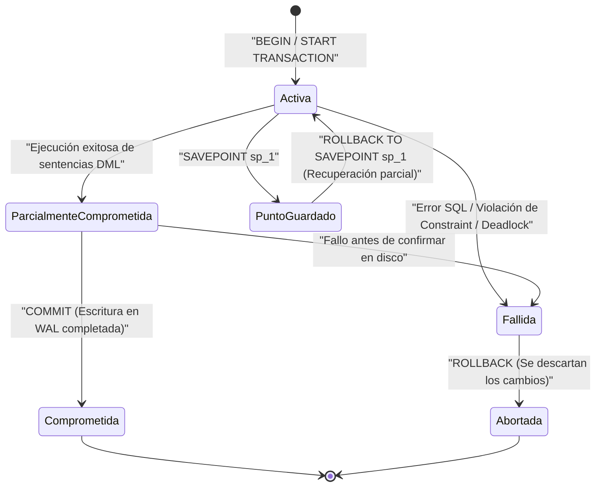
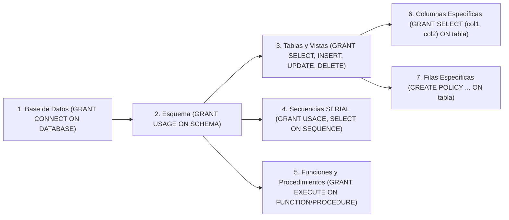

# 🔐 Semana 8: Transacciones, Concurrencia y Seguridad (Roles y Usuarios)

> **Instituto Superior Tecnológico de Turismo y Patrimonio Yavirac**  
> **Carrera:** Tecnología Superior en Desarrollo de Software  
> **Asignatura:** Base de Datos Avanzada (`DS4AC1-215`) | **Paralelo:** Paralelo D  
> **Docente:** Ing. Byron Moreno  
> **Unidad 3:** Transacciones y Seguridad  
> **Periodo Académico:** 2026-II | **Semestre:** Segundo | **Modalidad:** Dual  

---

## 📋 1. Ficha Técnica de la Sesión y Planificación Curricular

| Parámetro | Detalle Oficial según PEA y Planificación de Unidades (Paralelo D) |
| :--- | :--- |
| **Institución** | Instituto Superior Tecnológico de Turismo y Patrimonio Yavirac |
| **Carrera / Nivel** | Desarrollo de Software — Segundo Semestre (Modalidad Dual) |
| **Periodo Académico** | 2026-II |
| **Docente** | Ing. Byron Moreno |
| **Asignatura / Código** | Base de Datos Avanzada (`DS4AC1-215`) |
| **Paralelo** | Paralelo D |
| **Unidad Curricular** | Unidad 3: Transacciones y Seguridad (ID Unidad: 347554) |
| **Semana Académica** | Semana 8 de 9 |
| **Carga Horaria Semanal** | **5 Horas Presenciales** (ACD: 2h | APECD: 3h | APEA: 0h | AA: 0h) |
| **Clase 15 (2 Horas — ACD)** | **Fecha:** Lunes 14 de diciembre de 2026 \| **Tipo:** Aula (ACD - Presencial Teórico-Práctico) \| **Contenido:** Transacciones y Seguridad: Clase magistral sobre transacciones (COMMIT y ROLLBACK), concurrencias y criterios fundamentales de seguridad en bases de datos. |
| **Clase 16 (3 Horas — APECD)** | **Fecha:** Miércoles 16 de diciembre de 2026 \| **Tipo:** Laboratorio (APECD - Práctico-Experimental) \| **Contenido:** Laboratorio práctico: Gestión de roles y usuarios en base de datos. Análisis e implementación de instrucciones de creación de roles, asignación de privilegios y control de acceso. |
| **Prerrequisitos** | Fundamentos de Bases de Datos, Modelo Entidad-Relación (MER), Álgebra Relacional básica |
| **Entorno Tecnológico** | PostgreSQL 16+, pgAdmin 4, psql, DBeaver, Visual Studio Code |

---

## 🎯 2. Objetivos de las Clases, Resultados de Aprendizaje y Competencias

### 2.1. Objetivos de las Clases (Redactados con Verbo en Infinitivo)

- **Objetivo General de la Semana 8:**  
  Administrar transacciones ACID y la seguridad integral en PostgreSQL mediante mecanismos de concurrencia MVCC, gestión granular de roles (RBAC) y políticas de seguridad a nivel de fila (RLS).
- **Objetivo Específico de la Clase 15 (2 Horas (120 min) — ACD / Aula — Lunes 14 de diciembre de 2026):**  
  Analizar las propiedades ACID, el modelo de concurrencia MVCC, los niveles de aislamiento y los criterios fundamentales de seguridad relacional en PostgreSQL.
- **Objetivo Específico de la Clase 16 (3 Horas (180 min) — APECD / Laboratorio — Miércoles 16 de diciembre de 2026):**  
  Implementar la gestión de roles, usuarios, asignación de privilegios granulares (GRANT/REVOKE) y políticas de seguridad a nivel de fila (RLS) en PostgreSQL en entorno de laboratorio.

### 2.2. Resultados de Aprendizaje (RdA) y Competencias
> [!IMPORTANT]
> **Norma Pedagógica de Redacción:** Los Resultados de Aprendizaje describen lo que el estudiante demuestra al finalizar la clase; se redactan en **tercera persona del presente de indicativo** (NUNCA en infinitivo terminado en *-ar*, *-er*, *-ir*).

| Componente Curricular | Redacción Oficial (Sin Verbos en Infinitivo) |
| :--- | :--- |
| **Resultados de Aprendizaje Institucionales (PEA)** | **RdA 3 (PEA):** Brinda asistencia técnica en el diseño de bases de datos mediante procesos de control y seguimiento de las operaciones para el manejo adecuado de la información. |
| **Resultado de Aprendizaje Específico de la Semana** | **Describe los conceptos de transaccionalidad y concurrencia y administra roles, privilegios y políticas de seguridad para el control de acceso a la información en PostgreSQL.** |
| **Competencia de la Asignatura** | Administrar y controlar las operaciones de bases de datos mediante mecanismos de seguimiento, integridad y gestión de transacciones que garanticen la confiabilidad de la información. |
| **Habilidades Blandas Priorizadas (PEA)** | • **Trabajo en equipo:** Realiza trabajos de investigación grupales y prácticas colaborativas.<br>• **Pensamiento crítico:** Utiliza herramientas específicas para el diseño y optimización de bases de datos.<br>• **Gestión del tiempo:** Realiza las prácticas en laboratorio dentro del horario establecido.<br>• **Comunicación técnica efectiva:** Expone y sustenta con claridad decisiones de arquitectura relacional. |

---

## ⏱️ 3. Agenda Detallada y Cronograma Semanal (5 Horas)

### 📅 CLASE 15: Lunes 14 de diciembre de 2026 (2 Horas (120 min)) — ACD (Aula / Teoría Magistral y Ejemplos Guiados)
| Bloque | Tiempo | Componente | Actividad Pedagógica y Contenido |
| :---: | :---: | :---: | :--- |
| **Bloque 15.1** | 40 min | **ACD** | Transacciones y Propiedades ACID: Atomicidad, Consistencia, Aislamiento y Durabilidad; comandos TCL (`BEGIN`, `COMMIT`, `ROLLBACK`, `SAVEPOINT`) y máquina de estados transaccional. |
| **Bloque 15.2** | 40 min | **ACD** | Concurrencia, MVCC y Niveles de Aislamiento: Arquitectura de tuplas múltiples (*xmin*, *xmax*), fenómenos de concurrencia (*Dirty Read*, *Non-Repeatable Read*, *Phantom Read*), niveles `READ COMMITTED`, `REPEATABLE READ`, `SERIALIZABLE`, bloqueos explícitos y *Deadlocks*. |
| **Bloque 15.3** | 40 min | **ACD** | Criterios de Seguridad y Ejemplos Guiados: Tríada CIA, `ROLE` vs `USER`, privilegios granulares DCL (`GRANT`/`REVOKE`) y políticas de seguridad a nivel de fila (*Row-Level Security* - RLS). |

### 🔬 CLASE 16: Miércoles 16 de diciembre de 2026 (3 Horas (180 min)) — APECD (Laboratorio de Cómputo / Taller Práctico y Solucionario)
| Bloque | Tiempo | Componente | Actividad Pedagógica y Contenido |
| :---: | :---: | :---: | :--- |
| **Bloque 16.1** | 60 min | **APECD** | Laboratorio Fase 1: Simulación de Concurrencia en Dos Terminales: Pruebas simultáneas de aislamiento, bloqueo pesimista con `SELECT ... FOR UPDATE`, prevención de *Lost Update* y resolución de bloqueos. |
| **Bloque 16.2** | 70 min | **APECD** | Laboratorio Fase 2: Implementación de Seguridad RBAC y RLS: Creación de matriz empresarial de roles (administrador, desarrollador, cajero, auditor), herencia de roles, esquemas protegidos y políticas RLS. |
| **Bloque 16.3** | 50 min | **APECD** | Laboratorio Fase 3: Pruebas de Acceso, Auditoría y Solucionario: Verificación de permisos con `SET ROLE`, suplantación de identidad para pruebas de RLS, feedback docente y rúbrica. |

---

## 📚 4. PARTE I: CLASE 15 (14/12/2026 — 2 Horas / ACD) — Transacciones, Concurrencia y Criterios de Seguridad

### 4.1. Transacciones (`COMMIT` y `ROLLBACK`) y Propiedades ACID

Una **transacción** es una unidad lógica de trabajo compuesta por una o más sentencias SQL que deben ejecutarse bajo la regla del **"todo o nada"**. El ejemplo canónico es una transferencia bancaria: debitar \$500 de la Cuenta A y acreditar \$500 en la Cuenta B. Si el servidor se apaga justo después del débito y antes del crédito, el dinero no puede desaparecer.

#### Las 4 Propiedades ACID

| Propiedad | Nombre en Español | Significado Técnico en PostgreSQL | Mecanismo Interno del SGBD |
| :---: | :--- | :--- | :--- |
| **A** | **Atomicidad** (*Atomicity*) | Todas las operaciones de la transacción se completan con éxito o ninguna surte efecto. | Registro de transacciones y reversión (*Rollback* / estado de aborto en `pg_xact`). |
| **C** | **Consistencia** (*Consistency*) | Toda transacción lleva la base de datos de un estado válido a otro estado válido, respetando todas las restricciones (`PK`, `FK`, `UNIQUE`, `CHECK`, *Triggers*). | Verificador de restricciones e integridad referencial. |
| **I** | **Aislamiento** (*Isolation*) | La ejecución concurrente de múltiples transacciones no debe interferir entre sí; el resultado debe ser predecible según el nivel de aislamiento configurado. | **MVCC** (*Multi-Version Concurrency Control*), *Snapshots* y gestor de bloqueos (*Lock Manager*). |
| **D** | **Durabilidad** (*Durability*) | Una vez que una transacción ejecuta `COMMIT`, sus cambios persisten incluso ante un corte eléctrico o caída del sistema operativo. | **WAL** (*Write-Ahead Logging*): los cambios se escriben en disco en el log secuencial antes de confirmar el `COMMIT`. |

#### Diagrama de Estados de una Transacción



#### Comandos del Lenguaje de Control de Transacciones (TCL)
1. **`BEGIN;` o `START TRANSACTION;`**: Abre un bloque transaccional explícito. (En PostgreSQL, si no escribes `BEGIN`, cada sentencia individual se ejecuta en su propia transacción implícita o modo *autocommit*).
2. **`COMMIT;` o `END;`**: Confirma de forma permanente todos los cambios realizados desde el `BEGIN`.
3. **`ROLLBACK;` o `ABORT;`**: Deshace todos los cambios realizados dentro de la transacción actual.
4. **`SAVEPOINT nombre_punto;`**: Crea una marca intermedia dentro de una transacción activa.
5. **`ROLLBACK TO SAVEPOINT nombre_punto;`**: Deshace únicamente los cambios ocurridos *después* del `SAVEPOINT`, manteniendo viva la transacción y conservando el trabajo previo al punto de guardado.
6. **`RELEASE SAVEPOINT nombre_punto;`**: Elimina el punto de guardado liberando sus recursos cuando ya no se necesita retroceder a él.

> [!WARNING]
> **Particularidad Crítica de PostgreSQL ante Errores dentro de `BEGIN ... COMMIT`:**
> En PostgreSQL, si cualquier sentencia dentro de un bloque `BEGIN` lanza un error (por ejemplo, división por cero o violación de clave única), **toda la transacción entra inmediatamente en estado `ABORTED`** (`current transaction is aborted, commands ignored until end of transaction block`). No podrás ejecutar más consultas hasta que emitas un `ROLLBACK;` total o un `ROLLBACK TO SAVEPOINT` hacia un punto creado antes del error.

---

### 4.2. Concurrencia, Modelo MVCC, Niveles de Aislamiento y Bloqueos

Cuando cientos de usuarios consultan y modifican las mismas tablas al mismo tiempo, sin un control de concurrencia adecuado aparecen **4 anomalías clásicas**:

| Anomalía de Concurrencia | Descripción del Fenómeno | Ejemplo Financiero |
| :--- | :--- | :--- |
| **1. Lectura Sucia (*Dirty Read*)** | Una transacción $T_1$ lee datos que fueron modificados por otra transacción $T_2$ que **aún no ha hecho `COMMIT`** (y que luego hace `ROLLBACK`). | $T_2$ acredita \$10,000 por error; $T_1$ lee ese saldo y aprueba un retiro; $T_2$ hace `ROLLBACK`. El banco pierde \$10,000. |
| **2. Lectura No Repetible (*Non-Repeatable Read*)** | Una transacción $T_1$ lee la misma fila dos veces y obtiene **valores distintos** porque otra transacción $T_2$ modificó esa fila e hizo `COMMIT` en el intermedio. | $T_1$ consulta el precio de un producto (\$100), $T_2$ lo sube a \$150 y confirma; $T_1$ vuelve a leer la fila en la misma transacción y ve \$150. |
| **3. Lectura Fantasma (*Phantom Read*)** | Una transacción $T_1$ ejecuta dos veces la misma consulta con `WHERE` y en la segunda ejecución **aparecen nuevas filas o desaparecen filas** porque $T_2$ insertó o eliminó registros y confirmó. | Mientras Contabilidad cuadra las ventas del día en $T_1$, un cajero en $T_2$ inserta una factura nueva, descuadrando el segundo `SUM()` de $T_1$. |
| **4. Actualización Perdida (*Lost Update*)** | Dos transacciones leen el mismo valor base, calculan un nuevo valor en memoria y ambas escriben; **el segundo `UPDATE` sobrescribe silenciosamente el cambio del primero**. | Cuenta con \$100. $T_1$ y $T_2$ leen \$100 al mismo tiempo. $T_1$ suma \$50 (guarda \$150). $T_2$ resta \$20 de los \$100 que leyó (guarda \$80). Los \$50 de $T_1$ se evaporaron. |

#### El Secreto de PostgreSQL: Arquitectura MVCC (*Multi-Version Concurrency Control*)
A diferencia de motores antiguos basados únicamente en bloqueos de lectura/escritura, PostgreSQL utiliza **MVCC**:
- Cuando ejecutas un `UPDATE` en PostgreSQL, el motor **no sobrescribe la fila en el mismo lugar físico**, sino que marca la versión antigua con el ID de la transacción que la expiró (`xmax`) e inserta una **nueva versión de la tupla** con el ID de la transacción creadora (`xmin`).
- Gracias a esto, cada transacción ve una **instantánea consistente (*snapshot*)** de la base de datos.
- **Lema de MVCC en PostgreSQL:** *"Los lectores NUNCA bloquean a los escritores, y los escritores NUNCA bloquean a los lectores"*.

#### Niveles de Aislamiento en PostgreSQL (`SET TRANSACTION ISOLATION LEVEL ...`)

| Nivel de Aislamiento | Lectura Sucia (*Dirty Read*) | Lectura No Repetible | Lectura Fantasma (*Phantom*) | Anomalía de Serialización | Comportamiento Real en PostgreSQL |
| :--- | :---: | :---: | :---: | :---: | :--- |
| **`READ UNCOMMITTED`** | ❌ Imposible | ⚠️ Posible | ⚠️ Posible | ⚠️ Posible | En PostgreSQL se comporta exactamente igual que `READ COMMITTED` (PostgreSQL jamás permite lecturas sucias). |
| **`READ COMMITTED`** *(Por defecto)* | ❌ Imposible | ⚠️ Posible | ⚠️ Posible | ⚠️ Posible | Cada sentencia `SELECT` dentro del `BEGIN` toma un nuevo *snapshot* con los datos confirmados hasta ese microsegundo. |
| **`REPEATABLE READ`** | ❌ Imposible | ❌ Imposible | ❌ Imposible (en PG) | ⚠️ Posible | Toma un único *snapshot* al inicio de la primera sentencia. Si otra transacción modifica la misma fila que intentas actualizar, lanza error `could not serialize access due to concurrent update`. |
| **`SERIALIZABLE`** | ❌ Imposible | ❌ Imposible | ❌ Imposible | ❌ Imposible | Garantiza que el resultado de las transacciones concurrentes sea idéntico a si se hubieran ejecutado una tras otra en serie (SSI - *Serializable Snapshot Isolation*). |

#### Bloqueos Pesimistas Explícitos y *Deadlocks* (Interbloqueos)
Cuando estamos en el nivel por defecto (`READ COMMITTED`) y queremos evitar una **Actualización Perdida (*Lost Update*)** al leer un saldo o stock para luego actualizarlo, usamos bloqueo pesimista a nivel de fila:
- **`SELECT ... FOR UPDATE;`**: Bloquea las filas seleccionadas para que ninguna otra transacción pueda modificarlas ni bloquearlas hasta nuestro `COMMIT`/`ROLLBACK`.
- **`SELECT ... FOR NO KEY UPDATE;`**: Similar a `FOR UPDATE`, pero más liviano cuando no se van a modificar columnas de clave primaria o única (permite que tablas hijas sigan insertando claves foráneas sin bloquearse).
- **`SELECT ... FOR SHARE;`**: Bloqueo compartido; permite que otros lean con `FOR SHARE`, pero impide que alguien modifique las filas.
- **Modificadores de espera:**
  - `FOR UPDATE NOWAIT`: Si la fila ya está bloqueada por otro usuario, no se queda esperando; falla de inmediato con error para que la aplicación reintente o informe al usuario.
  - `FOR UPDATE SKIP LOCKED`: Salta las filas que estén bloqueadas por otros y devuelve las siguientes disponibles (esencial para implementar colas de trabajo o asignación de tickets concurrentes).

```mermaid
sequenceDiagram
    autonumber
    participant T1 as "Transacción 1 (Terminal A)"
    participant PG as "Gestor de Bloqueos PostgreSQL"
    participant T2 as "Transacción 2 (Terminal B)"

    T1->>PG: BEGIN; UPDATE cuentas SET saldo = saldo - 10 WHERE id = 1;
    Note over PG: T1 adquiere bloqueo exclusivo sobre Fila id = 1
    T2->>PG: BEGIN; UPDATE cuentas SET saldo = saldo - 10 WHERE id = 2;
    Note over PG: T2 adquiere bloqueo exclusivo sobre Fila id = 2
    T1->>PG: UPDATE cuentas SET saldo = saldo + 10 WHERE id = 2; (Espera a T2...)
    T2->>PG: UPDATE cuentas SET saldo = saldo + 10 WHERE id = 1; (Espera a T1...)
    Note over PG: ¡Ciclo de espera mutua detectado tras deadlock_timeout (1s)!
    PG-->>T2: ERROR: deadlock detected (Aborta T2 para liberar a T1)
    PG-->>T1: Desbloquea y completa el UPDATE de T1
```

> [!TIP]
> **¿Cómo prevenir *Deadlocks* por diseño?**
> Obliga a que todas las funciones, procedimientos y aplicaciones actualicen o bloqueen las filas **siempre en el mismo orden determinista** (por ejemplo, ordenando siempre por `id ASC` antes de hacer `FOR UPDATE`). Si tanto $T_1$ como $T_2$ bloquean primero la cuenta `id = 1` y luego la `id = 2`, jamás habrá un ciclo cerrado, solo una espera ordenada en fila.

---

### 4.3. Seguridad en Bases de Datos: Criterios, Roles, Usuarios, DCL y RLS

#### 1. Criterios Fundamentales de Seguridad de la Información
1. **Confidencialidad:** Garantizar que los datos sensibles (salarios, historias clínicas, datos personales conforme a la LOPDP en Ecuador) solo sean accesibles por los roles autorizados.
2. **Integridad:** Asegurar que la información no sea alterada ni borrada de forma no autorizada o accidental.
3. **Disponibilidad:** Garantizar que los usuarios autorizados tengan acceso oportuno a los datos cuando lo requieran (controlando límites de conexión `CONNECTION LIMIT` y tiempos de espera).
4. **Principio de Menor Privilegio (*Principle of Least Privilege*):** Todo usuario, aplicación o microservicio debe operar únicamente con los permisos mínimos indispensables para cumplir su función. **Ninguna aplicación web o móvil debe conectarse jamás a la base de datos usando el superusuario `postgres`**.
5. **Defensa en Profundidad (*Defense in Depth*):** Combinar seguridad de red (`pg_hba.conf` + SSL/TLS), autenticación robusta (`scram-sha-256`), separación por esquemas, permisos DCL por roles, funciones `SECURITY DEFINER` y políticas a nivel de fila (`RLS`).

#### 2. Diferencia entre `ROLE` y `USER` en PostgreSQL
En PostgreSQL (desde la versión 8.1), el concepto de "usuarios" y "grupos" se unificó en una sola entidad llamada **`ROLE`**.
- La única diferencia entre `CREATE ROLE` y `CREATE USER` es que **`CREATE USER` incluye por defecto el atributo `LOGIN`**, mientras que **`CREATE ROLE` incluye por defecto `NOLOGIN`**.
- Es decir:
  ```sql
  CREATE USER ana WITH PASSWORD 'ClaveSegura#2026';
  -- Es 100% equivalente a:
  CREATE ROLE ana WITH LOGIN PASSWORD 'ClaveSegura#2026';
  ```
- **Buena práctica empresarial (Modelo RBAC — *Role-Based Access Control*):**
  1. Crea **Roles de Grupo sin login (`NOLOGIN`)** que representen cargos o perfiles funcionales (ej. `rol_administrador`, `rol_desarrollador`, `rol_cajero`, `rol_auditor`).
  2. Otorga todos los permisos (`GRANT`) a esos **Roles de Grupo**, nunca directamente a personas individuales.
  3. Crea **Usuarios con login (`LOGIN`)** para cada empleado o servicio y hazlos miembros del rol de grupo correspondiente (`GRANT rol_cajero TO usr_carlos;`).

#### 3. Atributos de un Rol en PostgreSQL

| Atributo | Descripción | Recomendación en Producción |
| :--- | :--- | :--- |
| `LOGIN` / `NOLOGIN` | Permite o impide iniciar sesión directa en el motor. | `NOLOGIN` para perfiles/grupos; `LOGIN` para usuarios reales. |
| `SUPERUSER` / `NOSUPERUSER` | Ignora absolutamente todas las verificaciones de permisos y políticas RLS. | **Solo para el DBA principal.** Prohibido en aplicaciones. |
| `CREATEDB` / `NOCREATEDB` | Permite crear nuevas bases de datos en el clúster. | Solo para DBAs o pipelines de aprovisionamiento. |
| `CREATEROLE` / `NOCREATEROLE` | Permite crear, alterar y administrar otros roles no-superusuarios. | Solo para administradores de seguridad. |
| `INHERIT` / `NOINHERIT` | Determina si el usuario hereda automáticamente los privilegios de los roles a los que pertenece, o si debe activar el rol explícitamente con `SET ROLE`. | `INHERIT` (por defecto) para roles operativos; `NOINHERIT` para privilegios críticos de elevación temporal. |
| `CONNECTION LIMIT n` | Número máximo de conexiones simultáneas permitidas para ese rol. | Vital para evitar que un usuario agote el pool de conexiones. |
| `VALID UNTIL 'timestamp'` | Fecha y hora de expiración automática de la contraseña/acceso. | Obligatorio para pasantes, consultores externos o auditores temporales. |

#### 4. Jerarquía de Permisos DCL (`GRANT` y `REVOKE`) en PostgreSQL
Un error muy común es ejecutar `GRANT SELECT ON tabla TO usuario;` y descubrir que el usuario aún recibe `permission denied for schema`. En PostgreSQL, el acceso es **jerárquico**:



> [!IMPORTANT]
> **El detalle olvidado de las columnas `SERIAL`:**
> Si otorgas `GRANT INSERT ON facturas TO rol_cajero;` y la tabla `facturas` tiene una clave primaria `factura_id SERIAL`, el `INSERT` fallará con `permission denied for sequence facturas_factura_id_seq` a menos que también otorgues permiso sobre la secuencia:
> `GRANT USAGE, SELECT ON ALL SEQUENCES IN SCHEMA comercial TO rol_cajero;`

#### 5. Seguridad a Nivel de Fila (*Row-Level Security* — RLS)
Mientras `GRANT SELECT (columna)` restringe **qué columnas** puede ver un usuario (seguridad vertical), **RLS** restringe **qué filas** puede ver o modificar cada usuario dentro de una misma tabla (seguridad horizontal):

```sql
-- 1. Activar RLS en la tabla
ALTER TABLE transacciones_caja ENABLE ROW LEVEL SECURITY;

-- 2. Crear política: cada cajero solo puede ver e insertar movimientos de su propio usuario
CREATE POLICY pol_cajero_sus_propios_movimientos
    ON transacciones_caja
    FOR ALL
    TO rol_cajero
    USING (usuario_cajero = current_user)
    WITH CHECK (usuario_cajero = current_user);
```

---

## 💻 5. CLASE 15: Ejemplos Guiados Paso a Paso en PostgreSQL (ACD — 2 Horas)

### 5.1. Creación del Entorno Financiero de Demostración

```sql
-- ============================================================================
-- EJEMPLO GUIADO SEMANA 8: TRANSACCIONES, CONCURRENCIA Y SEGURIDAD RBAC/RLS
-- ============================================================================
DROP SCHEMA IF EXISTS banco_yavirac CASCADE;
CREATE SCHEMA banco_yavirac;
SET search_path TO banco_yavirac, public;

CREATE TABLE cuentas_bancarias (
    cuenta_id      SERIAL PRIMARY KEY,
    numero_cuenta  VARCHAR(15) UNIQUE NOT NULL,
    titular        VARCHAR(120) NOT NULL,
    email_privado  VARCHAR(120) NOT NULL,
    telefono_priv  VARCHAR(20) NOT NULL,
    saldo          NUMERIC(14,2) NOT NULL CHECK (saldo >= 0.00),
    oficial_cuenta VARCHAR(60) NOT NULL DEFAULT current_user,
    actualizado_en TIMESTAMPTZ NOT NULL DEFAULT NOW()
);

CREATE TABLE movimientos_bancarios (
    movimiento_id  BIGSERIAL PRIMARY KEY,
    cuenta_id      INTEGER NOT NULL REFERENCES cuentas_bancarias(cuenta_id),
    tipo           VARCHAR(15) NOT NULL CHECK (tipo IN ('DEBITO', 'CREDITO')),
    monto          NUMERIC(14,2) NOT NULL CHECK (monto > 0.00),
    concepto       VARCHAR(200) NOT NULL,
    cajero_usuario VARCHAR(60) NOT NULL DEFAULT current_user,
    fecha_hora     TIMESTAMPTZ NOT NULL DEFAULT clock_timestamp()
);

INSERT INTO cuentas_bancarias (numero_cuenta, titular, email_privado, telefono_priv, saldo, oficial_cuenta)
VALUES
('400-001', 'Fundación Turismo Andino', 'finanzas@turismoandino.ec', '0991112221', 2500.00, 'usr_cajero_ana'),
('400-002', 'Hoteles Patrimoniales S.A.', 'tesoreria@hotelespat.ec',  '0993334442', 1200.00, 'usr_cajero_ana'),
('400-003', 'Transporte Escolar Quito',   'gerencia@transquito.ec',   '0987778883',  500.00, 'usr_cajero_luis');
```

---

### 5.2. Ejemplo Guiado 1: Transacciones Atómicas y Recuperación Parcial con `SAVEPOINT`

Supongamos que estamos procesando un lote de cobros mensuales: cobramos \$100 a la cuenta `400-001`, luego intentamos cobrar \$800 a la cuenta `400-003` (que solo tiene \$500, por lo que violará `CHECK (saldo >= 0.00)`), y gracias a `SAVEPOINT` revertimos solo el cobro fallido sin perder el cobro exitoso de la primera cuenta:

```sql
BEGIN;

    -- Operación 1: Débito exitoso de $100 a la cuenta 1
    UPDATE banco_yavirac.cuentas_bancarias
       SET saldo = saldo - 100.00, actualizado_en = NOW()
     WHERE cuenta_id = 1;

    INSERT INTO banco_yavirac.movimientos_bancarios (cuenta_id, tipo, monto, concepto)
    VALUES (1, 'DEBITO', 100.00, 'Pago mensual servicio custodia');

    -- Creamos un punto de guardado seguro después del primer cobro
    SAVEPOINT sp_despues_cuenta_1;

    -- Operación 2: Intentamos debitar $800 de la cuenta 3 (Saldo actual: $500 -> ¡FALLARÁ!)
    -- En una consola interactiva, esta sentencia lanzará ERROR: new row violates check constraint
    -- UPDATE banco_yavirac.cuentas_bancarias SET saldo = saldo - 800.00 WHERE cuenta_id = 3;

    -- Si ocurre el error, recuperamos la transacción volviendo al SAVEPOINT:
    ROLLBACK TO SAVEPOINT sp_despues_cuenta_1;

    -- Liberamos el savepoint y confirmamos el trabajo válido de la cuenta 1
    RELEASE SAVEPOINT sp_despues_cuenta_1;

COMMIT;

-- Verificamos que la cuenta 1 quedó en $2400.00 y la cuenta 3 intacta en $500.00
SELECT cuenta_id, numero_cuenta, titular, saldo FROM banco_yavirac.cuentas_bancarias ORDER BY cuenta_id;
```

---

### 5.3. Ejemplo Guiado 2: Creación de Roles, Usuarios, Permisos Granulares y RLS

```sql
-- Limpieza previa de roles de demostración (si existieran)
DO $$
BEGIN
    DROP ROLE IF EXISTS usr_cajero_ana, usr_cajero_luis, usr_auditor_externo,
                        rol_cajero_ventanilla, rol_auditor_cumplimiento;
EXCEPTION WHEN OTHERS THEN NULL;
END $$;

-- 1. Crear ROLES DE GRUPO (Perfiles organizacionales sin login directo)
CREATE ROLE rol_cajero_ventanilla NOLOGIN INHERIT;
CREATE ROLE rol_auditor_cumplimiento NOLOGIN INHERIT;

-- 2. Crear USUARIOS CON LOGIN y políticas de expiración / límite de conexiones
CREATE USER usr_cajero_ana
    WITH PASSWORD 'CajeroAna#2026'
    CONNECTION LIMIT 3
    VALID UNTIL '2027-01-01 00:00:00-05';

CREATE USER usr_cajero_luis
    WITH PASSWORD 'CajeroLuis#2026'
    CONNECTION LIMIT 3
    VALID UNTIL '2027-01-01 00:00:00-05';

CREATE USER usr_auditor_externo
    WITH PASSWORD 'Auditor#2026'
    CONNECTION LIMIT 1
    VALID UNTIL '2026-12-31 23:59:59-05';

-- 3. Asignar usuarios a sus respectivos roles de grupo (Herencia RBAC)
GRANT rol_cajero_ventanilla    TO usr_cajero_ana, usr_cajero_luis;
GRANT rol_auditor_cumplimiento TO usr_auditor_externo;

-- 4. Revocar permisos públicos por defecto y otorgar acceso al esquema
REVOKE ALL ON SCHEMA banco_yavirac FROM PUBLIC;
GRANT USAGE ON SCHEMA banco_yavirac TO rol_cajero_ventanilla, rol_auditor_cumplimiento;

-- 5. Permisos para el ROL AUDITOR:
--    Solo puede consultar (SELECT) las columnas financieras de cuentas_bancarias,
--    ¡PROHIBIDO ver email_privado y telefono_priv! (Seguridad a nivel de columna)
GRANT SELECT (cuenta_id, numero_cuenta, titular, saldo, oficial_cuenta, actualizado_en)
   ON banco_yavirac.cuentas_bancarias
   TO rol_auditor_cumplimiento;

GRANT SELECT ON banco_yavirac.movimientos_bancarios TO rol_auditor_cumplimiento;

-- 6. Permisos para el ROL CAJERO:
--    Puede consultar cuentas, actualizar exclusivamente el saldo, e insertar movimientos
GRANT SELECT (cuenta_id, numero_cuenta, titular, saldo, oficial_cuenta)
   ON banco_yavirac.cuentas_bancarias
   TO rol_cajero_ventanilla;

GRANT UPDATE (saldo, actualizado_en)
   ON banco_yavirac.cuentas_bancarias
   TO rol_cajero_ventanilla;

GRANT SELECT, INSERT
   ON banco_yavirac.movimientos_bancarios
   TO rol_cajero_ventanilla;

GRANT USAGE, SELECT
   ON SEQUENCE banco_yavirac.movimientos_bancarios_movimiento_id_seq
   TO rol_cajero_ventanilla;

-- 7. Seguridad a Nivel de Fila (RLS):
--    Cada cajero solo puede ver e insertar movimientos realizados por su propio usuario,
--    mientras que el auditor puede ver todos los movimientos.
ALTER TABLE banco_yavirac.movimientos_bancarios ENABLE ROW LEVEL SECURITY;

CREATE POLICY pol_cajeros_propios_movimientos
    ON banco_yavirac.movimientos_bancarios
    FOR ALL
    TO rol_cajero_ventanilla
    USING (cajero_usuario = current_user)
    WITH CHECK (cajero_usuario = current_user);

CREATE POLICY pol_auditor_ver_todo
    ON banco_yavirac.movimientos_bancarios
    FOR SELECT
    TO rol_auditor_cumplimiento
    USING (TRUE);
```

---

### 📺 Video Tutorial Recomendado en Español — Clase 15 (2 Horas — ACD / Aula)

> [!TIP]
> **Video de Apoyo Académico (Español):**  
> 🎬 **[Transacciones ACID, Aislamiento y Concurrencia en Bases de Datos](https://www.youtube.com/watch?v=0tAqp3w_K2o)**  
> **Canal / Autor:** BettaTech / SystemGuards • **Duración estimada:** ~30 min • **Idioma:** Español  
> **Temas clave explicados:** Propiedades ACID, comandos TCL (BEGIN, COMMIT, ROLLBACK, SAVEPOINT), arquitectura MVCC, fenómenos de concurrencia, niveles de aislamiento, bloqueos pesimistas y deadlocks.

---

## 🛠️ 6. PARTE II: CLASE 16 (16/12/2026 — 3 Horas / APECD) — Taller Práctico-Experimental en Laboratorio

El taller de 4 horas se divide en **dos laboratorios prácticos**:
- **Parte A (2 Horas):** Laboratorio de Transacciones, Niveles de Aislamiento y Bloqueos en **Dos Terminales Paralelas** (`Terminal A` y `Terminal B`).
- **Parte B (2 Horas):** Diseño e implementación de una **Matriz Integral de Seguridad Empresarial (RBAC + Column-Level Security + RLS)** para la plataforma médica y de facturación **ClínicaPatrimonio S.A.**

---

### 6.1. Parte A: Laboratorio Experimental en Dos Terminales Paralelas

Abre dos ventanas de terminal con `psql` (o dos pestañas SQL independientes en DBeaver/pgAdmin con *Auto-Commit* desactivado) conectadas a la misma base de datos donde creaste el esquema `banco_yavirac`.

#### Ejercicio A1: Demostración de Aislamiento `READ COMMITTED` vs `REPEATABLE READ`
Ejecuta paso a paso siguiendo el orden cronológico de la tabla y anota lo que observa cada terminal:

| Paso | 🟦 Terminal A (Consulta de Auditoría) | 🟧 Terminal B (Cajero en Ventanilla) |
| :---: | :--- | :--- |
| **1** | `BEGIN TRANSACTION ISOLATION LEVEL REPEATABLE READ;` | `BEGIN TRANSACTION ISOLATION LEVEL READ COMMITTED;` |
| **2** | `SELECT cuenta_id, saldo FROM banco_yavirac.cuentas_bancarias WHERE cuenta_id = 1;` *(Observa \$2400.00)* | `UPDATE banco_yavirac.cuentas_bancarias SET saldo = saldo + 600.00 WHERE cuenta_id = 1;` |
| **3** | `SELECT cuenta_id, saldo FROM banco_yavirac.cuentas_bancarias WHERE cuenta_id = 1;` *(Sigue viendo \$2400.00 porque Terminal B no ha hecho COMMIT y además A no bloquea a B gracias a MVCC)* | `COMMIT;` *(El saldo oficial en disco ahora es \$3000.00)* |
| **4** | `SELECT cuenta_id, saldo FROM banco_yavirac.cuentas_bancarias WHERE cuenta_id = 1;` *(¡Sigue viendo \$2400.00! Porque en `REPEATABLE READ` el snapshot se congeló en el Paso 2)* | — |
| **5** | `COMMIT;` y luego ejecuta `SELECT cuenta_id, saldo FROM banco_yavirac.cuentas_bancarias WHERE cuenta_id = 1;` *(Recién ahora ve \$3000.00)* | — |

#### Ejercicio A2: Prevención de *Lost Update* con `SELECT ... FOR UPDATE NOWAIT`
Dos cajeros intentan retirar dinero de la misma cuenta al mismo tiempo. Ejecuta la secuencia y comprueba cómo `FOR UPDATE NOWAIT` protege la integridad del saldo:

<details>
<summary>✅ Ver Solución y Secuencia Exacta — Ejercicio A2</summary>

```sql
-- ============================================================================
-- EN TERMINAL A (Transacción 1 bloquea la cuenta 2 para procesar retiro)
-- ============================================================================
BEGIN;
SELECT cuenta_id, numero_cuenta, saldo
  FROM banco_yavirac.cuentas_bancarias
 WHERE cuenta_id = 2
   FOR UPDATE;
-- Terminal A obtiene el bloqueo exclusivo de la fila cuenta_id = 2.

-- ============================================================================
-- EN TERMINAL B (Transacción 2 intenta bloquear la misma cuenta sin esperar)
-- ============================================================================
BEGIN;
SELECT cuenta_id, numero_cuenta, saldo
  FROM banco_yavirac.cuentas_bancarias
 WHERE cuenta_id = 2
   FOR UPDATE NOWAIT;
-- Resultado inmediato en Terminal B:
-- ERROR: could not obtain lock on row in relation "cuentas_bancarias"
-- SQL state: 55P03
ROLLBACK;

-- ============================================================================
-- DE REGRESO EN TERMINAL A (Completa la operación de forma segura)
-- ============================================================================
UPDATE banco_yavirac.cuentas_bancarias
   SET saldo = saldo - 200.00,
       actualizado_en = NOW()
 WHERE cuenta_id = 2;
COMMIT;
```
</details>

---

#### Ejercicio A3: Procedimiento Almacenado de Transferencia Bancaria Anti-Deadlock
Escribe un procedimiento `sp_transferencia_segura(p_cuenta_origen INT, p_cuenta_destino INT, p_monto NUMERIC, p_concepto VARCHAR)` en PL/pgSQL que:
1. Valide que `p_cuenta_origen <> p_cuenta_destino` y `p_monto > 0`.
2. **Prevenga cualquier posibilidad de *Deadlock*** bloqueando las dos cuentas involucradas en **orden ascendente de `cuenta_id`** (`ORDER BY cuenta_id ASC FOR UPDATE`), sin importar si la transferencia va de la cuenta 1 a la 2 o de la 2 a la 1.
3. Verifique saldo suficiente, debite de origen, acredite en destino y registre los dos movimientos en `movimientos_bancarios`.

<details>
<summary>✅ Ver Solución Propuesta — Ejercicio A3</summary>

```sql
CREATE OR REPLACE PROCEDURE banco_yavirac.sp_transferencia_segura(
    p_cuenta_origen  INTEGER,
    p_cuenta_destino INTEGER,
    p_monto          NUMERIC(14,2),
    p_concepto       VARCHAR(200)
)
LANGUAGE plpgsql
AS $$
DECLARE
    v_saldo_origen NUMERIC(14,2);
    v_existe_dest  BOOLEAN;
BEGIN
    IF p_cuenta_origen = p_cuenta_destino THEN
        RAISE EXCEPTION 'La cuenta de origen y destino no pueden ser la misma (ID %).', p_cuenta_origen;
    END IF;

    IF p_monto <= 0 THEN
        RAISE EXCEPTION 'El monto a transferir debe ser mayor a cero ($%).', p_monto;
    END IF;

    -- TRUCO DE INGENIERÍA ANTI-DEADLOCK:
    -- Bloqueamos ambas cuentas ordenadas siempre de menor a mayor cuenta_id
    PERFORM 1
       FROM banco_yavirac.cuentas_bancarias
      WHERE cuenta_id IN (p_cuenta_origen, p_cuenta_destino)
      ORDER BY cuenta_id ASC
        FOR UPDATE;

    -- Verificar existencia de cuenta destino
    SELECT EXISTS(SELECT 1 FROM banco_yavirac.cuentas_bancarias WHERE cuenta_id = p_cuenta_destino)
      INTO v_existe_dest;

    IF NOT v_existe_dest THEN
        RAISE EXCEPTION 'La cuenta destino ID % no existe.', p_cuenta_destino;
    END IF;

    -- Verificar saldo de cuenta origen
    SELECT saldo INTO v_saldo_origen
      FROM banco_yavirac.cuentas_bancarias
     WHERE cuenta_id = p_cuenta_origen;

    IF v_saldo_origen IS NULL THEN
        RAISE EXCEPTION 'La cuenta origen ID % no existe.', p_cuenta_origen;
    END IF;

    IF v_saldo_origen < p_monto THEN
        RAISE EXCEPTION 'FONDOS INSUFICIENTES: Cuenta % dispone de $% y solicita transferir $%.',
            p_cuenta_origen, v_saldo_origen, p_monto;
    END IF;

    -- Ejecutar débito y crédito
    UPDATE banco_yavirac.cuentas_bancarias
       SET saldo = saldo - p_monto, actualizado_en = NOW()
     WHERE cuenta_id = p_cuenta_origen;

    UPDATE banco_yavirac.cuentas_bancarias
       SET saldo = saldo + p_monto, actualizado_en = NOW()
     WHERE cuenta_id = p_cuenta_destino;

    -- Registrar ambos movimientos contables
    INSERT INTO banco_yavirac.movimientos_bancarios (cuenta_id, tipo, monto, concepto)
    VALUES
        (p_cuenta_origen,  'DEBITO',  p_monto, 'Transferencia enviada: ' || p_concepto),
        (p_cuenta_destino, 'CREDITO', p_monto, 'Transferencia recibida: ' || p_concepto);

    RAISE NOTICE 'Transferencia exitosa de $% desde cuenta % hacia cuenta %.',
        p_monto, p_cuenta_origen, p_cuenta_destino;
END;
$$;

-- Prueba de invocación
CALL banco_yavirac.sp_transferencia_segura(1, 2, 150.00, 'Pago factura hospedaje congreso');
```
</details>

---

### 6.2. Parte B: Matriz de Seguridad Empresarial (Roles, Usuarios, DCL y RLS)

#### Caso de Estudio: *ClínicaPatrimonio S.A.*
La clínica maneja datos médicos altamente sensibles (diagnósticos confidenciales) y datos de facturación. Debes construir el esquema `clinica` e implementar la siguiente **Matriz de Control de Acceso Basado en Roles (RBAC)**:

| Rol de Grupo (`NOLOGIN`) | Usuarios Miembros (`LOGIN`) | Permisos Requeridos (Principio de Menor Privilegio) |
| :--- | :--- | :--- |
| **`rol_admin_clinica`** | `usr_dba_sofia` | Propietario y administrador total de todas las tablas, secuencias, vistas y funciones del esquema `clinica`. |
| **`rol_medico_tratante`** | `usr_dr_mendoza`, `usr_dra_paredes` | Puede leer todos los `pacientes` y gestionar (`SELECT, INSERT, UPDATE`) `consultas_medicas`, pero **gracias a RLS solo puede modificar las consultas donde `medico_usuario = current_user`**. No tiene permiso sobre `facturas_clinica`. |
| **`rol_cajero_facturacion`** | `usr_caja_diana` | Puede leer datos básicos de `pacientes` (**excepto `antecedentes_confidenciales` y `alergias_criticas`**), y puede hacer `SELECT, INSERT` en `facturas_clinica` (usando su secuencia). **Prohibido** leer la columna `diagnostico_reservado` de `consultas_medicas`. |
| **`rol_auditor_salud`** | `usr_auditor_msp` (Expira el `2026-12-31`, máx 2 conexiones) | Acceso de **solo lectura (`SELECT`)** a `consultas_medicas` y `facturas_clinica`, sin poder insertar, actualizar ni eliminar ningún registro. |

#### Script Base de Tablas para la Parte B

```sql
DROP SCHEMA IF EXISTS clinica CASCADE;
CREATE SCHEMA clinica;
SET search_path TO clinica, public;

CREATE TABLE pacientes (
    paciente_id                 SERIAL PRIMARY KEY,
    cedula                      VARCHAR(10) UNIQUE NOT NULL,
    nombres_completos           VARCHAR(120) NOT NULL,
    telefono                    VARCHAR(20) NOT NULL,
    alergias_criticas           TEXT,
    antecedentes_confidenciales TEXT
);

CREATE TABLE consultas_medicas (
    consulta_id           SERIAL PRIMARY KEY,
    paciente_id           INTEGER NOT NULL REFERENCES pacientes(paciente_id),
    medico_usuario        VARCHAR(60) NOT NULL DEFAULT current_user,
    fecha_consulta        TIMESTAMPTZ NOT NULL DEFAULT NOW(),
    diagnostico_reservado TEXT NOT NULL,
    valor_consulta        NUMERIC(10,2) NOT NULL CHECK (valor_consulta > 0)
);

CREATE TABLE facturas_clinica (
    factura_id     SERIAL PRIMARY KEY,
    consulta_id    INTEGER UNIQUE NOT NULL REFERENCES consultas_medicas(consulta_id),
    cajero_usuario VARCHAR(60) NOT NULL DEFAULT current_user,
    fecha_emision  TIMESTAMPTZ NOT NULL DEFAULT NOW(),
    monto_total    NUMERIC(10,2) NOT NULL CHECK (monto_total > 0),
    estado_pago    VARCHAR(20) NOT NULL DEFAULT 'PAGADA'
);

INSERT INTO pacientes (cedula, nombres_completos, telefono, alergias_criticas, antecedentes_confidenciales)
VALUES
('1710020030', 'Elena Vásquez Morales', '0991234567', 'Penicilina', 'Hipertensión arterial crónica'),
('1720030040', 'Marco Vinicio Cevallos', '0987654321', 'Ninguna',    'Intervención quirúrgica 2023');

INSERT INTO consultas_medicas (paciente_id, medico_usuario, diagnostico_reservado, valor_consulta)
VALUES
(1, 'usr_dr_mendoza',  'Control cardiológico trimestral estable', 60.00),
(2, 'usr_dra_paredes', 'Evaluación postoperatoria traumatología', 75.00);
```

#### Solución Completa de la Matriz de Seguridad (Roles, Usuarios, `GRANT`, `REVOKE`, `RLS` y Pruebas con `SET ROLE`)

<details>
<summary>✅ Ver Solución Propuesta — Parte B Completa</summary>

```sql
-- ============================================================================
-- SOLUCIÓN PARTE B: ARQUITECTURA DE SEGURIDAD RBAC + COLUMN SECURITY + RLS
-- ============================================================================
-- 1. Limpieza segura de roles previos si existieran
DO $$
BEGIN
    DROP ROLE IF EXISTS usr_dba_sofia, usr_dr_mendoza, usr_dra_paredes,
                        usr_caja_diana, usr_auditor_msp,
                        rol_admin_clinica, rol_medico_tratante,
                        rol_cajero_facturacion, rol_auditor_salud;
EXCEPTION WHEN OTHERS THEN NULL;
END $$;

-- 2. Creación de Roles de Grupo (Perfiles)
CREATE ROLE rol_admin_clinica      NOLOGIN INHERIT;
CREATE ROLE rol_medico_tratante    NOLOGIN INHERIT;
CREATE ROLE rol_cajero_facturacion NOLOGIN INHERIT;
CREATE ROLE rol_auditor_salud      NOLOGIN INHERIT;

-- 3. Creación de Usuarios Nominales con Políticas de Seguridad
CREATE USER usr_dba_sofia
    WITH PASSWORD 'AdminSofia#2026'
    CREATEROLE
    CONNECTION LIMIT 5;

CREATE USER usr_dr_mendoza
    WITH PASSWORD 'DrMendoza#2026'
    CONNECTION LIMIT 3;

CREATE USER usr_dra_paredes
    WITH PASSWORD 'DraParedes#2026'
    CONNECTION LIMIT 3;

CREATE USER usr_caja_diana
    WITH PASSWORD 'CajaDiana#2026'
    CONNECTION LIMIT 2;

CREATE USER usr_auditor_msp
    WITH PASSWORD 'AuditorMSP#2026'
    CONNECTION LIMIT 2
    VALID UNTIL '2026-12-31 23:59:59-05';

-- 4. Asignación de Usuarios a Roles de Grupo
GRANT rol_admin_clinica      TO usr_dba_sofia;
GRANT rol_medico_tratante    TO usr_dr_mendoza, usr_dra_paredes;
GRANT rol_cajero_facturacion TO usr_caja_diana;
GRANT rol_auditor_salud      TO usr_auditor_msp;

-- 5. Blindaje del esquema y permisos por Rol
REVOKE ALL ON SCHEMA clinica FROM PUBLIC;
GRANT USAGE ON SCHEMA clinica TO rol_admin_clinica, rol_medico_tratante,
                                 rol_cajero_facturacion, rol_auditor_salud;

-- 5.1. Permisos para rol_admin_clinica
GRANT ALL PRIVILEGES ON ALL TABLES    IN SCHEMA clinica TO rol_admin_clinica;
GRANT ALL PRIVILEGES ON ALL SEQUENCES IN SCHEMA clinica TO rol_admin_clinica;

-- 5.2. Permisos para rol_medico_tratante
GRANT SELECT, INSERT, UPDATE ON clinica.pacientes         TO rol_medico_tratante;
GRANT SELECT, INSERT, UPDATE ON clinica.consultas_medicas TO rol_medico_tratante;
GRANT USAGE, SELECT ON SEQUENCE clinica.pacientes_paciente_id_seq           TO rol_medico_tratante;
GRANT USAGE, SELECT ON SEQUENCE clinica.consultas_medicas_consulta_id_seq   TO rol_medico_tratante;

-- 5.3. Permisos para rol_cajero_facturacion (Seguridad a nivel de columna)
-- Solo puede ver cedula, nombres y telefono del paciente (NO alergias ni antecedentes)
GRANT SELECT (paciente_id, cedula, nombres_completos, telefono)
   ON clinica.pacientes
   TO rol_cajero_facturacion;

-- Solo puede ver el valor de la consulta para facturar (NO el diagnostico_reservado)
GRANT SELECT (consulta_id, paciente_id, medico_usuario, fecha_consulta, valor_consulta)
   ON clinica.consultas_medicas
   TO rol_cajero_facturacion;

GRANT SELECT, INSERT ON clinica.facturas_clinica TO rol_cajero_facturacion;
GRANT USAGE, SELECT ON SEQUENCE clinica.facturas_clinica_factura_id_seq TO rol_cajero_facturacion;

-- 5.4. Permisos para rol_auditor_salud (Solo lectura)
GRANT SELECT ON clinica.consultas_medicas, clinica.facturas_clinica TO rol_auditor_salud;

-- 6. Configuración de Row-Level Security (RLS) en consultas_medicas
ALTER TABLE clinica.consultas_medicas ENABLE ROW LEVEL SECURITY;

-- Los médicos pueden ver las consultas, pero solo insertar/editar las suyas propias
CREATE POLICY pol_medicos_lectura
    ON clinica.consultas_medicas
    FOR SELECT
    TO rol_medico_tratante, rol_cajero_facturacion, rol_auditor_salud, rol_admin_clinica
    USING (TRUE);

CREATE POLICY pol_medicos_escritura_propia
    ON clinica.consultas_medicas
    FOR INSERT
    TO rol_medico_tratante
    WITH CHECK (medico_usuario = current_user);

CREATE POLICY pol_medicos_actualizacion_propia
    ON clinica.consultas_medicas
    FOR UPDATE
    TO rol_medico_tratante
    USING (medico_usuario = current_user)
    WITH CHECK (medico_usuario = current_user);

-- ============================================================================
-- 7. PRUEBAS DE VERIFICACIÓN CON SET ROLE (Simulación de cada usuario)
-- ============================================================================
-- Prueba 1: Conectarse como Cajera Diana e intentar leer antecedentes médicos
SET ROLE usr_caja_diana;
-- Esta consulta FUNCIONA (solo columnas autorizadas):
SELECT paciente_id, cedula, nombres_completos, telefono FROM clinica.pacientes;
-- Si intenta ejecutar: SELECT * FROM clinica.pacientes; -> Lanzará ERROR: permission denied for table pacientes

-- La cajera emite una factura para la consulta 1:
INSERT INTO clinica.facturas_clinica (consulta_id, monto_total) VALUES (1, 60.00);
RESET ROLE;

-- Prueba 2: Conectarse como Dr. Mendoza e intentar modificar la consulta de la Dra. Paredes (consulta_id = 2)
SET ROLE usr_dr_mendoza;
UPDATE clinica.consultas_medicas
   SET valor_consulta = 90.00
 WHERE consulta_id = 2;
-- Resultado: UPDATE 0 (RLS impide que el Dr. Mendoza modifique consultas de otro médico)
RESET ROLE;
```
</details>

---

### 📺 Video Tutorial Recomendado en Español — Clase 16 (3 Horas — APECD / Laboratorio)

> [!TIP]
> **Video de Apoyo Académico (Español):**  
> 🎬 **[Seguridad en PostgreSQL: Roles, Usuarios, Permisos y RLS](https://www.youtube.com/watch?v=l60FP1gHtJE)**  
> **Canal / Autor:** PicaCódigo / Jesús Conde • **Duración estimada:** ~35 min • **Idioma:** Español  
> **Temas clave explicados:** Administración de seguridad relacional: roles, usuarios, jerarquías, privilegios granulares (GRANT/REVOKE), esquemas seguros y políticas de seguridad a nivel de fila (RLS).

---

## 🚀 7. PARTE III: Actividades de Refuerzo, Casos Reales en Producción, Rúbrica y Bibliografía

1. **Colas de Trabajo Concurrentes con `FOR UPDATE SKIP LOCKED`:** Crea una tabla `cola_envio_correos (id SERIAL, destinatario TEXT, estado VARCHAR)` con 10 registros pendientes. Abre dos terminales y demuestra cómo ejecutar `SELECT * FROM cola_envio_correos WHERE estado = 'PENDIENTE' ORDER BY id LIMIT 1 FOR UPDATE SKIP LOCKED;` en ambas terminales asigna un correo distinto a cada trabajador sin bloquearse mutuamente.
2. **Auditoría de Privilegios en el Catálogo del Sistema:** Escribe una consulta sobre `information_schema.role_table_grants` y `pg_roles` que genere un reporte consolidado de todos los usuarios con login, su fecha de expiración (`rolvaliduntil`), límite de conexiones (`rolconnlimit`) y las tablas a las que tienen acceso.

---

## 🌐 Laboratorio Real de Transacciones, Concurrencia y Seguridad (RBAC + RLS) sobre Pagila, Employees y MusicBrainz

En esta sección llevamos los conceptos de **Transacciones ACID, Concurrencia MVCC y Seguridad DCL/RLS** directamente a nuestras **3 bases de datos reales de producción**:
- **[Pagila (`pagila`)](https://github.com/xzilla/pagila):** 33 tablas (~62.322 filas) de alquiler de películas.
- **[Employees (`employees`)](https://github.com/neondatabase/postgres-sample-dbs):** 6 tablas (~3.919.015 filas, 333 MB) de recursos humanos y salarios.
- **[MusicBrainz (`musicbrainz`)](https://musicbrainz.org/doc/MusicBrainz_Database):** Esquema global de metadatos musicales.

---

### A. Simulación de Concurrencia en 2 Terminales sobre `Pagila`

#### 1. Caso Real: "El Último DVD en Tienda" (`inventory_id = 1`)
Imagina el sábado a las 20:00 en la Tienda 1 de `Pagila`. Solo queda una copia física (`inventory_id = 1`, película *ACADEMY DINOSAUR*). Dos empleados en mostradores distintos (`staff_id = 1` Mike Hillyer y `staff_id = 2` Jon Stephens) escanean el mismo código de barras casi al mismo instante para alquilarlo a dos clientes distintos (`customer_id = 1` y `customer_id = 2`).

Si no usamos bloqueo pesimista (`FOR UPDATE NOWAIT`), ambos empleados consultarán si el DVD está disponible, ambos verán que sí y ambos insertarán en `rental`, generando un doble alquiler imposible físicamente.

```mermaid
sequenceDiagram
    autonumber
    participant S1 as "Terminal 1 (Staff 1 - Mike)"
    participant PG as "PostgreSQL (Pagila: inventory & rental)"
    participant S2 as "Terminal 2 (Staff 2 - Jon)"

    S1->>PG: BEGIN; SELECT * FROM inventory WHERE inventory_id = 1 FOR UPDATE NOWAIT;
    Note over PG: Staff 1 adquiere bloqueo exclusivo sobre inventory_id = 1
    S2->>PG: BEGIN; SELECT * FROM inventory WHERE inventory_id = 1 FOR UPDATE NOWAIT;
    PG-->>S2: ERROR 55P03: could not obtain lock on row in relation "inventory"
    Note over S2: Falla rápido sin colgar la caja registradora (ROLLBACK)
    S1->>PG: INSERT INTO rental (...) RETURNING rental_id;
    S1->>PG: SAVEPOINT sp_antes_de_pago;
    S1->>PG: INSERT INTO payment (...);
    S1->>PG: COMMIT;
    Note over PG: Alquiler y cobro confirmados atómicamente y bloqueo liberado
```

##### Ejecución Paso a Paso en Dos Terminales (`psql` o DBeaver)

| Paso | 🟦 Terminal 1 (Cajero Mike — `staff_id = 1`) | 🟧 Terminal 2 (Cajero Jon — `staff_id = 2`) |
| :---: | :--- | :--- |
| **1** | `BEGIN;` | `BEGIN;` |
| **2** | `SELECT inventory_id, film_id FROM public.inventory WHERE inventory_id = 1 FOR UPDATE NOWAIT;` *(Obtiene el bloqueo)* | `SELECT inventory_id, film_id FROM public.inventory WHERE inventory_id = 1 FOR UPDATE NOWAIT;` *(Lanza `ERROR: could not obtain lock on row` de inmediato)* |
| **3** | `INSERT INTO public.rental (rental_date, inventory_id, customer_id, staff_id) VALUES (NOW(), 1, 1, 1) RETURNING rental_id;` | `ROLLBACK;` *(Libera su transacción abortada)* |
| **4** | `SAVEPOINT sp_registro_pago;` | — |
| **5** | `INSERT INTO public.payment (customer_id, staff_id, rental_id, amount, payment_date) VALUES (1, 1, currval('rental_rental_id_seq'), 4.99, NOW());` | — |
| **6** | `COMMIT;` *(Persiste en WAL el alquiler y el pago)* | — |

---

#### 2. Simulación y Prevención de *Deadlock* en `Pagila` (`customer` vs `rental`)
Observa cómo se produce un interbloqueo real en `Pagila` cuando un proceso actualiza primero `customer` y luego `rental`, mientras otro proceso actualiza primero `rental` y luego `customer`:

```sql
-- ============================================================================
-- REPRODUCCIÓN Y RESOLUCIÓN DE DEADLOCK EN PAGILA
-- ============================================================================
-- [TERMINAL 1] Actualiza primero al cliente 1 y luego su alquiler 1:
BEGIN;
UPDATE public.customer SET last_update = NOW() WHERE customer_id = 1;
-- (Ahora ejecuta el primer UPDATE en Terminal 2 antes de continuar)
UPDATE public.rental   SET last_update = NOW() WHERE rental_id = 1; -- Espera a Terminal 2

-- [TERMINAL 2] Actualiza en orden INVERSO (primero rental 1 y luego customer 1):
BEGIN;
UPDATE public.rental   SET last_update = NOW() WHERE rental_id = 1;
UPDATE public.customer SET last_update = NOW() WHERE customer_id = 1;
-- Resultado tras 1 segundo (deadlock_timeout):
-- ERROR: deadlock detected (SQLSTATE 40P01)

-- ✅ SOLUCIÓN PROFESIONAL: Establecer una jerarquía fija de bloqueo de tablas
-- Siempre bloquear/actualizar en orden: 1º customer -> 2º inventory -> 3º rental -> 4º payment.
```

---

### B. Transacciones Masivas y Aislamiento `REPEATABLE READ` sobre `Employees` (3,9M Filas)

En la base `employees` (`2.844.047` registros en `salaries`), el área de Finanzas necesita generar un **cierre contable de nómina** que ejecuta múltiples consultas agregadas (gasto salarial por departamento, gasto salarial por cargo `titles` y promedio general). Si Finanzas usa el nivel por defecto (`READ COMMITTED`) y a mitad del reporte Recursos Humanos aplica un aumento salarial del 5% al departamento `'d005'` (*Development*), la primera consulta del reporte tendrá los sueldos antiguos y la segunda consulta tendrá los sueldos nuevos, **descuadrando el balance general**.

La solución en PostgreSQL sin bloquear a Recursos Humanos (gracias a **MVCC**) es encapsular todo el reporte en una transacción `REPEATABLE READ READ ONLY`:

```sql
-- ============================================================================
-- EMPLOYEES (3.9M FILAS): REPORTE MULTICONSULTA CONSISTENTE CON SNAPSHOT MVCC
-- ============================================================================
BEGIN TRANSACTION ISOLATION LEVEL REPEATABLE READ READ ONLY;

-- Consulta 1: Nómina vigente total por departamento
SELECT d.dept_no,
       d.dept_name,
       COUNT(s.emp_no) AS empleados_activos,
       SUM(s.salary)   AS masa_salarial_anual,
       ROUND(AVG(s.salary), 2) AS salario_promedio
  FROM employees.departments d
  JOIN employees.dept_emp de ON de.dept_no = d.dept_no AND de.to_date = DATE '9999-01-01'
  JOIN employees.salaries s  ON s.emp_no = de.emp_no   AND s.to_date  = DATE '9999-01-01'
 GROUP BY d.dept_no, d.dept_name
 ORDER BY masa_salarial_anual DESC;

-- Aunque otra terminal haga UPDATE e incluso COMMIT sobre employees.salaries en este instante,
-- la siguiente consulta verá EXACTAMENTE la misma fotografía (snapshot) del milisegundo inicial:

-- Consulta 2: Cuadre global de masa salarial vigente
SELECT COUNT(*) AS total_empleados_vigentes,
       SUM(salary) AS suma_global_exacta
  FROM employees.salaries
 WHERE to_date = DATE '9999-01-01';

COMMIT;
```

---

### C. Arquitectura de Roles, Usuarios y *Row-Level Security (RLS)* en `Pagila`, `Employees` y `MusicBrainz`

#### 1. Seguridad Multitienda con RLS en `Pagila` (`store_id = 1` vs `store_id = 2`)
En `Pagila` existen dos tiendas (`store_id = 1` atendida por `staff_id = 1`, y `store_id = 2` atendida por `staff_id = 2`). Implementaremos una arquitectura donde cada empleado solo pueda ver y modificar los alquileres (`rental`) gestionados por su propio usuario de personal:

```sql
-- ============================================================================
-- SEGURIDAD RBAC + RLS EN PAGILA (AISLAMIENTO POR EMPLEADO / TIENDA)
-- ============================================================================
DO $$
BEGIN
    DROP ROLE IF EXISTS usr_staff_1, usr_staff_2, usr_auditor_pagila,
                        rol_cajero_pagila, rol_gerente_tienda, rol_auditor_pagila;
EXCEPTION WHEN OTHERS THEN NULL;
END $$;

-- 1. Roles de Grupo (NOLOGIN)
CREATE ROLE rol_cajero_pagila  NOLOGIN INHERIT;
CREATE ROLE rol_gerente_tienda NOLOGIN INHERIT;
CREATE ROLE rol_auditor_pagila NOLOGIN INHERIT;

-- 2. Usuarios de Personal (el número final coincide con su staff_id en Pagila)
CREATE USER usr_staff_1        WITH PASSWORD 'PagilaStaff1#2026' CONNECTION LIMIT 3;
CREATE USER usr_staff_2        WITH PASSWORD 'PagilaStaff2#2026' CONNECTION LIMIT 3;
CREATE USER usr_auditor_pagila WITH PASSWORD 'PagilaAudit#2026'  CONNECTION LIMIT 1 VALID UNTIL '2026-12-31';

GRANT rol_cajero_pagila  TO usr_staff_1, usr_staff_2;
GRANT rol_auditor_pagila TO usr_auditor_pagila;

-- 3. Permisos DCL Granulares
GRANT USAGE ON SCHEMA public TO rol_cajero_pagila, rol_gerente_tienda, rol_auditor_pagila;

GRANT SELECT ON public.film, public.inventory, public.customer TO rol_cajero_pagila;
GRANT SELECT, INSERT, UPDATE (return_date, last_update) ON public.rental TO rol_cajero_pagila;
GRANT SELECT, INSERT ON public.payment TO rol_cajero_pagila;
GRANT USAGE, SELECT ON ALL SEQUENCES IN SCHEMA public TO rol_cajero_pagila;

GRANT SELECT ON ALL TABLES IN SCHEMA public TO rol_auditor_pagila;

-- 4. Row-Level Security (RLS) sobre la tabla rental
ALTER TABLE public.rental ENABLE ROW LEVEL SECURITY;

DROP POLICY IF EXISTS pol_pagila_rental_cajero ON public.rental;
CREATE POLICY pol_pagila_rental_cajero
    ON public.rental
    FOR ALL
    TO rol_cajero_pagila
    USING (
        staff_id = CASE current_user
                       WHEN 'usr_staff_1' THEN 1
                       WHEN 'usr_staff_2' THEN 2
                       ELSE -1
                   END
    )
    WITH CHECK (
        staff_id = CASE current_user
                       WHEN 'usr_staff_1' THEN 1
                       WHEN 'usr_staff_2' THEN 2
                       ELSE -1
                   END
    );

DROP POLICY IF EXISTS pol_pagila_rental_auditor ON public.rental;
CREATE POLICY pol_pagila_rental_auditor
    ON public.rental
    FOR SELECT
    TO rol_auditor_pagila, rol_gerente_tienda
    USING (TRUE);
```

---

#### 2. Blindaje de Nómina Confidencial en `Employees` y Catálogo Público en `MusicBrainz`

```sql
-- ============================================================================
-- SEGURIDAD DE DATOS CONFIDENCIALES EN EMPLOYEES Y MUSICBRAINZ
-- ============================================================================
DO $$
BEGIN
    DROP ROLE IF EXISTS usr_analista_rrhh, usr_empleado_portal,
                        rol_rrhh_nomina, rol_directorio_interno, rol_editor_musicbrainz;
EXCEPTION WHEN OTHERS THEN NULL;
END $$;

CREATE ROLE rol_directorio_interno NOLOGIN INHERIT;
CREATE ROLE rol_rrhh_nomina        NOLOGIN INHERIT;
CREATE ROLE rol_editor_musicbrainz NOLOGIN INHERIT;

CREATE USER usr_empleado_portal WITH PASSWORD 'PortalEmp#2026' CONNECTION LIMIT 10;
CREATE USER usr_analista_rrhh   WITH PASSWORD 'NominaRRHH#2026' CONNECTION LIMIT 2;

GRANT rol_directorio_interno TO usr_empleado_portal;
GRANT rol_rrhh_nomina        TO usr_analista_rrhh;

-- Blindaje en Employees: nadie del público puede leer la tabla salaries (2.84M de sueldos)
REVOKE ALL ON SCHEMA employees FROM PUBLIC;
REVOKE ALL ON ALL TABLES IN SCHEMA employees FROM PUBLIC;

GRANT USAGE ON SCHEMA employees TO rol_directorio_interno, rol_rrhh_nomina;

-- El directorio interno solo puede ver nombres, departamentos y títulos (¡PROHIBIDO ver salaries y birth_date!)
GRANT SELECT (emp_no, first_name, last_name, gender, hire_date)
   ON employees.employees TO rol_directorio_interno;
GRANT SELECT ON employees.departments, employees.dept_emp, employees.titles
   TO rol_directorio_interno;

-- Solo RRHH Nómina puede consultar e insertar salarios
GRANT SELECT, INSERT, UPDATE ON employees.salaries, employees.employees TO rol_rrhh_nomina;

-- Blindaje en MusicBrainz: rol editor puede insertar/actualizar metadatos pero NUNCA hacer DELETE ni TRUNCATE
GRANT USAGE ON SCHEMA musicbrainz TO rol_editor_musicbrainz;
GRANT SELECT, INSERT, UPDATE ON musicbrainz.artist, musicbrainz.recording, musicbrainz.release
   TO rol_editor_musicbrainz;
```

---

### D. Taller Práctico Adicional sobre `Pagila`, `Employees` y `MusicBrainz` (6 Retos con Solucionario)

#### Reto Real 1 (`Pagila`): Procedimiento Transaccional de Alquiler y Pago Atómico con Bloqueo `FOR UPDATE NOWAIT`
Crea el procedimiento `public.sp_pagila_alquilar_dvd(p_inventory_id INT, p_customer_id INT, p_staff_id INT, p_amount NUMERIC)` que:
1. Bloquee la fila en `inventory` con `FOR UPDATE NOWAIT`.
2. Verifique que el cliente esté activo (`activebool = TRUE`) y que el ejemplar no tenga un alquiler abierto (`return_date IS NULL` en `rental`).
3. Inserte el alquiler en `rental` y, si `p_amount > 0`, inserte el cobro en `payment`.

<details>
<summary>✅ Ver Solución Propuesta — Reto Real 1 (Pagila)</summary>

```sql
CREATE OR REPLACE PROCEDURE public.sp_pagila_alquilar_dvd(
    p_inventory_id INTEGER,
    p_customer_id  INTEGER,
    p_staff_id     INTEGER,
    p_amount       NUMERIC(5,2)
)
LANGUAGE plpgsql
AS $$
DECLARE
    v_activo    BOOLEAN;
    v_rental_id INTEGER;
BEGIN
    -- 1. Bloquear el ejemplar físico sin esperar si otro cajero lo está procesando
    PERFORM 1
       FROM public.inventory
      WHERE inventory_id = p_inventory_id
        FOR UPDATE NOWAIT;

    IF NOT FOUND THEN
        RAISE EXCEPTION 'El ejemplar inventory_id % no existe.', p_inventory_id;
    END IF;

    -- 2. Validar cliente activo
    SELECT activebool INTO v_activo
      FROM public.customer
     WHERE customer_id = p_customer_id;

    IF v_activo IS DISTINCT FROM TRUE THEN
        RAISE EXCEPTION 'El cliente ID % no existe o se encuentra inactivo.', p_customer_id;
    END IF;

    -- 3. Validar que el DVD no esté actualmente alquilado
    IF EXISTS (
        SELECT 1 FROM public.rental
         WHERE inventory_id = p_inventory_id AND return_date IS NULL
    ) THEN
        RAISE EXCEPTION 'El ejemplar inventory_id % se encuentra actualmente alquilado.', p_inventory_id;
    END IF;

    -- 4. Registrar el alquiler
    INSERT INTO public.rental (rental_date, inventory_id, customer_id, staff_id, last_update)
    VALUES (NOW(), p_inventory_id, p_customer_id, p_staff_id, NOW())
    RETURNING rental_id INTO v_rental_id;

    -- 5. Registrar el pago inicial
    IF p_amount > 0 THEN
        INSERT INTO public.payment (customer_id, staff_id, rental_id, amount, payment_date)
        VALUES (p_customer_id, p_staff_id, v_rental_id, p_amount, NOW());
    END IF;

    RAISE NOTICE 'Alquiler registrado exitosamente (rental_id = %) para cliente %.', v_rental_id, p_customer_id;
END;
$$;
```
</details>

---

#### Reto Real 2 (`Pagila`): Cola de Procesamiento de Devoluciones Pendientes con `FOR UPDATE SKIP LOCKED`
Escribe una consulta transaccional para operadores de call-center que tome el alquiler vencido más antiguo (`return_date IS NULL`) sin chocar con otros operadores conectados simultáneamente usando `FOR UPDATE SKIP LOCKED`.

<details>
<summary>✅ Ver Solución Propuesta — Reto Real 2 (Pagila)</summary>

```sql
BEGIN;

SELECT r.rental_id,
       r.rental_date,
       r.customer_id,
       r.inventory_id
  FROM public.rental r
 WHERE r.return_date IS NULL
 ORDER BY r.rental_date ASC
 LIMIT 1
   FOR UPDATE SKIP LOCKED;

-- El operador gestiona la llamada con el cliente y registra observación o devolución,
-- mientras el siguiente operador que ejecute la misma consulta recibirá el 2º alquiler más antiguo.
COMMIT;
```
</details>

---

#### Reto Real 3 (`Employees`): Reajuste Salarial por Lotes con `SAVEPOINT` ante Tope Presupuestario
Escribe un bloque transaccional sobre `employees` que aplique un incremento salarial a dos empleados (`emp_no = 10001` y `emp_no = 10002`), usando un `SAVEPOINT` intermedio para que, si el ajuste del segundo empleado excede un presupuesto máximo de `\$120,000`, se revierta únicamente el segundo cambio con `ROLLBACK TO SAVEPOINT` y se confirme el primero con `COMMIT`.

<details>
<summary>✅ Ver Solución Propuesta — Reto Real 3 (Employees)</summary>

```sql
BEGIN;

    -- 1. Incrementar en $1,000 el salario vigente del empleado 10001
    UPDATE employees.salaries
       SET salary = salary + 1000
     WHERE emp_no = 10001
       AND to_date = DATE '9999-01-01';

    SAVEPOINT sp_ajuste_emp_10001;

    -- 2. Intentar incrementar en $60,000 el salario vigente del empleado 10002
    UPDATE employees.salaries
       SET salary = salary + 60000
     WHERE emp_no = 10002
       AND to_date = DATE '9999-01-01';

    -- 3. Si supera el techo de $120,000, deshacemos solo el cambio del empleado 10002
    DO $$
    DECLARE
        v_sal INTEGER;
    BEGIN
        SELECT salary INTO v_sal
          FROM employees.salaries
         WHERE emp_no = 10002 AND to_date = DATE '9999-01-01';

        IF v_sal > 120000 THEN
            RAISE NOTICE 'El salario de emp_no 10002 ($%) excede el techo de $120,000. Ejecute ROLLBACK TO SAVEPOINT.', v_sal;
        END IF;
    END $$;

    ROLLBACK TO SAVEPOINT sp_ajuste_emp_10001;
    RELEASE SAVEPOINT sp_ajuste_emp_10001;

COMMIT;
```
</details>

---

#### Reto Real 4 (`Pagila`): Política RLS en `customer` para Gerentes de Tienda
Activa `ROW LEVEL SECURITY` en `public.customer` y crea una política para que el rol `rol_cajero_pagila` solo pueda ver y actualizar clientes pertenecientes a su misma tienda (`store_id = 1` para `usr_staff_1` y `store_id = 2` para `usr_staff_2`).

<details>
<summary>✅ Ver Solución Propuesta — Reto Real 4 (Pagila)</summary>

```sql
ALTER TABLE public.customer ENABLE ROW LEVEL SECURITY;

DROP POLICY IF EXISTS pol_customer_por_tienda ON public.customer;
CREATE POLICY pol_customer_por_tienda
    ON public.customer
    FOR ALL
    TO rol_cajero_pagila
    USING (
        store_id = CASE current_user
                       WHEN 'usr_staff_1' THEN 1
                       WHEN 'usr_staff_2' THEN 2
                       ELSE -1
                   END
    )
    WITH CHECK (
        store_id = CASE current_user
                       WHEN 'usr_staff_1' THEN 1
                       WHEN 'usr_staff_2' THEN 2
                       ELSE -1
                   END
    );
```
</details>

---

#### Reto Real 5 (`Employees`): Función `SECURITY DEFINER` para Consulta de Promedio Salarial sin Exponer Sueldos Individuales
El rol `rol_directorio_interno` no tiene permiso `SELECT` sobre `employees.salaries`. Crea una función `employees.fn_promedio_salarial_depto(p_dept_no CHAR(4))` con `SECURITY DEFINER` y `SET search_path = employees, pg_temp` que devuelva únicamente el promedio salarial del departamento (si tiene al menos 5 empleados activos) y otorga permiso `EXECUTE` a `rol_directorio_interno`.

<details>
<summary>✅ Ver Solución Propuesta — Reto Real 5 (Employees)</summary>

```sql
CREATE OR REPLACE FUNCTION employees.fn_promedio_salarial_depto(p_dept_no CHAR(4))
RETURNS NUMERIC(12,2)
LANGUAGE plpgsql
SECURITY DEFINER
SET search_path = employees, pg_temp
AS $$
DECLARE
    v_conteo   BIGINT;
    v_promedio NUMERIC(12,2);
BEGIN
    SELECT COUNT(*), ROUND(AVG(s.salary), 2)
      INTO v_conteo, v_promedio
      FROM employees.dept_emp de
      JOIN employees.salaries s ON s.emp_no = de.emp_no
     WHERE de.dept_no = p_dept_no
       AND de.to_date = DATE '9999-01-01'
       AND s.to_date  = DATE '9999-01-01';

    IF v_conteo < 5 THEN
        RAISE EXCEPTION 'Por privacidad estadística se requieren al menos 5 empleados activos en el departamento.';
    END IF;

    RETURN v_promedio;
END;
$$;

REVOKE ALL ON FUNCTION employees.fn_promedio_salarial_depto(CHAR) FROM PUBLIC;
GRANT EXECUTE ON FUNCTION employees.fn_promedio_salarial_depto(CHAR) TO rol_directorio_interno;
```
</details>

---

#### Reto Real 6 (`MusicBrainz`): Procedimiento Anti-Deadlock para Fusión de Artistas Duplicados (`artist`)
Cuando en `MusicBrainz` se detectan dos registros de artista duplicados (`p_artist_keep_id` y `p_artist_merge_id`), se deben reasignar todas las relaciones de `l_artist_recording` hacia `p_artist_keep_id`. Crea el procedimiento `musicbrainz.sp_fusionar_artistas_seguro(p_artist_keep_id INT, p_artist_merge_id INT)` que bloquee ambos artistas en `musicbrainz.artist` ordenados por `id ASC FOR UPDATE` antes de transferir sus grabaciones.

<details>
<summary>✅ Ver Solución Propuesta — Reto Real 6 (MusicBrainz)</summary>

```sql
CREATE OR REPLACE PROCEDURE musicbrainz.sp_fusionar_artistas_seguro(
    p_artist_keep_id  INTEGER,
    p_artist_merge_id INTEGER
)
LANGUAGE plpgsql
AS $$
BEGIN
    IF p_artist_keep_id = p_artist_merge_id THEN
        RAISE EXCEPTION 'Los IDs de artista a fusionar deben ser distintos.';
    END IF;

    -- Bloqueo determinista en orden ascendente de ID para prevenir Deadlocks
    PERFORM 1
       FROM musicbrainz.artist
      WHERE id IN (p_artist_keep_id, p_artist_merge_id)
      ORDER BY id ASC
        FOR UPDATE;

    -- Reasignar grabaciones del artista duplicado hacia el artista principal
    UPDATE musicbrainz.l_artist_recording
       SET entity0      = p_artist_keep_id,
           last_updated = NOW()
     WHERE entity0 = p_artist_merge_id;

    -- Marcar el artista fusionado como finalizado
    UPDATE musicbrainz.artist
       SET ended        = TRUE,
           comment      = LEFT(COALESCE(comment, '') || ' [Merged into ID ' || p_artist_keep_id || ']', 255),
           last_updated = NOW()
     WHERE id = p_artist_merge_id;

    RAISE NOTICE 'Artista ID % fusionado exitosamente dentro del Artista ID %.', p_artist_merge_id, p_artist_keep_id;
END;
$$;
```
</details>

---

## 📊 8. Rúbrica de Evaluación y Autoevaluación

### 8.1. Rúbrica Oficial del Laboratorio Práctico (APECD — 10 Puntos)

| Criterio de Evaluación | Excelente (100%) | Satisfactorio (75%) | En Proceso (50%) | Insuficiente (0-25%) | Puntaje |
| :--- | :--- | :--- | :--- | :--- | :---: |
| **1. Control de Transacciones (`COMMIT`, `ROLLBACK`, `SAVEPOINT`)** | Emplea bloques transaccionales y recupera errores parciales con `SAVEPOINT` sin perder operaciones previas válidas. | Usa `BEGIN`, `COMMIT` y `ROLLBACK` pero presenta confusión en el alcance de `SAVEPOINT`. | Ejecuta sentencias sueltas sin garantizar atomicidad. | No utiliza control transaccional explícito. | **2.5 pts** |
| **2. Concurrencia, Niveles de Aislamiento y Anti-Deadlock** | Demuestra en 2 terminales las diferencias de aislamiento, aplica `FOR UPDATE` y ordena bloqueos por ID para evitar *deadlocks*. | Usa `FOR UPDATE` pero no ordena los recursos al bloquear múltiples filas. | Confunde los fenómenos de concurrencia o no logra reproducir el bloqueo en 2 consolas. | No aplica mecanismos de control de concurrencia. | **3.0 pts** |
| **3. Creación de Roles, Usuarios y Atributos de Seguridad** | Distingue roles de grupo (`NOLOGIN`) y usuarios (`LOGIN`), aplicando `CONNECTION LIMIT`, `VALID UNTIL` y herencia RBAC. | Crea usuarios y roles pero asigna permisos directamente a usuarios en vez de grupos. | Otorga `SUPERUSER` innecesariamente violando el principio de menor privilegio. | No logra crear los roles o usuarios solicitados. | **2.5 pts** |
| **4. Permisos Granulares DCL (`GRANT`/`REVOKE`) y RLS** | Otorga permisos exactos sobre esquema, tablas, columnas sensibles, secuencias `SERIAL` y configura políticas RLS funcionales. | Configura `GRANT` sobre tablas pero olvida permisos en esquema/secuencias o permisos por columna. | Otorga `GRANT ALL` indiscriminadamente sin proteger columnas confidenciales. | Los usuarios reciben errores de acceso o tienen acceso total sin restricción. | **2.0 pts** |
| **TOTAL** | | | | | **10.0 pts** |

---

### 8.2. Preguntas de Autoevaluación

1. **¿Qué propiedad ACID garantiza el registro anticipado de escritura (*WAL - Write-Ahead Logging*) en PostgreSQL y por qué?**
   <details>
   <summary>Ver respuesta</summary>
   Garantiza la **Durabilidad (*Durability*)**. Antes de que PostgreSQL devuelva el mensaje `COMMIT` al cliente, escribe de forma síncrona en disco las modificaciones dentro de los archivos WAL. Si ocurre un apagón un milisegundo después del `COMMIT`, al reiniciar el servidor PostgreSQL reproduce (*replay*) el WAL y reconstruye los datos confirmados.
   </details>

2. **En PostgreSQL, ¿por qué una consulta `SELECT` pesada de reportes no bloquea a un cajero que está ejecutando `UPDATE` sobre las mismas filas?**
   <details>
   <summary>Ver respuesta</summary>
   Gracias a la arquitectura **MVCC (*Multi-Version Concurrency Control*)**. El `SELECT` lee una versión consistente (*snapshot*) de las tuplas según los identificadores de transacción `xmin` y `xmax`, mientras que el `UPDATE` crea una nueva versión de la fila sin sobrescribir la versión que está leyendo el reporte.
   </details>

3. **¿Cuál es la diferencia exacta entre ejecutar `CREATE ROLEventas;` y `CREATE USER ventas;` en PostgreSQL?**
   <details>
   <summary>Ver respuesta</summary>
   La única diferencia es que `CREATE USER` incluye implícitamente el atributo **`LOGIN`** (permitiendo conectarse al servidor), mientras que `CREATE ROLE` incluye por defecto **`NOLOGIN`** (pensado para actuar como un rol de grupo o perfil).
   </details>

4. **Si otorgas `GRANT INSERT ON comercial.pedidos TO rol_vendedor;` pero el usuario sigue recibiendo error de permisos al intentar insertar un pedido con clave primaria `SERIAL`, ¿qué dos permisos adicionales faltan otorgar?**
   <details>
   <summary>Ver respuesta</summary>
   1. Permiso de uso sobre el esquema: `GRANT USAGE ON SCHEMA comercial TO rol_vendedor;`
   2. Permiso de uso sobre la secuencia asociada a la columna `SERIAL`: `GRANT USAGE, SELECT ON SEQUENCE comercial.pedidos_id_seq TO rol_vendedor;`
   </details>

5. **¿Qué diferencia existe entre usar `SELECT ... FOR UPDATE NOWAIT` y `SELECT ... FOR UPDATE SKIP LOCKED`?**
   <details>
   <summary>Ver respuesta</summary>
   Si la fila objetivo ya está bloqueada por otra transacción:
   - **`NOWAIT`** aborta inmediatamente la sentencia lanzando un error (`could not obtain lock on row`).
   - **`SKIP LOCKED`** no lanza error ni espera; simplemente omite las filas bloqueadas y devuelve las demás filas disponibles que cumplan el `WHERE`.
   </details>

---

## 📖 9. Bibliografía y Recursos Recomendados

- **Silberschatz, A., Korth, H. F., & Sudarshan, S. (2014).** *Fundamentos de bases de datos* (6.ª ed.). McGraw-Hill. (Capítulos 14 y 15: Transacciones y Control de Concurrencia; Capítulo 4.6: Autorización).
- **Date, C. J. (2001).** *Introducción a los sistemas de bases de datos* (7.ª ed.). Pearson Educación. (Parte IV: Gestión de Transacciones y Seguridad).
- **Kroenke, D. M. (2003).** *Procesamiento de bases de datos: Fundamentos, diseño e implementación* (8.ª ed.). Pearson Educación.
- **PostgreSQL Global Development Group. (2026).** *PostgreSQL 16 Official Documentation — Chapter 13: Concurrency Control & Chapter 22: Database Roles & Row Security Policies*. Disponible en: `https://www.postgresql.org/docs/current/mvcc.html`

---

<div align="center">

⬅️ [Semana 7: Implementación Avanzada de Triggers](./semana-07-implementacion-avanzada-triggers.md) &nbsp;&nbsp;|&nbsp;&nbsp; 🏠 [Volver al Sílabo Principal](../README.md) &nbsp;&nbsp;|&nbsp;&nbsp; ➡️ [Semana 9: Repaso, Examen Parcial 2 y Examen de Recuperación](./semana-09-repaso-examen-parcial-2-recuperacion.md)

</div>
