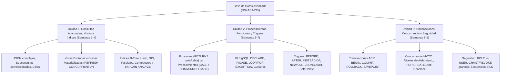

# 🎓 Semana 9: Repaso Integral, Examen Parcial 2, Examen de Recuperación y Cierre de Asignatura

---

## 📋 1. Portada y Ficha Técnica de la Sesión

| Campo | Detalle Oficial (PEA) |
| :--- | :--- |
| **Institución** | Instituto Superior Tecnológico de Turismo y Patrimonio Yavirac |
| **Carrera** | Tecnología Superior en Desarrollo de Software |
| **Asignatura** | Base de Datos Avanzada |
| **Código de Asignatura** | `DS4AC1-215` |
| **Semestre / Periodo** | Segundo Semestre — Periodo Académico `2026-II` |
| **Modalidad** | Dual |
| **Unidad Curricular** | **Unidad 3:** Transacciones y Seguridad (Cierre de Unidad 3 y de la Asignatura) |
| **Semana** | Semana 9 de 9 |
| **Carga Horaria Semanal** | **5 Horas Totales** — Aprendizaje en Contacto con el Docente (**ACD**): `2h` \| Aprendizaje Práctico-Experimental en Contacto con el Docente (**APECD**): `3h` |
| **Contenidos del PEA** | Examen parcial 2; Examen recuperación |
| **Software y Herramientas** | PostgreSQL 16+, pgAdmin 4 / DBeaver, Terminal `psql`, Git |

---

## 🎯 2. Objetivos, Resultados de Aprendizaje y Competencias

### Objetivo General de la Sesión
Consolidar los conocimientos teóricos y prácticos de las **Unidades 2 y 3** (Funciones, Procedimientos Almacenados, PL/pgSQL, Triggers, Transacciones ACID, Concurrencia MVCC y Seguridad DCL/RLS) mediante una sesión estructurada de preguntas y respuestas, evaluar el logro de los Resultados de Aprendizaje en el **Examen del Segundo Parcial**, validar la sustentación del **Proyecto de Integración de Saberes (PIS)** y aplicar el **Examen de Recuperación** integral.

### Alineación con el Programa de Estudio de la Asignatura (PEA)

| Componente Curricular | Descripción Oficial según el PEA |
| :--- | :--- |
| **Resultado de Aprendizaje (RdA 1)** | Realiza consultas avanzadas para extraer datos relevantes de múltiples tablas, vistas e índices. |
| **Resultado de Aprendizaje (RdA 2)** | Desarrollo de procedimientos almacenados, funciones o triggers. |
| **Resultado de Aprendizaje (RdA 3)** | Brinda asistencia técnica en el diseño de bases de datos mediante procesos de control y seguimiento de las operaciones para el manejo adecuado de la información. |
| **Actividad ACD (2h)** | Espacio de preguntas y respuestas, para aclarar dudas (Repaso ejecutivo de Unidades 2 y 3 y revisión final del Proyecto de Integración de Saberes). |
| **Actividad APECD (3h)** | Evaluación del segundo parcial y Examen de recuperación. |
| **Evidencia de Aprendizaje** | Resolución escrita y práctica en laboratorio del Examen Parcial 2, entrega/defensa del Proyecto Integrador y Examen de Recuperación (cuando aplique). |
| **Habilidades Blandas** | Integridad académica, gestión del tiempo bajo presión, comunicación técnica efectiva y pensamiento crítico. |

---

## ⏱️ 3. Agenda Detallada de la Sesión (5 Horas)

| Bloque | Duración | Componente | Tema / Actividad |
| :---: | :---: | :---: | :--- |
| **1** | 45 min | **ACD** | **Repaso Ejecutivo y *Cheat Sheet* (Unidades 2 y 3):** Síntesis comparativa de Funciones vs Procedimientos, Triggers (`BEFORE`/`AFTER`/`INSTEAD OF`), Transacciones ACID, MVCC y Seguridad RBAC/RLS. |
| **2** | 45 min | **ACD** | **Espacio de Preguntas y Respuestas (FAQ Técnico):** Resolución en vivo de las 10 dudas más frecuentes y depuración de errores comunes en PL/pgSQL y permisos. |
| **3** | 30 min | **ACD** | **Revisión del Proyecto de Integración de Saberes (PIS):** Verificación de entregables técnicos según la matriz de evaluación sumativa del PEA. |
| **4** | 90 min | **APECD** | **Aplicación del Examen Parcial 2 (Teórico + Laboratorio Práctico):** Caso *Cooperativa de Ahorro y Crédito CoopYavirac Ltda.* |
| **5** | 90 min | **APECD** | **Retroalimentación del Parcial 2 y Aplicación del Examen de Recuperación (Unidades 1, 2 y 3):** Caso *Sistema Hospitalario y Farmacéutico AndesMed S.A.* |

---

## 📚 4. Desarrollo Teórico-Conceptual: Repaso Ejecutivo y FAQ (ACD - 2 Horas)

### 4.1. Mapa Conceptual Integrador de la Asignatura (`DS4AC1-215`)



---

### 4.2. *Cheat Sheet* Ejecutivo de Bolsillo (Unidades 2 y 3)

#### A. Comparativa Rápida: Funciones vs Procedimientos vs Triggers en PostgreSQL

| Característica | Función (`CREATE FUNCTION`) | Procedimiento (`CREATE PROCEDURE`) | Función de Trigger (`RETURNS TRIGGER`) |
| :--- | :--- | :--- | :--- |
| **Cómo se invoca** | `SELECT fn_nombre(...);` o dentro de `WHERE` / `FROM` | `CALL sp_nombre(...);` | Automáticamente ante `INSERT`, `UPDATE`, `DELETE` o `TRUNCATE` |
| **Retorno** | Obligatorio (`RETURNS tipo`, `RETURNS TABLE`, `SETOF`, `VOID`) | No tiene cláusula `RETURNS` (puede usar parámetros `INOUT`) | Obligatorio `RETURNS TRIGGER` (`RETURN NEW`, `OLD` o `NULL`) |
| **Control Transaccional interno** | ❌ Prohibido hacer `COMMIT` o `ROLLBACK` (usa `EXCEPTION` para subtransacciones) | ✅ Permite ejecutar `COMMIT;` y `ROLLBACK;` dentro del cuerpo | ❌ Prohibido hacer `COMMIT` o `ROLLBACK` (para abortar usa `RAISE EXCEPTION`) |
| **Caso de uso ideal** | Cálculos reutilizables, reportes parametrizados, validaciones puras | Procesos por lotes, transferencias, migraciones multi-etapa | Integridad compleja de negocio, stock en tiempo real, auditoría forense |

#### B. Plantillas Sintácticas Esenciales para el Examen

```sql
-- 1. FUNCIÓN QUE RETORNA UNA TABLA
CREATE OR REPLACE FUNCTION fn_reporte(p_id INT)
RETURNS TABLE (col1 INT, col2 NUMERIC) LANGUAGE plpgsql AS $$
BEGIN
    RETURN QUERY SELECT t.id, t.monto FROM tabla t WHERE t.id = p_id;
END;
$$;

-- 2. PROCEDIMIENTO ALMACENADO CON BLOQUEO ANTI-DEADLOCK
CREATE OR REPLACE PROCEDURE sp_operacion(p_id INT, p_valor NUMERIC)
LANGUAGE plpgsql AS $$
BEGIN
    PERFORM 1 FROM cuentas WHERE id = p_id FOR UPDATE;
    UPDATE cuentas SET saldo = saldo + p_valor WHERE id = p_id;
END;
$$;

-- 3. TRIGGER COMPLETO (FUNCIÓN + ENLACE A TABLA)
CREATE OR REPLACE FUNCTION fn_trg_ejemplo()
RETURNS TRIGGER LANGUAGE plpgsql AS $$
BEGIN
    IF TG_OP = 'INSERT' THEN
        NEW.creado_en := NOW();
        RETURN NEW;
    ELSIF TG_OP = 'DELETE' THEN
        RETURN OLD;
    END IF;
    RETURN NEW;
END;
$$;

CREATE TRIGGER trg_01_ejemplo
BEFORE INSERT OR UPDATE OR DELETE ON mi_tabla
FOR EACH ROW EXECUTE FUNCTION fn_trg_ejemplo();

-- 4. SEGURIDAD: ROLES, USUARIOS, GRANT Y RLS
CREATE ROLE rol_operador NOLOGIN INHERIT;
CREATE USER usr_juan WITH PASSWORD 'Clave#2026' CONNECTION LIMIT 3 VALID UNTIL '2026-12-31';
GRANT rol_operador TO usr_juan;
GRANT USAGE ON SCHEMA mi_esquema TO rol_operador;
GRANT SELECT, INSERT, UPDATE (col_a, col_b) ON mi_esquema.mi_tabla TO rol_operador;
GRANT USAGE, SELECT ON ALL SEQUENCES IN SCHEMA mi_esquema TO rol_operador;
```

---

### 4.3. Espacio de Preguntas y Respuestas Frecuentes (FAQ Técnico — ACD)

Durante la sesión de contacto con el docente resolvemos las **8 dudas críticas** planteadas por los estudiantes antes de rendir el examen:

1. **❓ *"Profe, ¿cuándo debo usar `PERFORM` en lugar de `SELECT` dentro de PL/pgSQL?"***
   - **Respuesta:** En PL/pgSQL todo `SELECT` que no guarde su resultado en una variable con `INTO` produce el error `query has no destination for result data`. Si solo quieres ejecutar una consulta para bloquear filas (`SELECT 1 FROM cuentas WHERE id = 1 FOR UPDATE`) o llamar a una función cuyo valor de retorno no necesitas guardar, reemplaza la palabra `SELECT` por **`PERFORM`** (`PERFORM 1 FROM cuentas WHERE id = 1 FOR UPDATE;`).

2. **❓ *"¿Por qué mi trigger `BEFORE INSERT` deja la fila en blanco o no inserta nada aunque no da ningún mensaje de error?"***
   - **Respuesta:** Porque olvidaste colocar **`RETURN NEW;`** al final de la función del trigger (o devolviste `RETURN NULL;`). Recuerda: en un trigger `BEFORE EACH ROW`, retornar `NULL` cancela silenciosamente la inserción o actualización de esa fila.

3. **❓ *"En un trigger `AFTER DELETE`, ¿puedo leer `NEW.id`?"***
   - **Respuesta:** **No.** En un evento `DELETE`, el registro `NEW` es `NULL` porque la fila está siendo eliminada. Debes leer siempre **`OLD.id`**. Si tu función atiende tanto `INSERT/UPDATE` como `DELETE`, usa `COALESCE(NEW.id, OLD.id)` o separa la lógica con `IF TG_OP = 'DELETE' THEN ...`.

4. **❓ *"Si dentro de una función o trigger capturo un error con `EXCEPTION WHEN OTHERS THEN`, ¿qué pasa con los `INSERT` o `UPDATE` que hice antes del error?"***
   - **Respuesta:** Al entrar al bloque `EXCEPTION`, PostgreSQL hace un *rollback* automático de todo lo ocurrido dentro de ese bloque `BEGIN ... EXCEPTION ... END`, pero la transacción externa continúa viva. En cambio, si quieres que toda la operación falle y nada se guarde, **no captures la excepción** (o vuelve a lanzarla con `RAISE;`).

5. **❓ *"¿Por qué en una consola con `BEGIN;` tras un error de sintaxis PostgreSQL me dice `current transaction is aborted, commands ignored until end of transaction block`?"***
   - **Respuesta:** Porque PostgreSQL garantiza la Atomicidad estricta: cualquier error invalida el bloque transaccional activo. Debes ejecutar `ROLLBACK;` (o `ROLLBACK TO SAVEPOINT nombre_sp;` si creaste un punto de guardado previo al error) para limpiar el estado antes de enviar nuevos comandos.

6. **❓ *"¿Qué diferencia hay entre `SECURITY INVOKER` y `SECURITY DEFINER` al crear una función o procedimiento?"***
   - **Respuesta:**
     - `SECURITY INVOKER` (por defecto): la función se ejecuta con los permisos del usuario que la llama.
     - `SECURITY DEFINER`: la función se ejecuta con los permisos del **dueño que la creó** (por ejemplo, el administrador). Esto es utilísimo para permitir que un cajero ejecute `CALL sp_transferir(...)` sin darle permiso directo de `UPDATE` sobre la tabla `cuentas`.

7. **❓ *"¿Por qué el usuario que creé con `GRANT SELECT, INSERT ON tabla TO rol_cajero` no puede insertar filas si la tabla usa `SERIAL`?"***
   - **Respuesta:** Porque el tipo `SERIAL` utiliza una secuencia interna (`tabla_id_seq`) para generar el siguiente número con `nextval()`. Debes otorgar permiso de uso sobre el esquema (`GRANT USAGE ON SCHEMA ...`) y sobre la secuencia (`GRANT USAGE, SELECT ON SEQUENCE ...`).

8. **❓ *"¿Cómo recuerdo en el examen cuál es la diferencia entre Lectura No Repetible y Lectura Fantasma?"***
   - **Respuesta:**
     - **Lectura No Repetible (*Non-Repeatable Read*):** Lees la **misma fila existente** dos veces y uno de sus atributos cambió porque otro usuario hizo `UPDATE`.
     - **Lectura Fantasma (*Phantom Read*):** Ejecutas una consulta de conjunto (`WHERE` o `COUNT/SUM`) dos veces y **aparecen filas nuevas o desaparecen filas** porque otro usuario hizo `INSERT` o `DELETE`.

---

## 📝 5. Examen del Segundo Parcial (APECD - 90 Minutos)

### Instrucciones Generales de Evaluación
- **Unidades Evaluadas:** Unidad 2 (Procedimientos, Funciones y Triggers) y Unidad 3 (Transacciones, Concurrencia y Seguridad).
- **Duración:** 90 minutos.
- **Puntaje Total:** **10.0 puntos** (Sección Teórica: `3.0 puntos` | Sección Práctica de Laboratorio: `7.0 puntos`).

---

### 5.1. Sección I: Evaluación Teórico-Conceptual (3.0 Puntos — 0.50 pts c/u)

Responde seleccionando la alternativa correcta y justificando brevemente tu elección:

1. **En PostgreSQL, ¿cuál de los siguientes objetos permite ejecutar explícitamente sentencias `COMMIT` y `ROLLBACK` dentro de su bloque de código PL/pgSQL?**
   - a) Una función escalar definida con `RETURNS NUMERIC`.
   - b) Una función de trigger definida con `RETURNS TRIGGER`.
   - c) Un procedimiento almacenado definido con `CREATE PROCEDURE` e invocado mediante `CALL`.
   - d) Una vista materializada con índice único.

2. **Un desarrollador crea un trigger `BEFORE UPDATE FOR EACH ROW` para normalizar en mayúsculas el nombre de un socio (`NEW.nombres := UPPER(NEW.nombres);`), pero al final de la función escribe `RETURN OLD;`. ¿Qué sucederá cuando alguien ejecute un `UPDATE` sobre la tabla?**
   - a) PostgreSQL lanzará un error de compilación porque `OLD` no existe en `UPDATE`.
   - b) La fila se actualizará con los valores nuevos y en mayúsculas.
   - c) La actualización no surtirá ningún cambio en los datos porque al retornar `OLD` en un trigger `BEFORE UPDATE`, PostgreSQL sobrescribe la fila con los valores antiguos originales.
   - d) La fila será eliminada físicamente de la tabla.

3. **Dos transacciones concurrentes ($T_1$ y $T_2$) necesitan transferir fondos entre las cuentas `101` y `205`. $T_1$ transfiere de la `101` a la `205`, mientras que al mismo milisegundo $T_2$ transfiere de la `205` a la `101`. ¿Qué técnica garantiza prevenir un *Deadlock* (interbloqueo) sin reducir la concurrencia global?**
   - a) Cambiar el nivel de aislamiento a `READ UNCOMMITTED`.
   - b) Adquirir siempre los bloqueos de fila (`SELECT ... FOR UPDATE`) en un orden determinista único (por ejemplo, ordenando ambas cuentas por `cuenta_id ASC`) antes de realizar los `UPDATE`.
   - c) Eliminar todas las claves primarias y foráneas de la tabla.
   - d) Usar un trigger `AFTER DELETE` en lugar de un procedimiento.

4. **Dentro de una transacción iniciada con `BEGIN;`, se ejecuta un `INSERT` válido en la tabla `socios`, luego se define `SAVEPOINT sp_credito;`, y a continuación se ejecuta un `INSERT` en `prestamos` que falla por violar una restricción `CHECK`. ¿Qué comando permite descartar únicamente el `INSERT` fallido en `prestamos` y mantener vivo el `INSERT` previo de `socios`?**
   - a) `ROLLBACK;`
   - b) `COMMIT TO SAVEPOINT sp_credito;`
   - c) `ROLLBACK TO SAVEPOINT sp_credito;` seguido finalmente de `COMMIT;`
   - d) `RELEASE SAVEPOINT sp_credito;`

5. **Según el Principio de Menor Privilegio en PostgreSQL, si deseas crear un perfil llamado `rol_ventanilla` que agrupe permisos pero no pueda iniciar sesión por sí mismo, y un usuario `usr_carmen` que sí pueda iniciar sesión con máximo 2 conexiones simultáneas heredando dicho perfil, ¿cuál es la secuencia correcta?**
   - a) `CREATE USER rol_ventanilla;` y `CREATE ROLE usr_carmen NOLOGIN;`
   - b) `CREATE ROLE rol_ventanilla NOLOGIN INHERIT; CREATE USER usr_carmen WITH PASSWORD '...' CONNECTION LIMIT 2; GRANT rol_ventanilla TO usr_carmen;`
   - c) `CREATE ROLE usr_carmen SUPERUSER; REVOKE ALL FROM rol_ventanilla;`
   - d) `GRANT usr_carmen TO rol_ventanilla;`

6. **¿Para qué se utiliza la expresión `pg_trigger_depth() > 1` dentro de una función de trigger en PostgreSQL?**
   - a) Para contar cuántas columnas tiene la tabla auditada.
   - b) Para medir cuántos usuarios están conectados simultáneamente.
   - c) Para detectar si el trigger fue disparado de forma anidada/recursiva por otro trigger y cortar bucles infinitos de ejecución.
   - d) Para encriptar el contenido de `to_jsonb(NEW)`.

---

### 5.2. Sección II: Caso Práctico de Laboratorio — *Cooperativa de Ahorro y Crédito "CoopYavirac Ltda."* (7.0 Puntos)

La **Cooperativa de Ahorro y Crédito CoopYavirac Ltda.** requiere implementar el núcleo transaccional, de reglas de negocio, auditoría y seguridad de su módulo de **Cuentas de Ahorro y Créditos**.

#### Script Base del Examen Parcial 2 (Ejecutar antes de resolver los ejercicios)

```sql
-- ============================================================================
-- SCRIPT BASE EXAMEN PARCIAL 2: COOPERATIVA COOPYAVIRAC LTDA.
-- ============================================================================
DROP SCHEMA IF EXISTS coopyavirac CASCADE;
CREATE SCHEMA coopyavirac;
SET search_path TO coopyavirac, public;

CREATE TABLE socios (
    socio_id          SERIAL PRIMARY KEY,
    cedula            VARCHAR(10) UNIQUE NOT NULL,
    nombres           VARCHAR(120) NOT NULL,
    ingresos_mensuales NUMERIC(12,2) NOT NULL CHECK (ingresos_mensuales >= 0),
    score_crediticio  INTEGER NOT NULL DEFAULT 750 CHECK (score_crediticio BETWEEN 300 AND 999),
    activo            BOOLEAN NOT NULL DEFAULT TRUE
);

CREATE TABLE cuentas_ahorro (
    cuenta_id         SERIAL PRIMARY KEY,
    numero_libreta    VARCHAR(15) UNIQUE NOT NULL,
    socio_id          INTEGER NOT NULL REFERENCES socios(socio_id),
    saldo_disponible  NUMERIC(14,2) NOT NULL DEFAULT 0.00 CHECK (saldo_disponible >= 0),
    saldo_bloqueado   NUMERIC(14,2) NOT NULL DEFAULT 0.00 CHECK (saldo_bloqueado >= 0),
    estado_cuenta     VARCHAR(15) NOT NULL DEFAULT 'ACTIVA'
                      CHECK (estado_cuenta IN ('ACTIVA', 'CONGELADA', 'CERRADA')),
    ultima_transaccion TIMESTAMPTZ
);

CREATE TABLE transacciones_ahorro (
    transaccion_id    BIGSERIAL PRIMARY KEY,
    cuenta_id         INTEGER NOT NULL REFERENCES cuentas_ahorro(cuenta_id),
    tipo_movimiento   VARCHAR(15) NOT NULL
                      CHECK (tipo_movimiento IN ('DEPOSITO', 'RETIRO', 'TRANSFERENCIA_ENV', 'TRANSFERENCIA_REC')),
    monto             NUMERIC(14,2) NOT NULL CHECK (monto > 0),
    saldo_resultante  NUMERIC(14,2),
    observacion       VARCHAR(200),
    cajero_db         VARCHAR(60) NOT NULL DEFAULT current_user,
    fecha_registro    TIMESTAMPTZ NOT NULL DEFAULT clock_timestamp()
);

CREATE TABLE auditoria_cooperativa (
    audit_id          BIGSERIAL PRIMARY KEY,
    fecha_hora        TIMESTAMPTZ NOT NULL DEFAULT clock_timestamp(),
    txid              BIGINT NOT NULL DEFAULT txid_current(),
    tabla_afectada    VARCHAR(60) NOT NULL,
    operacion         VARCHAR(10) NOT NULL,
    usuario_db        VARCHAR(60) NOT NULL DEFAULT current_user,
    registro_old      JSONB,
    registro_new      JSONB
);

INSERT INTO socios (cedula, nombres, ingresos_mensuales, score_crediticio) VALUES
('1711223344', ' Gabriela Montalvo ', 1450.00, 820),
('1722334455', ' Roberto Pazmiño ',    950.00, 680),
('1733445566', ' Lucía Cárdenas ',    2100.00, 910);

INSERT INTO cuentas_ahorro (numero_libreta, socio_id, saldo_disponible, saldo_bloqueado, estado_cuenta) VALUES
('AH-2026-001', 1, 1800.00, 200.00, 'ACTIVA'),
('AH-2026-002', 2,  450.00,   0.00, 'ACTIVA'),
('AH-2026-003', 3, 5200.00, 500.00, 'CONGELADA');
```

#### Ejercicios Prácticos a Resolver (7.0 Puntos)

1. **Ejercicio 1 — Función PL/pgSQL de Evaluación de Capacidad de Endeudamiento (`1.5 puntos`):**
   Crea la función `coopyavirac.fn_evaluar_credito_socio(p_socio_id INT, p_monto_solicitado NUMERIC, p_plazo_meses INT)` que retorne una tabla (`RETURNS TABLE`) con las columnas `(socio_nombre VARCHAR, cuota_mensual_estimada NUMERIC, capacidad_pago_maxima NUMERIC, dictamen VARCHAR)`.
   - La tasa de interés mensual fija es del `1.2%` sobre el monto solicitado: `cuota_mensual_estimada = ROUND((p_monto_solicitado / p_plazo_meses) + (p_monto_solicitado * 0.012), 2)`.
   - La `capacidad_pago_maxima` del socio es el `35%` de sus `ingresos_mensuales`.
   - El `dictamen` será:
     - `'RECHAZADO POR SCORE'` si `score_crediticio < 700`.
     - `'RECHAZADO POR CAPACIDAD DE PAGO'` si `cuota_mensual_estimada > capacidad_pago_maxima`.
     - `'CRÉDITO APROBADO'` en caso contrario.

2. **Ejercicio 2 — Trigger de Reglas de Negocio y Actualización de Saldo en `transacciones_ahorro` (`2.0 puntos`):**
   Crea la función `coopyavirac.fn_trg_procesar_transaccion_ahorro()` y su trigger `trg_01_procesar_transaccion_ahorro` (`BEFORE INSERT ON coopyavirac.transacciones_ahorro FOR EACH ROW`) que:
   - Bloquee la fila correspondiente en `cuentas_ahorro` (`FOR UPDATE`).
   - Verifique que `estado_cuenta = 'ACTIVA'`. Si está `'CONGELADA'` o `'CERRADA'`, aborte con `RAISE EXCEPTION`.
   - Si `tipo_movimiento IN ('DEPOSITO', 'TRANSFERENCIA_REC')`, sume `NEW.monto` a `saldo_disponible`.
   - Si `tipo_movimiento IN ('RETIRO', 'TRANSFERENCIA_ENV')`, verifique que `saldo_disponible >= NEW.monto` (sin tocar `saldo_bloqueado`); si no alcanza, lance `RAISE EXCEPTION`. Caso contrario, reste `NEW.monto` de `saldo_disponible`.
   - Actualice `ultima_transaccion = NOW()` en `cuentas_ahorro` y asigne en la propia fila de la transacción `NEW.saldo_resultante` con el nuevo `saldo_disponible`.

3. **Ejercicio 3 — Trigger de Auditoría Forense `JSONB` (`1.0 punto`):**
   Crea la función `coopyavirac.fn_trg_auditoria_cooperativa()` y el trigger `trg_99_auditoria_cuentas` (`AFTER INSERT OR UPDATE OR DELETE ON coopyavirac.cuentas_ahorro FOR EACH ROW`) que guarde en `auditoria_cooperativa` el estado `to_jsonb(OLD)` y `to_jsonb(NEW)`.

4. **Ejercicio 4 — Procedimiento Transaccional de Transferencia Interbancaria Anti-Deadlock con `SAVEPOINT` (`1.5 puntos`):**
   Crea el procedimiento `coopyavirac.sp_transferir_entre_cuentas(p_cuenta_origen INT, p_cuenta_destino INT, p_monto NUMERIC, p_motivo VARCHAR)` que:
   - Valide que ambas cuentas sean distintas y `p_monto > 0`.
   - Bloquee ambas filas en `cuentas_ahorro` ordenadas por `cuenta_id ASC FOR UPDATE` (prevención de *Deadlock*).
   - Inserte primero el movimiento `'TRANSFERENCIA_ENV'` en `transacciones_ahorro` para la cuenta origen y luego el movimiento `'TRANSFERENCIA_REC'` para la cuenta destino (los cuales dispararán automáticamente el trigger del Ejercicio 2).

5. **Ejercicio 5 — Seguridad Basada en Roles, Columnas y RLS (`1.0 punto`):**
   Escribe las sentencias DCL para:
   - Crear el rol de grupo `rol_cajero_coop` (`NOLOGIN`) y el usuario `usr_cajero_pablo` (`LOGIN`, contraseña `'Coop#2026'`, límite de 2 conexiones). Asigna el rol al usuario.
   - Otorgar a `rol_cajero_coop` acceso al esquema `coopyavirac`, permiso de `SELECT (socio_id, cedula, nombres, activo)` sobre `socios` (ocultando `ingresos_mensuales` y `score_crediticio`), `SELECT, UPDATE (saldo_disponible, ultima_transaccion)` sobre `cuentas_ahorro`, `SELECT, INSERT` sobre `transacciones_ahorro` y uso de su secuencia.

---

### 5.3. Solucionario Oficial Completo del Examen Parcial 2

<details>
<summary>✅ Ver Solucionario Oficial Completo — Examen Parcial 2 (Secciones I y II)</summary>

#### Solución Sección I (Teórica — 3.0 Puntos)
1. **c)** Un procedimiento almacenado (`CREATE PROCEDURE` invocado con `CALL`) es el único que permite control transaccional explícito (`COMMIT`/`ROLLBACK`) dentro de su cuerpo.
2. **c)** En un trigger `BEFORE UPDATE FOR EACH ROW`, la fila que finalmente se escribe en disco es la que retorna la función. Al hacer `RETURN OLD;`, se descartan las modificaciones hechas en `NEW` y se conserva la fila antigua sin cambios.
3. **b)** Bloquear las filas siempre en un mismo orden determinista (`ORDER BY cuenta_id ASC FOR UPDATE`) rompe la condición de espera circular y hace matemáticamente imposible un *deadlock* entre esas dos cuentas.
4. **c)** `ROLLBACK TO SAVEPOINT sp_credito;` revierte el estado de aborto causado por el segundo `INSERT`, mantiene intacto el `INSERT` previo en `socios` y permite cerrar con `COMMIT;`.
5. **b)** Crea el rol de grupo con `NOLOGIN`, el usuario con `LOGIN` y `CONNECTION LIMIT 2`, y asigna el rol al usuario mediante `GRANT rol_ventanilla TO usr_carmen;`.
6. **c)** `pg_trigger_depth()` devuelve el nivel de recursión de triggers activos y permite cortar disparos en cascada infinitos.

#### Solución Sección II (Práctica de Laboratorio — 7.0 Puntos)

```sql
-- ============================================================================
-- SOLUCIÓN EJERCICIO 1: FUNCIÓN DE EVALUACIÓN DE CRÉDITO (1.5 PTS)
-- ============================================================================
CREATE OR REPLACE FUNCTION coopyavirac.fn_evaluar_credito_socio(
    p_socio_id         INTEGER,
    p_monto_solicitado NUMERIC(12,2),
    p_plazo_meses      INTEGER
)
RETURNS TABLE (
    socio_nombre           VARCHAR,
    cuota_mensual_estimada NUMERIC(12,2),
    capacidad_pago_maxima  NUMERIC(12,2),
    dictamen               VARCHAR
)
LANGUAGE plpgsql
AS $$
DECLARE
    v_nombres   VARCHAR(120);
    v_ingresos  NUMERIC(12,2);
    v_score     INTEGER;
    v_cuota     NUMERIC(12,2);
    v_capacidad NUMERIC(12,2);
    v_resultado VARCHAR(60);
BEGIN
    IF p_monto_solicitado <= 0 OR p_plazo_meses <= 0 THEN
        RAISE EXCEPTION 'El monto solicitado y el plazo en meses deben ser mayores a cero.';
    END IF;

    SELECT TRIM(nombres), ingresos_mensuales, score_crediticio
      INTO v_nombres, v_ingresos, v_score
      FROM coopyavirac.socios
     WHERE socio_id = p_socio_id AND activo = TRUE;

    IF NOT FOUND THEN
        RAISE EXCEPTION 'El socio ID % no existe o se encuentra inactivo.', p_socio_id;
    END IF;

    v_cuota     := ROUND((p_monto_solicitado / p_plazo_meses) + (p_monto_solicitado * 0.012), 2);
    v_capacidad := ROUND(v_ingresos * 0.35, 2);

    IF v_score < 700 THEN
        v_resultado := 'RECHAZADO POR SCORE';
    ELSIF v_cuota > v_capacidad THEN
        v_resultado := 'RECHAZADO POR CAPACIDAD DE PAGO';
    ELSE
        v_resultado := 'CRÉDITO APROBADO';
    END IF;

    RETURN QUERY SELECT v_nombres, v_cuota, v_capacidad, v_resultado;
END;
$$;

-- Prueba Ejercicio 1:
SELECT * FROM coopyavirac.fn_evaluar_credito_socio(1, 3000.00, 12);

-- ============================================================================
-- SOLUCIÓN EJERCICIO 2: TRIGGER DE REGLAS Y SALDOS EN CUENTAS (2.0 PTS)
-- ============================================================================
CREATE OR REPLACE FUNCTION coopyavirac.fn_trg_procesar_transaccion_ahorro()
RETURNS TRIGGER
LANGUAGE plpgsql
AS $$
DECLARE
    v_saldo_disp NUMERIC(14,2);
    v_estado     VARCHAR(15);
    v_nuevo_saldo NUMERIC(14,2);
BEGIN
    -- Bloquear la cuenta afectada
    SELECT saldo_disponible, estado_cuenta
      INTO v_saldo_disp, v_estado
      FROM coopyavirac.cuentas_ahorro
     WHERE cuenta_id = NEW.cuenta_id
       FOR UPDATE;

    IF NOT FOUND THEN
        RAISE EXCEPTION 'La cuenta ID % no existe.', NEW.cuenta_id;
    END IF;

    IF v_estado <> 'ACTIVA' THEN
        RAISE EXCEPTION 'OPERACIÓN RECHAZADA: La cuenta ID % se encuentra en estado %.',
            NEW.cuenta_id, v_estado
            USING ERRCODE = 'P0020';
    END IF;

    IF NEW.tipo_movimiento IN ('DEPOSITO', 'TRANSFERENCIA_REC') THEN
        v_nuevo_saldo := v_saldo_disp + NEW.monto;
    ELSIF NEW.tipo_movimiento IN ('RETIRO', 'TRANSFERENCIA_ENV') THEN
        IF v_saldo_disp < NEW.monto THEN
            RAISE EXCEPTION 'SALDO DISPONIBLE INSUFICIENTE en cuenta ID %: Disponible $%, Solicitado $%.',
                NEW.cuenta_id, v_saldo_disp, NEW.monto
                USING ERRCODE = 'P0021';
        END IF;
        v_nuevo_saldo := v_saldo_disp - NEW.monto;
    END IF;

    UPDATE coopyavirac.cuentas_ahorro
       SET saldo_disponible   = v_nuevo_saldo,
           ultima_transaccion = NOW()
     WHERE cuenta_id = NEW.cuenta_id;

    NEW.saldo_resultante := v_nuevo_saldo;
    RETURN NEW;
END;
$$;

CREATE TRIGGER trg_01_procesar_transaccion_ahorro
BEFORE INSERT ON coopyavirac.transacciones_ahorro
FOR EACH ROW
EXECUTE FUNCTION coopyavirac.fn_trg_procesar_transaccion_ahorro();

-- ============================================================================
-- SOLUCIÓN EJERCICIO 3: TRIGGER DE AUDITORÍA FORENSE JSONB (1.0 PTO)
-- ============================================================================
CREATE OR REPLACE FUNCTION coopyavirac.fn_trg_auditoria_cooperativa()
RETURNS TRIGGER
LANGUAGE plpgsql
AS $$
BEGIN
    INSERT INTO coopyavirac.auditoria_cooperativa (
        tabla_afectada, operacion, registro_old, registro_new
    ) VALUES (
        TG_TABLE_NAME,
        TG_OP,
        CASE WHEN TG_OP IN ('UPDATE', 'DELETE') THEN to_jsonb(OLD) ELSE NULL END,
        CASE WHEN TG_OP IN ('INSERT', 'UPDATE') THEN to_jsonb(NEW) ELSE NULL END
    );
    RETURN COALESCE(NEW, OLD);
END;
$$;

CREATE TRIGGER trg_99_auditoria_cuentas
AFTER INSERT OR UPDATE OR DELETE ON coopyavirac.cuentas_ahorro
FOR EACH ROW
EXECUTE FUNCTION coopyavirac.fn_trg_auditoria_cooperativa();

-- ============================================================================
-- SOLUCIÓN EJERCICIO 4: PROCEDIMIENTO DE TRANSFERENCIA ANTI-DEADLOCK (1.5 PTS)
-- ============================================================================
CREATE OR REPLACE PROCEDURE coopyavirac.sp_transferir_entre_cuentas(
    p_cuenta_origen  INTEGER,
    p_cuenta_destino INTEGER,
    p_monto          NUMERIC(14,2),
    p_motivo         VARCHAR(200)
)
LANGUAGE plpgsql
AS $$
BEGIN
    IF p_cuenta_origen = p_cuenta_destino THEN
        RAISE EXCEPTION 'La cuenta de origen y destino no pueden ser idénticas.';
    END IF;

    IF p_monto <= 0 THEN
        RAISE EXCEPTION 'El monto a transferir debe ser positivo.';
    END IF;

    -- Bloqueo en orden ascendente de cuenta_id para prevenir Deadlocks
    PERFORM 1
       FROM coopyavirac.cuentas_ahorro
      WHERE cuenta_id IN (p_cuenta_origen, p_cuenta_destino)
      ORDER BY cuenta_id ASC
        FOR UPDATE;

    -- Insertar salida en cuenta origen (el trigger valida estado, saldo y descuenta)
    INSERT INTO coopyavirac.transacciones_ahorro (cuenta_id, tipo_movimiento, monto, observacion)
    VALUES (p_cuenta_origen, 'TRANSFERENCIA_ENV', p_monto, 'Envío a cta ' || p_cuenta_destino || ': ' || p_motivo);

    -- Insertar entrada en cuenta destino (el trigger valida estado y acredita)
    INSERT INTO coopyavirac.transacciones_ahorro (cuenta_id, tipo_movimiento, monto, observacion)
    VALUES (p_cuenta_destino, 'TRANSFERENCIA_REC', p_monto, 'Recepción de cta ' || p_cuenta_origen || ': ' || p_motivo);

    RAISE NOTICE 'Transferencia cooperativa completada por $% de cuenta % a cuenta %.',
        p_monto, p_cuenta_origen, p_cuenta_destino;
END;
$$;

-- Prueba Ejercicio 4:
CALL coopyavirac.sp_transferir_entre_cuentas(1, 2, 300.00, 'Pago préstamo familiar');

-- ============================================================================
-- SOLUCIÓN EJERCICIO 5: SEGURIDAD RBAC Y COLUMNAS (1.0 PTO)
-- ============================================================================
DO $$
BEGIN
    DROP ROLE IF EXISTS usr_cajero_pablo, rol_cajero_coop;
EXCEPTION WHEN OTHERS THEN NULL;
END $$;

CREATE ROLE rol_cajero_coop NOLOGIN INHERIT;
CREATE USER usr_cajero_pablo WITH PASSWORD 'Coop#2026' CONNECTION LIMIT 2;
GRANT rol_cajero_coop TO usr_cajero_pablo;

REVOKE ALL ON SCHEMA coopyavirac FROM PUBLIC;
GRANT USAGE ON SCHEMA coopyavirac TO rol_cajero_coop;

GRANT SELECT (socio_id, cedula, nombres, activo)
   ON coopyavirac.socios TO rol_cajero_coop;

GRANT SELECT, UPDATE (saldo_disponible, ultima_transaccion)
   ON coopyavirac.cuentas_ahorro TO rol_cajero_coop;

GRANT SELECT, INSERT
   ON coopyavirac.transacciones_ahorro TO rol_cajero_coop;

GRANT USAGE, SELECT
   ON SEQUENCE coopyavirac.transacciones_ahorro_transaccion_id_seq TO rol_cajero_coop;
```
</details>

---

## 🛡️ 6. Examen de Recuperación Integral (Unidades 1, 2 y 3 — 90 Minutos)

Este examen evalúa de manera integral **los tres Resultados de Aprendizaje del semestre** (Unidad 1: Consultas avanzadas, Vistas e Índices; Unidad 2: Funciones, Procedimientos y Triggers; Unidad 3: Transacciones, Concurrencia y Seguridad).

### 6.1. Caso de Estudio: *Red Farmacéutica y Hospitalaria "AndesMed S.A."*

```sql
-- ============================================================================
-- SCRIPT BASE EXAMEN DE RECUPERACIÓN: RED FARMACÉUTICA ANDESMED S.A.
-- ============================================================================
DROP SCHEMA IF EXISTS andesmed CASCADE;
CREATE SCHEMA andesmed;
SET search_path TO andesmed, public;

CREATE TABLE laboratorios (
    laboratorio_id SERIAL PRIMARY KEY,
    nombre_lab     VARCHAR(100) UNIQUE NOT NULL,
    pais_origen    VARCHAR(60) NOT NULL
);

CREATE TABLE medicamentos (
    medicamento_id   SERIAL PRIMARY KEY,
    laboratorio_id   INTEGER NOT NULL REFERENCES laboratorios(laboratorio_id),
    codigo_registro  VARCHAR(25) UNIQUE NOT NULL,
    nombre_comercial VARCHAR(120) NOT NULL,
    principio_activo VARCHAR(120) NOT NULL,
    requiere_receta  BOOLEAN NOT NULL DEFAULT FALSE,
    precio_publico   NUMERIC(10,2) NOT NULL CHECK (precio_publico > 0),
    stock_unidades   INTEGER NOT NULL DEFAULT 0,
    activo           BOOLEAN NOT NULL DEFAULT TRUE
);

CREATE TABLE recetas_dispensadas (
    receta_id        SERIAL PRIMARY KEY,
    cedula_paciente  VARCHAR(10) NOT NULL,
    nombre_paciente  VARCHAR(120) NOT NULL,
    medico_colegiado VARCHAR(80) NOT NULL,
    fecha_emision    TIMESTAMPTZ NOT NULL DEFAULT NOW(),
    total_receta     NUMERIC(12,2) NOT NULL DEFAULT 0.00
);

CREATE TABLE detalle_dispensacion (
    detalle_id       SERIAL PRIMARY KEY,
    receta_id        INTEGER NOT NULL REFERENCES recetas_dispensadas(receta_id) ON DELETE CASCADE,
    medicamento_id   INTEGER NOT NULL REFERENCES medicamentos(medicamento_id),
    cantidad         INTEGER NOT NULL CHECK (cantidad > 0),
    precio_aplicado  NUMERIC(10,2) NOT NULL CHECK (precio_aplicado > 0),
    subtotal         NUMERIC(12,2) NOT NULL DEFAULT 0.00
);

CREATE TABLE kardex_auditoria (
    kardex_id        BIGSERIAL PRIMARY KEY,
    fecha_evento     TIMESTAMPTZ NOT NULL DEFAULT clock_timestamp(),
    medicamento_id   INTEGER NOT NULL,
    operacion        VARCHAR(15) NOT NULL,
    stock_anterior   INTEGER,
    stock_nuevo      INTEGER,
    usuario_responsable VARCHAR(60) NOT NULL DEFAULT current_user
);

INSERT INTO laboratorios (nombre_lab, pais_origen) VALUES
('Laboratorios Andinos Pharma', 'Ecuador'),
('BioGen Suiza Internacional', 'Suiza');

INSERT INTO medicamentos (laboratorio_id, codigo_registro, nombre_comercial, principio_activo, requiere_receta, precio_publico, stock_unidades)
VALUES
(1, 'REG-EC-101', 'AmoxilAndes 500mg', 'Amoxicilina', TRUE,  12.50, 40),
(1, 'REG-EC-102', 'ParacetAndes 1g',   'Paracetamol', FALSE,  4.80, 120),
(2, 'REG-CH-201', 'CardioPlus 50mg',   'Losartán',    TRUE,  28.00, 15);
```

### 6.2. Reactivos Prácticos del Examen de Recuperación (10.0 Puntos)

1. **Reactivo 1 — Unidad 1: Consulta Avanzada con CTE/Subconsulta, Vista Materializada e Índices (`2.5 puntos`):**
   - a) Crea un **índice compuesto parcial** sobre `medicamentos (laboratorio_id, principio_activo)` únicamente para aquellos medicamentos donde `activo = TRUE` (`1.0 pto`).
   - b) Crea una **Vista Materializada** llamada `andesmed.vm_resumen_laboratorios` que muestre `laboratorio_id`, `nombre_lab`, `pais_origen`, el total de medicamentos activos (`total_productos`), el valor monetario total del inventario (`SUM(stock_unidades * precio_publico)`) y que permita refrescarse de forma concurrente creando su respectivo `UNIQUE INDEX` (`1.5 pts`).

2. **Reactivo 2 — Unidad 2: Trigger de Control de Stock, Recálculo de Receta y Kardex (`3.5 puntos`):**
   - Crea la función `andesmed.fn_trg_dispensacion_medicamento()` y su trigger `BEFORE INSERT OR DELETE ON andesmed.detalle_dispensacion FOR EACH ROW` que:
     - En `INSERT`: bloquee el medicamento (`FOR UPDATE`), verifique que `stock_unidades >= NEW.cantidad` (lanzando `RAISE EXCEPTION` si no hay stock), calcule `NEW.subtotal := ROUND(NEW.cantidad * NEW.precio_aplicado, 2)`, descuente `stock_unidades` en `medicamentos`, sume `NEW.subtotal` a `recetas_dispensadas.total_receta` e inserte el rastro en `kardex_auditoria`.
     - En `DELETE`: devuelva las unidades a `medicamentos.stock_unidades`, reste `OLD.subtotal` de `recetas_dispensadas.total_receta` y registre la devolución en `kardex_auditoria`.

3. **Reactivo 3 — Unidad 2 y 3: Procedimiento Almacenado Transaccional de Abastecimiento Masivo (`2.0 puntos`):**
   - Crea el procedimiento `andesmed.sp_reabastecer_laboratorio(p_laboratorio_id INT, p_unidades_extra INT, p_porcentaje_ajuste_precio NUMERIC)` que incremente el stock en `p_unidades_extra` y ajuste el `precio_publico` en `p_porcentaje_ajuste_precio` para todos los medicamentos activos de ese laboratorio, bloqueando las filas en orden de `medicamento_id ASC FOR UPDATE` y registrando el cambio de stock en `kardex_auditoria`.

4. **Reactivo 4 — Unidad 3: Configuración de Roles, Usuarios y Seguridad DCL (`2.0 puntos`):**
   - Crea el rol `rol_farmaceutico` (`NOLOGIN`) y el usuario `usr_farmacia_turno1` (`LOGIN`, contraseña `'Farma#2026'`, válido hasta `'2026-12-31'`).
   - Otorga permisos de lectura sobre `laboratorios`, `medicamentos` y `vm_resumen_laboratorios`, y permisos de `SELECT, INSERT` sobre `recetas_dispensadas` y `detalle_dispensacion` (incluyendo sus secuencias y el esquema).

---

### 6.3. Solucionario Oficial Completo del Examen de Recuperación

<details>
<summary>✅ Ver Solucionario Oficial Completo — Examen de Recuperación</summary>

```sql
-- ============================================================================
-- SOLUCIÓN REACTIVO 1 (UNIDAD 1: ÍNDICES Y VISTA MATERIALIZADA - 2.5 PTS)
-- ============================================================================
-- 1a. Índice compuesto parcial para medicamentos activos
CREATE INDEX idx_medicamentos_lab_principio_activos
    ON andesmed.medicamentos (laboratorio_id, principio_activo)
 WHERE activo = TRUE;

-- 1b. Vista Materializada con soporte para REFRESH MATERIALIZED VIEW CONCURRENTLY
CREATE MATERIALIZED VIEW andesmed.vm_resumen_laboratorios AS
SELECT l.laboratorio_id,
       l.nombre_lab,
       l.pais_origen,
       COUNT(m.medicamento_id) AS total_productos,
       COALESCE(SUM(m.stock_unidades * m.precio_publico), 0.00) AS valor_inventario
  FROM andesmed.laboratorios l
  LEFT JOIN andesmed.medicamentos m
         ON m.laboratorio_id = l.laboratorio_id AND m.activo = TRUE
 GROUP BY l.laboratorio_id, l.nombre_lab, l.pais_origen;

CREATE UNIQUE INDEX idx_uk_vm_resumen_lab
    ON andesmed.vm_resumen_laboratorios (laboratorio_id);

-- Comprobación de refresco concurrente:
REFRESH MATERIALIZED VIEW CONCURRENTLY andesmed.vm_resumen_laboratorios;

-- ============================================================================
-- SOLUCIÓN REACTIVO 2 (UNIDAD 2: TRIGGER DE DISPENSACIÓN Y KARDEX - 3.5 PTS)
-- ============================================================================
CREATE OR REPLACE FUNCTION andesmed.fn_trg_dispensacion_medicamento()
RETURNS TRIGGER
LANGUAGE plpgsql
AS $$
DECLARE
    v_stock_previo INTEGER;
    v_stock_nuevo  INTEGER;
BEGIN
    IF TG_OP = 'INSERT' THEN
        SELECT stock_unidades INTO v_stock_previo
          FROM andesmed.medicamentos
         WHERE medicamento_id = NEW.medicamento_id
           FOR UPDATE;

        IF v_stock_previo < NEW.cantidad THEN
            RAISE EXCEPTION 'STOCK INSUFICIENTE para Medicamento ID %: Disponible %, Solicitado %.',
                NEW.medicamento_id, v_stock_previo, NEW.cantidad
                USING ERRCODE = 'P0030';
        END IF;

        v_stock_nuevo := v_stock_previo - NEW.cantidad;
        NEW.subtotal  := ROUND(NEW.cantidad * NEW.precio_aplicado, 2);

        UPDATE andesmed.medicamentos
           SET stock_unidades = v_stock_nuevo
         WHERE medicamento_id = NEW.medicamento_id;

        UPDATE andesmed.recetas_dispensadas
           SET total_receta = total_receta + NEW.subtotal
         WHERE receta_id = NEW.receta_id;

        INSERT INTO andesmed.kardex_auditoria (
            medicamento_id, operacion, stock_anterior, stock_nuevo
        ) VALUES (
            NEW.medicamento_id, 'DISPENSACION', v_stock_previo, v_stock_nuevo
        );

        RETURN NEW;

    ELSIF TG_OP = 'DELETE' THEN
        SELECT stock_unidades INTO v_stock_previo
          FROM andesmed.medicamentos
         WHERE medicamento_id = OLD.medicamento_id
           FOR UPDATE;

        v_stock_nuevo := v_stock_previo + OLD.cantidad;

        UPDATE andesmed.medicamentos
           SET stock_unidades = v_stock_nuevo
         WHERE medicamento_id = OLD.medicamento_id;

        UPDATE andesmed.recetas_dispensadas
           SET total_receta = GREATEST(0.00, total_receta - OLD.subtotal)
         WHERE receta_id = OLD.receta_id;

        INSERT INTO andesmed.kardex_auditoria (
            medicamento_id, operacion, stock_anterior, stock_nuevo
        ) VALUES (
            OLD.medicamento_id, 'DEVOLUCION', v_stock_previo, v_stock_nuevo
        );

        RETURN OLD;
    END IF;
END;
$$;

CREATE TRIGGER trg_01_dispensacion_medicamento
BEFORE INSERT OR DELETE ON andesmed.detalle_dispensacion
FOR EACH ROW
EXECUTE FUNCTION andesmed.fn_trg_dispensacion_medicamento();

-- ============================================================================
-- SOLUCIÓN REACTIVO 3 (UNIDAD 2 Y 3: PROCEDIMIENTO DE REABASTECIMIENTO - 2.0 PTS)
-- ============================================================================
CREATE OR REPLACE PROCEDURE andesmed.sp_reabastecer_laboratorio(
    p_laboratorio_id           INTEGER,
    p_unidades_extra           INTEGER,
    p_porcentaje_ajuste_precio NUMERIC(5,2)
)
LANGUAGE plpgsql
AS $$
DECLARE
    r_med RECORD;
BEGIN
    IF p_unidades_extra < 0 THEN
        RAISE EXCEPTION 'Las unidades de reabastecimiento no pueden ser negativas.';
    END IF;

    FOR r_med IN
        SELECT medicamento_id, stock_unidades
          FROM andesmed.medicamentos
         WHERE laboratorio_id = p_laboratorio_id AND activo = TRUE
         ORDER BY medicamento_id ASC
           FOR UPDATE
    LOOP
        UPDATE andesmed.medicamentos
           SET stock_unidades = stock_unidades + p_unidades_extra,
               precio_publico = ROUND(precio_publico * (1.0 + (p_porcentaje_ajuste_precio / 100.0)), 2)
         WHERE medicamento_id = r_med.medicamento_id;

        INSERT INTO andesmed.kardex_auditoria (
            medicamento_id, operacion, stock_anterior, stock_nuevo
        ) VALUES (
            r_med.medicamento_id, 'ABASTECIMIENTO', r_med.stock_unidades, r_med.stock_unidades + p_unidades_extra
        );
    END LOOP;
END;
$$;

-- ============================================================================
-- SOLUCIÓN REACTIVO 4 (UNIDAD 3: ROLES Y PERMISOS DCL - 2.0 PTS)
-- ============================================================================
DO $$
BEGIN
    DROP ROLE IF EXISTS usr_farmacia_turno1, rol_farmaceutico;
EXCEPTION WHEN OTHERS THEN NULL;
END $$;

CREATE ROLE rol_farmaceutico NOLOGIN INHERIT;
CREATE USER usr_farmacia_turno1
    WITH PASSWORD 'Farma#2026'
    VALID UNTIL '2026-12-31 23:59:59-05';

GRANT rol_farmaceutico TO usr_farmacia_turno1;

REVOKE ALL ON SCHEMA andesmed FROM PUBLIC;
GRANT USAGE ON SCHEMA andesmed TO rol_farmaceutico;

GRANT SELECT ON andesmed.laboratorios,
                andesmed.medicamentos,
                andesmed.vm_resumen_laboratorios
   TO rol_farmaceutico;

GRANT SELECT, INSERT ON andesmed.recetas_dispensadas,
                        andesmed.detalle_dispensacion
   TO rol_farmaceutico;

GRANT UPDATE (total_receta) ON andesmed.recetas_dispensadas TO rol_farmaceutico;
GRANT UPDATE (stock_unidades) ON andesmed.medicamentos TO rol_farmaceutico;
GRANT INSERT ON andesmed.kardex_auditoria TO rol_farmaceutico;

GRANT USAGE, SELECT ON ALL SEQUENCES IN SCHEMA andesmed TO rol_farmaceutico;
```
</details>

---

## 🏆 7. Guía Oficial de Entrega del Proyecto de Integración de Saberes (PIS)

Conforme al **Sistema de Evaluación Sumativa del PEA Oficial** de la asignatura (`DS4AC1-215`), el **Proyecto de Integración de Saberes** constituye un pilar de la evaluación de fin de periodo. A continuación se detalla la lista de verificación técnica (*Checklist*) que cada equipo debe presentar en su repositorio Git:

| N.º | Componente Técnico Obligatorio en el Proyecto Integrador | Unidad PEA | Ponderación en el PIS |
| :-: | :--- | :---: | :---: |
| **1** | **Modelo Relacional Normalizado (3FN) y Script DDL:** Mínimo 6 tablas de negocio con restricciones `PRIMARY KEY`, `FOREIGN KEY`, `UNIQUE` y `CHECK`. | Unidad 1 | **15%** |
| **2** | **Consultas Avanzadas, Vistas e Índices:** Mínimo 4 consultas analíticas complejas (`JOIN`, subconsultas/CTEs), 2 Vistas (`VIEW` / `MATERIALIZED VIEW`) y 3 Índices justificados con `EXPLAIN ANALYZE`. | Unidad 1 | **25%** |
| **3** | **Capa Programable PL/pgSQL:** Mínimo 2 Funciones (`RETURNS TABLE` o escalares) y 2 Procedimientos Almacenados (`CREATE PROCEDURE`) con manejo de errores. | Unidad 2 | **25%** |
| **4** | **Motor de Reglas Activas y Auditoría con Triggers:** Mínimo 2 Triggers de reglas de negocio (ej. control de stock/saldos) y 1 Trigger de auditoría forense en formato `JSONB`. | Unidad 2 | **20%** |
| **5** | **Transacciones, Concurrencia y Seguridad RBAC:** Demostración de control transaccional (`BEGIN/COMMIT/ROLLBACK/SAVEPOINT`), prevención de *Lost Update* con `FOR UPDATE` y script DCL con mínimo 3 roles de negocio (`GRANT`/`REVOKE`). | Unidad 3 | **15%** |

---

## 📊 8. Matriz de Calificación Oficial del PEA (Segundo Parcial y Cierre Semestral)

| Actividad de Evaluación (Según PEA) | Peso Parcial 1 | Peso Parcial 2 | Total Semestre |
| :--- | :---: | :---: | :---: |
| **Actividades en Contacto con el Docente / Talleres Prácticos (APECD)** | 30% | 30% | **30%** |
| **Trabajo Autónomo e Investigación Formativa** | 20% | 20% | **20%** |
| **Proyecto de Integración de Saberes (Avance P1 / Defensa Final P2)** | 20% | 20% | **20%** |
| **Evaluación Sumativa Parcial (Examen Parcial 1 / Examen Parcial 2)** | 30% | 30% | **30%** |
| **TOTAL PONDERADO** | **100% (10 pts)** | **100% (10 pts)** | **100% (10 pts)** |

---

## 📖 9. Bibliografía General de la Asignatura

- **Silberschatz, A., Korth, H. F., & Sudarshan, S. (2014).** *Fundamentos de bases de datos* (6.ª ed.). McGraw-Hill.
- **Date, C. J. (2001).** *Introducción a los sistemas de bases de datos* (7.ª ed.). Pearson Educación.
- **Kroenke, D. M. (2003).** *Procesamiento de bases de datos: Fundamentos, diseño e implementación* (8.ª ed.). Pearson Educación.
- **PostgreSQL Global Development Group. (2026).** *PostgreSQL 16 Official Documentation*. Disponible en: `https://www.postgresql.org/docs/16/index.html`

---

<div align="center">

⬅️ [Semana 8: Transacciones, Concurrencia y Seguridad (Roles y Usuarios)](./semana-08-transacciones-concurrencia-seguridad-roles.md) &nbsp;&nbsp;|&nbsp;&nbsp; 🏠 [Volver al Sílabo Principal](../README.md)

</div>
